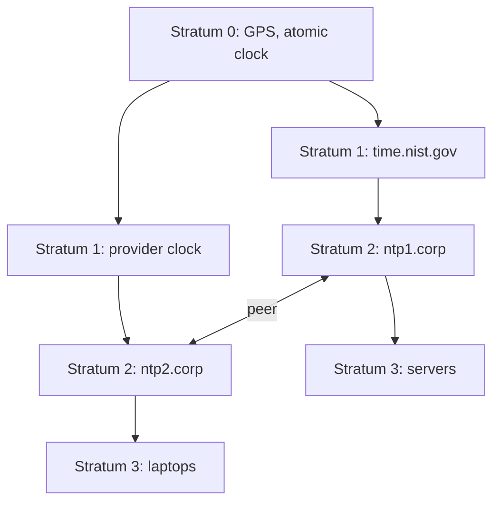
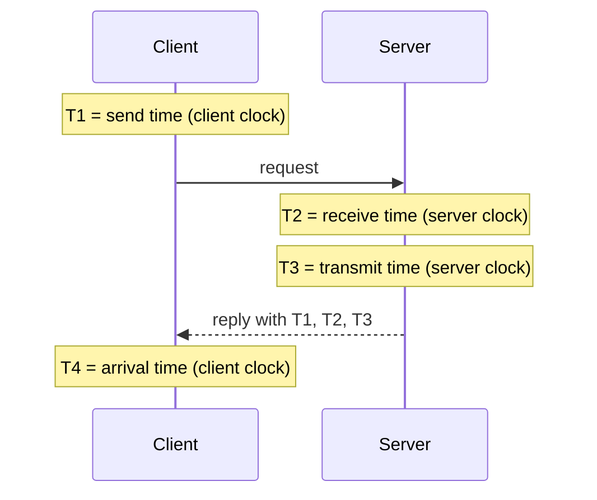

# NTP

## Summary

The Network Time Protocol (NTP) synchronizes the clocks of computers and network devices to reference time sources over a network. Developed by David L. Mills, first specified in 1985 (RFC 958) and now at version 4 (RFC 5905, 2010), it runs over UDP port 123 and organizes servers in a hierarchy of strata below reference clocks such as GPS receivers and atomic clocks. A client exchanges four timestamps with a server to compute both its clock offset and the network delay, then disciplines its clock gradually. Accurate time is not cosmetic: TLS certificate validation, Kerberos, log correlation, distributed databases and financial records all fail or mislead when clocks drift. Precision Time Protocol (PTP) covers needs below a microsecond.

## Prerequisites

- [Networking overview](../networking-overview.md) and [Ports](../transport-layer/ports.md).

## Core concepts

### Definition and importance

NTP synchronizes clocks to a precise time source and typically achieves sub-millisecond to a few milliseconds of accuracy on a LAN (better with good hardware), and tens of milliseconds over the Internet. It is an application layer protocol over UDP port 123.

Accurate time is needed for:

- **timestamps** in logs, authentication records and security events, which must be correlated across many machines during incident response,
- **distributed systems, databases and financial transactions**, where ordering of events and time-based leases depend on clocks,
- **cryptographic protocols**: TLS certificates have validity periods, Kerberos rejects tickets if clocks differ by more than five minutes by default, TOTP codes for MFA depend on time.

*Analogy.* A city of clocks synchronized from an observatory. The observatory's master clock (stratum 0) sets the clock at the town hall (stratum 1), which sets church towers (stratum 2), which people use to set their watches (stratum 3). Each step adds a little error, and people correct for the time it takes to walk from the tower. The analogy breaks because NTP measures that "walking time" (network delay) on every exchange and adjusts clocks smoothly instead of jumping them.

### Stratum hierarchy

| Stratum | Description | Typical accuracy |
| --- | --- | --- |
| 0 | Reference clocks: atomic clocks, GPS and other GNSS receivers, radio clocks; not on the network themselves | Nanoseconds |
| 1 | Servers directly connected to a stratum 0 clock | Microseconds |
| 2 | Servers synchronized to stratum 1 servers | Sub-millisecond to milliseconds |
| 3 | Servers synchronized to stratum 2 | Milliseconds |
| 4 and higher | Further levels (up to 15; 16 means unsynchronized) | Milliseconds to tens of milliseconds, worse with poor networks |

Example path: GPS satellite (stratum 0), a stratum 1 server such as NIST's, a company's stratum 2 servers, a laptop at stratum 3.

Lower strata are closer to the reference, but the stratum number is not a quality guarantee; network path and server load matter as much. End devices should synchronize with stratum 2 or 3 servers (internal servers or public pools), not hammer stratum 1 servers.



### Packet structure

| Field | Size | Description |
| --- | --- | --- |
| Leap indicator (LI) | 2 bits | Announces a leap second at the end of the day |
| Version number (VN) | 3 bits | NTP version (currently 4) |
| Mode | 3 bits | Client, server, symmetric peer, broadcast and others |
| Stratum | 8 bits | Stratum of the server |
| Poll | 8 bits | Interval between messages (log2 seconds) |
| Precision | 8 bits | Precision of the server clock (log2 seconds) |
| Root delay | 32 bits | Round-trip delay to the reference clock |
| Root dispersion | 32 bits | Maximum error relative to the reference clock |
| Reference ID | 32 bits | Identifier of the server's source |
| Reference timestamp | 64 bits | Time the server clock was last set |
| Origin timestamp | 64 bits | Time the request left the client (T1) |
| Receive timestamp | 64 bits | Time the request arrived at the server (T2) |
| Transmit timestamp | 64 bits | Time the reply left the server (T3) |

### Modes

| Mode | Description |
| --- | --- |
| Client | A device requests time from servers |
| Server | Answers client requests |
| Symmetric (peer) | Two servers synchronize each other for redundancy |
| Broadcast | A server sends time to all devices on a network (less accurate; avoid without authentication) |
| Multicast | Like broadcast, to a multicast group |

Typical setup: clients synchronize with internal servers, internal servers with higher-stratum (lower number) external sources, and data center servers peer with each other for redundancy.

### Synchronization: offset and delay

A client exchanges one request and reply with four timestamps:

1. **T1** (origin): the client sends the request.
2. **T2** (receive): the server receives it.
3. **T3** (transmit): the server sends the reply.
4. **T4** (destination): the client receives the reply.



- **Offset** (how far the client clock is from the server): `θ = ((T2 - T1) + (T3 - T4)) / 2`
- **Round-trip delay**: `δ = (T4 - T1) - (T3 - T2)`

The formulas assume the network delay is the same in both directions; asymmetric paths cause errors of up to half the asymmetry. The client collects many samples from several servers, filters out outliers and jitter, selects the best sources and slews (gradually speeds up or slows down) its clock instead of stepping it, so time never jumps backwards in normal operation.

### Vulnerabilities and mitigation

These are described for defense; test only in labs or with authorization.

- **NTP amplification (DDoS).** Older `ntpd` servers answered the `monlist` command with the list of the last 600 clients, a response far larger than the request. Attackers spoof the victim's address and send `monlist` queries to many servers, which flood the victim (CVE-2013-5211). Mitigation: upgrade, disable monitoring queries (`restrict default kod nomodify noquery nopeer` and `disable monitor` in classic ntpd), filter spoofed traffic (BCP 38).
- **NTP spoofing (man in the middle).** Modified NTP packets set clients to wrong times, which breaks Kerberos, certificate validation, logs and financial records, or makes expired certificates look valid. Mitigation: authenticated time with Network Time Security (NTS, RFC 8915, supported by chrony and NTPsec), several independent sources so one bad server is outvoted, firewall rules that limit who can serve NTP.

### Alternative protocols

| Protocol | Port | Accuracy | Use case |
| --- | --- | --- | --- |
| NTP v4 | UDP 123 | About 1 ms (LAN better, Internet worse) | General networks |
| SNTP (Simple NTP) | UDP 123 | About 10 to 100 ms | Lightweight clients and IoT devices, no complex filtering |
| PTP (Precision Time Protocol, IEEE 1588) | UDP 319 and 320 | Nanoseconds to sub-microsecond with hardware timestamping | Stock exchanges, 5G, industrial automation, broadcast, research labs |
| RDT (Reliable Datagram Transport) | N/A | Microseconds (as quoted) | Mentioned for NASA and GPS networks; TODO: verify, no standard time protocol of this name was found in IETF or IEEE sources |

PTP is more precise than NTP because switches and network cards timestamp packets in hardware and boundary or transparent clocks correct for switch delays. Financial regulation (for example MiFID II in the EU) requires traceable timestamps at 100 microseconds for some trading, which pushes exchanges to PTP.

### Public NTP servers

| Provider | Address | Note |
| --- | --- | --- |
| Google | `time.google.com` | Smears leap seconds over 24 hours, so do not mix with non-smearing servers |
| Cloudflare | `time.cloudflare.com` | Supports NTS |
| NIST (USA) | `time.nist.gov` | Stratum 1 servers |
| NTP Pool Project | `0.pool.ntp.org` to `3.pool.ntp.org` | Volunteer pool, regional names such as `europe.pool.ntp.org` |

Cloud VMs should use the provider's local time service (for example `169.254.169.123` on AWS, `metadata.google.internal` on Google Cloud), which is close and highly available.

## Worked example

Configure chrony with authenticated sources and check synchronization. Untested; chrony 4.x on Ubuntu 24.04, checked 2026-11.

```text
# /etc/chrony/chrony.conf (excerpt)
server time.cloudflare.com iburst nts
server ntppool1.time.nl iburst nts
pool 2.pool.ntp.org iburst maxsources 2
makestep 1.0 3          # step the clock only during the first 3 updates if off by more than 1 s
rtcsync
```

```bash
sudo systemctl restart chrony
chronyc sources -v       # '*' marks the selected source, '+' combined sources
chronyc authdata         # NTS-authenticated sources show Mode NTS
chronyc tracking
```

Example `chronyc tracking` output (shortened, illustrative):

```text
Reference ID    : A29FC801 (time.cloudflare.com)
Stratum         : 4
System time     : 0.000012843 seconds fast of NTP time
Root delay      : 0.021345 seconds
Leap status     : Normal
```

The system clock is 13 microseconds fast, and the client runs at stratum 4 because its source is stratum 3.

## Trade offs and when to use it

- **NTP** is enough for logs, TLS, Kerberos and most distributed systems; **PTP** is needed for sub-microsecond requirements and needs supporting hardware.
- **Internal NTP servers** reduce dependence on the Internet and give consistent time; they need at least three or four upstream sources to detect a bad one.
- **Leap smearing** avoids a repeated or skipped second but makes time differ from non-smearing sources by up to half a second during the smear.

## Common mistakes

- **Only one time source.** A bad source cannot be detected. Fix: at least four sources, or three internal servers.
- **Mixing smearing and non-smearing servers.** Fix: use one kind consistently.
- **VMs without time sync** after snapshots or suspend. Fix: run chrony or the hypervisor time service on every VM.
- **Blocking UDP 123 outbound** without providing internal NTP. Fix: internal servers and firewall rules for them.

## Practice

1. What does stratum 16 mean?
2. With T1 = 100.000, T2 = 100.060, T3 = 100.061 and T4 = 100.041 (seconds), what are the offset and delay?
3. Why does NTP slew the clock instead of stepping it?
4. What does NTS add to NTP?

Answers:

1. The clock is unsynchronized.
2. Offset = ((0.060) + (0.020)) / 2 = 0.040 s, so the client is 40 ms behind; delay = 0.041 - 0.001 = 0.040 s.
3. Stepping makes time jump, possibly backwards, which breaks applications that assume monotonic time; slewing adjusts the rate gradually.
4. Cryptographic authentication of time servers and responses, using TLS for key exchange, so time cannot be spoofed in transit.

## Further reading

- [RFC 5905: Network Time Protocol Version 4](https://www.rfc-editor.org/rfc/rfc5905) (IETF, 2010).
- [RFC 8915: Network Time Security for NTP](https://www.rfc-editor.org/rfc/rfc8915) (IETF, 2020).
- [chrony documentation](https://chrony-project.org/documentation.html) (chrony project).
- [NTP Pool Project](https://www.ntppool.org/) (NTP Pool Project).
- [IEEE 1588-2019: Precision Clock Synchronization Protocol](https://standards.ieee.org/ieee/1588/6825/) (IEEE).
- [CVE-2013-5211](https://nvd.nist.gov/vuln/detail/CVE-2013-5211) (NIST NVD): the `monlist` amplification vulnerability.
