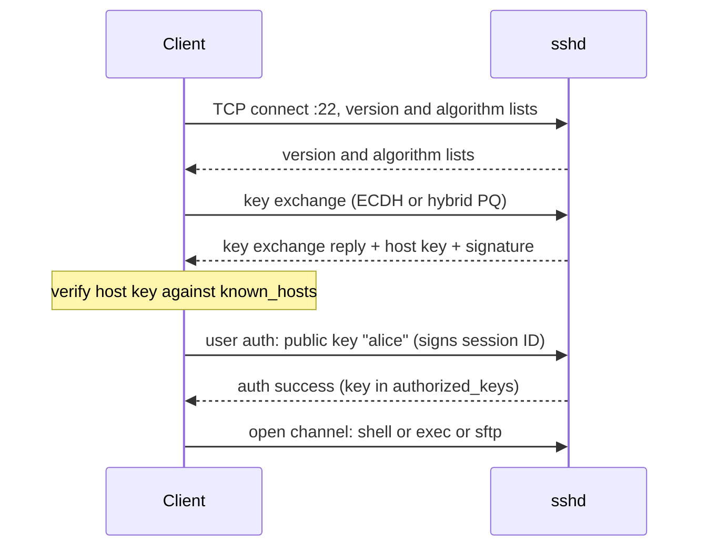

# SSH

## Summary

Secure Shell (SSH) is a cryptographic protocol for secure remote login, command execution, file transfer (SCP, SFTP) and tunneling over untrusted networks, by default on TCP port 22. The client verifies the server's host key, the two sides agree on encryption keys, and the user authenticates with a password, a public key, a certificate signed by an SSH certificate authority, or a hardware-backed key, optionally with multi-factor authentication. SSH is the backbone of server administration and of much automation (Ansible, Git over SSH, CI deployments). Its security depends on key hygiene: protected private keys, verified host keys, no password logins on internet-facing servers and short-lived credentials where possible.

## Prerequisites

- [SSL and TLS](../network-security/ssl-and-tls.md) for public-key cryptography concepts.
- [Terminal](../../operating-systems/shell-and-terminal/terminal.md).

## Core concepts

### Definition and uses

SSH (protocol version 2, RFC 4251 to RFC 4254, 2006) provides strong authentication, encryption and integrity, which makes it a basic tool for DevOps, cloud and infrastructure work:

- secure remote access to servers and infrastructure,
- automated deployments and configuration with SSH keys,
- file transfers with SCP and SFTP,
- tunneling and port forwarding,
- authentication and hardening of production access.

It replaced Telnet, rlogin and rsh, which sent passwords in plain text. OpenSSH is the dominant implementation.

*Analogy.* A secure intercom to a building's doorman. First you check the doorman's badge against the photo you saved last time (host key verification), then you talk through an encrypted line, then you prove who you are with a key only you hold (public key authentication). The analogy breaks on tunneling: SSH can also carry other conversations through the same secure line, like passing sealed envelopes for third parties.

### How a connection is established

SSH listens on port 22 by default and uses public-key cryptography both to authenticate the server and, usually, the user.

1. The client opens a TCP connection; both sides exchange protocol versions and supported algorithms.
2. **Key exchange**: an ephemeral Diffie-Hellman exchange (for example curve25519, or hybrid post-quantum `mlkem768x25519-sha256`, the default in OpenSSH 10, checked 2026-11) creates shared session keys.
3. **Server authentication**: the server proves it holds the private host key; the client compares the host key fingerprint with `~/.ssh/known_hosts`. On first connection it asks the user to confirm and stores it ("trust on first use").
4. **User authentication**: password, public key, certificate, keyboard-interactive (for MFA) or a combination.
5. **Session**: an encrypted channel for a shell, a command, SFTP or forwarded ports.



### Authentication methods

**Password authentication.** The user sends a password over the encrypted channel. It is vulnerable to brute-force and credential-stuffing attacks unless protected by rate limiting (fail2ban, `MaxAuthTries`) and should be disabled on internet-facing servers.

**Public key authentication.** A key pair: the public key (for example `id_ed25519.pub`) goes into `~/.ssh/authorized_keys` on the server; the private key (`id_ed25519`) stays on the client, protected by a passphrase, and is never shared. The client proves possession by signing data from the session.

```bash
ssh-keygen -t ed25519 -C "alice@example.com"        # preferred today
ssh-keygen -t rsa -b 4096 -C "alice@example.com"    # when RSA is required by old systems
ssh-copy-id alice@server.example.com                 # appends the public key to authorized_keys
ssh alice@server.example.com                         # logs in without a password
```

**Certificate-based authentication.** An SSH certificate authority (CA) signs user keys (and host keys) with principals and an expiry time. Servers trust the CA (`TrustedUserCAKeys`) instead of listing every key, which centralizes access for many servers and makes short-lived credentials (hours) practical; tools such as HashiCorp Vault, Teleport or step-ca issue them after SSO login.

**Multi-factor authentication.** Through PAM modules such as Google Authenticator (TOTP), or with FIDO2 hardware keys (YubiKey) using `ed25519-sk` or `ecdsa-sk` key types, which require a physical touch.

### Port forwarding and tunneling

| Type | Command | Effect |
| --- | --- | --- |
| Local | `ssh -L 5432:db.internal:5432 bastion` | Local port 5432 reaches `db.internal:5432` through the bastion |
| Remote | `ssh -R 8080:localhost:3000 server` | The server's port 8080 reaches the client's local port 3000 |
| Dynamic (SOCKS) | `ssh -D 1080 bastion` | A SOCKS proxy on the client routes any connection through the bastion |
| Jump host | `ssh -J bastion app.internal` | Connect to an internal host through a bastion without agent forwarding |

### Best practices

- **Strong key types**: Ed25519 (preferred) or RSA with at least 3072 to 4096 bits; remove DSA and short RSA keys.
- **Disable password authentication** (`PasswordAuthentication no`, `KbdInteractiveAuthentication no` unless used for MFA) and root login (`PermitRootLogin no` or `prohibit-password`).
- **Rotate keys regularly**, and immediately when people leave; certificates with expiry automate this.
- **Use `ssh-agent`** to hold decrypted keys in memory; avoid agent forwarding to untrusted hosts (`-J` instead of `-A`).
- **Key expiration policies** with SSH certificates.
- **Restrict access**: `AllowGroups`, firewall rules or a bastion, VPN or ZTNA in front of SSH; restrict keys in `authorized_keys` with options such as `from=` and `command=`.
- **Verify host keys** (SSHFP records with DNSSEC, host certificates, or distributing `known_hosts` with configuration management).
- **Patch OpenSSH** promptly (for example CVE-2024-6387 "regreSSHion" allowed remote code execution on unpatched glibc-based Linux systems).
- **Log and audit** logins (`/var/log/auth.log` or `/var/log/secure`, the journal).

## Worked example

Harden an internet-facing server and use a bastion with a jump configuration. Untested; OpenSSH 9.x, checked 2026-11.

Server side:

```text
# /etc/ssh/sshd_config.d/10-hardening.conf
PasswordAuthentication no
KbdInteractiveAuthentication no
PermitRootLogin no
AllowGroups ssh-users
MaxAuthTries 3
LoginGraceTime 20
X11Forwarding no
```

```bash
sudo sshd -t && sudo systemctl reload ssh      # test the configuration before reloading
```

Client side, `~/.ssh/config`:

```text
Host bastion
    HostName bastion.example.com
    User alice
    IdentityFile ~/.ssh/id_ed25519

Host *.internal
    ProxyJump bastion
    User alice
```

```bash
ssh app1.internal                         # goes through the bastion automatically
ssh -L 5432:db1.internal:5432 bastion -N  # local tunnel to an internal database
psql -h 127.0.0.1 -p 5432 -U app          # connects through the tunnel
```

Keep the reload session open and test a new login in a second terminal before closing it, so a configuration mistake cannot lock you out.

## Trade offs and when to use it

- **SSH keys** are simple and strong, but unmanaged keys accumulate on servers; **certificates** add a CA to operate but give expiry and central control.
- **Bastion hosts** concentrate and log access; **ZTNA or cloud session managers** (AWS Systems Manager Session Manager, Google IAP TCP forwarding) remove inbound port 22 entirely.
- **Changing the port** from 22 reduces log noise from scanners but is not a security control.

## Common mistakes

- **Ignoring host key warnings** ("REMOTE HOST IDENTIFICATION HAS CHANGED"). It can mean a man in the middle. Fix: verify the new fingerprint out of band before updating `known_hosts`.
- **Private keys without passphrases** on laptops, or copied into CI images. Fix: passphrases with an agent, short-lived certificates or deploy keys with minimal rights.
- **Agent forwarding to shared servers.** Root on that server can use your agent. Fix: `ProxyJump`.
- **Wrong permissions** on `~/.ssh` (must be `700`) and `authorized_keys` (`600`). sshd ignores the keys.

## Practice

1. What is stored in `known_hosts` and what does it protect against?
2. Why is Ed25519 preferred over RSA for new keys?
3. What is the difference between `-L` and `-R` port forwarding?
4. How do SSH certificates simplify access management for many servers?

Answers:

1. Host keys (fingerprints) of servers already contacted; it protects against man-in-the-middle attacks by detecting a changed host key.
2. It offers strong security with short keys, fast operations and a design that avoids several implementation pitfalls of RSA and ECDSA.
3. `-L` makes a local port forward to a destination reachable from the server; `-R` makes a port on the server forward back to a destination reachable from the client.
4. Servers trust one CA key; users get signed, expiring certificates, so no per-server `authorized_keys` management is needed and revocation happens by expiry.

## Further reading

- [RFC 4251: The Secure Shell (SSH) Protocol Architecture](https://www.rfc-editor.org/rfc/rfc4251) (IETF, 2006), with RFC 4252 to 4254.
- [OpenSSH manual pages](https://www.openssh.com/manual.html) (OpenBSD project): `ssh`, `sshd_config`, `ssh-keygen`.
- [Mozilla OpenSSH security guidelines](https://infosec.mozilla.org/guidelines/openssh) (Mozilla).
- [CVE-2024-6387](https://nvd.nist.gov/vuln/detail/CVE-2024-6387) (NIST NVD): regreSSHion.
