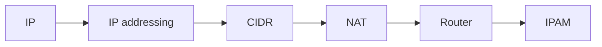

# Internet layer

Addressing and routing packets between networks: the IP protocol, IPv4 and IPv6 addressing, CIDR, NAT, routers and IP address management.

## Map

The diagram shows the notes in reading order; subareas are marked with (subarea).

## Notes in reading order

1. [IP](ip.md): IPv4 and IPv6, header fields, routing, MTU and security.
2. [IP addressing](ip-addressing.md): address structure, special ranges, masks, gateways, private and public addresses.
3. [CIDR](cidr.md): prefix notation, subnet calculation, VLSM and route aggregation.
4. [NAT](nat.md): static, dynamic and PAT, traversal techniques, NAT64 and security.
5. [Router](router.md): forwarding, routing tables, router types and hardening.
6. [IPAM](ipam.md): planning and tracking address space with DHCP and DNS integration.

## Planned topics

- ICMP and ICMPv6
- Routing protocols: RIP
- Routing protocols: OSPF
- Routing protocols: BGP
- IPv6 addressing and SLAAC in depth
- Multicast and IGMP
