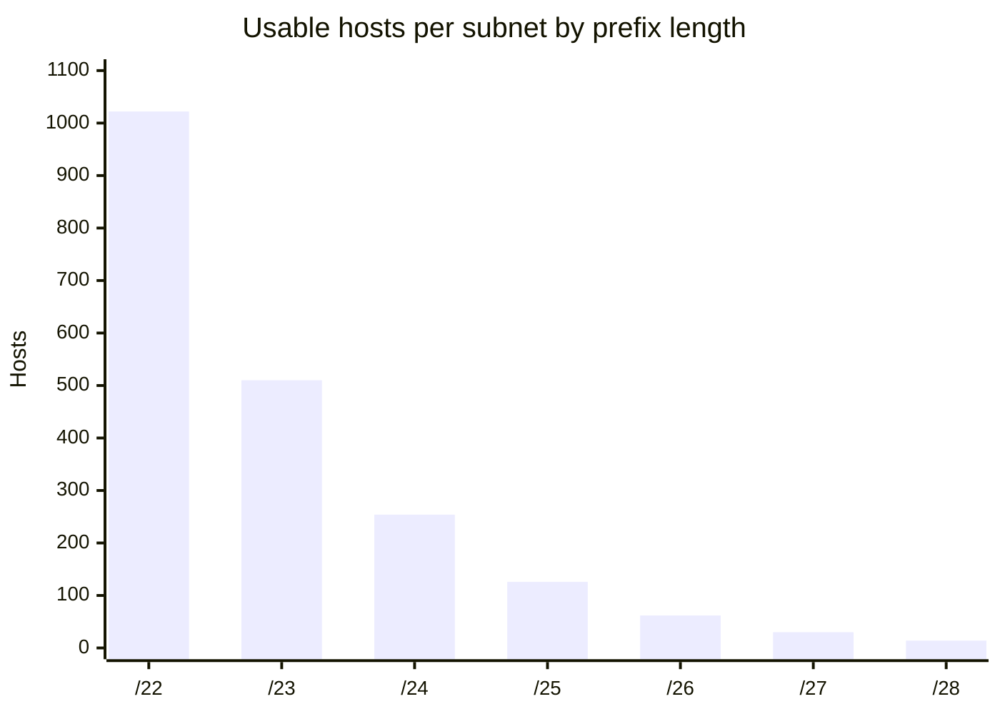
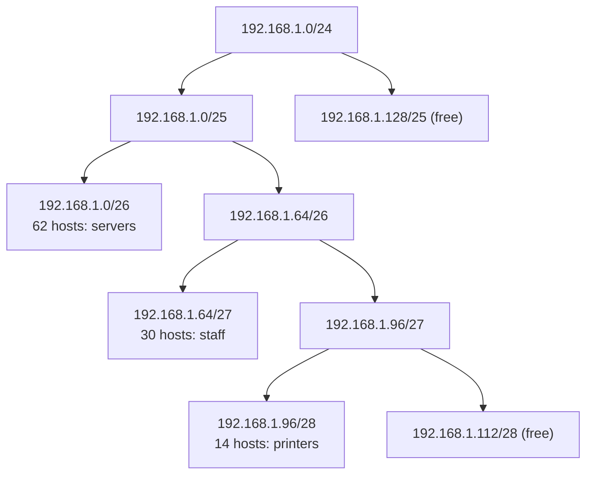

# CIDR

## Summary

Classless Inter-Domain Routing (CIDR) describes IP networks as an address plus a prefix length, such as `10.20.0.0/16`, where the prefix length is the number of leading network bits. Introduced in 1993 (RFC 1519, updated by RFC 4632) to replace the wasteful classful scheme of class A, B and C networks, it enables subnets of any power-of-two size (variable-length subnet masking, VLSM) and the aggregation of many routes into one summary route (supernetting). CIDR arithmetic is a daily skill in DevOps: sizing VPC and Kubernetes pod ranges, writing firewall rules and security groups, and avoiding overlaps between networks.

## Prerequisites

- [IP addressing](ip-addressing.md) for address structure and subnet masks.

## Core concepts

### Why CIDR was introduced

Before CIDR, networks came in fixed classes:

| Class | Prefix | Addresses | Problem |
| --- | --- | --- | --- |
| A | `/8` | about 16.7 million | Far too large for almost every organization |
| B | `/16` | 65,536 | Too large for most, too small for some, so B networks were exhausted fast |
| C | `/24` | 256 (254 hosts) | Too small, so organizations needed many, each a separate route |

This wasted addresses and inflated Internet routing tables. CIDR removed fixed classes, so blocks are allocated by actual need and routes can be summarized.

*Analogy.* Selling land. Classful addressing sold only small, medium or huge fixed plots, so a family needing a medium-small plot bought a medium one and left most of it empty. CIDR sells plots of any power-of-two size and lets the land registry list a whole neighborhood as one entry. The analogy breaks at boundaries: CIDR blocks must start at addresses aligned to their size, which land plots need not.

### Notation and masks

```text
<IP address>/<prefix length>
192.168.1.0/24  -> 24 network bits, 8 host bits, mask 255.255.255.0
```

| CIDR | Subnet mask | Host range example | Usable hosts |
| --- | --- | --- | --- |
| `/8` | `255.0.0.0` | `10.0.0.1` to `10.255.255.254` | 16,777,214 |
| `/16` | `255.255.0.0` | `192.168.0.1` to `192.168.255.254` | 65,534 |
| `/24` | `255.255.255.0` | `192.168.1.1` to `192.168.1.254` | 254 |
| `/30` | `255.255.255.252` | `192.168.1.1` to `192.168.1.2` | 2 |

### Calculating subnets

- **Subnet size** = 2^(32 - prefix) addresses.
- **Usable hosts** = 2^(32 - prefix) - 2 (network and broadcast addresses excluded; `/31` point-to-point links per RFC 3021 and `/32` host routes are exceptions).

| Example | Mask | Hosts | Usable range |
| --- | --- | --- | --- |
| `192.168.1.0/24` | `255.255.255.0` | 2^8 - 2 = 254 | `192.168.1.1` to `192.168.1.254` |
| `192.168.1.0/26` | `255.255.255.192` | 2^6 - 2 = 62 | `192.168.1.1` to `192.168.1.62` |
| `192.168.1.0/30` | `255.255.255.252` | 2^2 - 2 = 2 | `192.168.1.1` to `192.168.1.2` (point-to-point links) |

Each additional prefix bit halves the block and doubles the number of subnets:



Cloud providers reserve extra addresses per subnet (AWS reserves five, so a `/24` has 251 usable), which matters for small subnets.

### VLSM

Variable-length subnet masking uses different subnet sizes within one network, matched to need. Breaking `192.168.1.0/24` into subnets:

| Subnet | CIDR | Mask | Hosts |
| --- | --- | --- | --- |
| `192.168.1.0` | `/26` | `255.255.255.192` | 62 |
| `192.168.1.64` | `/27` | `255.255.255.224` | 30 |
| `192.168.1.96` | `/28` | `255.255.255.240` | 14 |
| `192.168.1.112` and up | free | | Room for later |

Advantages: efficient use of addresses, custom sizes per segment, less waste. Allocate the largest subnets first so each block starts on a boundary aligned to its size.



### Route aggregation (supernetting)

CIDR lets contiguous networks be summarized as one route, which shrinks routing tables.

```text
Without aggregation:              With aggregation:
192.168.0.0/24 -> Router A        192.168.0.0/22 -> Router A
192.168.1.0/24 -> Router A
192.168.2.0/24 -> Router A
```

`192.168.0.0/22` covers `192.168.0.0` to `192.168.3.255`. Note that it also covers `192.168.3.0/24`, which must also be behind Router A for the summary to be correct. Fewer entries mean faster convergence and less router memory; the global IPv4 table still has around one million routes (checked 2026-11), which would be far more without aggregation.

### Routing protocols and CIDR

| Protocol | Supports CIDR | Use case |
| --- | --- | --- |
| RIPv1 | No (classful, no mask in updates) | Old networks |
| RIPv2 | Yes | Small networks |
| OSPF | Yes | Large enterprises |
| EIGRP | Yes | Cisco networks |
| BGP-4 | Yes | Internet routing |

Static summary route on Cisco IOS:

```text
ip route 192.168.0.0 255.255.252.0 10.0.0.1
```

### Allocation on the Internet

IANA allocates blocks to five regional Internet registries (RIRs), which assign CIDR blocks to ISPs and organizations:

- ARIN (North America),
- RIPE NCC (Europe, Middle East, Central Asia),
- APNIC (Asia-Pacific),
- LACNIC (Latin America and Caribbean),
- AFRINIC (Africa).

Large providers announce many blocks; examples quoted for illustration include Google's `8.8.8.0/24` (Google Public DNS), Amazon blocks within `52.0.0.0/11` and Cloudflare ranges in `104.16.0.0/12`. Providers publish their current lists (AWS `ip-ranges.json`, Cloudflare's IP list), which are the authority for firewall rules. TODO: Verify the AWS and Cloudflare example blocks against the published lists.

### IPv6 and CIDR

IPv6 uses the same notation.

| CIDR | Use |
| --- | --- |
| `::/0` | Default route |
| `2000::/3` | Global unicast |
| `fc00::/7` | Unique local addresses (ULA) |
| `fe80::/10` | Link-local |

A site prefix of `2001:db8::/48` contains 2^16 = 65,536 subnets of size `/64`, the standard LAN subnet size.

## Worked example

Plan a VPC for a Kubernetes platform in `10.40.0.0/16` with three availability zones (AZs). Requirements: public subnets for load balancers (small), private node subnets, and large pod ranges.

| Purpose | Size per AZ | Prefix | AZ a | AZ b | AZ c |
| --- | --- | --- | --- | --- | --- |
| Pods | about 4,000 IPs | `/20` | `10.40.0.0/20` | `10.40.16.0/20` | `10.40.32.0/20` |
| Nodes | about 250 IPs | `/24` | `10.40.48.0/24` | `10.40.49.0/24` | `10.40.50.0/24` |
| Public | about 60 IPs | `/26` | `10.40.51.0/26` | `10.40.51.64/26` | `10.40.51.128/26` |
| Reserved for growth | | | `10.40.52.0` to `10.40.255.255` | | |

Verify with Python (untested; Python 3.12 standard library):

```python
import ipaddress
vpc = ipaddress.ip_network("10.40.0.0/16")
plan = ["10.40.0.0/20","10.40.16.0/20","10.40.32.0/20","10.40.48.0/24","10.40.49.0/24",
        "10.40.50.0/24","10.40.51.0/26","10.40.51.64/26","10.40.51.128/26"]
nets = [ipaddress.ip_network(p) for p in plan]
assert all(n.subnet_of(vpc) for n in nets)
assert not any(a.overlaps(b) for i, a in enumerate(nets) for b in nets[i+1:])
print(list(ipaddress.collapse_addresses(nets[:3])))   # [IPv4Network('10.40.0.0/20'), IPv4Network('10.40.16.0/20'), IPv4Network('10.40.32.0/20')]
print(sum(n.num_addresses for n in nets), "of", vpc.num_addresses, "addresses planned")
```

The three pod ranges cannot be collapsed into one prefix because `10.40.0.0/19` covers only the first two; ordering allocations so summaries are possible is part of good planning.

## Trade offs and when to use it

- **Large subnets** leave room to grow but waste space and enlarge broadcast domains; **small subnets** conserve addresses but fill up and are hard to resize later (cloud subnets usually cannot be resized).
- **Aggregation** reduces routes but hides detail; a summary that covers unused space can attract traffic that is then dropped (blackholed).

## Common mistakes

- **Misaligned blocks** such as `192.168.1.50/26`; the network address is `192.168.1.0`. Fix: compute boundaries (`ipcalc`, Python `ipaddress`).
- **Overlapping ranges** between VPCs, VPNs and container networks. Fix: central IP address management ([IPAM](ipam.md)).
- **Under-sizing Kubernetes pod ranges.** Fix: size for maximum pods per node times maximum nodes.

## Practice

1. How many usable hosts are in a `/27`, and what is its mask?
2. Summarize `10.1.4.0/24`, `10.1.5.0/24`, `10.1.6.0/24` and `10.1.7.0/24`.
3. Which address block contains `172.16.37.200/20`, and what is its broadcast address?
4. Why did RIPv1 not support CIDR?

Answers:

1. 30 hosts, mask `255.255.255.224`.
2. `10.1.4.0/22`.
3. `172.16.32.0/20` (32 is the nearest lower multiple of 16 in the third octet); broadcast `172.16.47.255`.
4. Its updates carry no subnet masks, so routers assume classful boundaries.

## Further reading

- [RFC 4632: Classless Inter-domain Routing (CIDR)](https://www.rfc-editor.org/rfc/rfc4632) (IETF, 2006): the current specification, obsoleting RFC 1519.
- [RFC 3021: Using 31-Bit Prefixes on IPv4 Point-to-Point Links](https://www.rfc-editor.org/rfc/rfc3021) (IETF, 2000).
- [Python ipaddress module](https://docs.python.org/3/library/ipaddress.html) (Python Software Foundation).
- [AWS IP address ranges](https://docs.aws.amazon.com/vpc/latest/userguide/aws-ip-ranges.html) (Amazon Web Services).
