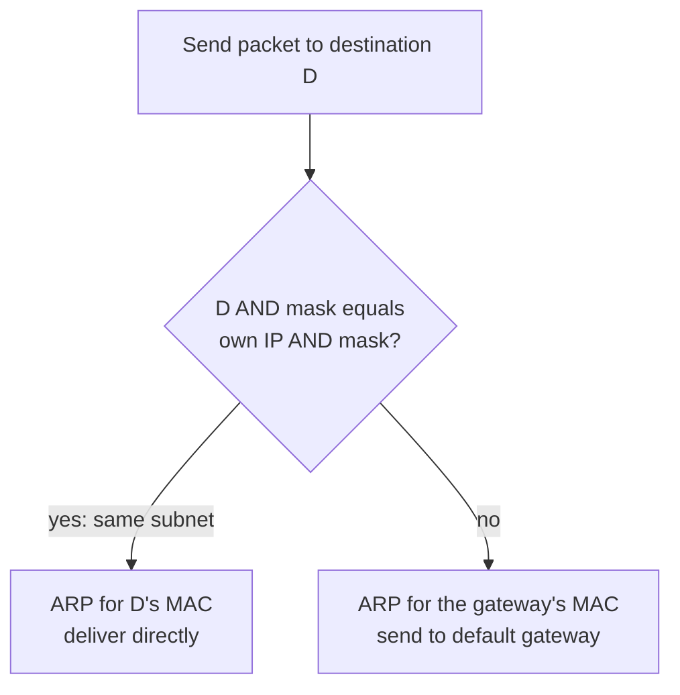

# IP addressing

## Summary

An IP address is the identifier of a network interface in an IP network. It has a network part, shared by all hosts on the same subnet, and a host part, unique within it; a subnet mask or prefix length marks the boundary. IPv4 addresses are 32 bits written as four decimal octets (`192.0.2.10`), IPv6 addresses are 128 bits written in hexadecimal groups (`2001:db8::10`). Special ranges have fixed meanings: loopback, link-local (APIPA), private (RFC 1918), multicast, broadcast and documentation ranges. A host sends traffic for its own subnet directly and everything else to its default gateway. Getting addressing right is the base of routing, firewall rules and cloud network design.

## Prerequisites

- [Networking overview](../networking-overview.md).

## Core concepts

### What an IP address is

An IP (Internet Protocol) address uniquely identifies a device interface on a network that uses IP, so it can send and receive data. It consists of:

- a **network part**, which identifies the network,
- a **host part**, which identifies the device within that network.

*Analogy.* A postal address: the street (network part) is shared by every house on it, the house number (host part) is unique on that street. Postal workers route by street first and look at the house number only at the end. The analogy breaks because the split between "street" and "house number" in IP is not fixed: the prefix length moves it.

### IPv4 address structure

An IPv4 address is 32 bits long, divided into four octets of 8 bits, written in dotted decimal notation:

```text
192.168.1.1
11000000.10101000.00000001.00000001
```

Each octet ranges from 0 to 255 (2^8 = 256 values). There are 2^32, about 4.3 billion, IPv4 addresses, which is not enough for every device; IANA's free pool ran out in 2011.

### IPv6 address structure

IPv6 uses 128-bit addresses written as eight groups of four hexadecimal digits separated by colons:

```text
2001:0db8:85a3:0000:0000:8a2e:0370:7334
2001:db8:85a3::8a2e:370:7334      # same address, shortened
```

Shortening rules (RFC 5952): leading zeros in a group are dropped, and one run of consecutive zero groups is replaced by `::`. The address space (2^128) is so large that every device can have a globally unique address, which removes the need for NAT for address shortage (NAT66 exists but is rarely needed); firewalls still provide protection.

### Special addresses

| Address or range | Name | Purpose |
| --- | --- | --- |
| `127.0.0.1` (all of `127.0.0.0/8`), `::1` | Loopback (localhost) | Communication within the device; packets never leave it; testing and local services |
| `169.254.0.0/16`, `fe80::/10` | Link-local; in IPv4 called APIPA (Automatic Private IP Addressing) | Self-assigned when DHCP fails or for local-only communication; not routed, so no Internet access. Cloud metadata services also use `169.254.169.254` |
| `255.255.255.255` | Limited broadcast | All hosts on the local network segment (not forwarded by routers); each subnet also has a directed broadcast, its last address |
| `224.0.0.0/4`, `ff00::/8` | Multicast | One-to-many delivery to subscribed hosts |
| `0.0.0.0` | Unspecified | "This host" at startup, or "all addresses" when a server listens on `0.0.0.0` |
| `192.0.2.0/24`, `198.51.100.0/24`, `203.0.113.0/24`, `2001:db8::/32` | Documentation | Examples in documentation (RFC 5737, RFC 3849) |
| `100.64.0.0/10` | Shared address space | Carrier-grade NAT between ISPs and customers (RFC 6598) |

### Subnet mask

A subnet mask marks the boundary between network and host parts: bits set to 1 belong to the network, bits set to 0 to the host.

```text
IP:      192.168.1.10   11000000.10101000.00000001.00001010
Mask:    255.255.255.0  11111111.11111111.11111111.00000000
Network: 192.168.1.0    (first 24 bits: 192.168.1)
Host:    .10            (last 8 bits)
```

The same mask written as a prefix length is `/24` ([CIDR](cidr.md)).

| CIDR | Subnet mask | Usable hosts |
| --- | --- | --- |
| `/8` | `255.0.0.0` | 16,777,214 (about 16 million) |
| `/16` | `255.255.0.0` | 65,534 (about 65 thousand) |
| `/24` | `255.255.255.0` | 254 |
| `/30` | `255.255.255.252` | 2 |

Usable hosts are 2^(32 - prefix) - 2, because the first address (network) and the last (broadcast) are reserved. Smaller subnets mean more networks with fewer hosts each.

### Default gateway

The default gateway is the router that connects the local network to other networks, such as the Internet:

```text
Device IP:        192.168.1.10
Subnet mask:      255.255.255.0
Default gateway:  192.168.1.1
```

The host compares the destination with its own network: if the destination is in `192.168.1.0/24`, it delivers directly (finding the MAC address with ARP); otherwise it sends the packet to the gateway.



Check the gateway with `ip route show` (Linux), `netstat -rn` (macOS, BSD) or `ipconfig` and `route print` (Windows).

### Private and public addresses

**Private addresses** (RFC 1918) are not routed on the Internet and are used in local networks: homes, corporate LANs, data centers and cloud VPCs.

| Range | Subnet mask | CIDR |
| --- | --- | --- |
| `10.0.0.0` to `10.255.255.255` | `255.0.0.0` | `10.0.0.0/8` |
| `172.16.0.0` to `172.31.255.255` | `255.240.0.0` | `172.16.0.0/12` |
| `192.168.0.0` to `192.168.255.255` | `255.255.0.0` | `192.168.0.0/16` |

**Public addresses** are globally routable and assigned by regional Internet registries through ISPs; they are required for direct Internet communication. Example: Google Public DNS at `8.8.8.8`.

**NAT** lets private addresses communicate with the Internet by translating private to public addresses; it is used in almost every home and enterprise network ([NAT](nat.md)).

### Addressing in IPv6

IPv6 also uses prefix notation, for example `2001:db8::/32`. A typical site receives a `/48` and uses `/64` subnets.

| Type | Prefix | Purpose |
| --- | --- | --- |
| Global unicast | `2000::/3` | Globally unique, routable addresses |
| Link-local | `fe80::/10` | Communication on the local link; every IPv6 interface has one |
| Unique local | `fc00::/7` (in practice `fd00::/8`) | Private addressing, comparable to RFC 1918 |
| Multicast | `ff00::/8` | One-to-many traffic (IPv6 has no broadcast) |
| Anycast | Any unicast prefix assigned to several nodes | Routed to the nearest node |

Link-local addresses are required for neighbor discovery and routing on each link and always start with `fe80::`, for example `fe80::1a2b:3c4d:5e6f:7a8b`. Hosts usually configure global addresses themselves with SLAAC (stateless address autoconfiguration) from router advertisements, or with DHCPv6.

## Worked example

Inspect a host's addressing and decide where a packet goes. Untested; iproute2 on Linux, checked 2026-11. Output shortened and illustrative.

```bash
ip -br addr
# lo     UNKNOWN  127.0.0.1/8 ::1/128
# eth0   UP       192.168.1.10/24 fe80::5054:ff:fe12:3456/64
ip route
# default via 192.168.1.1 dev eth0
# 192.168.1.0/24 dev eth0 proto kernel scope link src 192.168.1.10
ip route get 192.168.1.25      # 192.168.1.25 dev eth0 src 192.168.1.10   (direct)
ip route get 198.51.100.7      # 198.51.100.7 via 192.168.1.1 dev eth0    (via gateway)
```

Python check of the same logic:

```python
import ipaddress
iface = ipaddress.ip_interface("192.168.1.10/24")
for dst in ["192.168.1.25", "198.51.100.7", "169.254.10.1", "10.2.3.4"]:
    ip = ipaddress.ip_address(dst)
    print(dst, "local" if ip in iface.network else "via gateway",
          "private" if ip.is_private else "public", "link-local" if ip.is_link_local else "")
```

## Trade offs and when to use it

- **IPv4 with NAT** is universal but adds translation complexity; **IPv6** simplifies end-to-end addressing but needs dual-stack operation and IPv6-aware firewalls during the long transition.
- **Large private ranges** (`10.0.0.0/8`) give room but collide easily when companies merge or connect VPNs; plan ranges centrally ([IPAM](ipam.md)).

## Common mistakes

- **Overlapping private ranges** between sites, VPNs, Docker (`172.17.0.0/16` default) and cloud VPCs. Fix: an address plan and custom Docker address pools.
- **Treating `169.254.x.x` as a working address.** It signals a DHCP failure. Fix: check DHCP.
- **Ignoring IPv6.** Hosts with IPv6 enabled may bypass IPv4-only firewall rules. Fix: firewall both or disable IPv6 deliberately.

## Practice

1. How many usable hosts does a `/26` contain?
2. Is `172.32.0.5` a private address?
3. What does an address in `169.254.0.0/16` on a laptop indicate?
4. Shorten `2001:0db8:0000:0000:0000:0000:0000:0001`.

Answers:

1. 2^6 - 2 = 62.
2. No. The private range is `172.16.0.0` to `172.31.255.255`.
3. The laptop did not get an address from DHCP and assigned itself a link-local address.
4. `2001:db8::1`.

## Further reading

- [RFC 791: Internet Protocol](https://www.rfc-editor.org/rfc/rfc791) (IETF, 1981): IPv4.
- [RFC 1918: Address Allocation for Private Internets](https://www.rfc-editor.org/rfc/rfc1918) (IETF, 1996).
- [RFC 4291: IP Version 6 Addressing Architecture](https://www.rfc-editor.org/rfc/rfc4291) (IETF, 2006).
- [IANA IPv4 Special-Purpose Address Registry](https://www.iana.org/assignments/iana-ipv4-special-registry/) (IANA).
- [RFC 5952: A Recommendation for IPv6 Address Text Representation](https://www.rfc-editor.org/rfc/rfc5952) (IETF, 2010).
