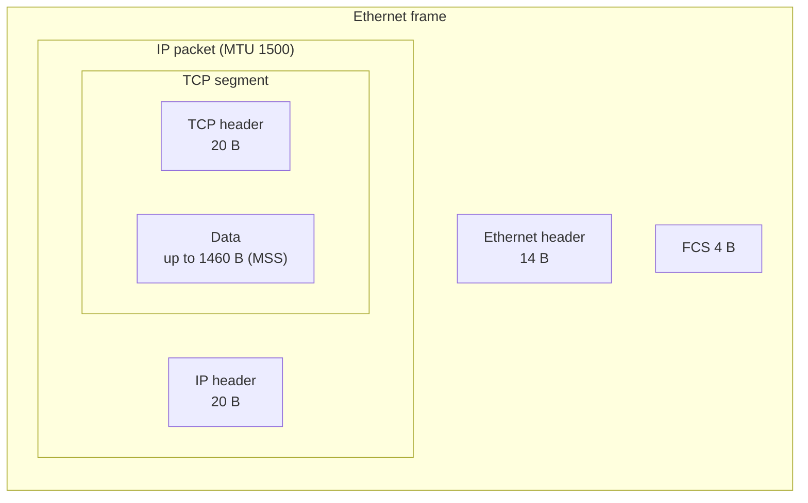

# IP

## Summary

The Internet Protocol (IP) is the network layer protocol of the TCP/IP suite: it gives every interface an address and carries packets hop by hop from source to destination across many networks. IP is connectionless and best effort: each packet is routed independently and may be lost, duplicated or reordered; reliability is left to TCP or the application. Two versions are in use. IPv4 (RFC 791, 1981) has 32-bit addresses and a variable 20 to 60 byte header; IPv6 (RFC 8200) has 128-bit addresses, a fixed 40-byte header, no broadcast and no fragmentation by routers. Understanding the header fields (TTL, protocol, fragmentation flags) explains `traceroute`, MTU problems and many firewall rules.

## Prerequisites

- [IP addressing](ip-addressing.md) and [CIDR](cidr.md).
- [TCP/IP model](../network-models/tcp-ip-model.md).

## Core concepts

### Definition and functions

IP is the primary layer 3 protocol of the TCP/IP model, responsible for addressing and routing packets between devices and networks; it is the base of the Internet and of private networks.

- **Addressing**: every interface has an IP address.
- **Routing**: packets are forwarded through multiple networks to their destination ([Router](router.md)).
- **Fragmentation and reassembly**: packets larger than a link's maximum transmission unit (MTU) are split and reassembled at the destination.

*Analogy.* IP is the postal service for envelopes of limited size: it reads the address, forwards the envelope from sorting center to sorting center, and does not promise delivery or order. If you need a signed, ordered correspondence, you add a registered-mail process on top (TCP). The analogy breaks on loss: the postal service rarely loses letters, while IP routers deliberately drop packets when queues are full.

### IPv4 compared with IPv6

| Feature | IPv4 | IPv6 |
| --- | --- | --- |
| Address size | 32 bits | 128 bits |
| Address space | About 4.3 billion | About 3.4 x 10^38 (2^128, "340 undecillion") |
| Notation | Dotted decimal (`192.168.1.1`) | Hexadecimal groups (`2001:db8::1`) |
| Address types | Unicast, broadcast, multicast | Unicast, multicast, anycast (no broadcast) |
| NAT | Widely needed because of address shortage | Not needed for address shortage |
| IPsec | Optional add-on | Originally mandatory to implement (RFC 4294), relaxed to recommended in 2011 (RFC 6434); never mandatory to use |
| Header size | 20 bytes minimum, up to 60 with options | Fixed 40 bytes, options in extension headers |
| Fragmentation | By the sender or by routers | Only by the sender; routers send "packet too big" (path MTU discovery) |
| Header checksum | Yes | No (left to link and transport layers) |
| Address configuration | Manual or DHCP | SLAAC, DHCPv6 or manual |

### Legacy address classes

Before CIDR, the first bits of an IPv4 address fixed its class:

| Class | Range | Default mask | Usage |
| --- | --- | --- | --- |
| A | `0.0.0.0` to `127.255.255.255` (usable `1.0.0.0` to `126.255.255.255`; `0/8` and `127/8` are reserved) | `255.0.0.0` (`/8`) | Large networks |
| B | `128.0.0.0` to `191.255.255.255` | `255.255.0.0` (`/16`) | Medium networks |
| C | `192.0.0.0` to `223.255.255.255` | `255.255.255.0` (`/24`) | Small networks |
| D | `224.0.0.0` to `239.255.255.255` | none | Multicast |
| E | `240.0.0.0` to `255.255.255.255` | none | Reserved, experimental |

CIDR replaced classes with variable-length prefixes: `192.168.1.0/24` has 256 addresses (254 hosts), `192.168.1.0/26` has 64 (62 hosts). See [CIDR](cidr.md).

### Address types

By scope: **public** addresses are globally unique and routable; **private** addresses (RFC 1918: `10.0.0.0/8`, `172.16.0.0/12`, `192.168.0.0/16`) are used inside networks and not routed on the Internet.

By function:

| Type | IPv4 | IPv6 |
| --- | --- | --- |
| Unicast | One to one | One to one |
| Broadcast | One to all (for example `255.255.255.255`) | No equivalent; multicast to all-nodes `ff02::1` |
| Multicast | One to many (`224.0.0.0/4`) | One to many (`ff00::/8`) |
| Anycast | Not defined in the protocol, but used in practice through routing (for example DNS root servers, `1.1.1.1`) | One to nearest, part of the addressing architecture |

Special addresses:

| Address | Meaning |
| --- | --- |
| `0.0.0.0` | Unspecified address; `0.0.0.0/0` is the default route |
| `127.0.0.1` | Loopback (localhost) |
| `169.254.0.0/16` | Link-local, APIPA |
| `192.0.2.0/24` | TEST-NET-1, documentation |
| `255.255.255.255` | Limited broadcast |

### Packet structure

An IP packet consists of a header and a payload (usually a TCP or UDP segment).

**IPv4 header (20 bytes without options):**

| Field | Size | Description |
| --- | --- | --- |
| Version | 4 bits | 4 for IPv4 |
| IHL (header length) | 4 bits | Header length in 32-bit words (5 to 15) |
| DSCP and ECN (formerly Type of Service) | 8 bits | QoS class and congestion notification |
| Total length | 16 bits | Header plus data, up to 65,535 bytes |
| Identification | 16 bits | Groups fragments of one packet |
| Flags | 3 bits | Don't Fragment (DF) and More Fragments (MF) |
| Fragment offset | 13 bits | Position of this fragment in the original packet |
| Time to live (TTL) | 8 bits | Decremented at every hop; the packet is dropped at 0 |
| Protocol | 8 bits | Payload protocol: ICMP 1, TCP 6, UDP 17 |
| Header checksum | 16 bits | Integrity of the header, recomputed at each hop |
| Source address | 32 bits | Sender |
| Destination address | 32 bits | Receiver |



**IPv6 header (40 bytes, fixed)** simplifies processing: version, traffic class, *flow label* (identifies flows for special handling), payload length, next header (the protocol or the first extension header), hop limit (the TTL equivalent), and the source and destination addresses. Fragmentation fields moved to an optional extension header used only by the sender.

### Routing and forwarding

IP routing forwards packets toward their destination using routing tables that list next hops.

| Type | Description | Example |
| --- | --- | --- |
| Static routing | Routes configured by hand | `ip route 10.0.0.0 255.255.255.0 192.168.1.1` (Cisco) |
| Dynamic routing | Routers exchange reachability | RIP, OSPF, BGP |

| Protocol | Type | Use case |
| --- | --- | --- |
| RIP | Distance vector | Small networks |
| OSPF | Link state | Large enterprise networks |
| EIGRP | Advanced distance vector (Cisco, sometimes called hybrid) | Cisco environments |
| BGP | Path vector | Internet backbone |

### MTU and fragmentation

Every link has an MTU (1,500 bytes on standard Ethernet). A packet larger than the next link's MTU is fragmented (IPv4 without the DF flag) or dropped with an ICMP "fragmentation needed" or IPv6 "packet too big" message, so the sender can lower its size (path MTU discovery). Firewalls that block these ICMP messages create "black hole" connections that hang after the handshake, a classic problem with VPNs and tunnels.

### Security considerations

- **IP spoofing**: forged source addresses to bypass filters or hide the origin of attacks. Countermeasure: ingress and egress filtering by network operators (BCP 38, RFC 2827) and anti-spoofing checks (reverse path filtering).
- **Denial of service**: floods of IP traffic (for example SYN floods at the TCP level, or amplified UDP reflection) overwhelm targets. Countermeasures: rate limiting, SYN cookies, upstream DDoS scrubbing.
- **Man in the middle**: IP itself does not encrypt, so traffic can be read or modified on the path. Countermeasure: encryption at a higher layer (TLS) or at the IP layer.
- **IPsec** secures IP traffic with the Authentication Header (AH, integrity and authentication) and the Encapsulating Security Payload (ESP, encryption and integrity), in transport or tunnel mode; it underlies many VPNs ([VPN](../network-security/vpn.md)).

## Worked example

Observe TTL, fragmentation and the protocol field. Untested; iputils and tcpdump on Linux, checked 2026-11.

```bash
ping -c 1 -M do -s 1472 198.51.100.7   # 1472 + 8 ICMP + 20 IP = 1500 bytes, DF set: succeeds on a 1500 MTU path
ping -c 1 -M do -s 1473 198.51.100.7   # 1501 bytes with DF: "message too long, mtu=1500"
traceroute -n 198.51.100.7            # each hop answers when the TTL reaches 0
sudo tcpdump -n -v -c 3 ip and host 198.51.100.7
# IP (tos 0x0, ttl 64, id 4242, offset 0, flags [DF], proto ICMP (1), length 84) ...
```

The `ttl 64` shows a Linux sender's default; Windows uses 128. When the reply arrives with TTL 54, it crossed about 10 hops.

## Trade offs and when to use it

- **Best effort** keeps routers simple and the Internet scalable; reliability, ordering and congestion control live at the endpoints.
- **IPv6 adoption** removes NAT complexity and address scarcity but requires dual-stack operations, new firewall rules and IPv6 skills.
- **Fragmentation** is fragile (fragments are often filtered); prefer path MTU discovery and MSS clamping.

## Common mistakes

- **Blocking all ICMP.** Breaks path MTU discovery and diagnostics. Fix: allow at least ICMP types needed for PMTUD and errors.
- **Assuming IPv6 traffic is filtered by IPv4 rules.** Fix: separate IPv6 firewall rules (`ip6tables` or `nftables` `inet` tables).
- **Ignoring tunnel overhead.** VPN and VXLAN headers reduce the effective MTU. Fix: adjust MTU or clamp MSS.

## Practice

1. What happens to a packet whose TTL reaches zero?
2. Which protocol numbers do TCP and UDP have in the IP header?
3. Why does IPv6 have no header checksum?
4. A connection succeeds for small requests but hangs on large responses through a VPN. What is the likely cause?

Answers:

1. The router drops it and sends an ICMP Time Exceeded message to the source.
2. TCP 6, UDP 17.
3. The link layer and transport layer already check integrity, and removing it saves processing at every hop.
4. An MTU problem: large packets are dropped and the "packet too big" or "fragmentation needed" ICMP messages are blocked.

## Further reading

- [RFC 791: Internet Protocol](https://www.rfc-editor.org/rfc/rfc791) (IETF, 1981).
- [RFC 8200: Internet Protocol, Version 6 (IPv6) Specification](https://www.rfc-editor.org/rfc/rfc8200) (IETF, 2017).
- [RFC 2827 (BCP 38): Network Ingress Filtering](https://www.rfc-editor.org/rfc/rfc2827) (IETF, 2000).
- [RFC 4301: Security Architecture for the Internet Protocol](https://www.rfc-editor.org/rfc/rfc4301) (IETF, 2005).
