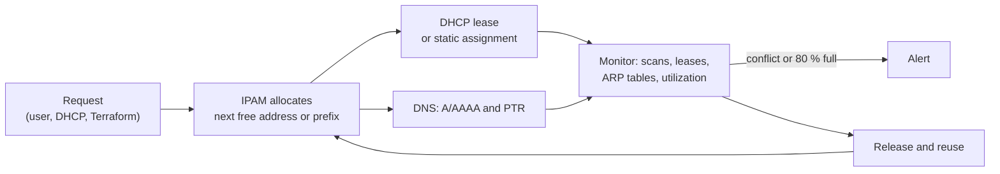

# IPAM

## Summary

IP address management (IPAM) is the set of processes and tools for planning, allocating, tracking and auditing IP address space and subnets, usually integrated with DHCP and DNS (together called DDI). An IPAM system is the source of truth for which prefixes exist, which addresses are used by what, and which ranges are free, for IPv4 and IPv6, on-premises and in clouds. It prevents conflicts and overlaps, makes growth predictable, speeds up troubleshooting and supports security and compliance. Without it, addresses live in spreadsheets that drift from reality until two VPCs overlap and cannot be peered.

## Prerequisites

- [IP addressing](ip-addressing.md), [CIDR](cidr.md), [DHCP](../application-layer/dhcp.md).

## Core concepts

### Definition and importance

IPAM ensures efficient use of addresses, integrates with DHCP and DNS for automated management, and supports troubleshooting, security and compliance. It:

- prevents IP conflicts and overlapping subnets,
- supports scalability in large and multi-site networks,
- keeps IPv4 and IPv6 allocation efficient and structured,
- gives visibility into address usage (who has which address, how full each subnet is).

*Analogy.* The land registry of a city. It records every plot (prefix), which buildings stand on it (assigned addresses), which plots are free for development (available ranges) and who owns them, and it is consulted before anything is built. The analogy breaks on speed: addresses are created and released automatically every minute by DHCP and cloud APIs, so the registry must update itself instead of waiting for clerks.

### Key functions

| Function | Description |
| --- | --- |
| IP address tracking | A database of assigned and available addresses |
| Subnet management | Subnets, their allocations and utilization |
| DHCP integration | Coordinated dynamic allocation and reservations |
| DNS integration | Hostnames and reverse records kept in step with addresses |
| Address planning | Design of scalable addressing schemes and hierarchies |
| Conflict prevention | Detection of duplicate addresses and overlapping prefixes |
| Audit and compliance | History of who used which address when, for security and regulation |

### How it works: the address lifecycle

1. **Request**: a device or team requests an address or a subnet (manually, through DHCP, or through an API from automation such as Terraform).
2. **Assignment**: IPAM allocates an available address or the next free prefix of the requested size.
3. **DHCP and DNS update**: DHCP leases the address, and DNS gets forward (A or AAAA) and reverse (PTR) records.
4. **Monitoring**: IPAM tracks usage, lease expiry and conflicts, often by scanning networks and reading DHCP leases and router ARP tables.
5. **Release and reuse**: unused addresses and prefixes return to the free pool.



### Allocation strategies

| Method | Description | Use case |
| --- | --- | --- |
| Dynamic allocation | Addresses leased temporarily through DHCP | End-user devices, Wi-Fi |
| Static allocation | Fixed addresses assigned by hand or reservation | Servers, printers, network devices |
| Hierarchical allocation | Blocks organized by region, site, department or environment | Large enterprises, multi-cloud |
| Role-based allocation | Ranges by function (servers, VoIP, IoT, management) | Data centers, industrial networks |

### Subnet planning

IPAM organizes addresses into logical groups. An example plan:

| Department | Subnet | CIDR | Host capacity |
| --- | --- | --- | --- |
| HR | `192.168.1.0` | `/24` | 254 |
| IT | `192.168.2.0` | `/24` | 254 |
| Finance | `192.168.3.0` | `/25` | 126 |
| VoIP phones | `192.168.4.0` | `/26` | 62 |

Benefits: less broadcast traffic per segment, better security segmentation, and early warning of exhaustion.

### IPAM for IPv4 and IPv6

| Feature | IPv4 | IPv6 |
| --- | --- | --- |
| Address space | 32 bits, scarce | 128 bits, abundant |
| Subnetting | CIDR, many sizes (for example `/24`) | `/64` per LAN segment, `/48` or `/56` per site |
| Tracking | Needed to avoid exhaustion and overlap | Still needed: not for scarcity but for structure, documentation and security (addresses are too many to scan, so registration matters more) |
| NAT | Usually required for Internet access | Not needed |

IPv6 plan example:

```text
2001:db8:1::/48      main network (site or region allocation)
2001:db8:1:1::/64    IT department
2001:db8:1:2::/64    Finance
```

A `/48` holds 65,536 `/64` segments; encoding site, environment and function in the subnet bits makes addresses readable.

### DHCP and DNS integration

**DHCP**: IPAM ensures non-overlapping scopes, tracks lease expiration and reservations. Workflow:

1. A device sends `DHCPDISCOVER`.
2. The DHCP server checks the scope (managed in IPAM) for a free address.
3. IPAM records the assignment.
4. DHCP leases the address to the client.

**DNS**: IPAM maps addresses to host names automatically and maintains reverse records:

```text
host1.corp.example.com.          A    192.168.1.10     ; forward: name to address
10.1.168.192.in-addr.arpa.       PTR  host1.corp.example.com.   ; reverse: address to name
```

Avoid the `.local` suffix for internal DNS; it is reserved for multicast DNS (RFC 6762).

### Security considerations

| Threat | Impact | Mitigation |
| --- | --- | --- |
| IP spoofing | A device impersonates another address | DHCP snooping with IP Source Guard, IPAM monitoring |
| Rogue DHCP server | Malicious network settings (gateway, DNS) | DHCP snooping, trusted ports only |
| IP conflicts | Duplicate addresses cause outages | Automatic conflict detection in IPAM |
| Unauthorized addresses | Users configure addresses outside DHCP | IP policies with alerts, 802.1X |

Cisco DHCP snooping, which lets only trusted ports carry DHCP server replies:

```text
ip dhcp snooping
ip dhcp snooping vlan 10
interface GigabitEthernet0/1
 ip dhcp snooping trust
```

### Tools

| Tool | Type | Key features |
| --- | --- | --- |
| Infoblox | Enterprise DDI | DHCP, DNS and IPAM automation |
| SolarWinds IP Address Manager | Enterprise | DHCP and DNS integration |
| BlueCat Address Manager | Enterprise DDI | Central address control |
| BlueCat Micetro (formerly Men & Mice) | Enterprise overlay | Manages existing DNS and DHCP servers and cloud IPAM |
| phpIPAM | Open source | Web-based tracking, scans, API |
| NetBox | Open source | IPAM plus data center infrastructure (DCIM), widely used as source of truth for automation |

phpIPAM and NetBox are installed from their projects (container images or source), not from standard Debian or Ubuntu repositories.

### Best practices

- Use dynamic allocation for end devices to avoid conflicts.
- Reserve static addresses (or DHCP reservations) for critical infrastructure.
- Segment into subnets to reduce congestion and improve security.
- Monitor utilization and alert before exhaustion.
- Apply role-based access control to IPAM changes.
- Alert on conflicts and unauthorized assignments.
- Integrate with a SIEM for incident response (map an IP and time to a device and owner).
- Make IPAM the source of truth for automation: IaC requests prefixes from it instead of hardcoding them.

### Cloud and future developments

- **Cloud IPAM services**: AWS VPC IPAM, Azure Virtual Network Manager IP address management and Google Cloud's address planning tools track and allocate prefixes across accounts and regions.
- **Predictive planning**: tools use utilization trends (sometimes marketed as AI) to forecast exhaustion and propose allocations.
- **Routing security**: preventing IP hijacking on the Internet relies on RPKI (Resource Public Key Infrastructure) route origin validation for BGP; blockchain-based allocation has been proposed in research but is not in production use.

## Worked example

Allocate subnets from NetBox through its API in a pipeline instead of hardcoding CIDRs. Untested; NetBox 4.x REST API, checked 2026-11. Token and IDs are placeholders.

```bash
# ask for the next free /24 inside the parent prefix with ID 42 (10.40.0.0/16)
curl -s -X POST https://netbox.example.com/api/ipam/prefixes/42/available-prefixes/ \
  -H "Authorization: Token <TOKEN>" -H "Content-Type: application/json" \
  -d '{"prefix_length": 24, "description": "team-shop staging", "status": "active"}'
# => {"id": 977, "prefix": "10.40.53.0/24", ...}
```

The returned prefix feeds Terraform as a variable, so two pipelines can never pick the same range, and the IPAM records who requested it and why.

## Trade offs and when to use it

- **Spreadsheets** work for one small site; they fail with automation, multiple teams or clouds.
- **Full DDI suites** integrate DHCP, DNS and IPAM tightly but are expensive; **open source** tools (NetBox, phpIPAM) need integration work.
- **Cloud-native IPAM** covers one provider; multi-cloud needs a neutral source of truth.

## Common mistakes

- **Planning without growth headroom**, so subnets cannot be extended. Fix: reserve adjacent blocks.
- **Overlapping ranges** across VPCs, offices and VPN pools. Fix: allocate everything from one IPAM.
- **Stale records.** Fix: reconcile with scans, DHCP leases and cloud APIs automatically.

## Practice

1. Why is IPAM still needed for IPv6?
2. What is the difference between a DHCP reservation and a static address?
3. Which DNS record type maps an address back to a name?

Answers:

1. For structure, documentation and security: the space is too large to scan, so you must know what is allocated where.
2. A reservation is handed out by DHCP but always the same address for a given client; a static address is configured on the device and bypasses DHCP.
3. PTR.

## Further reading

- [NetBox documentation](https://netboxlabs.com/docs/netbox/) (NetBox Labs).
- [phpIPAM](https://phpipam.net/) (phpIPAM project).
- [Amazon VPC IP Address Manager](https://docs.aws.amazon.com/vpc/latest/ipam/what-it-is-ipam.html) (Amazon Web Services).
- [RFC 6811: BGP Prefix Origin Validation](https://www.rfc-editor.org/rfc/rfc6811) (IETF, 2013).
