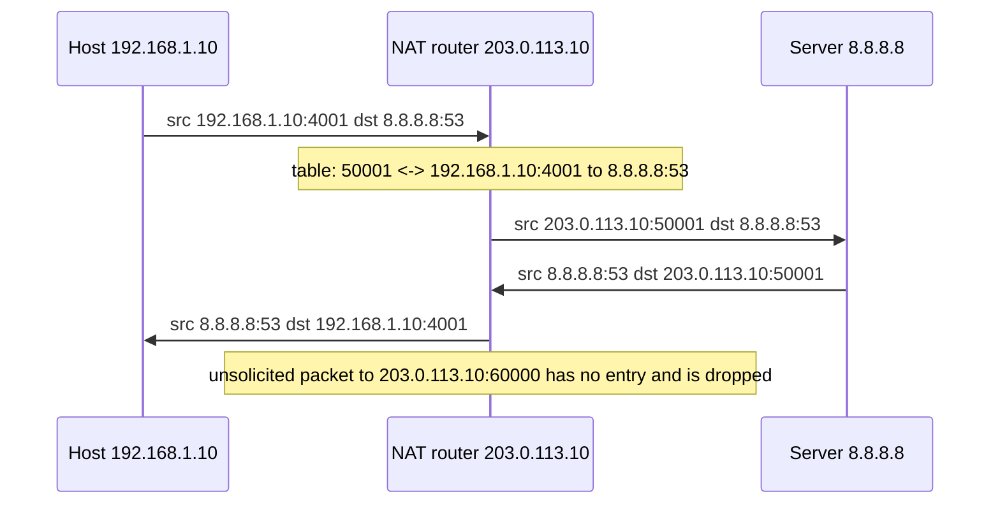

# NAT

## Summary

Network Address Translation (NAT) rewrites the IP addresses (and usually ports) in packet headers as packets cross a router, most often so that hosts with private addresses can reach the Internet through a public address. Static NAT maps one private address to one public address, dynamic NAT maps from a pool, and Port Address Translation (PAT, NAT overload, masquerading) lets thousands of hosts share one public address by giving each connection its own port. NAT conserved IPv4 addresses for three decades, but it breaks end-to-end connectivity, which forces traversal techniques (STUN, TURN, NAT-T), and it is not a firewall, even though it blocks unsolicited inbound connections as a side effect. IPv6 makes NAT unnecessary for address shortage; NAT64 bridges IPv6-only clients to IPv4 services.

## Prerequisites

- [IP addressing](ip-addressing.md) (private and public addresses) and [Router](router.md).
- [Ports](../transport-layer/ports.md).

## Core concepts

### Definition and usage

NAT modifies IP address information in packet headers so that devices in a private network can communicate with external networks such as the Internet. It operates at layer 3 (and at layer 4 when ports are translated) and is used to:

- **conserve public IPv4 addresses**: many private devices share one public address,
- **hide internal network details**: outside hosts see only the public address,
- **simplify network management**: internal addressing does not need public addresses for every device and does not change when the ISP changes.

*Analogy.* A company switchboard. Outsiders see one public phone number; when an employee calls out, the switchboard notes which extension made the call on which line (translation table), and routes the answer back to that extension. Outsiders cannot dial extensions directly unless a fixed forwarding is set up (port forwarding). The analogy breaks for protocols that write the extension number inside the conversation (SIP, FTP), which the switchboard cannot rewrite unless it understands the protocol.

### Types

**Static NAT (one-to-one).** One private address maps permanently to one public address, used when an internal server needs a fixed public address.

```text
Private 192.168.1.100  <->  Public 203.0.113.10
ip nat inside source static 192.168.1.100 203.0.113.10        ! Cisco IOS
```

**Dynamic NAT (many-to-many).** Private addresses are mapped to addresses from a pool of public addresses as they are needed; when the pool is exhausted, new hosts cannot connect.

```text
192.168.1.10 -> 203.0.113.10
192.168.1.11 -> 203.0.113.11

ip nat pool NAT-POOL 203.0.113.10 203.0.113.20 netmask 255.255.255.0
ip nat inside source list 1 pool NAT-POOL
access-list 1 permit 192.168.1.0 0.0.0.255
```

**PAT, NAT overload (many-to-one).** The most common form: many private addresses share one public address, and the router distinguishes connections by source port.

```text
192.168.1.10:4001 -> 203.0.113.10:50001
192.168.1.11:4002 -> 203.0.113.10:50002

ip nat inside source list 1 interface GigabitEthernet0/0 overload
```

Used by home routers and enterprises that connect many devices through one ISP-provided address. One public IPv4 address offers about 64,000 ports per destination and protocol, which limits concurrent connections to a single destination (a known issue with cloud NAT gateways connecting to one API endpoint).

**Destination NAT and port forwarding.** The reverse direction: inbound connections to a public address and port are forwarded to an internal host (for example `203.0.113.10:443 -> 192.168.1.50:443`), as used for servers in a DMZ ([DMZ](../network-security/dmz.md)).

**Carrier-grade NAT (CGNAT).** ISPs translate customers' addresses from the shared range `100.64.0.0/10` to a small pool of public addresses, so customers sit behind two layers of NAT.

### How PAT works

1. A device with `192.168.1.10` sends a packet from port 4001 to `8.8.8.8:53` (Google Public DNS).
2. The router replaces the source with its public address and a free port, `203.0.113.10:50001`, and records the mapping in its translation table.
3. The server replies to `203.0.113.10:50001`.
4. The router looks up port 50001, rewrites the destination back to `192.168.1.10:4001` and forwards the reply.



### Traversal problems and solutions

Because NAT rewrites headers and blocks unsolicited inbound packets, protocols that need end-to-end connectivity or carry addresses inside their payload struggle:

1. **VoIP (SIP, H.323, RTP)**: endpoints advertise private addresses for media streams, so calls connect but have no audio.
2. **Peer-to-peer applications** (file sharing, games, video conferencing): direct connections between two NATed peers fail.
3. **IPsec VPNs**: ESP has no ports and AH protects the addresses that NAT changes, so translation breaks them.

Solutions:

1. **STUN (Session Traversal Utilities for NAT)**: a client asks a STUN server which public address and port it appears from, used by VoIP and WebRTC; with that, peers can attempt UDP hole punching.
2. **TURN (Traversal Using Relays around NAT)**: a relay server forwards traffic when direct connections are impossible (for example with symmetric NAT). ICE combines STUN and TURN to pick the best path.
3. **UPnP IGD and NAT-PMP or PCP**: applications ask the router to open port mappings automatically (convenient, but a security risk on untrusted devices; often disabled).
4. **NAT-T (NAT traversal for IPsec)**: encapsulates ESP in UDP port 4500.
5. **Application layer gateways (ALGs)**: routers that understand FTP or SIP and rewrite addresses inside the payload (often buggy for SIP).

### NAT and IPv6

IPv6 provides enough addresses for global, end-to-end addressing, so NAT is not needed for address shortage.

| Feature | IPv4 with NAT | IPv6 |
| --- | --- | --- |
| Addressing | Private inside, public outside | Globally unique addresses |
| Protection | Hides internal addresses, drops unsolicited inbound as a side effect | Stateful firewalls (and IPsec where used) |
| Need for NAT | Required in most networks | Not needed; end-to-end routing |

Translation still exists for coexistence: **NAT64** with **DNS64** lets IPv6-only clients reach IPv4-only servers (`64:ff9b::/96` prefix), common in mobile networks.

### Security considerations

NAT provides some protection but is not a firewall.

- It hides the internal structure and, because no mapping exists for unsolicited inbound packets, blocks them by default.
- It is not a security mechanism by design: it is stateful translation, not policy-based filtering; outbound traffic is unrestricted, port forwards and UPnP open holes, and IPv6 traffic bypasses it entirely.
- It does not encrypt traffic.
- Attacks such as **NAT Slipstreaming** (Samy Kamkar, 2020) trick a router's ALG, through a malicious web page, into opening inbound ports to internal devices; browsers and router vendors patched specific variants.

Use a real stateful firewall with default-deny inbound rules, with or without NAT ([Firewalls](../network-security/firewalls.md)).

### Use cases

- **Home networks**: one public address from the ISP shared by all devices with PAT: router `203.0.113.10`, devices `192.168.1.x`.
- **Enterprise networks**: PAT for users, static NAT or port forwarding for published servers, combined with firewall policies.
- **Data centers and clouds**: public cloud providers give private VPC addresses and map public addresses with one-to-one NAT (AWS Elastic IP addresses), and offer managed outbound PAT services (AWS NAT Gateway, Azure NAT Gateway, Google Cloud NAT).

### Linux tools

```bash
iptables -t nat -L -n -v                                  # show NAT rules (legacy iptables)
iptables -t nat -A POSTROUTING -o eth0 -j MASQUERADE      # PAT for traffic leaving eth0
conntrack -L -p tcp --dport 443                           # active translations (conntrack-tools)
nft list table ip nat                                     # nftables equivalent
```

## Worked example

Expose an internal web server through a Linux router with destination NAT, and let internal hosts browse with PAT. Untested; nftables 1.0 on Debian 12, checked 2026-11. `wan0` has `203.0.113.10`, `lan0` has `10.0.0.1/24`, the server is `10.0.0.50`.

```bash
sudo sysctl -w net.ipv4.ip_forward=1
sudo nft -f - <<'EOF'
table ip nat {
  chain prerouting {
    type nat hook prerouting priority -100;
    iifname "wan0" tcp dport 443 dnat to 10.0.0.50:443        # port forwarding (destination NAT)
  }
  chain postrouting {
    type nat hook postrouting priority 100;
    oifname "wan0" ip saddr 10.0.0.0/24 masquerade            # PAT for outbound traffic
  }
}
EOF
```

From outside, `curl -k https://203.0.113.10/` reaches the internal server; from inside, `curl https://example.com` leaves with source `203.0.113.10`. A forward-chain firewall rule must still allow `tcp dport 443` to `10.0.0.50` and drop everything else inbound.

## Trade offs and when to use it

- **PAT** saves addresses at the cost of end-to-end connectivity, port exhaustion at scale and harder logging (you must log port mappings to identify a user behind a shared address).
- **Static NAT** gives predictable inbound reachability for servers.
- **IPv6** avoids NAT complexity but needs firewall discipline because hosts become directly addressable.

## Common mistakes

- **Treating NAT as security.** Fix: explicit firewall rules for IPv4 and IPv6.
- **Port exhaustion behind cloud NAT gateways** when many connections go to one destination. Fix: more public IPs on the gateway, connection reuse, private endpoints.
- **Hairpin NAT surprises**: internal clients cannot reach a server by its public address. Fix: enable NAT reflection or use split-horizon DNS.

## Practice

1. What distinguishes PAT from dynamic NAT?
2. Why does NAT break inbound connections initiated from the Internet?
3. What do STUN and TURN do?
4. Why is NAT not a firewall?

Answers:

1. PAT shares one public address among many hosts by translating ports; dynamic NAT gives each active host its own address from a pool.
2. Inbound packets have no entry in the translation table, so the router does not know which internal host to send them to.
3. STUN tells a client its public address and port as seen from outside; TURN relays traffic when a direct connection cannot be established.
4. It translates addresses without policy: outbound traffic is unrestricted, mappings can be opened by applications or attacks, and IPv6 is unaffected; filtering requires firewall rules.

## Further reading

- [RFC 3022: Traditional IP Network Address Translator](https://www.rfc-editor.org/rfc/rfc3022) (IETF, 2001).
- [RFC 4787: NAT Behavioral Requirements for Unicast UDP](https://www.rfc-editor.org/rfc/rfc4787) (IETF, 2007).
- [RFC 8489: Session Traversal Utilities for NAT (STUN)](https://www.rfc-editor.org/rfc/rfc8489) (IETF, 2020) and [RFC 8656: TURN](https://www.rfc-editor.org/rfc/rfc8656) (IETF, 2020).
- [RFC 6146: Stateful NAT64](https://www.rfc-editor.org/rfc/rfc6146) (IETF, 2011).
- [NAT Slipstreaming](https://samy.pl/slipstream/) (Samy Kamkar, 2020).
