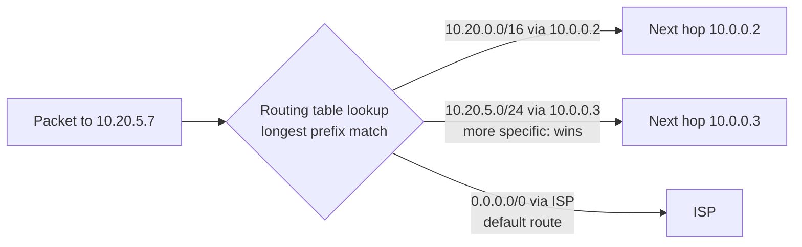

# Router

## Summary

A router is a layer 3 device that forwards packets between different networks based on destination IP addresses, acting as the gateway between LANs, WANs and the Internet. For each packet it looks up the destination in its routing table, chooses the longest matching prefix and sends the packet to the next hop, decrementing the TTL on the way. Routing tables are filled by static routes and dynamic routing protocols (OSPF inside organizations, BGP between them). Most routers also perform NAT, filter traffic with ACLs, terminate VPN tunnels and prioritize traffic with QoS. Because routers sit at network edges, they are prime attack targets and must be hardened.

## Prerequisites

- [IP](ip.md) and [IP addressing](ip-addressing.md), [CIDR](cidr.md).
- [Switch](../link-layer/switch.md) for the layer 2 counterpart.

## Core concepts

### Definition

A router forwards data packets between networks and connects LANs, WANs and the Internet.

- **Function**: routes traffic based on IP addresses.
- **OSI layer**: layer 3 (network).
- **Main role**: directs packets toward the destination network.

*Analogy.* A motorway interchange with signposts. Each car (packet) shows only its destination address; the interchange (router) reads it, finds the most specific matching sign (longest prefix match) and sends the car onto the right road toward the next interchange, without knowing the full route. The analogy breaks because routers also exchange information with neighbors about which roads exist (routing protocols), and a sign can change within seconds.

### How it works

1. Receive an incoming packet on an interface.
2. Check the destination IP address against the routing table and select the most specific matching route (longest prefix match; ties broken by administrative distance and metric).
3. Decrement the TTL (or IPv6 hop limit); drop the packet and send an ICMP Time Exceeded message if it reaches zero (this is how `traceroute` works).
4. Find the next hop's MAC address with ARP (or IPv6 neighbor discovery) and forward the packet out of the selected interface.
5. Apply NAT when moving between private and public networks.
6. Apply security rules where configured (firewall, ACLs, VPN encryption).



Example routing table on a Linux host acting as a router:

```text
$ ip route
default via 203.0.113.1 dev wan0
10.0.0.0/24 dev lan0 proto kernel scope link src 10.0.0.1
10.20.0.0/16 via 10.0.0.2 dev lan0
10.20.5.0/24 via 10.0.0.3 dev lan0 proto ospf metric 20
```

### Types

| Type | Description | Use case |
| --- | --- | --- |
| Home router | Consumer device combining Wi-Fi, NAT, DHCP, a switch and a firewall | Small offices, households |
| Enterprise router | High-performance, many interfaces and features | Corporate networks, data centers |
| Edge router | Connects an organization to its ISP, often running BGP | WAN entry point |
| Core router | Very high-speed backbone routing within large networks | ISP and large enterprise backbones |
| Virtual router | Software routing (vRouter, VyOS, cloud routers, Linux) | Cloud and SDN environments |

### Key functions

- **Routing tables**: determine the best path; built from static routes and dynamic routing protocols.
- **NAT**: translates private addresses to public ones for Internet access and hides the internal address plan ([NAT](nat.md)); NAT is not a security control by itself.
- **Firewall and ACLs**: block unauthorized traffic with rules, protecting internal networks ([Firewalls](../network-security/firewalls.md)).
- **VPN**: encrypted tunnels for remote access and site-to-site connections, for example IPsec, OpenVPN, WireGuard ([VPN](../network-security/vpn.md)).
- **Quality of Service (QoS)**: prioritizes traffic (for example VoIP over downloads) to limit the effect of congestion.

### Routing protocols

| Protocol | Type | Scope | Metric |
| --- | --- | --- | --- |
| Static routes | Manual | Small or stub networks | None |
| RIP (Routing Information Protocol) | Distance vector | Small legacy networks | Hop count, maximum 15 |
| OSPF (Open Shortest Path First) | Link state (Dijkstra) | Inside an organization (interior gateway protocol) | Cost based on bandwidth |
| IS-IS | Link state | ISP backbones | Configurable cost |
| BGP (Border Gateway Protocol) | Path vector | Between autonomous systems on the Internet (exterior gateway protocol), also in data centers | Path attributes and policy |

RIP, OSPF and BGP are planned topics of the [Internet layer](README.md) subarea.

### Security best practices

- **Change default credentials** (no `admin/admin` or `root/root`); use long, unique passwords and central authentication (TACACS+ or RADIUS) for teams.
- **Disable unused services**: Telnet, plain HTTP management and SNMPv1/v2c; use SSH, HTTPS and SNMPv3.
- **Enable firewall rules and ACLs**: filter unauthorized connections and limit inbound and outbound traffic, including to the management plane.
- **Wireless**: use WPA3 (or WPA2-AES at least) and disable WPS, which is vulnerable to PIN brute force.
- **Update firmware regularly**: routers are frequently exploited through firmware vulnerabilities and are targets of botnets.
- **Use a VPN for remote management**; never expose SSH, RDP or web interfaces to the Internet.
- **MAC address filtering** restricts which devices may connect, but it is weak because MAC addresses are easily spoofed.
- **Monitor logs**: detect failed logins and configuration changes, forward to a SIEM (Splunk, Elastic Stack).

### Advanced technologies

- **SDN (software-defined networking)**: a central controller programs forwarding across many devices; used in clouds and data centers.
- **BGP**: the routing protocol of the Internet backbone, exchanging reachability between autonomous systems and enabling multi-homing and traffic engineering.
- **SD-WAN**: optimizes WAN traffic dynamically and can replace costly MPLS links with cheaper broadband; benefits are lower cost, better application performance and central management and security.

## Worked example

Turn a Linux server with two interfaces into a router for a private LAN with NAT to the Internet. Untested; iproute2 and nftables on Debian 12, checked 2026-11. Interfaces `lan0` (10.0.0.1/24) and `wan0` (203.0.113.10/24).

```bash
sudo sysctl -w net.ipv4.ip_forward=1                    # forward packets between interfaces
sudo ip route add default via 203.0.113.1 dev wan0
sudo nft add table ip nat
sudo nft 'add chain ip nat postrouting { type nat hook postrouting priority 100 ; }'
sudo nft add rule ip nat postrouting oifname "wan0" ip saddr 10.0.0.0/24 masquerade
# on a LAN client: default gateway 10.0.0.1
traceroute -n 1.1.1.1     # first hop 10.0.0.1, then the ISP gateway
```

## Trade offs and when to use it

- **Hardware routers** forward at line rate with ASICs; **software routers** (Linux, VyOS) are flexible and cheap but CPU-bound at high packet rates.
- **Static routing** is simple and predictable for small networks; **dynamic routing** adapts to failures and scales, at the cost of protocol complexity.
- **Layer 3 switches** route between VLANs inside a site; dedicated routers handle WAN links, NAT and VPNs.

## Common mistakes

- **Asymmetric routing through stateful firewalls.** Return traffic takes another path and is dropped. Fix: symmetric paths or state synchronization.
- **Missing return routes.** A packet reaches the destination, but the reply has no route back. Fix: check routes in both directions.
- **Management interfaces on the Internet.** Fix: management VLAN or out-of-band network, VPN access.

## Practice

1. What is the longest prefix match rule?
2. Why does `traceroute` show each router on the path?
3. Which routing protocol connects different organizations on the Internet?

Answers:

1. When several routes match a destination, the router uses the one with the longest (most specific) prefix.
2. It sends packets with increasing TTL; each router that decrements the TTL to zero returns an ICMP Time Exceeded message revealing its address.
3. BGP.

## Further reading

- [RFC 1812: Requirements for IP Version 4 Routers](https://www.rfc-editor.org/rfc/rfc1812) (IETF, 1995).
- [RFC 4271: A Border Gateway Protocol 4 (BGP-4)](https://www.rfc-editor.org/rfc/rfc4271) (IETF, 2006).
- [RFC 2328: OSPF Version 2](https://www.rfc-editor.org/rfc/rfc2328) (IETF, 1998).
- [CISA: Securing network infrastructure devices](https://www.cisa.gov/news-events/news/securing-network-infrastructure-devices) (CISA).
