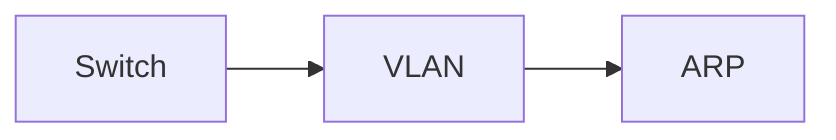

# Link layer

Communication within one network segment: Ethernet switching, VLAN segmentation and IP-to-MAC address resolution.

## Map

The diagram shows the notes in reading order; subareas are marked with (subarea).

## Notes in reading order

1. [Switch](switch.md): MAC learning, switch types, spanning tree, link aggregation and security.
2. [VLAN](vlan.md): segmentation, 802.1Q tagging, trunks, inter-VLAN routing and VLAN hopping.
3. [ARP](arp.md): address resolution, gratuitous and proxy ARP, spoofing and NDP.

## Planned topics

- Ethernet frames and standards
- Spanning Tree Protocol in depth
- Wi-Fi at the link layer (802.11 MAC)
- PPP and point-to-point links
