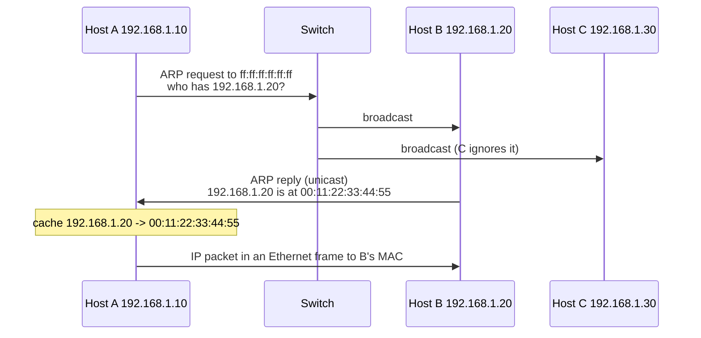

# ARP

## Summary

The Address Resolution Protocol (ARP, RFC 826, 1982) finds the MAC address that belongs to an IPv4 address on the local network. Ethernet delivers frames by MAC address, but applications and routing work with IP addresses, so before a host can send a packet to a neighbor or to its default gateway it broadcasts "who has this IP?" and caches the unicast answer. ARP works only within one broadcast domain (subnet) and has no authentication, which makes ARP spoofing a classic man-in-the-middle technique on LANs; Dynamic ARP Inspection and monitoring defend against it. IPv6 replaces ARP with the Neighbor Discovery Protocol.

## Prerequisites

- [Switch](switch.md) for MAC addresses and broadcasts.
- [IP addressing](../internet-layer/ip-addressing.md) for subnets and the default gateway.

## Core concepts

### Definition

ARP maps IP addresses (layer 3) to MAC addresses (layer 2) within a local network and is essential for communication on Ethernet. Because devices must know the destination MAC address to build an Ethernet frame, ARP resolves the IP address of the next hop to its MAC address. It operates only inside a subnet: for destinations in other networks, the host resolves the MAC address of the default gateway instead.

*Analogy.* Calling out in an open-plan office: "Who is sitting at desk 192.168.1.20?" Everyone hears it (broadcast), only the person at that desk answers "it's me, my badge number is 00:11:22:33:44:55" (unicast reply), and you write it on a sticky note (cache). The analogy breaks on trust: in an office you would notice if a stranger answered for someone else, while ARP believes any answer, which is exactly how spoofing works.

### How it works

1. Device A (`192.168.1.10`) wants to talk to device B (`192.168.1.20`).
2. A checks its ARP cache for B's MAC address. If found, it uses it.
3. If not, A sends an **ARP request** as a broadcast to `ff:ff:ff:ff:ff:ff`: "Who has 192.168.1.20? Tell 192.168.1.10."
4. B answers with a unicast **ARP reply**: "192.168.1.20 is at 00:11:22:33:44:55."
5. A stores the mapping in its ARP cache and sends the IP packet in a frame addressed to B's MAC address. (B usually also caches A's mapping from the request.)



### Packet structure

| Field | Size | Description |
| --- | --- | --- |
| Hardware type | 16 bits | Link layer type (Ethernet = `0x0001`) |
| Protocol type | 16 bits | Protocol being resolved (IPv4 = `0x0800`) |
| Hardware address length | 8 bits | 6 for Ethernet MAC addresses |
| Protocol address length | 8 bits | 4 for IPv4 addresses |
| Operation | 16 bits | 1 = request, 2 = reply |
| Sender MAC address | 48 bits | MAC address of the sender |
| Sender IP address | 32 bits | IP address of the sender |
| Target MAC address | 48 bits | MAC address of the target (zero in a request) |
| Target IP address | 32 bits | IP address being resolved |

An ARP packet is carried directly in an Ethernet frame with EtherType `0x0806`; it is not an IP packet, so routers never forward it.

### Types of ARP

- **Standard ARP**: resolves IP-to-MAC mappings within the same subnet with requests and replies.
- **Gratuitous ARP (GARP)**: an ARP announcement sent without a request (as a request or reply for the sender's own address). Used to detect IP conflicts (duplicate addresses), to update other hosts' caches after a change, and in failover: when a virtual IP moves to a standby node (VRRP, keepalived, pacemaker), the new owner sends GARP so traffic follows immediately.
- **Reverse ARP (RARP)**: resolved a MAC address to an IP address for diskless devices; obsolete, replaced by BOOTP and DHCP.
- **Proxy ARP**: a router answers ARP requests on behalf of hosts in another network, so hosts can reach them without a gateway configured. Useful in special cases, but it hides misconfigurations and enlarges failure domains.
- **Inverse ARP (InARP)**: in Frame Relay and ATM networks, maps a known virtual circuit identifier (DLCI in Frame Relay) to the remote IP address. Legacy WAN technology.

### ARP cache and timeouts

Every host keeps an ARP table (cache) of recent mappings. Entries expire so that changes are noticed; on Linux, entries pass through states (`REACHABLE`, `STALE`, `DELAY`, `PROBE`, `FAILED`) with reachability confirmed by traffic, typically for tens of seconds to a few minutes.

```bash
ip neigh show                       # Linux: the modern view of the cache
arp -a                              # Linux (net-tools), macOS and Windows
sudo ip -s -s neigh flush all       # Linux: clear the cache
netsh interface ip delete arpcache  # Windows: clear the cache
```

### ARP spoofing and poisoning

ARP has no authentication. An attacker sends forged ARP replies that associate the attacker's MAC address with another IP address, typically the default gateway. Victims then send traffic through the attacker, who can read, modify or drop it (man in the middle). Reference: MITRE ATT&CK T1557.002 (ARP cache poisoning). Demonstrate only in a lab or with written authorization, for example with the dsniff tool:

```bash
arpspoof -i eth0 -t 192.168.1.10 -r 192.168.1.1   # lab only
```

Effect: `192.168.1.10` believes the attacker's MAC belongs to the gateway `192.168.1.1`, so its traffic flows through the attacker.

### Mitigations

- **Dynamic ARP Inspection (DAI)** on managed switches (Cisco, Juniper and others) validates ARP packets against the DHCP snooping binding table and drops forged ones:

  ```text
  ip dhcp snooping vlan 10
  ip arp inspection vlan 10
  ```

- **Detection tools**: `arpwatch -i eth0` on Linux logs and alerts on changing IP-to-MAC pairs; XArp on Windows monitors ARP anomalies; IDS signatures detect gratuitous ARP floods.
- **Static ARP entries** prevent spoofing for critical pairs but are hard to manage at scale (`arp -s 192.168.1.1 00:aa:bb:cc:dd:ee`).
- **Encryption** (TLS, VPNs) does not stop poisoning but makes intercepted traffic useless; **port security and 802.1X** limit who can connect to the network at all.

### ARP in modern networks

**IPv6** does not use ARP. The Neighbor Discovery Protocol (NDP, RFC 4861) over ICMPv6 performs address resolution (neighbor solicitation and advertisement), router discovery, redirects and duplicate address detection, using multicast instead of broadcast. NDP has its own spoofing risks, addressed by RA Guard and SEND.

**Virtualized and cloud networks.** Guests still send ARP requests, but SDN controllers and hypervisors answer them from their own mapping database (ARP suppression or proxying) instead of flooding. In AWS VPC and Azure Virtual Network, the virtual network answers ARP from the provider's address mappings, so broadcast-based tricks such as gratuitous ARP failover do not work there; cloud failover moves IPs through the provider's API instead.

## Worked example

Watch ARP resolution on a Linux host. Untested; iproute2 and tcpdump on Linux, checked 2026-11.

```bash
sudo ip neigh flush dev eth0
sudo tcpdump -n -e -i eth0 arp &      # -e prints MAC addresses
ping -c 1 192.168.1.20
```

Expected capture (shortened):

```text
52:54:00:aa:00:10 > ff:ff:ff:ff:ff:ff, ARP, Request who-has 192.168.1.20 tell 192.168.1.10
00:11:22:33:44:55 > 52:54:00:aa:00:10, ARP, Reply 192.168.1.20 is-at 00:11:22:33:44:55
```

```bash
ip neigh show 192.168.1.20
# 192.168.1.20 dev eth0 lladdr 00:11:22:33:44:55 REACHABLE
ping -c 1 198.51.100.7      # outside the subnet: no ARP for 198.51.100.7, only for the gateway
ip neigh show | grep 192.168.1.1
```

## Trade offs and when to use it

- **ARP's simplicity** (no configuration) makes Ethernet plug-and-play, at the cost of trust in every reply.
- **Large layer 2 domains** generate much ARP broadcast traffic and widen the blast radius of spoofing; keep subnets moderate and route between them.
- **Static entries** trade operational effort for spoofing resistance; use them only for a few critical devices.

## Common mistakes

- **Expecting ARP across routers.** ARP is local; for remote hosts the gateway's MAC is used.
- **Duplicate IP addresses** causing intermittent connectivity as caches flip. Fix: GARP-based conflict detection, DHCP reservations, IPAM.
- **Gratuitous ARP failover in the cloud.** It does not work. Fix: provider APIs or load balancers.

## Practice

1. Why is an ARP request a broadcast and the reply a unicast?
2. Which MAC address does a host resolve when sending to a server on the Internet?
3. What does gratuitous ARP do during a failover?
4. Which protocol replaces ARP in IPv6?

Answers:

1. The requester does not know the target's MAC address, so it must ask everyone; the target knows the requester's MAC from the request and answers directly.
2. The MAC address of its default gateway.
3. The new owner of a moved IP announces its MAC address so other hosts update their caches and send traffic to it immediately.
4. The Neighbor Discovery Protocol (NDP) over ICMPv6.

## Further reading

- [RFC 826: An Ethernet Address Resolution Protocol](https://www.rfc-editor.org/rfc/rfc826) (IETF, 1982).
- [RFC 4861: Neighbor Discovery for IP version 6](https://www.rfc-editor.org/rfc/rfc4861) (IETF, 2007).
- [MITRE ATT&CK T1557.002: ARP Cache Poisoning](https://attack.mitre.org/techniques/T1557/002/) (MITRE).
- [ip-neighbour(8)](https://man7.org/linux/man-pages/man8/ip-neighbour.8.html) (Linux man-pages project).
