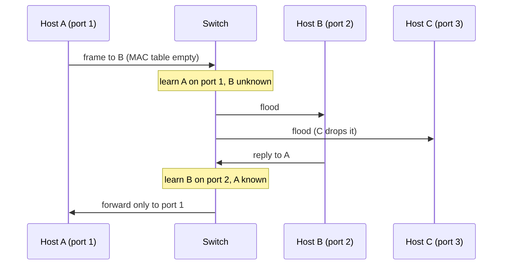

# Switch

## Summary

A network switch connects devices within a LAN and forwards Ethernet frames only to the port where the destination MAC address lives. It learns which MAC address sits behind which port by watching source addresses, stores them in a MAC address table (in fast CAM memory), and floods frames for unknown or broadcast destinations. Managed switches add VLANs, 802.1Q trunks, spanning tree to prevent loops, link aggregation, port security and 802.1X authentication; layer 3 switches also route between VLANs. Switches replaced hubs, which repeated every frame to every port. Their weaknesses (MAC flooding, VLAN hopping, STP manipulation) are well known and have standard countermeasures.

## Prerequisites

- [Networking overview](../networking-overview.md) and [OSI model](../network-models/osi-model.md).

## Core concepts

### Definition

A switch is a layer 2 (data link) device, or a layer 3 device in the case of multilayer switches, that connects devices in a network and forwards data based on MAC addresses.

- **Function**: manages traffic efficiently within a LAN.
- **OSI layer**: primarily layer 2; layer 3 switches also route.
- **Key role**: forward frames by MAC address (layer 2) or packets by IP address (layer 3).

*Analogy.* A mail room for one building that learns where each person sits: the first letter for a new name is copied to every desk (flooding), but once someone has sent a letter, the clerk notes their desk (MAC learning) and delivers future letters only there. The analogy breaks at scale: a switch learns and forwards millions of frames per second in hardware.

### How it works

1. Receive a frame on a port.
2. Learn: record the frame's *source* MAC address and the port in the MAC address table (with an aging timer, typically 300 seconds).
3. Look up the *destination* MAC address in the table.
4. Forward the frame to the single matching port (unicast); flood it to all ports in the VLAN except the incoming one if the destination is unknown, broadcast (`ff:ff:ff:ff:ff:ff`) or multicast without snooping.
5. Keep learning dynamically, so flooding decreases as the table fills.



### Types

| Type | Description | Use case |
| --- | --- | --- |
| Unmanaged | Plug-and-play, no configuration | Small offices and homes |
| Managed | VLANs, QoS, monitoring, security settings | Enterprises and data centers |
| Layer 2 | Forwards frames by MAC address | Access switching inside a LAN |
| Layer 3 (multilayer) | Also routes packets by IP address | Large networks with VLANs, distribution and core layers |
| PoE (Power over Ethernet) | Supplies power and data over the same cable (IEEE 802.3af, at, bt) | IP cameras, VoIP phones, access points |
| Stackable | Several switches act as one logical unit | Scalable enterprise access layers |

### Key features

- **MAC address table and learning**, stored in content-addressable memory (CAM) for lookups in constant time.
- **VLANs**: one switch is split into several logical networks for security and performance ([VLAN](vlan.md)).
- **Trunking with 802.1Q**: many VLANs over one link, distinguished by tags.
- **Spanning Tree Protocol (STP)**: redundant links create loops, and Ethernet frames have no TTL, so a loop causes a broadcast storm that can take down a network within seconds. STP blocks redundant paths and unblocks them on failure. Variants: STP (IEEE 802.1D), Rapid STP (802.1w, convergence in seconds instead of 30 to 50), Multiple STP (802.1s, one tree per group of VLANs). Modern data centers avoid STP with routed leaf-spine fabrics.
- **Port security**: limits the number of MAC addresses per port and blocks unknown devices.
- **Link aggregation (LAG) and LACP**: several physical ports form one logical link for bandwidth and redundancy, negotiated with the Link Aggregation Control Protocol (originally IEEE 802.3ad, now IEEE 802.1AX). Each flow uses one member link, chosen by a hash.

### Layer 2 compared with layer 3 switches

| Feature | Layer 2 switch | Layer 3 switch |
| --- | --- | --- |
| Forwarding decision | MAC address | MAC address, and IP address between VLANs |
| Routing capability | No | Yes (static and routing protocols) |
| Use case | Access switching in a LAN | Inter-VLAN routing, distribution and core |
| Common protocols | STP, VLAN, LACP | Plus OSPF, BGP, VRRP |

### Security best practices

Switches are targets of MAC flooding, VLAN hopping and STP manipulation (describe and test these only in labs or with authorization).

- **MAC flooding.** An attacker sends frames with thousands of fake source MAC addresses until the table is full; the switch then floods traffic like a hub and the attacker can sniff it. Countermeasure: port security limiting MAC addresses per port.
- **VLAN hopping.** Abuse of trunk negotiation or double tagging to reach restricted VLANs. Countermeasure: disable unused ports, configure access and trunk ports manually, disable negotiation ([VLAN](vlan.md)).
- **STP manipulation.** Spoofed BPDUs make the attacker's device the root bridge (traffic flows through it) or cause outages. Countermeasures: BPDU Guard on access ports (shuts down a port that receives BPDUs), Root Guard on ports that must never lead to the root.
- **Disable unused ports** so rogue devices cannot connect.
- **802.1X authentication**: devices or users authenticate (with a RADIUS server) before the port is opened.
- **DHCP snooping and Dynamic ARP Inspection** against rogue DHCP and ARP spoofing.

### Monitoring and management

| Tool | Function |
| --- | --- |
| SNMP (prefer SNMPv3) | Monitors health, interface counters and errors |
| Syslog | Logs security events and errors centrally |
| SPAN and RSPAN | Mirrors traffic of ports or VLANs to a local (SPAN) or remote (RSPAN) analyzer |
| LLDP and CDP | Discover neighboring devices |
| sFlow and NetFlow/IPFIX | Sampled or flow-level traffic statistics |

## Worked example

Inspect MAC learning on a Linux bridge, which is a software switch. Untested; iproute2 and bridge-utils semantics on Linux 6.x, checked 2026-11.

```bash
sudo ip link add br0 type bridge
sudo ip link set eth1 master br0; sudo ip link set eth2 master br0
sudo ip link set br0 up
bridge fdb show br br0 | grep -v permanent     # learned MAC addresses and their ports
# 52:54:00:aa:bb:01 dev eth1 master br0
# 52:54:00:aa:bb:02 dev eth2 master br0
sudo ip link set br0 type bridge stp_state 1   # enable spanning tree
bridge link show                                # port states: forwarding or blocking
```

Port security on a Cisco IOS access port:

```text
interface FastEthernet0/5
 switchport mode access
 switchport port-security
 switchport port-security maximum 2
 switchport port-security violation restrict
 spanning-tree bpduguard enable
```

## Trade offs and when to use it

- **Unmanaged switches** are cheap but give no VLANs, monitoring or security; avoid them in business networks.
- **Large layer 2 domains** spread broadcasts and failure; keep them small and route between them.
- **Stacking or chassis** simplifies management; independent switches with routing between them limit shared failure.

## Common mistakes

- **Loops without STP** (a cable plugged back into the same switch). Fix: STP everywhere with BPDU Guard on edge ports.
- **LACP mismatches** between switch and server (static on one side, LACP on the other). Fix: same mode on both ends.
- **Expecting LAG to speed up a single flow.** One flow uses one link. Fix: multiple flows or faster links.

## Practice

1. What does a switch do with a frame whose destination MAC address is unknown?
2. Why are switching loops so harmful?
3. What does BPDU Guard protect against?

Answers:

1. It floods the frame to all ports in the VLAN except the incoming one.
2. Ethernet frames have no TTL, so broadcasts circulate forever and multiply, saturating links and CPUs (a broadcast storm).
3. Rogue or accidental switches sending spanning tree BPDUs on access ports, which could change the topology or create loops.

## Further reading

- [IEEE 802.1Q-2022: Bridges and Bridged Networks](https://standards.ieee.org/ieee/802.1Q/10323/) (IEEE): bridging, VLANs and spanning tree.
- [IEEE 802.1AX: Link Aggregation](https://standards.ieee.org/ieee/802.1AX/6768/) (IEEE).
- [IEEE 802.1X: Port-Based Network Access Control](https://standards.ieee.org/ieee/802.1X/7345/) (IEEE).
- *Computer Networking: A Top-Down Approach*, 8th edition (Kurose, Ross, Pearson, 2021): link layer switches.
