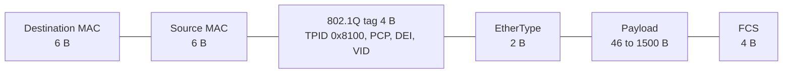
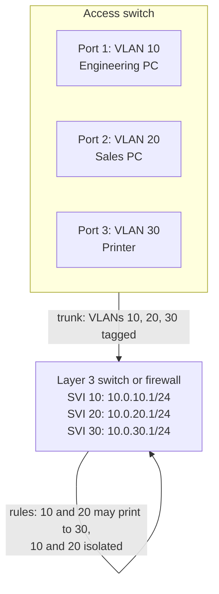

# VLAN

## Summary

A virtual local area network (VLAN) is a logical layer 2 network carved out of physical switches: devices in the same VLAN behave as if they were on one switch, wherever they are plugged in, and devices in different VLANs are separated as if on different switches. Each VLAN is its own broadcast domain, which reduces broadcast traffic and isolates groups (departments, servers, voice, guests). IEEE 802.1Q tags Ethernet frames with a 12-bit VLAN ID so that one trunk link can carry many VLANs between switches. Traffic between VLANs must be routed, by a router or a layer 3 switch, which is where firewall rules apply. In clouds the same idea appears as VPCs, subnets and VXLAN overlays.

## Prerequisites

- [Switch](switch.md) for MAC learning and broadcast domains.
- [Network types](../network-types.md) (LAN).

## Core concepts

### Definition and use cases

A VLAN is a logically segmented network that lets devices communicate as if they were on the same physical network, even in different physical locations. VLANs operate at layer 2 (data link) and segment broadcast domains, which improves performance and security.

- **Network segmentation**: one physical network becomes several logical networks, less congestion, better security.
- **Security isolation**: devices in different VLANs cannot talk directly unless routing and layer 3 policies allow it.
- **Broadcast control**: broadcasts stay inside their VLAN instead of flooding the whole network.
- **Logical grouping**: users and devices are grouped by department, function or project instead of location.
- **Easier management**: moving or adding users does not require recabling.

*Analogy.* An office floor with movable glass walls. The floor and the cabling stay the same (the physical switches), but walls define separate rooms (VLANs): people in a room hear each other's announcements (broadcasts), people in another room do not, and to talk between rooms you go through a reception desk (router or firewall). The analogy breaks at trunks: one corridor (trunk link) can carry conversations of all rooms at once, labeled by room number (the 802.1Q tag).

### VLAN types

- **Static (port-based) VLAN.** Switch ports are assigned to VLANs manually; whatever is plugged into a port belongs to its VLAN. Simple but inflexible.
- **Dynamic VLAN.** Membership is assigned based on the MAC address, authentication (IEEE 802.1X with a RADIUS server returning the VLAN) or policy. It needs a VLAN Management Policy Server (VMPS, Cisco legacy) or a network access control or SDN solution. More flexible, more configuration.
- **Voice VLAN.** A dedicated VLAN for VoIP phones, combined with Quality of Service (QoS) rules that prioritize latency-sensitive voice traffic. The phone tags voice traffic while a PC behind it uses the data VLAN on the same port.
- **Private VLAN (PVLAN).** A VLAN subdivided for isolation within one subnet:
  - *Primary VLAN*: the parent VLAN, connected to the router through *promiscuous* ports.
  - *Isolated (secondary) VLAN*: hosts can communicate only with promiscuous ports, not with each other.
  - *Community (secondary) VLAN*: hosts communicate with each other and with promiscuous ports, but not with other communities or isolated hosts.

  Hosting providers use PVLANs to put many customers in one subnet without letting them reach each other.

### VLAN tagging with IEEE 802.1Q

Many VLANs can share one switch and one link, so frames must say which VLAN they belong to. IEEE 802.1Q inserts a 4-byte tag into the Ethernet frame, after the source MAC address:

| Field | Size | Meaning |
| --- | --- | --- |
| TPID (Tag Protocol Identifier) | 16 bits | `0x8100`, marks the frame as 802.1Q tagged |
| PCP (Priority Code Point) | 3 bits | Priority 0 to 7 for QoS (IEEE 802.1p) |
| DEI (Drop Eligible Indicator) | 1 bit | Frame may be dropped first under congestion |
| VID (VLAN Identifier) | 12 bits | VLAN 1 to 4094; 0 and 4095 are reserved |



**Ports and trunks.**

- An *access port* belongs to one VLAN; frames to and from the end device are untagged.
- A *trunk port* carries many VLANs over one link between switches (or to a server or router), with tagged frames.
- The *native VLAN* is the VLAN whose frames cross a trunk untagged.
- VLANs allowed on a trunk should be listed explicitly (`switchport trunk allowed vlan <VLAN-ID>` in Cisco IOS syntax).

### Inter-VLAN routing

VLANs are separate layer 2 domains, so devices in different VLANs cannot communicate directly; traffic must be routed:

1. **Router on a stick (legacy).** One physical router interface with a subinterface per VLAN on an 802.1Q trunk. Simple, but all inter-VLAN traffic shares one link.
2. **Layer 3 switch (modern).** A multilayer switch routes in hardware between *switched virtual interfaces* (SVIs), one IP interface per VLAN. More scalable and efficient.

In security-conscious designs, inter-VLAN traffic goes through a firewall so that rules decide which VLANs may talk.



### Security considerations

These attacks are described for defense; test them only in a lab or with written authorization.

- **VLAN hopping by switch spoofing.** An attacker's device negotiates a trunk (for example with Cisco DTP) and gains access to all VLANs.
- **VLAN hopping by double tagging.** An attacker in the native VLAN sends frames with two tags; the first switch strips the outer tag and forwards the frame on the trunk, where the inner tag places it in the victim VLAN (one-way only).
- Mitigations: shut down unused ports (`shutdown`); configure user ports explicitly as access ports (`switchport mode access`) and disable trunk negotiation (`switchport nonegotiate`); prune VLANs on trunks (`switchport trunk allowed vlan`); set the native VLAN to an unused VLAN (`switchport trunk native vlan 999`) or tag the native VLAN.
- **DHCP spoofing.** A rogue DHCP server hands out a malicious gateway or DNS server. Mitigation: DHCP snooping, which only trusts DHCP replies from designated ports ([DHCP](../application-layer/dhcp.md)).
- **ARP spoofing (man in the middle).** Fake ARP replies redirect traffic through the attacker. Mitigation: Dynamic ARP Inspection (DAI), which validates ARP against the DHCP snooping table ([ARP](arp.md)).

References: MITRE ATT&CK T1557.002 (ARP cache poisoning) and T1557.003 (DHCP spoofing).

### Advanced features

- **GVRP (GARP VLAN Registration Protocol)**: dynamic VLAN registration between switches; replaced by MVRP (Multiple VLAN Registration Protocol) in IEEE 802.1Q-2011.
- **VTP (VLAN Trunking Protocol)**: Cisco-proprietary central distribution of VLAN definitions. Convenient, but a switch with a higher revision number can wipe VLANs across the domain; many networks run it in transparent or off mode.
- **MAC-based VLAN**: VLAN assigned by the device's MAC address.
- **Q-in-Q (IEEE 802.1ad, VLAN stacking)**: an outer service tag wraps customer tags, used by carriers and clouds to transport customer VLANs.

### VLANs in cloud networking

- **Virtual Private Cloud (VPC)** in AWS and Google Cloud (VNet in Azure): isolation similar to VLANs but implemented at layer 3 by the provider's software-defined network.
- **Subnets and security groups** replace VLANs and inter-VLAN ACLs in virtualized environments.
- **VXLAN (Virtual Extensible LAN, RFC 7348)** carries layer 2 frames in UDP across layer 3 networks, with a 24-bit identifier (about 16 million segments instead of 4,094), used in data centers and to extend networks between sites.

## Worked example

Configure two VLANs on a Cisco IOS access switch and a Linux host on a trunk. Untested; Cisco IOS 15.x syntax and iproute2 on Linux, checked 2026-11.

Create VLANs and assign ports:

```text
Switch(config)# vlan 10
Switch(config-vlan)# name Engineering
Switch(config-vlan)# exit
Switch(config)# interface FastEthernet0/1
Switch(config-if)# switchport mode access
Switch(config-if)# switchport access vlan 10
Switch(config-if)# switchport nonegotiate
Switch(config-if)# exit
```

Configure the trunk to the core:

```text
Switch(config)# interface GigabitEthernet0/1
Switch(config-if)# switchport mode trunk
Switch(config-if)# switchport trunk allowed vlan 10,20,30
Switch(config-if)# switchport trunk native vlan 999
Switch(config-if)# exit
Switch# show interfaces trunk
```

A Linux server connected to a trunk port can join VLAN 20 with a tagged subinterface:

```bash
sudo ip link add link eth0 name eth0.20 type vlan id 20
sudo ip addr add 10.0.20.15/24 dev eth0.20
sudo ip link set eth0.20 up
sudo tcpdump -e -n -i eth0 vlan 20     # shows frames with "vlan 20" in the Ethernet header
```

## Trade offs and when to use it

- **VLANs** are cheap segmentation on existing switches; the limit of 4,094 IDs and spanning tree domains make them hard to scale across data centers, where VXLAN with EVPN is used.
- **Segmentation needs enforcement.** A VLAN without a firewall between it and others gives broadcast isolation, not security.
- **Many small VLANs** increase routing and rule complexity; group by trust level, not by every team.

## Common mistakes

- **Leaving VLAN 1 as the native and management VLAN.** Fix: dedicated management VLAN and an unused native VLAN.
- **Allowing all VLANs on every trunk.** Broadcasts and attacks reach everywhere. Fix: prune.
- **Mismatched native VLANs** between switches. Traffic leaks between VLANs. Fix: consistent configuration, CDP/LLDP warnings.
- **Dynamic trunk negotiation on user ports.** Fix: access mode and `nonegotiate`.

## Practice

1. How many usable VLAN IDs does 802.1Q provide, and why?
2. What is the difference between an access port and a trunk port?
3. How do hosts in two VLANs communicate?
4. How does double tagging work, and which configuration prevents it?
5. Why does VXLAN exist?

Answers:

1. 4,094: the VID has 12 bits (4,096 values), and 0 and 4095 are reserved.
2. An access port carries one VLAN untagged to an end device; a trunk carries many VLANs with tags between network devices.
3. Through a router or layer 3 switch (and usually a firewall) that routes between the VLANs' subnets.
4. The attacker in the native VLAN sends a frame with an outer native tag and an inner victim tag; the first switch strips the outer tag and forwards it tagged with the victim VLAN. An unused native VLAN (or tagging the native VLAN) prevents it.
5. To carry layer 2 segments over layer 3 networks with far more than 4,094 segment IDs, for multi-tenant data centers.

## Further reading

- [IEEE 802.1Q-2022: Bridges and Bridged Networks](https://standards.ieee.org/ieee/802.1Q/10323/) (IEEE): the VLAN tagging standard.
- [RFC 7348: Virtual eXtensible Local Area Network (VXLAN)](https://www.rfc-editor.org/rfc/rfc7348) (IETF, 2014).
- [MITRE ATT&CK T1557: Adversary-in-the-Middle](https://attack.mitre.org/techniques/T1557/) (MITRE): ARP and DHCP spoofing techniques.
- [Linux VLAN configuration with iproute2](https://man7.org/linux/man-pages/man8/ip-link.8.html) (Linux man-pages project, ip-link(8)).
