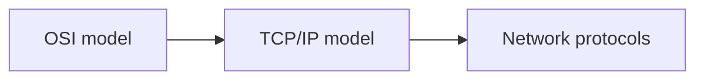

# Network models

Reference models that structure networking: the seven-layer OSI model, the four-layer TCP/IP model, and how protocols are defined and standardized.

## Map

The diagram shows the notes in reading order; subareas are marked with (subarea).

## Notes in reading order

1. [OSI model](osi-model.md): the seven layers, encapsulation and troubleshooting by layer.
2. [TCP/IP model](tcp-ip-model.md): the four layers of the Internet and the hourglass.
3. [Network protocols](network-protocols.md): definition, categories and the RFC process.
