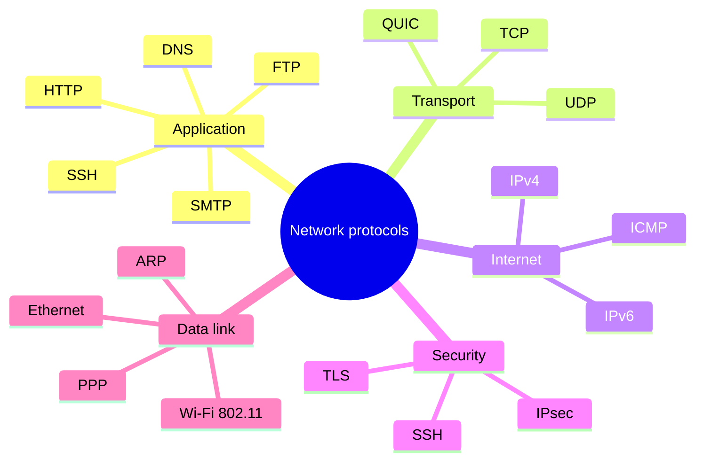

# Network protocols

## Summary

A network protocol is a standardized set of rules for exchanging data between devices: the format of messages, their order, and the actions taken on sending and receiving them. Protocols let devices from different manufacturers and operating systems communicate correctly and securely. They are organized in layers (OSI or TCP/IP), each protocol relying on the one below, and can be grouped into application, transport, internet, security and data link protocols. Most Internet protocols are specified openly by the IETF in RFCs, which is why reading an RFC is often the fastest way to settle a networking argument.

## Prerequisites

- [OSI model](osi-model.md) and [TCP/IP model](tcp-ip-model.md).

## Core concepts

### Definition

Network protocols are standardized rules and conventions that govern data exchange between devices in a network, so that devices communicate effectively and securely regardless of vendor or operating system. A protocol defines three things: *syntax* (message formats and fields), *semantics* (what each field and message means) and *timing* (order of messages, timeouts, retransmissions), often specified as a state machine.

*Analogy.* Diplomatic protocol: the rules of who greets first, which language is used, how documents are formatted and what happens if a reply does not come. Two delegations that follow the same protocol can work together without having met. The analogy breaks because network protocols must be precise enough for machines: every byte position and timeout is specified.

### Key characteristics

1. **Standardization**: compatibility across devices and platforms (IETF RFCs, IEEE 802 standards, ITU and W3C specifications).
2. **Layered architecture**: protocols align with the OSI or TCP/IP layers and use the services of the layer below.
3. **Interoperability**: diverse systems communicate seamlessly.

### Categories



1. **Application protocols** enable services such as web browsing and email: HTTP, FTP, SMTP, DNS ([Application layer](../application-layer/README.md)).
2. **Transport protocols** deliver data between processes reliably (TCP) or quickly without guarantees (UDP) ([Transport layer](../transport-layer/README.md)).
3. **Internet protocols** handle addressing and routing: IPv4, IPv6 ([Internet layer](../internet-layer/README.md)).
4. **Security protocols** provide confidentiality, integrity and authentication: TLS, IPsec ([Network security](../network-security/README.md)).
5. **Data link protocols** manage communication between nodes on the same network: Ethernet, ARP ([Link layer](../link-layer/README.md)).

### How protocols are standardized

Internet protocols move through the IETF process: an Internet-Draft is discussed in a working group, published as an RFC (Request for Comments), and may become a Proposed Standard and then an Internet Standard. RFCs are never changed after publication; corrections come as new RFCs that "update" or "obsolete" older ones, so always check the RFC's status on the RFC Editor site. Key words such as MUST, SHOULD and MAY have precise meanings defined in RFC 2119.

## Worked example

Speak a text protocol by hand to see syntax, semantics and timing. Untested; `nc` (OpenBSD netcat), checked 2026-11.

```bash
printf 'GET / HTTP/1.1\r\nHost: example.com\r\nConnection: close\r\n\r\n' | nc example.com 80 | head -5
```

```text
HTTP/1.1 200 OK
Content-Type: text/html
...
```

The request line, the `Host` header and the empty line ending the headers (`\r\n\r\n`) are the protocol's syntax; `GET` and `200 OK` its semantics; the server waiting for the blank line before answering, then closing because of `Connection: close`, its timing.

## Trade offs and when to use it

- **Text protocols** (HTTP/1.1, SMTP) are easy to debug by hand; **binary protocols** (HTTP/2, gRPC, DNS) are compact and fast but need tools to read.
- **Standard protocols** give interoperability; **custom protocols** should be a last resort.

## Common mistakes

- **Implementing a protocol from blog posts.** Fix: read the RFC and its updates.
- **Assuming a protocol is secure by default.** Many classic protocols (FTP, Telnet, SMTP without STARTTLS) send data in plain text. Fix: use secure variants or tunnels.

## Practice

1. What three aspects does a protocol define?
2. What is the difference between an RFC that "updates" and one that "obsoletes" another?

Answers:

1. Syntax (message formats), semantics (meaning of messages and fields) and timing (order and timeouts).
2. "Updates" changes or extends parts of the older RFC, which remains valid; "obsoletes" replaces it completely.

## Further reading

- [RFC Editor](https://www.rfc-editor.org/) (IETF): search RFCs and their status.
- [RFC 2026: The Internet Standards Process](https://www.rfc-editor.org/rfc/rfc2026) (IETF, 1996).
- [RFC 2119: Key words for use in RFCs to Indicate Requirement Levels](https://www.rfc-editor.org/rfc/rfc2119) (IETF, 1997).
