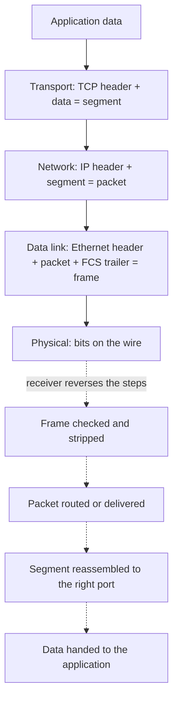

# OSI model

## Summary

The Open Systems Interconnection (OSI) model (ISO/IEC 7498-1, first published in 1984) is a conceptual framework that divides network communication into seven layers: physical, data link, network, transport, session, presentation and application. Each layer offers services to the layer above and uses the layer below, and each adds its own header when data is sent (encapsulation). The OSI protocol suite itself lost to TCP/IP, but the model survived as the common vocabulary of networking: "layer 2 switch", "layer 4 load balancer", "layer 7 firewall". Its most practical use is troubleshooting from the bottom up.

## Prerequisites

- [Networking overview](../networking-overview.md).

## Core concepts

### Purpose

1. **Standardization**: a universal reference so vendors and developers build compatible products.
2. **Troubleshooting**: problems can be isolated to a layer.
3. **Layered approach**: modular design, so a change in one layer does not require changes in the others (Wi-Fi replaced cables without changing HTTP).
4. **Interoperability**: communication across heterogeneous systems.

*Analogy.* Sending a diplomatic letter. The minister writes the message (application), a translator puts it in the recipient's language (presentation), a protocol office manages the ongoing exchange (session), the courier service guarantees delivery and order (transport), the postal network chooses the route between countries (network), each local post office hands it to the next (data link), and trucks and planes physically carry it (physical). Each office only deals with its neighbors. The analogy breaks because in real networks the session and presentation "offices" are usually inside the application itself.

### The seven layers

The figure summarizes the layers with typical protocols and devices.

The placements in the figure follow common teaching practice; several protocols do not fit one layer cleanly (TLS, SSH and IMAP are usually treated as application or between transport and application).

| Layer | Unit (PDU) | Function | Key responsibilities | Examples |
| --- | --- | --- | --- | --- |
| 1 Physical | Bits | Transmit and receive raw bit streams over a medium | Cables, connectors, signaling, encoding and modulation, bit synchronization | Ethernet cabling, fiber, radio, hubs, repeaters |
| 2 Data link | Frames | Node-to-node transfer on one link | Framing, error detection (CRC), MAC addressing, flow control, medium access and collision handling | Ethernet, Wi-Fi MAC, PPP, switches, NICs |
| 3 Network | Packets | Delivery across networks | Logical addressing (IP), routing and forwarding, fragmentation | IPv4, IPv6, ICMP, OSPF, routers |
| 4 Transport | Segments (TCP), datagrams (UDP) | End-to-end delivery between processes | Ports and multiplexing, reliability and error recovery, flow and congestion control | TCP (reliable, connection-oriented), UDP (unreliable, connectionless) |
| 5 Session | Data | Manage dialogs between applications | Establish, maintain, terminate sessions; synchronization and recovery checkpoints | NetBIOS, RPC, sockets APIs |
| 6 Presentation | Data | Translate between application formats and the network | Data representation, encryption, compression | TLS (encryption), JPEG, ASCII and UTF-8, MPEG |
| 7 Application | Data | Network services for applications | File transfer, email, web, name resolution, management | HTTP, FTP, SMTP, DNS, SNMP |

The data link layer has two sublayers (IEEE 802): **MAC** (media access control) controls access to the medium and addressing; **LLC** (logical link control, IEEE 802.2) multiplexes network protocols and can provide flow and error control.

### Encapsulation and decapsulation

When sending, data passes from the application layer down to the physical layer, and each layer adds its header (the data link layer also a trailer); the physical layer transmits bits. When receiving, data moves up and each layer removes its header.

Devices work up to a certain layer: hubs and repeaters at layer 1, switches at layer 2, routers at layer 3, and load balancers, proxies and firewalls at layer 4 or layer 7, depending on what they inspect.

### Troubleshooting by layer

1. **Physical**: cables, link lights, power, optics, interface errors (`ip -s link`, `ethtool`).
2. **Data link**: MAC addressing, VLAN membership, switch port configuration, ARP (`ip neigh`).
3. **Network**: IP configuration, routes, firewalls dropping packets (`ip addr`, `ip route`, `ping`, `traceroute`).
4. **Transport**: correct ports, listening services, congestion, resets (`ss -tlnp`, `nc -vz host port`).
5. **Session**: session persistence and timeouts (sticky sessions on load balancers, expired session tokens).
6. **Presentation**: data format and encoding compatibility, TLS handshakes and certificates (`openssl s_client`).
7. **Application**: application errors, for example HTTP 404 or 502, DNS NXDOMAIN (`curl -v`, `dig`).

### Advantages and criticism

Advantages: modularity (layers evolve independently), interoperability among technologies, systematic protocol design, and a common language for professionals.

Criticism:

1. **Overhead**: seven layers are more than practical implementations need.
2. **Unused layers**: the session and presentation layers have few distinct protocols in modern networks; their functions are built into applications or TLS.
3. **TCP/IP dominance**: real networks follow the TCP/IP model, so OSI is a teaching and vocabulary tool.

### Comparison with the TCP/IP model

| OSI layer | TCP/IP layer |
| --- | --- |
| Application | Application |
| Presentation | Application |
| Session | Application |
| Transport | Transport |
| Network | Internet |
| Data link and physical | Network access (link) |

See [TCP/IP model](tcp-ip-model.md).

## Worked example

A user reports "the website does not load". Walk the layers with commands (untested; Linux tools, checked 2026-11):

| Layer | Check | Command | Healthy result |
| --- | --- | --- | --- |
| 1 | Link up | `ip -br link` | `eth0 UP` |
| 2 | Gateway MAC resolved | `ip neigh show 192.168.1.1` | `REACHABLE` |
| 3 | Route and reachability | `ip route get 93.184.215.14; ping -c2 93.184.215.14` | Replies |
| 7 (DNS) | Name resolves | `dig +short www.example.com` | An address |
| 4 | Port open | `nc -vz www.example.com 443` | `succeeded` |
| 6 | TLS handshake | `openssl s_client -connect www.example.com:443 -servername www.example.com` | `Verify return code: 0 (ok)` |
| 7 | HTTP response | `curl -sv https://www.example.com/ -o /dev/null` | `HTTP/2 200` |

The first failing row locates the problem: for example, if `ping` works but `nc` times out, look at firewalls or the service, not at cabling.

## Trade offs and when to use it

- **Use OSI terms** to communicate precisely about where a device or problem operates.
- **Use TCP/IP** to reason about how protocols are actually built and implemented.
- **Do not force every protocol into one layer**; TLS, QUIC and tunneling protocols cross layers by design.

## Common mistakes

- **Starting troubleshooting at layer 7** and changing application code when a cable or route is the cause. Fix: bottom-up (or top-down with quick checks at each layer).
- **Calling TLS a layer 6 protocol literally.** It runs on TCP and is part of the application in TCP/IP terms; the OSI label is approximate.
- **Assuming "layer 3 switch" means it is not a switch.** It switches and routes.

## Practice

1. Name the seven layers in order from layer 1.
2. At which layer do switches, routers and application load balancers work?
3. What does encapsulation add at the data link layer that the other layers do not?

Answers:

1. Physical, data link, network, transport, session, presentation, application.
2. Switches at layer 2, routers at layer 3, application load balancers at layer 7.
3. A trailer (the frame check sequence) in addition to the header.

## Further reading

- [ISO/IEC 7498-1:1994: Basic Reference Model](https://www.iso.org/standard/20269.html) (ISO, 1994).
- *Computer Networks*, 6th edition (Andrew S. Tanenbaum, Nick Feamster, David Wetherall, Pearson, 2021): reference models chapter.
- [RFC 3439: Some Internet Architectural Guidelines and Philosophy](https://www.rfc-editor.org/rfc/rfc3439) (IETF, 2002): "layering considered harmful" discussion.
