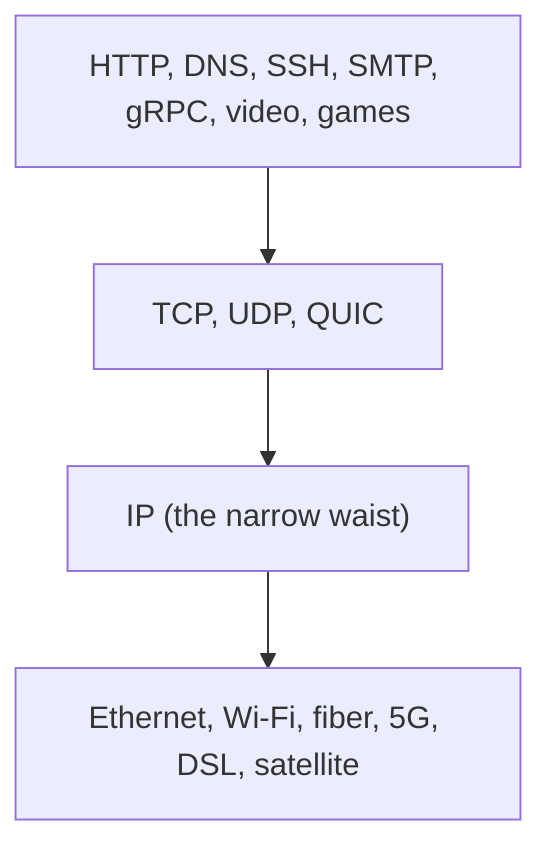

# TCP/IP model

## Summary

The TCP/IP model, also called the Internet protocol suite or the DoD model, is the four-layer architecture on which the Internet is actually built: link (network access), internet, transport and application. It grew out of ARPANET research in the 1970s (Vinton Cerf and Robert Kahn's 1974 paper), became the ARPANET standard on 1 January 1983, and was formalized in RFC 1122 and RFC 1123 (1989). IP at the internet layer provides best-effort delivery between hosts anywhere, TCP and UDP at the transport layer provide process-to-process communication, and everything above is the application's business. This repository's networking area is organized by these layers.

## Prerequisites

- [OSI model](osi-model.md) for the seven-layer vocabulary.

## Core concepts

### Purpose

1. **Standardization**: a common framework so different hardware and software communicate.
2. **Interoperability**: compatibility across devices and platforms.
3. **Simplification**: focus on practical implementation, which made it more widely adopted than OSI.
4. **Internet communication**: the foundation of Internet protocols and applications.

*Analogy.* A shipping company with four departments: customer service writes the order (application), the logistics desk guarantees that all boxes arrive and in order or ships cheap postcards without guarantees (transport: TCP or UDP), the routing department moves boxes between warehouses worldwide (internet), and local drivers carry them on each road (link). The analogy breaks at the "end-to-end principle": in TCP/IP the routing department never opens boxes or repairs them; all intelligence stays at the endpoints.

### The four layers

| Layer | Function | Key responsibilities | Protocols | OSI equivalent |
| --- | --- | --- | --- | --- |
| Application | Communication between applications; end-user services such as email, file transfer, web | Application protocols and data formats, user interaction | HTTP, HTTPS, FTP, SMTP, DNS, SNMP, Telnet, SSH | Application, presentation, session |
| Transport | Data transfer between processes on hosts | Ports, connection setup and teardown (TCP), segmentation and reassembly, error detection and recovery, flow and congestion control | TCP (reliable, connection-oriented), UDP (unreliable, connectionless), QUIC (over UDP) | Transport |
| Internet | Logical addressing and routing across networks | IPv4 and IPv6 addressing, fragmentation and reassembly, routing and forwarding, error reporting | IP, ICMP, IGMP, IPsec | Network |
| Link (network interface, network access) | Transmission on one physical network | Framing IP packets, MAC addressing, error detection in hardware | Ethernet, Wi-Fi, PPP, DSL, ARP | Data link and physical |

**Where ARP belongs.** ARP resolves IP addresses to MAC addresses. Some teaching materials place ARP (and the obsolete RARP) in the internet layer because it serves IP; RFC 1122 treats it as part of the link layer, because ARP messages are not IP packets and never leave the local link. This repository follows RFC 1122 ([ARP](../link-layer/arp.md)).

Some textbooks use a five-layer hybrid (physical, data link, network, transport, application), splitting the link layer in two.

### Data flow

1. **Encapsulation**: data starts at the application layer and moves down; each layer adds its header (the link layer also a trailer).
2. **Decapsulation**: at the receiver, data moves up and each layer removes its header.
3. **Example**: requesting a web page:
   - application layer: HTTP formats the request,
   - transport layer: TCP segments the data and ensures reliable delivery to port 443,
   - internet layer: IP addresses the packets and routes them,
   - link layer: the packets are placed in Ethernet or Wi-Fi frames and transmitted.

```mermaid
sequenceDiagram
  participant App as Application (browser)
  participant TCP as Transport (TCP)
  participant IP as Internet (IP)
  participant Link as Link (Ethernet)
  App->>TCP: HTTP request bytes
  TCP->>IP: segment: ports 51514 -> 443, sequence numbers
  IP->>Link: packet: 192.0.2.10 -> 198.51.100.7, TTL 64
  Link->>Link: frame to the gateway MAC, sent as bits
  Note over Link,App: at the server the steps run in reverse
```

### The hourglass

The suite is often drawn as an hourglass: many link technologies below, many applications above, and a narrow waist of IP (and a few transport protocols) in the middle. Any application can run over any network because both only need to support IP. This is why the Internet survived the move from copper to fiber, Wi-Fi and 5G without changing applications, and why changing IP itself (IPv6) is so slow.



### Advantages and disadvantages

Advantages:

1. **Simplicity**: fewer layers, easier to understand and implement.
2. **Scalability**: designed for large networks, including the Internet.
3. **Interoperability** among devices and protocols.
4. **Flexibility**: applications choose the transport (TCP or UDP) they need.
5. **Real-world focus**: practical implementation over theoretical abstraction.

Disadvantages:

1. **Ambiguity**: several functions in single layers make it less precise than OSI as a teaching model.
2. **IP-centric**: designed for IP networks, little room for non-IP protocols.
3. **Dated design**: from the 1970s and 1980s; QoS, mobility and security were added later (DiffServ, Mobile IP, IPsec, TLS) rather than designed in.
4. **Blurred boundaries**: overlapping responsibilities (for example TLS, NAT, tunnels) complicate troubleshooting.

### TCP/IP compared with OSI

| TCP/IP layer | Corresponding OSI layers |
| --- | --- |
| Application | Application, presentation, session |
| Transport | Transport |
| Internet | Network |
| Link (network interface) | Data link, physical |

## Worked example

Observe all four layers of one HTTP request in a packet capture. Untested; tcpdump on Linux, checked 2026-11.

```bash
sudo tcpdump -n -e -c 1 -i eth0 'tcp dst port 80 and tcp[tcpflags] & tcp-push != 0' &
curl -s http://example.com/ -o /dev/null
```

Output (shortened, one line split for reading):

```text
52:54:00:aa:00:10 > 00:00:5e:00:01:01, ethertype IPv4 (0x0800),          <- link: MAC addresses, EtherType
192.0.2.10.51514 > 93.184.215.14.80:                                      <- internet: IP addresses; transport: ports
Flags [P.], seq 1:76, ack 1, win 502, length 75: HTTP: GET / HTTP/1.1     <- transport: TCP flags; application: HTTP
```

Each layer's header is visible: the frame's MAC addresses (link), the IP addresses (internet), the ports and TCP flags (transport) and the HTTP request line (application).

## Trade offs and when to use it

- **Design and debug with TCP/IP layers**, because real stacks (the Linux kernel, cloud networking) are built that way.
- **Use OSI numbers in conversation** when tools and vendors do ("L4 or L7 load balancer").

## Common mistakes

- **Assuming TCP/IP means only TCP.** UDP, ICMP and QUIC are equally part of the suite.
- **Expecting the network to fix errors.** IP is best effort; reliability comes from TCP or the application.

## Practice

1. Which OSI layers does the TCP/IP application layer cover?
2. Why is IP called the narrow waist of the Internet?
3. In which TCP/IP layer does RFC 1122 place ARP, and why?

Answers:

1. Application, presentation and session.
2. All applications and all link technologies meet at one protocol, IP, so either side can change independently.
3. The link layer, because ARP messages are carried directly in link frames and never cross routers.

## Further reading

- [RFC 1122: Requirements for Internet Hosts, Communication Layers](https://www.rfc-editor.org/rfc/rfc1122) (IETF, 1989).
- [RFC 1123: Requirements for Internet Hosts, Application and Support](https://www.rfc-editor.org/rfc/rfc1123) (IETF, 1989).
- "A Protocol for Packet Network Intercommunication" (Vinton G. Cerf, Robert E. Kahn, IEEE Transactions on Communications, 1974): the original TCP/IP design.
- *TCP/IP Illustrated, Volume 1*, 2nd edition (Fall, Stevens, Addison-Wesley, 2011).
