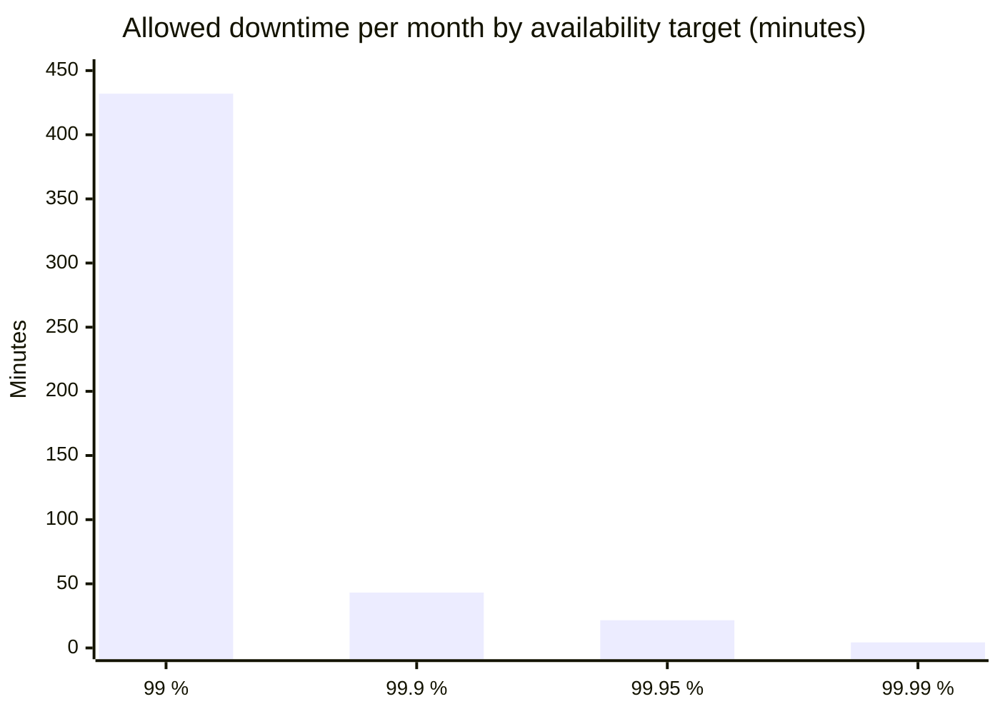
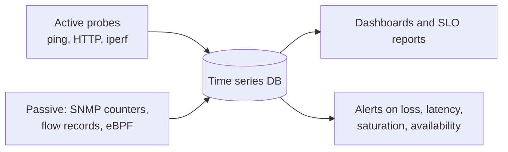

# Network metrics

## Summary

Network key performance indicators (KPIs) are goal-oriented metrics that measure and benchmark how a network operates and show where to act to reach target performance and meet service level agreements (SLAs). The core technical metrics are latency (one-way or round-trip), jitter, packet loss, bandwidth usage and throughput, availability and connectivity; on top of them sit connection time, server and application response time, mean time to repair (MTTR) and QoS-based metrics. Measured continuously and correlated with application metrics, they separate "the network is slow" from "the server is slow".

## Prerequisites

- [Monitoring](../../observability/monitoring.md) and [Network tools](network-tools.md).

## Core concepts

### Definition

Network KPIs measure and benchmark network operation and tell network professionals what to do to reach optimal performance, raise service levels and set and meet SLAs. They are business-oriented: each one answers a question a user or contract cares about.

*Analogy.* A city's traffic dashboard. Travel time between two points (latency), how much travel times vary (jitter), how many cars never arrive (packet loss), how full the roads are (bandwidth usage), how many cars actually get through per hour (throughput) and whether roads are open at all (availability). The analogy breaks on loss: lost cars are a disaster, while lost packets are routinely resent, at the cost of time.

### Metrics

| Metric | Definition | Why it matters |
| --- | --- | --- |
| Application layer latency | Time between application request and response pairs (for example HTTP request to response) | Directly drives application performance and user experience |
| Bandwidth usage (utilization) | Share of link capacity in use | Finds saturated links to address with upgrades, traffic redirection, load balancing or shaping |
| Connection time | Time to establish a connection between two devices (TCP handshake, plus TLS) | Reveals connection, server or path problems that slow everything |
| Connectivity | Whether nodes and devices can reach each other | Detects broken links and failing devices early; faulty devices, misconfiguration and occasionally malware-infected nodes degrade parts of the network |
| Mean time to repair (MTTR) | Average time from failure to restored service | Often written into SLAs; shortened by detailed monitoring with actionable alerts and automated remediation |
| Network availability | Uptime over a defined period | Shows how reliably key services are delivered; historical trends reveal recurring causes |
| Network latency | Time for data to travel from one point to another (one-way delay) | Base of every interactive experience |
| Jitter | Variation in latency between packets | Critical for voice and video; buffers hide only small variation |
| Packet loss | Share of packets that never arrive | Causes retransmissions, lower throughput, choppy calls |
| QoS metrics | SLA metrics combining bandwidth, connectivity, availability, latency and loss per traffic class | Prioritize bandwidth for sensitive services such as VoIP |
| Response time | Time for a request to reach a device and get a response | General health indicator from the user's view |
| Round-trip time (RTT) | Time in milliseconds for a request (such as a ping) to return from a remote device | Easiest latency measure; doubles one-way delay on symmetric paths |
| Server response time | Time for a server to receive, complete and answer a request | Separates server slowness from network slowness |
| Throughput | Amount of data successfully delivered per unit of time (often called goodput when only useful data counts) | Low throughput despite free bandwidth usually means loss, high RTT or small TCP windows |

Throughput, latency and loss are linked: for a single TCP connection, throughput is bounded roughly by window size divided by RTT, and by the Mathis formula about `MSS / (RTT x sqrt(loss))`. Even 1 percent loss on a long path cuts a single connection's throughput dramatically.

### Availability numbers

| Availability | Downtime per year | Downtime per month (30 days) |
| --- | --- | --- |
| 99 percent | 3.65 days | 7.2 hours |
| 99.9 percent | 8.76 hours | 43.2 minutes |
| 99.99 percent | 52.6 minutes | 4.3 minutes |
| 99.999 percent | 5.26 minutes | 26 seconds |



### Measuring

- **Active measurement**: send probes (ping, TCP connects, HTTP checks, synthetic transactions, iperf throughput tests) and measure the answers. Example tools: Prometheus blackbox exporter, smokeping, `mtr`, cloud network monitoring.
- **Passive measurement**: observe real traffic (SNMP interface counters, NetFlow and IPFIX or sFlow, packet captures, TCP statistics in eBPF). It reflects real users but needs traffic to exist.



## Worked example

Measure the key metrics between two hosts. Untested; iputils, mtr and iperf3 on Linux, checked 2026-11.

```bash
ping -c 100 -i 0.2 198.51.100.20 | tail -2
# 100 packets transmitted, 99 received, 1% packet loss
# rtt min/avg/max/mdev = 11.8/12.6/31.2/2.1 ms      <- RTT and jitter (mdev)
mtr -rwc 100 198.51.100.20        # per-hop loss and latency: where does loss start?
iperf3 -c 198.51.100.20 -t 20     # throughput with one TCP stream
iperf3 -c 198.51.100.20 -t 20 -P 8   # with 8 parallel streams
curl -so /dev/null -w 'connect=%{time_connect} tls=%{time_appconnect} ttfb=%{time_starttransfer}\n' https://app.example.com/
```

Interpreting a result such as 1 percent loss, 12.6 ms RTT, 380 Mbit/s with one stream and 920 Mbit/s with eight: the link is not saturated, but loss limits each TCP stream, so look for the lossy hop with `mtr` rather than buying more bandwidth.

## Trade offs and when to use it

- **Averages** are easy but hide spikes; use percentiles and loss over time windows.
- **Probes from many locations** (synthetic monitoring) reflect user experience better than measurements inside the data center.
- **Fine-grained flow data** is valuable for capacity planning and security but costly to store at full resolution.

## Common mistakes

- **Using ping as the only health signal.** ICMP may be deprioritized or blocked while TCP works. Fix: TCP and HTTP probes too.
- **Reading high utilization as the cause of slowness without checking loss and latency.** Fix: look at all metrics together.
- **Measuring throughput with a single stream on long paths.** It understates link capacity. Fix: parallel streams and tuned TCP windows.

## Practice

1. What is the difference between bandwidth and throughput?
2. Why does jitter matter more for VoIP than for file downloads?
3. How much downtime per month does 99.9 percent availability allow?

Answers:

1. Bandwidth is the capacity of the link; throughput is the data actually delivered per unit of time.
2. Voice is played in real time with small buffers, so variable delay causes gaps; downloads only care about total time.
3. About 43 minutes.

## Further reading

- [RFC 7680: A One-Way Loss Metric for IP Performance Metrics](https://www.rfc-editor.org/rfc/rfc7680) (IETF, 2016) and the IETF IPPM working group documents.
- [Prometheus blackbox exporter](https://github.com/prometheus/blackbox_exporter) (Prometheus project).
- "The Macroscopic Behavior of the TCP Congestion Avoidance Algorithm" (Mathis, Semke, Mahdavi, Ott, ACM SIGCOMM CCR, 1997).
- [iperf3 documentation](https://software.es.net/iperf/) (ESnet).
