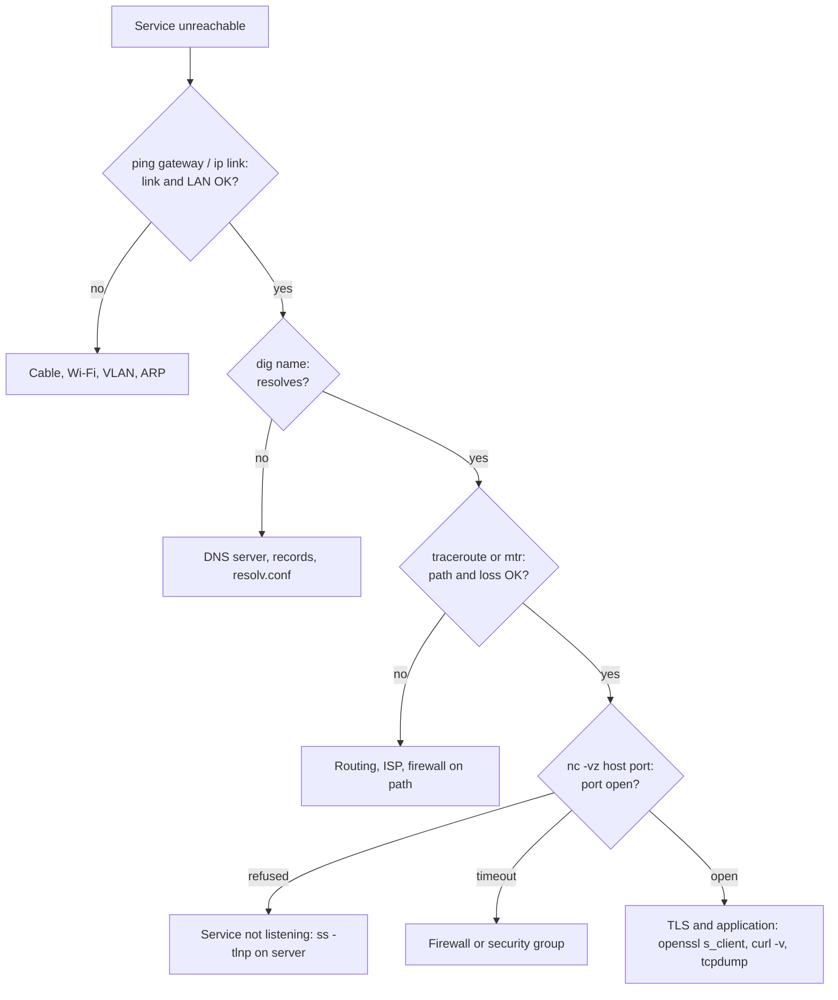

# Network tools

## Summary

Network tools are utilities to monitor, analyze, troubleshoot, secure and manage networks. They fall into six groups: monitoring (Zabbix, Nagios, Cacti, SolarWinds NPM), diagnostics (ping, traceroute, netstat or ss, dig, nslookup), security (Nmap, OpenVAS), performance (iperf), packet analysis (Wireshark, tcpdump) and management and access (OpenSSH, PuTTY, WireGuard, netcat). Used systematically, layer by layer, they turn "the network is broken" into a precise finding such as "DNS works, TCP 443 is filtered after hop 6".

## Prerequisites

- [Networking overview](../networking-overview.md), [Ports](../transport-layer/ports.md).

## Core concepts

### Categories

1. **Monitoring tools** track performance and detect issues over time: Zabbix, Nagios ([Nagios](../../observability/monitoring-tools/nagios.md)), Cacti, SolarWinds Network Performance Monitor.
2. **Diagnostic tools** identify and resolve problems: ping, traceroute, netstat and ss, dig, nslookup.
3. **Security tools** assess vulnerabilities: Nmap, OpenVAS (Greenbone).
4. **Performance tools** measure bandwidth and throughput: iperf.
5. **Packet analysis tools** inspect traffic in depth: Wireshark, tcpdump.
6. **Management and access tools** configure and reach devices: PuTTY, OpenSSH, WireGuard.

*Analogy.* A mechanic's toolbox: a quick check light (ping), a road map of the route (traceroute), a stethoscope on the engine (tcpdump and Wireshark), a dynamometer (iperf), a security inspection checklist (Nmap, OpenVAS) and the dashboard gauges watched over months (monitoring systems). The analogy breaks because network problems often sit outside your car, on someone else's road, so tools must be run from several vantage points.



### Tools

**Wireshark.** Graphical packet analyzer that captures and decodes packets of hundreds of protocols. Uses: troubleshooting, protocol analysis, detecting suspicious activity. Usage: select an interface, start a capture, apply display filters such as `http`, `tcp.port == 443` or `dns.qry.name contains "example"`. It can also open captures taken elsewhere with tcpdump.

**Nmap (Network Mapper).** Network scanner and security auditing tool: discovers hosts and services, identifies open ports and versions, maps topology, supports vulnerability assessment with scripts. Use only on networks you own or are authorized to test.

```bash
nmap -sS -p 80,443 192.0.2.1        # TCP SYN scan of two ports (needs root)
nmap -sV -p- 192.0.2.1              # all ports with service version detection
```

**Ping.** Tests whether a host is reachable with ICMP echo and measures round-trip time; diagnoses connectivity and latency. `ping 8.8.8.8`. A missing reply can also mean ICMP is filtered.

**Traceroute.** Shows the path packets take, hop by hop, by sending probes with increasing TTL; diagnoses routing problems and locates delays. `traceroute example.com` (Windows: `tracert`). `mtr` combines it with continuous ping statistics.

**Netstat.** Displays connections, listening ports, routing tables and interface statistics: `netstat -an`. On Linux it is deprecated in favor of `ss -tulpn` (sockets) and `ip route` and `ip -s link` (routes, interfaces).

**Tcpdump.** Command-line packet capture: real-time traffic analysis and debugging, with Berkeley Packet Filter expressions. `tcpdump -i eth0 port 80`, or `tcpdump -i eth0 -w capture.pcap host 192.0.2.10` to save for Wireshark.

**Iperf.** Measures bandwidth and throughput between two nodes to find bottlenecks. iperf3 is the current, incompatible successor of iperf2:

```bash
iperf3 -s                 # on the server
iperf3 -c 192.0.2.20      # on the client; add -R for reverse direction, -u for UDP
```

**Netcat (nc).** Versatile utility for testing ports, simple transfers and debugging, for example a quick chat server:

```bash
nc -l 12345               # listener (traditional netcat: nc -l -p 12345)
nc 192.0.2.20 12345       # connect to it
nc -vz 192.0.2.20 443     # test whether a TCP port is open
```

**Nslookup.** DNS query tool, available on Windows by default: `nslookup example.com`. Good for quick checks.

**Dig.** Detailed DNS lookups from BIND: query specific record types and servers, check propagation and DNSSEC. `dig example.com A`, `dig @1.1.1.1 example.com MX +short`, `dig +trace example.com` ([DNS overview](../application-layer/dns/dns-overview.md)).

**PuTTY.** Terminal emulator for Windows providing SSH, Telnet and serial connections for managing servers and network devices: enter the host, choose SSH, connect. Modern Windows also ships OpenSSH and Windows Terminal.

**WireGuard.** A modern VPN protocol for secure point-to-point tunnels with simple configuration: `wg-quick up wg0` ([VPN](../network-security/vpn.md)).

**OpenVAS (Greenbone Community Edition).** Vulnerability scanner for networks and systems, used for assessments and compliance audits; scans are configured and run through the web interface. Authorized use only.

**SolarWinds Network Performance Monitor.** Commercial enterprise monitoring with performance insights, topology maps, alerts and dashboards. (SolarWinds' Orion platform was the target of the 2020 supply chain compromise, CVE-2020-10148 and related, a reminder that monitoring tools are high-value targets.)

**Cacti.** Open source graphing tool on RRDtool that polls SNMP counters to visualize traffic and resource use for capacity planning and historical analysis: add devices and data sources, then watch trends.

**OpenSSH.** Suite for encrypted remote access and file transfer (ssh, scp, sftp, ssh-keygen): `ssh user@server` ([SSH](../application-layer/ssh.md)).

## Worked example

A user reports that `https://app.example.com` times out. Diagnosis from their machine (untested; Linux tools, checked 2026-11; output illustrative):

```bash
dig +short app.example.com            # 198.51.100.40  -> DNS works
ping -c 3 198.51.100.40               # 3 received, 24 ms -> host reachable by ICMP
nc -vz 198.51.100.40 443              # timed out -> TCP 443 not reachable
mtr -rwc 20 -T -P 443 198.51.100.40   # TCP traceroute: probes stop after the provider edge
sudo tcpdump -ni eth0 host 198.51.100.40 and port 443
# SYN sent, no SYN-ACK and no RST -> dropped silently, typical of a firewall
```

Conclusion: name resolution and routing work, but TCP 443 is dropped. Next step on the server side: `ss -tlnp | grep 443` (is it listening?), then the security group or firewall rules for 443.

## Trade offs and when to use it

- **CLI tools** are scriptable and available on servers; **GUI tools** (Wireshark) speed up deep analysis of captures.
- **Active scanners** find exposure but can disturb fragile systems and must be authorized.
- **Point-in-time diagnostics** solve incidents; **continuous monitoring** catches trends and intermittent problems.

## Common mistakes

- **Concluding a host is down because ping fails.** ICMP is often filtered. Fix: test the actual service port.
- **Capturing without filters on busy links.** Huge files and dropped packets. Fix: capture filters and ring buffers (`-C`, `-W`).
- **Scanning third-party networks.** It can be illegal. Fix: written authorization.

## Practice

1. Which tool would you use to see whether port 5432 is reachable from a pod?
2. What is the difference between tcpdump capture filters and Wireshark display filters?
3. Why use `mtr -T -P 443` instead of plain traceroute?

Answers:

1. `nc -vz host 5432` (or a TCP probe such as `curl telnet://host:5432`).
2. Capture filters (BPF) decide which packets are recorded at all; display filters only hide packets in an existing capture.
3. It probes with TCP to port 443, which follows the same firewall rules as real traffic, while ICMP or UDP probes may be treated differently.

## Further reading

- [Wireshark User's Guide](https://www.wireshark.org/docs/wsug_html_chunked/) (Wireshark Foundation).
- [Nmap Reference Guide](https://nmap.org/book/man.html) (Gordon Lyon).
- [tcpdump and libpcap documentation](https://www.tcpdump.org/) (The Tcpdump Group).
- [iperf3](https://software.es.net/iperf/) (ESnet).
- [Greenbone Community Edition documentation](https://greenbone.github.io/docs/latest/) (Greenbone).
