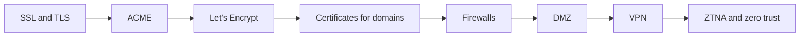

# Network security

Controls that protect networks and traffic: TLS encryption and certificate automation, firewalls, DMZ designs, VPNs and zero trust access.

## Map

The diagram shows the notes in reading order; subareas are marked with (subarea).

## Notes in reading order

1. [SSL and TLS](ssl-and-tls.md): versions, handshake, cryptography and certificates.
2. [ACME](acme.md): the protocol for automated certificate issuance, challenges, ARI and clients.
3. [Let's Encrypt](lets-encrypt.md): the free ACME CA, chains of trust, profiles, lifetimes and rate limits.
4. [Certificates for domains](domain-certificates.md): validation, CAA and challenge records, Certificate Transparency and automation.
5. [Firewalls](firewalls.md): types, policies, features and host firewalls.
6. [DMZ](dmz.md): architectures, mechanisms and attack mitigations.
7. [VPN](vpn.md): types, protocols, encryption and leaks.
8. [ZTNA and zero trust](ztna.md): microsegmentation and identity-based access.

## Planned topics

- Intrusion detection and prevention (Suricata, Zeek)
- DDoS protection
- Network access control and 802.1X
- Public key infrastructure for internal CAs
