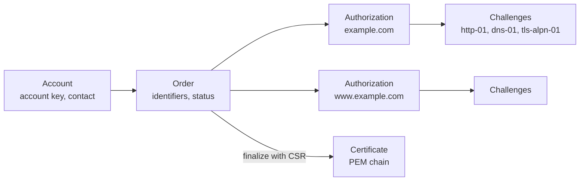
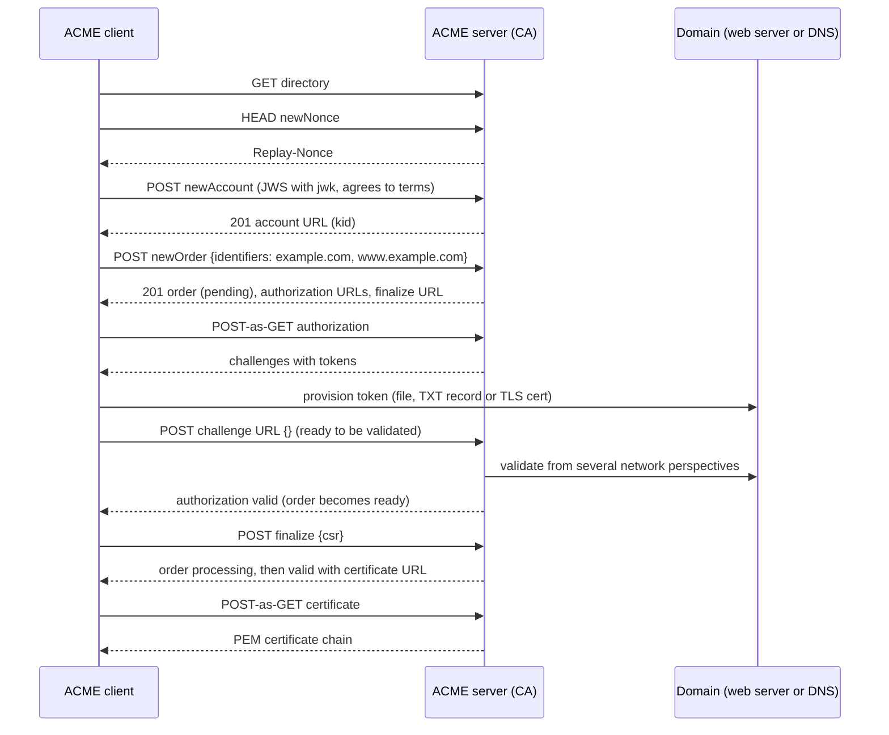
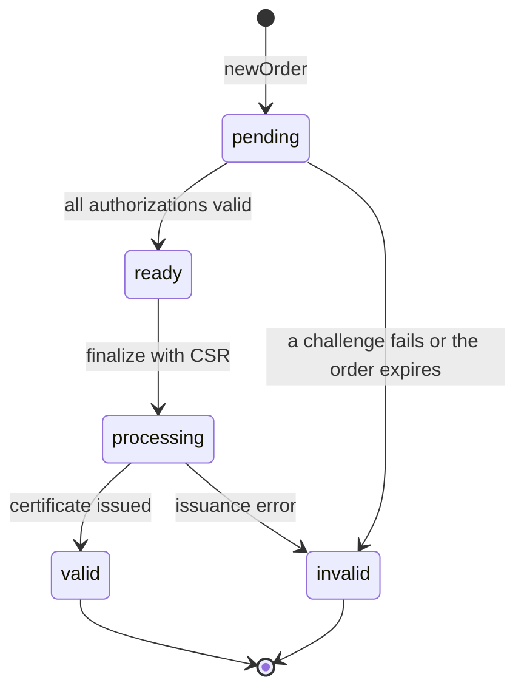
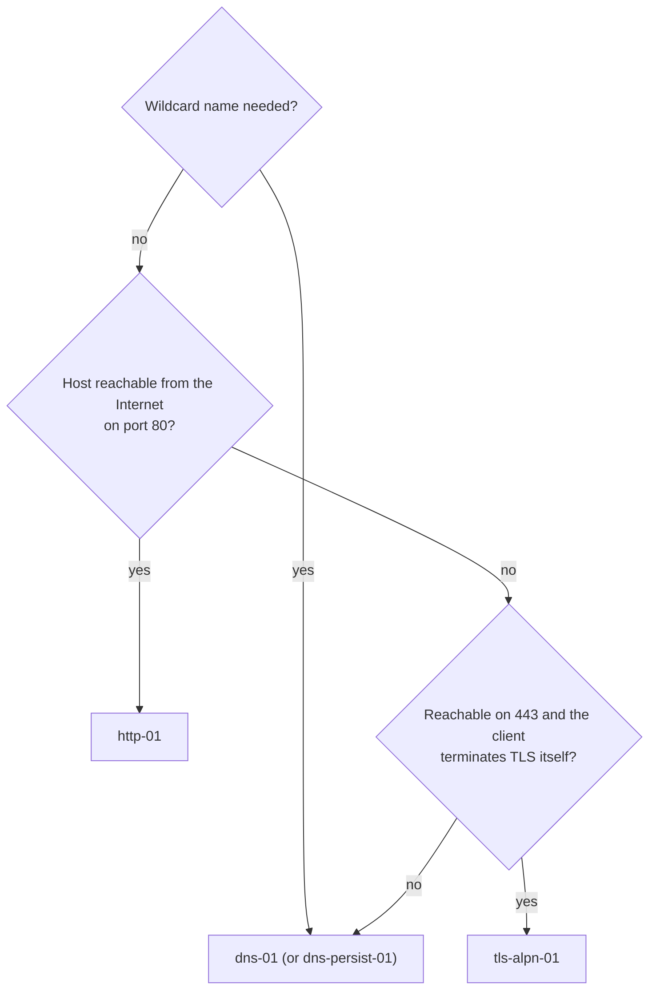

# ACME

## Summary

The Automatic Certificate Management Environment (ACME, RFC 8555, 2019) is the protocol that lets software obtain, renew and revoke X.509 certificates from a certificate authority (CA) without human involvement. A client registers an account key with the CA, places an *order* for a set of domain names, proves control of each name by answering a *challenge* (publishing a token over HTTP at `/.well-known/acme-challenge/`, in a DNS TXT record at `_acme-challenge`, or in a special TLS handshake), then sends a certificate signing request and downloads the certificate. Every request is a signed JSON message (JWS) protected against replay with nonces. ACME was built for Let's Encrypt and is now supported by most public CAs and many private ones; extensions add renewal hints (ARI, RFC 9773), IP address identifiers and persistent DNS validation. Because certificate lifetimes are shrinking to 47 days by 2029, ACME automation is no longer optional.

## Prerequisites

- [SSL and TLS](ssl-and-tls.md), in particular the section on certificates.
- [DNS records](../application-layer/dns/dns-records.md) and [HTTP and HTTPS](../application-layer/http-and-https.md).

## Core concepts

### The problem ACME solves

Before ACME, getting a certificate meant generating a key and certificate signing request (CSR) by hand, pasting it into a CA web form, answering an email sent to `admin@` the domain, waiting, downloading the certificate, installing it and putting a reminder in a calendar for next year. The manual process caused two chronic failures: sites without HTTPS because it was too much work, and outages when someone forgot to renew. ACME turns the whole lifecycle into an API that a client runs on a schedule, so certificates can be short-lived and renewed automatically.

*Analogy.* A parcel locker with a pickup code. You order online (the order), the shop sends a code to your phone number on file and you prove you control that phone by typing the code into the locker (the challenge), and the locker opens (issuance). Nobody at a counter checks your identity. The analogy breaks on what is proven: the locker proves you control a phone, ACME proves you control a *domain name* at the moment of validation, nothing about who you are, which is why ACME certificates are domain validated (DV).

### Actors and resources

- **ACME client**: the software that requests certificates (Certbot, acme.sh, lego, Caddy, Traefik, cert-manager, win-acme).
- **ACME server**: the CA's API (Boulder at Let's Encrypt, Pebble for testing, step-ca and HashiCorp Vault PKI for private CAs).
- **Account**: a key pair registered with the server; every request is signed with the account key. The account key is not the certificate key.
- **Directory**: the single URL a client needs; a JSON document listing all other endpoints.

```json
{
  "newNonce":   "https://acme.example/acme/new-nonce",
  "newAccount": "https://acme.example/acme/new-acct",
  "newOrder":   "https://acme.example/acme/new-order",
  "revokeCert": "https://acme.example/acme/revoke-cert",
  "keyChange":  "https://acme.example/acme/key-change",
  "renewalInfo": "https://acme.example/acme/renewal-info",
  "meta": {
    "termsOfService": "https://acme.example/terms",
    "caaIdentities": ["acme.example"],
    "externalAccountRequired": false,
    "profiles": { "classic": "default profile", "shortlived": "six-day certificates" }
  }
}
```

The resource model:



The diagram shows the hierarchy: an account places orders, each order needs one authorization per identifier, each authorization offers several challenge types of which the client completes one, and a finalized order yields the certificate.

### The issuance flow



The sequence follows RFC 8555 section 7: account creation, order, authorizations and challenges, finalization with a CSR, and download.

**Order and authorization states.** An order moves `pending` (authorizations not yet valid) to `ready` (all authorizations valid) to `processing` (after finalize) to `valid` (certificate available), or to `invalid` if any authorization fails or the order expires. Authorizations are `pending`, `valid`, `invalid`, `deactivated`, `expired` or `revoked`. A valid authorization can be reused for later orders for a CA-specific period; this reuse period is itself being shortened by the CA/Browser Forum (see [Certificates for domains](domain-certificates.md)).



### Message security: JWS, nonces and POST-as-GET

Every ACME request except fetching the directory and nonces is an HTTP POST with a JSON Web Signature (JWS, RFC 7515) body in flattened JSON serialization:

```json
{
  "protected": "base64url({\"alg\":\"ES256\",\"kid\":\"https://acme.example/acme/acct/123\",\"nonce\":\"oFvnlFP1wIhRlYS2jTaXbA\",\"url\":\"https://acme.example/acme/new-order\"})",
  "payload":   "base64url({\"identifiers\":[{\"type\":\"dns\",\"value\":\"example.com\"}]})",
  "signature": "base64url(ES256 signature over protected.payload)"
}
```

- **`jwk` or `kid`**: the first request (`newAccount`) carries the public key (`jwk`); later requests carry the account URL (`kid`).
- **`nonce`**: a value from the server's `Replay-Nonce` header, usable once; the server rejects reused nonces (`badNonce`), which stops replay attacks. Every response carries a fresh nonce for the next request.
- **`url`**: the exact URL the request is for, so a signed request cannot be redirected to another endpoint.
- **POST-as-GET**: reading a resource (order, authorization, certificate) is a POST with an empty payload `""`, so that even reads are authenticated.

Errors are problem documents (RFC 7807) with types such as `urn:ietf:params:acme:error:rateLimited`, `badNonce`, `unauthorized`, `dns`, `connection`, `caa`.

### Challenge types

Each challenge proves control of the identifier in a different way. All use a *key authorization*: the challenge token concatenated with the base64url-encoded SHA-256 thumbprint of the account key (`token.thumbprint`), which binds the proof to the account that requested it.

| Challenge | Defined in | Proof | Port or record | Wildcards | Typical use |
| --- | --- | --- | --- | --- | --- |
| `http-01` | RFC 8555 | File at `http://<domain>/.well-known/acme-challenge/<token>` containing the key authorization | TCP 80 (redirects to HTTPS are followed) | No | Single web servers, reverse proxies |
| `dns-01` | RFC 8555 | TXT record at `_acme-challenge.<domain>` with `base64url(SHA-256(key authorization))` | DNS | Yes | Wildcards, internal hosts, hosts without port 80 |
| `tls-alpn-01` | RFC 8737 | TLS handshake on port 443 with ALPN `acme-tls/1` returning a self-signed certificate with an `acmeIdentifier` extension holding the hash | TCP 443 | No | TLS terminators that cannot use port 80 (Caddy, Traefik) |
| `dns-persist-01` | IETF draft, CA/B Forum ballot SC-088v3 (2025) | Long-lived TXT record at `_validation-persist.<domain>` naming the CA and the account URI | DNS | With `policy=wildcard` | Many short-lived certificates without per-issuance DNS changes |

Validation is done by the CA from several network locations (*multi-perspective issuance corroboration*), so an attacker who hijacks traffic or BGP routes near one vantage point cannot obtain a certificate.



The decision tree summarizes the table: dns-01 works everywhere but needs DNS API access; http-01 and tls-alpn-01 need the host to be reachable by the CA.

**http-01 details.** The CA connects to port 80 of every address in the domain's A and AAAA records; if IPv6 fails, validation can fail even if IPv4 works. It follows up to 10 redirects, to HTTP or HTTPS on ports 80 or 443, and ignores certificate errors on those redirects (Let's Encrypt behavior, checked 2026-11). Behind a load balancer, every backend must serve the token, or the token must be served by the load balancer.

**dns-01 details.** The CA queries the authoritative servers through its own resolvers, following CNAMEs. This allows *delegation*: `_acme-challenge.example.com CNAME example.com.acme.example.net.` lets a client update a record in a separate, low-value zone (for example run with acme-dns) instead of holding API credentials for the main zone. TXT records must have propagated to all authoritative servers before the client asks for validation; clients wait and check.

### The certificate signing request and keys

The client generates the certificate key pair (separate from the account key), creates a CSR listing exactly the identifiers of the order, and sends it base64url-encoded DER in the finalize request. Recommended keys: ECDSA P-256 (smaller, faster handshakes) or RSA 2048 for compatibility with old clients. The CA ignores most CSR fields and builds the certificate from its own profile.

### Renewal, revocation and account management

- **Renewal** is simply a new order. Clients traditionally renew when about one third of the lifetime remains (day 60 of 90).
- **ACME Renewal Information (ARI, RFC 9773, 2025)**: the server publishes a suggested renewal window per certificate at the `renewalInfo` endpoint; clients poll it (unauthenticated GET) and renew at a random time inside the window. This spreads load and lets a CA ask clients to renew early before a mass revocation. Let's Encrypt exempts ARI-coordinated renewals from rate limits (checked 2026-11). With certificate lifetimes shrinking, a fixed "renew at 60 days" rule stops working; ARI or a "renew at two thirds of the lifetime" rule is required.
- **Revocation**: `revokeCert` with the certificate, signed either by the account that owns it or by the certificate's private key (useful after key compromise), with a reason code (for example 1, `keyCompromise`).
- **Account key rollover**: `keyChange` with a request signed by both the old and the new key.
- **Deactivation**: an account or an authorization can be deactivated.

### Extensions and related specifications

| Specification | Adds |
| --- | --- |
| RFC 8737 | The `tls-alpn-01` challenge |
| RFC 8738 | IP address identifiers (certificates for IP addresses) |
| RFC 8739 | Short-term, automatically renewed (STAR) certificates for delegated use |
| RFC 8657 | CAA parameters `accounturi` and `validationmethods`, which restrict issuance to one ACME account and chosen challenge types |
| RFC 9773 | ACME Renewal Information (ARI) |
| External Account Binding (RFC 8555 section 7.3.4) | Links an ACME account to an existing customer account with a MAC key; required by commercial CAs such as ZeroSSL, Google Trust Services, Sectigo and DigiCert |
| Profiles (IETF draft, deployed at Let's Encrypt) | Lets the client choose a certificate profile, for example a shorter lifetime |
| dns-persist-01 (IETF draft) | Persistent DNS authorization (see the table above) |

### Clients and servers

| Client | Strength |
| --- | --- |
| Certbot (EFF) | Reference client, plugins for nginx and Apache, many DNS plugins |
| acme.sh | Pure shell, more than 100 DNS provider APIs, no dependencies |
| lego | Single Go binary, used inside Traefik |
| Caddy | Web server with built-in ACME (http-01, tls-alpn-01, dns-01 through modules), on-demand TLS |
| cert-manager | Kubernetes controller: `Issuer`, `ClusterIssuer` and `Certificate` resources, ingress integration |
| win-acme, Posh-ACME | Windows and IIS |

| Server | Use |
| --- | --- |
| Boulder | Let's Encrypt's production CA |
| Pebble | Miniature test server for client development; deliberately randomizes behavior |
| step-ca (Smallstep), Vault PKI secrets engine (1.14+), EJBCA | Private CAs with ACME, for internal services |

## Worked example

Obtain a certificate with dns-01 and observe each protocol step. Untested; lego 4.x and the Let's Encrypt staging environment, checked 2026-11. The DNS provider and its token are placeholders; the staging CA issues untrusted test certificates and has high rate limits.

```bash
export CLOUDFLARE_DNS_API_TOKEN=<TOKEN>          # scoped to edit DNS of one zone
lego --server https://acme-staging-v02.api.letsencrypt.org/directory \
     --email admin@example.com --accept-tos \
     --dns cloudflare \
     --domains example.com --domains '*.example.com' \
     --key-type ec256 \
     run
```

```text
[INFO] acme: Registering account for admin@example.com
[INFO] [*.example.com, example.com] acme: Obtaining bundled SAN certificate
[INFO] [*.example.com] AuthURL: https://acme-staging-v02.api.letsencrypt.org/acme/authz/...
[INFO] [example.com] acme: Preparing to solve DNS-01
[INFO] [example.com] acme: Trying to solve DNS-01
[INFO] [example.com] acme: Checking DNS record propagation ...
[INFO] [example.com] The server validated our request
[INFO] [*.example.com, example.com] acme: Validations succeeded; requesting certificates
[INFO] [*.example.com] Server responded with a certificate.
```

What happened, step by step:

1. lego generated an account key, fetched the directory and a nonce, and created an account (JWS with `jwk`).
2. It created one order with two identifiers. Both authorizations are for the base name `example.com` (the wildcard authorization is for `example.com` with `"wildcard": true`), and both use the same TXT label `_acme-challenge.example.com`, so two TXT values are published at once.
3. It computed `base64url(SHA-256(token.thumbprint))` for each, created the TXT records through the DNS API, and waited until the authoritative servers returned them.
4. It told the CA to validate; the CA queried the TXT records from several locations.
5. It generated an EC P-256 certificate key and CSR, finalized the order, polled until `valid`, and downloaded the chain into `.lego/certificates/`.

Check the TXT record that the CA saw during validation:

```bash
dig +short TXT _acme-challenge.example.com @ns1.example.net
# "d8z5f...base64url..."  "Qm2a...base64url..."
openssl x509 -in .lego/certificates/_.example.com.crt -noout -subject -issuer -dates -ext subjectAltName
```

## Trade offs and when to use it

- **ACME vs manual issuance.** ACME should be the default for any certificate that a machine can renew. Manual issuance remains for OV and EV certificates where the CA's identity checks need human steps, and for devices that cannot run a client.
- **http-01** needs no DNS credentials but needs inbound port 80 on every host; **dns-01** works for wildcards and private hosts but puts DNS write credentials on the machine running the client (mitigate with CNAME delegation or scoped API tokens); **tls-alpn-01** suits TLS terminators that own port 443.
- **Many certificates or one wildcard.** Wildcards reduce the number of orders but spread one private key across many services; per-service certificates limit blast radius.
- **Public ACME CA vs private ACME CA.** Public CAs are trusted everywhere but log every certificate in Certificate Transparency, revealing internal host names; a private ACME CA (step-ca, Vault) keeps names private but needs its root distributed to clients.

## Common mistakes

- **Testing against production.** Repeated failures hit rate limits. Fix: use the staging directory until the setup works.
- **Hard-coded renewal at 60 days** that breaks with shorter lifetimes. Fix: ARI-capable clients, or renew at two thirds of the remaining lifetime.
- **Port 80 blocked or redirected to a host that does not have the token.** Fix: serve `/.well-known/acme-challenge/` on every node or at the load balancer, or switch to dns-01.
- **An AAAA record pointing to a host that does not answer.** The CA prefers IPv6 and validation fails. Fix: correct or remove the AAAA record.
- **DNS API tokens with full account access on every server.** Fix: tokens scoped to one zone, or CNAME delegation of `_acme-challenge` to a dedicated zone.
- **Reloading the server is forgotten**: the certificate is renewed on disk but nginx still serves the old one. Fix: deploy hooks (`--deploy-hook "systemctl reload nginx"`) and expiry monitoring on the live endpoint.
- **Losing the account key** and being unable to revoke. Fix: back up the account key, or revoke with the certificate key.

## Practice

1. What is the difference between the account key and the certificate key?
2. Why does every ACME request carry a nonce and the request URL in the protected header?
3. Which challenge types support wildcard certificates?
4. What does the `_acme-challenge` TXT record contain?
5. What problem does ARI solve, and how does a client use it?
6. Why would you add a CNAME for `_acme-challenge.example.com`?

Answers:

1. The account key signs ACME requests and identifies the subscriber to the CA; the certificate key is the key pair whose public half goes into the certificate and is used by the TLS server.
2. The nonce prevents replaying a captured request; the URL prevents a signed request from being sent to a different endpoint.
3. dns-01, and dns-persist-01 with the wildcard policy; http-01 and tls-alpn-01 cannot.
4. The base64url-encoded SHA-256 hash of the key authorization, which is the challenge token joined with the account key thumbprint.
5. Without it, clients renew at fixed times, all at once and without warning before mass revocations; with ARI, the CA suggests a renewal window per certificate, and the client polls it and renews at a random time inside it.
6. To delegate validation to a separate zone, so the ACME client only needs write access to that zone instead of to the main zone.

## Further reading

- [RFC 8555: Automatic Certificate Management Environment (ACME)](https://www.rfc-editor.org/rfc/rfc8555) (IETF, 2019): the protocol.
- [RFC 8737: ACME TLS ALPN Challenge Extension](https://www.rfc-editor.org/rfc/rfc8737) (IETF, 2020).
- [RFC 9773: ACME Renewal Information (ARI) Extension](https://www.rfc-editor.org/rfc/rfc9773) (IETF, 2025).
- [RFC 8657: CAA Record Extensions for Account URI and ACME Method Binding](https://www.rfc-editor.org/rfc/rfc8657) (IETF, 2019).
- [Challenge Types](https://letsencrypt.org/docs/challenge-types/) (Let's Encrypt): practical behavior of each challenge.
- [DNS-PERSIST-01: A New Model for DNS-based Challenge Validation](https://letsencrypt.org/2026/02/18/dns-persist-01.html) (Let's Encrypt, 2026).
- [ACME client implementations](https://letsencrypt.org/docs/client-options/) (Let's Encrypt).
