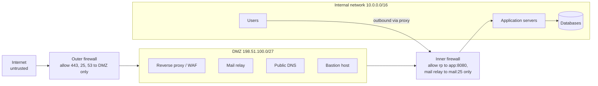

# DMZ

## Summary

A demilitarized zone (DMZ), also called a perimeter network or screened subnet, is a separate network segment that holds an organization's internet-facing services (web, mail, DNS, VPN gateways, bastion hosts) between the untrusted Internet and the trusted internal network. Firewalls allow the Internet to reach only specific services in the DMZ and allow the DMZ to reach only specific internal systems, so a compromised public server is not a foothold into the whole company. Designs range from one three-legged firewall through two firewalls in series to air-gapped zones with data diodes. In clouds the same pattern is built with public and private subnets, security groups, load balancers and web application firewalls.

## Prerequisites

- [Firewalls](firewalls.md) and [NAT](../internet-layer/nat.md).
- [Reverse proxy](../traffic-management/reverse-proxy.md).

## Core concepts

### Definition and goal

A DMZ is a security boundary that isolates external-facing services from the internal network and acts as a buffer zone between an untrusted network and a trusted one. Its goals are to minimize attack vectors and limit exposure of critical systems: an attacker who compromises a DMZ service must still pass further controls to reach internal systems. It is a direct application of defense in depth.

Use cases:

- **Security isolation**: lower risk of external threats reaching the internal network.
- **Controlled access**: only specific inbound and outbound flows, by policy.
- **Minimized attack surface**: no direct communication between external users and internal systems.
- **Limiting lateral movement**: a compromised DMZ server cannot freely reach internal resources.

*Analogy.* The reception area of a secure building. Visitors (Internet users) may enter the lobby, meeting rooms and the mail room (DMZ services), but a second locked door with a guard (inner firewall) separates them from the offices; even the receptionist can open it only for specific deliveries. The analogy breaks because in networks the "visitors" are often automated and hostile at scale, so the lobby must assume constant attack.

### Architecture models

**Single firewall (three-legged) DMZ.** One firewall with three interfaces: Internet (untrusted), internal network (trusted) and a separate DMZ subnet. Internet users reach the public services in the DMZ; any access to internal resources is decided by the same firewall's rules.

- Pros: simpler setup, less hardware.
- Cons: a single point of failure and compromise; if the firewall is breached or misconfigured, the internal network is exposed. Less security than a dual-firewall design.

**Dual firewall DMZ.** Two firewalls in series, ideally from different vendors:

- the *outer (edge) firewall* separates the Internet from the DMZ,
- the *inner (core) firewall* separates the DMZ from the internal network.

External users reach DMZ services through the outer firewall; a DMZ service that needs internal data must pass the inner firewall.

- Pros: DMZ traffic is filtered twice; the internal network stays isolated even if the DMZ is compromised.
- Cons: more complex configuration and management, more hardware or software.

**Air-gapped DMZ.** The DMZ has no network connection to the internal network at all. Data moves by manual or tightly controlled methods (one-way data diodes, controlled transfer stations), with any remote access through strongly authenticated channels (VPN with MFA). Used in critical infrastructure (power plants, defense, financial institutions) and highly sensitive environments.

- Pros: no direct attack path; complete isolation of critical systems.
- Cons: operational complexity; real-time communication is hard.



### Security mechanisms

**Firewall rules and ACLs.** Access control lists restrict traffic between zones, with default deny:

- allow HTTP(S) only to the web server,
- block all inbound requests to the internal network by default,
- allow DMZ services to answer legitimate requests (stateful firewalls handle return traffic automatically),
- restrict DMZ outbound traffic too, so a compromised server cannot download tools or exfiltrate freely.

Cisco ACL example (documentation addresses):

```text
access-list 100 permit tcp any host 198.51.100.10 eq 443
access-list 100 deny   ip  any 10.0.0.0 0.0.255.255
```

**Network address translation.** *Static NAT* maps a public IP to a DMZ server; *port forwarding* exposes only necessary ports (for example 443) on a shared public address. Cisco example:

```text
ip nat inside source static tcp 198.51.100.10 443 interface GigabitEthernet0/1 443
```

**Intrusion detection and prevention (IDS/IPS).** IDS monitors and alerts on suspicious activity; IPS blocks it inline. Example rules: detect brute-force login attempts, block repeated failed SSH connections, flag exploit signatures against DMZ services.

**Reverse proxy and load balancing.** A reverse proxy (nginx, Apache HTTP Server, HAProxy) in the DMZ hides backend infrastructure, enforces security (TLS termination, rate limiting, WAF rules) and distributes traffic:

```nginx
server {
    listen 443 ssl;
    server_name example.com;
    ssl_certificate     /etc/ssl/example.com.crt;
    ssl_certificate_key /etc/ssl/example.com.key;
    location / {
        proxy_pass http://10.0.1.10:8080;      # internal application, reachable only from the proxy
        proxy_set_header Host $host;
    }
}
```

**VPN access control.** Remote users and partners reach internal resources through a VPN gateway in the DMZ: TLS-based VPNs (OpenVPN), WireGuard, IPsec VPNs, or zero trust network access (ZTNA) for granular, per-application access ([VPN](vpn.md), [ZTNA](ztna.md)).

### Common DMZ services

| Service | Purpose | Examples |
| --- | --- | --- |
| Web server or reverse proxy | Public-facing applications | nginx, Apache, IIS |
| Mail server or relay | External email | Postfix, Exchange Edge |
| DNS server | Authoritative public DNS | BIND, Unbound, PowerDNS |
| Proxy server | Intermediary for outbound or inbound traffic | Squid, HAProxy |
| Bastion host | Hardened jump host for remote administration | OpenSSH with MFA |
| FTP or SFTP | File exchange with partners | vsftpd, OpenSSH SFTP |
| VPN gateway | Encrypted access to internal resources | OpenVPN, WireGuard, IPsec |

### Attack vectors and mitigations

| Attack | Description | Mitigation |
| --- | --- | --- |
| DDoS | Floods DMZ services to cause downtime | Rate limiting, load balancing, cloud DDoS protection (Cloudflare, AWS Shield) |
| SQL injection | Attacks databases through web services | WAF, input validation, parameterized queries |
| Zero-day exploits | Exploits unknown vulnerabilities | Patching, segmentation, IDS/IPS, minimal services |
| Man in the middle | Intercepts sensitive data | HTTPS everywhere, HSTS, strong TLS configuration |
| Lateral movement | A compromised DMZ host pivots inward | Strict inner firewall rules, jump hosts, segmentation, egress filtering |

### Cloud and virtualized DMZ

- **Cloud DMZ**: public subnets with internet-facing load balancers and private subnets for applications; security groups and network ACLs in AWS VPC or Azure VNet; cloud WAFs (AWS WAF, Azure Front Door, Cloudflare).
- **Virtualized DMZ**: VMware NSX, Cisco ACI or other SDN micro-segmentation create software-defined DMZs that scale and are automated.

### Example setup

Components: internet (edge) firewall, DMZ with public services (web, DNS, mail), internal (core) firewall, internal network.

Traffic flows:

- **Inbound**: Internet, edge firewall, filtered access to DMZ services; only defined DMZ services may call specific internal systems through the core firewall.
- **Outbound**: internal users, core firewall, allowed DMZ services (such as an outbound proxy), Internet.

## Worked example

A firewall rule matrix for a dual-firewall DMZ (documentation addresses):

| # | Source | Destination | Port | Action | Reason |
| --- | --- | --- | --- | --- | --- |
| 1 | Internet | DMZ reverse proxy 198.51.100.10 | TCP 443 | Allow | Public web |
| 2 | Internet | DMZ mail relay 198.51.100.11 | TCP 25 | Allow | Inbound email |
| 3 | Admin VPN pool 10.8.0.0/24 | DMZ bastion 198.51.100.12 | TCP 22 | Allow | Administration with MFA |
| 4 | DMZ reverse proxy | App servers 10.0.1.0/24 | TCP 8080 | Allow | Only path inward for web |
| 5 | DMZ mail relay | Internal mail 10.0.2.5 | TCP 25 | Allow | Mail delivery |
| 6 | Internal users | DMZ proxy | TCP 3128 | Allow | Outbound web via proxy |
| 7 | DMZ any | Internet | any | Deny except updates repository | Egress control |
| 8 | Any | Any | any | Deny and log | Default deny |

Verification from outside and inside (only against your own systems):

```bash
nmap -Pn -p 1-1024 198.51.100.10          # from the Internet: only 443 open
nc -vz 10.0.1.20 5432                      # from the DMZ proxy: must fail (database not reachable)
```

## Trade offs and when to use it

- **Single firewall** suits small sites with limited budgets; **dual firewall** is the standard for regulated environments; **air gap** only where the risk justifies the operational cost.
- **Zero trust** reduces reliance on perimeter zones by authenticating every request, but DMZ-style segmentation remains a valuable layer.
- **Managed edge services** (CDN, WAF, DDoS protection) move part of the DMZ to the provider.

## Common mistakes

- **Allowing DMZ hosts broad access inward** ("the app needs the database, open 10.0.0.0/8"). Fix: one rule per required flow.
- **No egress filtering from the DMZ.** Fix: deny by default, allow only updates and required destinations.
- **Putting databases in the DMZ.** Fix: keep data stores internal, behind the inner firewall.
- **Unmonitored DMZ.** Fix: centralized logging and IDS on all DMZ traffic.

## Practice

1. Why is a dual-firewall DMZ more secure than a single firewall?
2. Which services typically live in a DMZ, and which do not?
3. Why filter outbound traffic from the DMZ?

Answers:

1. Traffic is filtered twice by independent devices, so a single misconfiguration or compromise does not expose the internal network.
2. Reverse proxies, mail relays, public DNS, VPN gateways and bastion hosts live there; databases, internal applications and user workstations do not.
3. To stop a compromised DMZ host from downloading attack tools, contacting command and control servers or exfiltrating data.

## Further reading

- [NIST SP 800-41 Rev. 1: Guidelines on Firewalls and Firewall Policy](https://csrc.nist.gov/pubs/sp/800/41/r1/final) (NIST, 2009): firewall architectures including DMZs.
- [CIS Critical Security Controls v8](https://www.cisecurity.org/controls) (Center for Internet Security): network infrastructure management and boundary defense.
- [AWS: public and private subnets](https://docs.aws.amazon.com/vpc/latest/userguide/configure-subnets.html) (Amazon Web Services): the cloud form of a DMZ.
