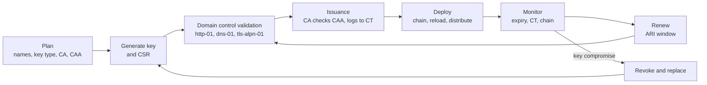
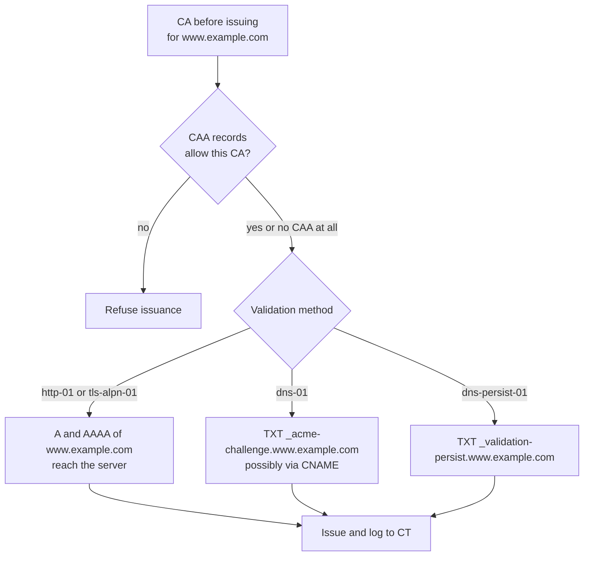

# Certificates for domains

## Summary

A TLS certificate for a domain is the public statement that a key belongs to a set of DNS names, signed by a certificate authority (CA) after it verified that the requester controls those names. Getting one right involves more than the certificate itself: DNS records decide who can validate (A and AAAA records for http-01, `_acme-challenge` TXT records for dns-01) and which CAs may issue at all (CAA records); Certificate Transparency logs make every issued certificate public and let owners detect misissuance; ACME automates issuance and renewal; and monitoring, key management and deployment complete the lifecycle. This note connects these pieces end to end for a DevOps engineer who must run certificates for many domains and services, as lifetimes shrink toward 47 days.

## Prerequisites

- [SSL and TLS](ssl-and-tls.md) for X.509 certificates, chains and the handshake.
- [DNS records](../application-layer/dns/dns-records.md) and [DNS security](../application-layer/dns/dns-security.md).
- [ACME](acme.md) and [Let's Encrypt](lets-encrypt.md).

## Core concepts

### The certificate lifecycle

A certificate is not a file you install once; it is a process with a loop.



The diagram shows the stages. The loop between monitoring, renewal and validation now repeats every few weeks, which is why every stage must be automated.

*Analogy.* A passport for a website. The issuing office (CA) checks your claim against an authoritative register (DNS), the passport lists exactly which names it covers (SAN), it expires and must be renewed, a public register records every passport issued (Certificate Transparency), and a notice at the border (CAA) can say "only accept passports from these offices". The analogy breaks on validation: a passport office checks who you are, while a domain validated certificate only checks that you control the domain at that moment, so anyone who gains control of your DNS or web server can get a valid certificate for your name.

### What a domain certificate contains

| Field | Rule for domain certificates |
| --- | --- |
| Subject Alternative Name (SAN) | The authoritative list of names; browsers ignore the Common Name. Up to 100 names at Let's Encrypt, other CAs vary |
| Wildcard SAN | `*.example.com` matches exactly one label: `api.example.com`, not `example.com` and not `a.b.example.com` |
| Key | ECDSA P-256 (default choice) or RSA 2048 to 4096 |
| Validity | At most 200 days from 15 March 2026, 100 days from 15 March 2027, 47 days from 15 March 2029 (CA/B Forum SC-081v3) |
| Extended key usage | `serverAuth`; public CAs are removing `clientAuth` from server certificates |
| Embedded SCTs | Signed certificate timestamps proving the certificate was submitted to Certificate Transparency logs |
| CRL distribution point | Where revocation status is published (OCSP is being retired by several CAs) |

Validation levels:

| Level | CA verifies | Automation | Use |
| --- | --- | --- | --- |
| Domain validated (DV) | Control of each domain name | Fully automatic (ACME) | The default for almost everything |
| Organization validated (OV) | Domain control plus the legal organization | Partly manual, then ACME with External Account Binding | Contracts or policies requiring organization identity |
| Extended validation (EV) | Strict organization vetting | Partly manual | Rare today; browsers no longer show EV prominently |

### Domain control validation

CAs must validate each name using one of the methods in the CA/Browser Forum Baseline Requirements (section 3.2.2.4). The methods that ACME implements:

| Baseline Requirements method | ACME challenge | DNS records involved |
| --- | --- | --- |
| 3.2.2.4.19 Agreed-upon change to website (ACME) | `http-01` | A and AAAA records of the name must reach the web server |
| 3.2.2.4.7 DNS change | `dns-01` | TXT at `_acme-challenge.<name>`, possibly through a CNAME |
| 3.2.2.4.20 TLS using ALPN | `tls-alpn-01` | A and AAAA records of the name must reach the TLS server |
| 3.2.2.4.22 DNS TXT record with persistent value (ballot SC-088v3, 2025) | `dns-persist-01` | TXT at `_validation-persist.<name>` naming the CA and account |

TODO: verify the Baseline Requirements section numbers against the current version of the Baseline Requirements.

Other methods (email to addresses from WHOIS or to `admin@`, phone) are manual, and the CA/Browser Forum has been removing the weakest of them after incidents such as WHOIS servers of abandoned TLDs being taken over by researchers in 2024. The CA validates from several network perspectives (multi-perspective issuance corroboration, required by the Baseline Requirements since 2025; TODO: verify the effective date and required number of perspectives), so a local BGP or DNS hijack near one vantage point is not enough to obtain a certificate.

How long a validation can be reused for later certificates is also being shortened by SC-081v3: from 398 days to 10 days by 2029. In practice, every issuance will soon need a fresh validation.

### DNS records that matter for certificates



The diagram shows the order in which a CA consults DNS: CAA first, then the records the chosen validation method needs.

**CAA records** (Certification Authority Authorization, RFC 8659) say which CAs may issue for a domain. CAs must check them since September 2017.

```text
example.com.  3600 IN CAA 0 issue "letsencrypt.org"
example.com.  3600 IN CAA 0 issue "pki.goog; cansignhttpexchanges=yes"
example.com.  3600 IN CAA 0 issuewild ";"
example.com.  3600 IN CAA 0 iodef "mailto:security@example.com"
```

| Tag | Meaning |
| --- | --- |
| `issue` | CAs allowed to issue any certificate for the name; `";"` allows none |
| `issuewild` | CAs allowed to issue wildcard certificates; overrides `issue` for wildcards |
| `iodef` | Where CAs may report refused requests that violate the policy |
| Flag `128` (critical) | The CA must refuse if it does not understand the tag |

Rules that surprise people:

- **Tree climbing.** For `www.example.com` the CA looks for CAA at `www.example.com`; if there is none, at `example.com`; it stops at the first name with a CAA record set. A CAA record on a subdomain replaces, not extends, the parent's policy.
- **CNAMEs are followed.** If `shop.example.com` is a CNAME to `shops.saas.example.net`, the CAA of the target applies unless `shop.example.com` has its own (the exact algorithm is in RFC 8659 section 3).
- **No CAA means any CA** may issue.
- **DNS errors block issuance.** If the authoritative servers return SERVFAIL for CAA queries (for example broken DNSSEC), CAs must refuse.
- **Binding to an account and method** (RFC 8657): `0 issue "letsencrypt.org; accounturi=https://acme-v02.api.letsencrypt.org/acme/acct/123456; validationmethods=dns-01"` restricts issuance to one ACME account and to dns-01, so an attacker who controls the web server but not the account cannot obtain a certificate.

**ACME challenge records.** dns-01 needs a TXT record at `_acme-challenge.<name>` for every name; for `*.example.com` the label is `_acme-challenge.example.com`. Short TTLs (60 to 300 seconds) help when a validation must be repeated. To avoid giving every ACME client write access to the production zone, delegate the label once:

```text
_acme-challenge.example.com.      IN CNAME  example.com.acme-validation.example.net.
_acme-challenge.www.example.com.  IN CNAME  www.example.com.acme-validation.example.net.
```

The ACME client then updates only the small `acme-validation.example.net` zone (for example run with acme-dns or a provider API token scoped to that zone).

**DNSSEC** protects all of these records from forgery between the authoritative servers and the CA's resolvers; CAs validate DNSSEC when it is present ([DNS security](../application-layer/dns/dns-security.md)).

**TLSA records (DANE, RFC 6698 and RFC 7671)** publish, under DNSSEC, which certificate or key a service must present, for example `_25._tcp.mail.example.com TLSA 3 1 1 <hash>`. DANE is used for SMTP between mail servers (RFC 7672); browsers do not use it. A TLSA record must be updated before a key changes, so key rotation and TLSA updates must be coordinated (publish the new hash first, rotate, then remove the old hash).

### Certificate Transparency

Certificate Transparency (CT, RFC 6962) requires CAs to submit every publicly trusted certificate to several independent, append-only logs before or at issuance. The log returns a signed certificate timestamp (SCT), which is embedded in the certificate; browsers such as Chrome and Safari reject certificates without enough SCTs from qualified logs.

Consequences for domain owners:

- **Detection.** Anyone can search the logs (crt.sh, Censys, SSLMate Cert Spotter) and owners can subscribe to alerts for their domains, catching misissued certificates and forgotten shadow IT.
- **Exposure.** Every name in every public certificate becomes public within minutes, including `staging-payments-v2.internal.example.com`. Attackers watch CT logs to find new hosts. Use wildcards or a private CA for names that should not be published.

```bash
# List certificates logged for a domain and its subdomains (crt.sh JSON API)
curl -s 'https://crt.sh/?q=%25.example.com&output=json' \
  | jq -r '.[] | [.not_before, .issuer_name, .name_value] | @tsv' | sort -u | tail
```

### Keys, wildcards and where certificates live

| Decision | Options | Guidance |
| --- | --- | --- |
| Key type | ECDSA P-256, RSA 2048 | ECDSA by default; RSA only for old clients. Some servers can serve both |
| Key reuse on renewal | New key each time, or reuse | A new key per renewal limits the life of a stolen key; reuse only when keys are pinned (TLSA 3 1 1 with planned rollover) |
| Wildcard vs per-name | `*.example.com`, or a SAN per service | Wildcards hide names from CT and reduce orders, but one key then serves many services; prefer per-service certificates where keys are spread across systems |
| Where TLS terminates | Load balancer, ingress, service mesh, application | Fewer termination points means fewer keys to protect and rotate; managed load balancer certificates (cloud-managed) renew themselves |
| Private CA | Internal ACME CA (step-ca, Vault PKI), service mesh CA | For internal names, mTLS and names that must not appear in CT |

### Automation patterns

| Environment | Pattern |
| --- | --- |
| Single server | Certbot or acme.sh with a systemd timer and a deploy hook that reloads the server |
| Web server with built-in ACME | Caddy, Traefik: certificates are obtained on first request and renewed automatically |
| Kubernetes | cert-manager: an `Issuer` or `ClusterIssuer` (ACME, Vault, private CA) and `Certificate` resources, or annotations on `Ingress` and `Gateway` objects; secrets are updated in place |
| Cloud load balancers and CDNs | Provider-managed certificates (AWS Certificate Manager, Google-managed certificates, CDN-managed TLS) validated through DNS CNAMEs |
| Many domains, one platform | A central certificate service that issues per tenant, with CNAME delegation of `_acme-challenge` and a second ACME CA as fallback |

A cert-manager example (cert-manager 1.x, checked 2026-11, untested):

```yaml
apiVersion: cert-manager.io/v1
kind: ClusterIssuer
metadata:
  name: letsencrypt-dns
spec:
  acme:
    server: https://acme-v02.api.letsencrypt.org/directory
    email: admin@example.com
    privateKeySecretRef:
      name: letsencrypt-account-key       # the ACME account key
    solvers:
      - dns01:
          cloudflare:
            apiTokenSecretRef:
              name: cloudflare-api-token   # token scoped to one zone
              key: api-token
---
apiVersion: cert-manager.io/v1
kind: Certificate
metadata:
  name: example-com
  namespace: web
spec:
  secretName: example-com-tls             # where the key and chain are stored
  dnsNames: ["example.com", "*.example.com"]
  privateKey:
    algorithm: ECDSA
    size: 256
    rotationPolicy: Always                # new key on every renewal
  issuerRef:
    kind: ClusterIssuer
    name: letsencrypt-dns
```

### Monitoring

Certificates fail in a few predictable ways, and each has a check:

| Failure | Check |
| --- | --- |
| Expiry | Probe every public endpoint: `probe_ssl_earliest_cert_expiry` (Prometheus blackbox exporter); alert when less than one third of the lifetime remains |
| Renewed on disk but not deployed | Compare the serial served on the endpoint with the newest issued certificate |
| Incomplete or wrong chain | `openssl s_client -showcerts`, SSL Labs; clients without intermediate fetching fail |
| Name mismatch | Probe each name, including `www` and the apex |
| Unexpected issuance | CT monitoring for your domains |
| CAA or DNS breakage | Synthetic `dig CAA` and `dig TXT _acme-challenge` checks; ACME client error logs |

## Worked example

Set up a domain so that only one ACME account at one CA can issue certificates, using DNS validation through a delegated zone, and verify each piece. Untested; dig 9.18, OpenSSL 3.0, acme.sh 3.x, checked 2026-11. Names, account numbers and tokens are placeholders.

1. Publish the CAA policy (in the `example.com` zone):

   ```text
   example.com.  3600 IN CAA 0 issue "letsencrypt.org; accounturi=https://acme-v02.api.letsencrypt.org/acme/acct/123456; validationmethods=dns-01"
   example.com.  3600 IN CAA 0 issuewild "letsencrypt.org; accounturi=https://acme-v02.api.letsencrypt.org/acme/acct/123456; validationmethods=dns-01"
   example.com.  3600 IN CAA 0 iodef "mailto:security@example.com"
   ```

2. Delegate the challenge label to a validation zone that the ACME host may edit:

   ```text
   _acme-challenge.example.com. 300 IN CNAME example.com.acme-validation.example.net.
   ```

3. Issue with acme.sh using a DNS API token scoped to `acme-validation.example.net`:

   ```bash
   acme.sh --issue --dns dns_cf -d example.com -d '*.example.com' \
           --challenge-alias acme-validation.example.net --keylength ec-256
   ```

4. Verify:

   ```bash
   dig +short CAA example.com
   dig +short CNAME _acme-challenge.example.com
   echo | openssl s_client -connect example.com:443 -servername example.com 2>/dev/null \
     | openssl x509 -noout -issuer -enddate -ext subjectAltName,ct_precert_scts | head -20
   ```

What each step buys:

| Threat | Mitigated by |
| --- | --- |
| Another CA tricked into issuing (for example through a compromised registrar email) | CAA `issue` limited to one CA |
| An attacker who controls the web server requests a certificate through http-01 | `validationmethods=dns-01` |
| An attacker with their own Let's Encrypt account and DNS write access to a subzone | `accounturi` binding |
| A stolen ACME host credential edits the production zone | CNAME delegation: the token can only edit the validation zone |
| A misissued certificate goes unnoticed | `iodef` reports and CT monitoring |

## Trade offs and when to use it

- **Strict CAA with account binding** stops many misissuance paths but makes a CA switch or a new ACME account a DNS change first; keep a documented fallback (a second CA in CAA, ready but unused).
- **dns-01 everywhere** gives one uniform method (wildcards, private hosts) at the cost of DNS API credentials; **http-01** avoids credentials but requires inbound reachability.
- **Public CA vs private CA**: public certificates work in every client but expose names in CT; private CAs keep names private but require trust distribution and their own operations.
- **Managed certificates** (cloud load balancers, CDNs) remove the work entirely, but tie the certificate to that service and do not cover other endpoints.

## Common mistakes

- **A CAA record that omits the CA you actually use** (or a subdomain CAA that unexpectedly overrides the parent). Issuance fails at renewal time. Fix: inventory CAs before publishing CAA, test with the staging CA.
- **Wildcard assumptions.** `*.example.com` does not cover `example.com` or `a.b.example.com`. Fix: list the apex explicitly and use separate wildcards per level.
- **Internal names in public certificates.** They appear in CT logs. Fix: wildcard or private CA.
- **Broken DNSSEC** causing SERVFAIL for CAA lookups, which blocks all issuance. Fix: DNSSEC monitoring.
- **Serving only the leaf certificate.** Some clients cannot build the chain. Fix: serve the full chain.
- **No expiry monitoring on the live endpoint.** Fix: blackbox probes per name.
- **TLSA records not updated before key rotation.** DANE-validating mail servers stop delivering. Fix: publish the new key's hash before rotating.

## Practice

1. Which DNS records does a CA consult before issuing a certificate validated with dns-01?
2. `example.com` has `CAA 0 issue "letsencrypt.org"` and `shop.example.com` has `CAA 0 issue "pki.goog"`. Can Let's Encrypt issue for `shop.example.com`?
3. What does `validationmethods=dns-01` in a CAA record protect against?
4. Why might you not want a public certificate for `admin-staging.example.com`?
5. Which names does `*.example.com` cover?
6. What is an SCT, and why do browsers require it?

Answers:

1. CAA (with tree climbing and CNAME following) and the TXT record at `_acme-challenge.<name>` (following a CNAME if present); DNSSEC records if the zone is signed.
2. No. The CA stops at the first CAA record set found, which is the one at `shop.example.com`, and it allows only Google Trust Services.
3. Against someone who can serve files on the web server or answer on port 443 obtaining a certificate through http-01 or tls-alpn-01.
4. Certificate Transparency makes the name public, which reveals internal infrastructure to attackers.
5. Any name with exactly one label in place of the asterisk, such as `www.example.com` or `api.example.com`, but not `example.com` or `a.b.example.com`.
6. A signed certificate timestamp: a log's promise that the certificate has been added to a Certificate Transparency log. Browsers require it so that every trusted certificate is publicly auditable.

## Further reading

- [Baseline Requirements for TLS Server Certificates](https://cabforum.org/working-groups/server/baseline-requirements/documents/) (CA/Browser Forum): validation methods, lifetimes, CAA processing.
- [RFC 8659: DNS Certification Authority Authorization (CAA) Resource Record](https://www.rfc-editor.org/rfc/rfc8659) (IETF, 2019).
- [RFC 8657: CAA Record Extensions for Account URI and ACME Method Binding](https://www.rfc-editor.org/rfc/rfc8657) (IETF, 2019).
- [RFC 6962: Certificate Transparency](https://www.rfc-editor.org/rfc/rfc6962) (IETF, 2013) and [certificate.transparency.dev](https://certificate.transparency.dev/) (Google).
- [RFC 7671: The DANE Protocol: Updates and Operational Guidance](https://www.rfc-editor.org/rfc/rfc7671) (IETF, 2015).
- [cert-manager documentation](https://cert-manager.io/docs/) (cert-manager project, CNCF).
- [Certificate Authority Authorization (CAA)](https://letsencrypt.org/docs/caa/) (Let's Encrypt).
