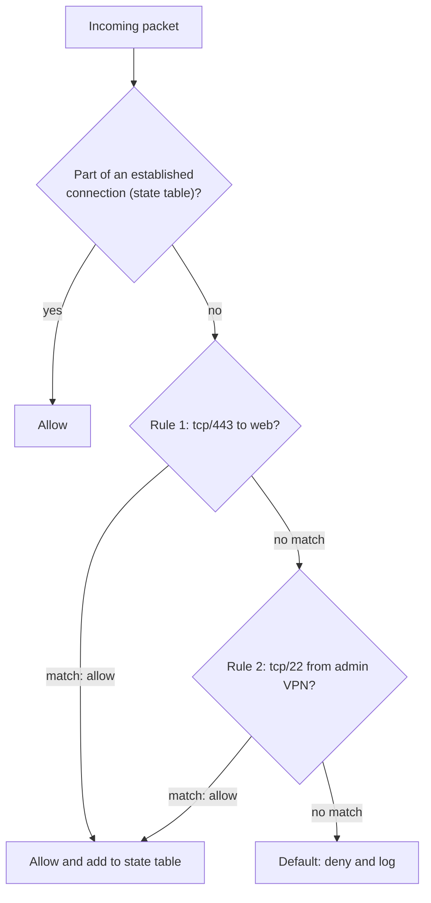

# Firewalls

## Summary

A firewall is a security control, in hardware, software or both, that monitors network traffic and allows or blocks it according to rules, forming a barrier between networks of different trust (for example the Internet and an internal network) and between internal zones. Firewalls evolved from stateless packet filters that read IP and port headers, through stateful firewalls that track connections, to proxy firewalls, next-generation firewalls (NGFWs) with application awareness and intrusion prevention, web application firewalls (WAFs) for HTTP, and cloud-native firewalls such as security groups. The policy model matters as much as the product: default deny, least privilege and regular rule review.

## Prerequisites

- [IP](../internet-layer/ip.md), [Ports](../transport-layer/ports.md), [OSI model](../network-models/osi-model.md).

## Core concepts

### Definition and purpose

A firewall monitors and controls network traffic based on predetermined rules and acts as a barrier between a trusted internal network and untrusted external networks such as the Internet. It is a hardware device, a software application or both, enforcing security policy by filtering inbound and outbound traffic. Its purpose is to prevent unauthorized access, protect sensitive data and mitigate threats such as malware, intrusions and denial-of-service attacks.

*Analogy.* Border control at an airport. Officers check every traveler against rules (passport, visa, banned items), remember who left so they can return (stateful tracking), and some officers also open suitcases (deep packet inspection). The analogy breaks inside the building: once past border control, a classic perimeter firewall no longer checks movement between gates, which is why internal segmentation and zero trust matter ([ZTNA](ztna.md)).

### How it works

1. **Traffic monitoring**: packets entering or leaving the network are checked against the rules.
2. **Packet filtering**: header fields (source and destination IP, ports, protocol) decide whether to allow or block.
3. **Stateful inspection**: modern firewalls track active connections and judge packets in the context of their session, so return traffic of allowed connections passes automatically.
4. **Rule enforcement**: rules permit or deny by IP address, port, protocol, user or application. Rules are evaluated in order; the first match wins (in most products), and a final default rule applies.



### Types

| Type | Layer | Description | Pros | Cons |
| --- | --- | --- | --- | --- |
| Packet-filtering (stateless) | 3 and 4 | Checks each packet's headers against rules | Lightweight and fast | Limited; no content inspection; return traffic needs explicit rules |
| Stateful inspection | Up to 4 | Packet filtering plus connection state tracking | Secure handling of return traffic, standard today | No application awareness |
| Proxy firewall (application gateway) | 7 | Intermediary that terminates connections and inspects content with application-specific rules | Deep control | Slower, protocol-specific |
| Next-generation firewall (NGFW) | 3 to 7 | Deep packet inspection, intrusion prevention, application and user awareness, antivirus, anti-malware, URL filtering, TLS inspection | Broad protection | Cost, complexity, performance cost of inspection |
| Web application firewall (WAF) | 7 (HTTP) | Protects web applications against SQL injection, cross-site scripting and other OWASP Top 10 attacks | Application-specific defense | False positives, needs tuning; does not fix vulnerable code |
| Cloud firewall | 3 to 7 | Virtual firewalls for cloud networks: security groups, network ACLs, managed firewalls (AWS Network Firewall, Azure Firewall, Google Cloud NGFW) | Scales with the cloud, API-driven | Provider-specific |
| Hardware firewall | Varies | Dedicated appliances for enterprise networks, for example Cisco ASA or Firepower, Palo Alto Networks, Fortinet FortiGate | High throughput, central perimeter | Cost, physical management |
| Software (host) firewall | Varies | Runs on individual devices or servers, for example Windows Defender Firewall, iptables or nftables, firewalld, ufw | Protection per host, also inside the network | Must be managed on every host |

### Key features

1. **Access control**: rules allow or block by IP, port, protocol, application or user.
2. **NAT**: hides internal addresses behind public ones ([NAT](../internet-layer/nat.md)); not a security control by itself.
3. **VPN support**: secure remote connections and site-to-site tunnels ([VPN](vpn.md)).
4. **Intrusion detection and prevention (IDS/IPS)**: identifies and blocks malicious traffic with signatures and anomaly detection.
5. **Logging and monitoring**: records traffic for analysis and compliance.
6. **Deep packet inspection (DPI)**: examines payloads beyond headers for advanced filtering (requires TLS inspection for encrypted traffic).

### Use cases

1. **Perimeter security** of enterprise networks against external threats.
2. **Internal segmentation** between departments or zones ([DMZ](dmz.md)).
3. **Web application protection** with WAFs in front of web servers.
4. **Cloud security** for VMs, containers and workloads.
5. **Remote work** with integrated VPN access.

### Policies

1. **Default deny**: block everything not explicitly allowed. Recommended for maximum security.
2. **Default allow**: allow everything not explicitly blocked. Easier but risky; any forgotten service is exposed.
3. **Least privilege**: users and systems get only the access their tasks require, applied to rules as narrowly scoped sources, destinations and ports.

### Best practices

1. **Regular updates** of firmware and software to fix vulnerabilities (firewall and VPN appliances are frequent attack targets).
2. **Rule optimization**: review and remove outdated, redundant, shadowed or overly broad rules periodically; record an owner and reason per rule.
3. **Logging and alerts** for suspicious activity, forwarded to a SIEM.
4. **Segmentation** into smaller zones to limit lateral movement.
5. **Configuration backups** and configuration as code with review.
6. **Egress filtering**: restrict outbound traffic too, not only inbound.

### Advantages and disadvantages

Advantages: better security against unauthorized access and attacks, visibility into traffic patterns, support for regulatory compliance, and central control of network security policy.

Disadvantages: cost of high-end appliances; complexity, since misconfiguration creates holes or outages; added latency; and no complete protection, especially against insiders, phishing-based compromise or attacks inside allowed traffic.

### Firewalls in DevOps

1. **Container security**: control traffic between containers and external systems (Docker manages iptables rules; published ports bypass ufw rules unless configured otherwise).
2. **Microservices**: Kubernetes NetworkPolicies restrict pod-to-pod communication.
3. **Cloud environments**: security groups and cloud firewalls protect VPCs and workloads, managed as code.
4. **CI/CD security**: restrict unauthorized outbound connections from build runners to limit supply chain attacks and exfiltration.

## Worked example

A default-deny host firewall with nftables for a web server. Untested; nftables 1.0 on Debian 12, checked 2026-11. Warning: applying a default-drop policy over SSH without an allow rule for your session locks you out; test with a console or a timed rollback.

```text
#!/usr/sbin/nft -f
flush ruleset
table inet filter {
  chain input {
    type filter hook input priority 0; policy drop;          # default deny
    ct state established,related accept                     # return traffic (stateful)
    ct state invalid drop
    iif "lo" accept
    meta l4proto { icmp, ipv6-icmp } accept                  # ping, PMTUD, IPv6 neighbor discovery
    tcp dport { 80, 443 } accept                             # public web
    ip saddr 10.8.0.0/24 tcp dport 22 accept                 # SSH only from the admin VPN
    log prefix "nft-drop: " limit rate 10/minute
  }
  chain forward { type filter hook forward priority 0; policy drop; }
  chain output  { type filter hook output priority 0; policy accept; }
}
```

```bash
sudo nft -c -f /etc/nftables.conf                       # syntax check only
sudo systemd-run --on-active=120 systemctl restart nftables-rollback.service   # example safety net (custom unit)
sudo nft -f /etc/nftables.conf
sudo nft list ruleset
nc -vz 198.51.100.10 22                                  # from outside the VPN: times out (dropped)
```

The `inet` family covers IPv4 and IPv6 in one table, avoiding the classic mistake of protecting only IPv4.

## Trade offs and when to use it

- **Perimeter firewalls** remain necessary but insufficient; combine them with host firewalls, segmentation and zero trust.
- **NGFW inspection** finds threats inside allowed ports at the cost of performance, TLS inspection complexity and privacy concerns.
- **Cloud security groups** are simple and scale but are stateful allow-lists only (no explicit deny in AWS security groups; use network ACLs or a firewall service for that).

## Common mistakes

- **"Any any allow" rules** added during an incident and never removed. Fix: expiry dates and periodic review.
- **Forgetting IPv6.** Fix: rules for both families.
- **Blocking all ICMP.** Breaks path MTU discovery. Fix: allow needed ICMP types.
- **Rules nobody understands.** Fix: comments, owners, configuration as code with tests.

## Practice

1. What does a stateful firewall track that a stateless one does not?
2. Why is default deny recommended?
3. Which firewall type protects against SQL injection in HTTP requests?
4. Why can a firewall not stop an attacker who phished a valid VPN user?

Answers:

1. The state of connections, so it can allow return traffic and reject packets that do not belong to a known session.
2. Anything not explicitly needed is blocked, so forgotten or new services are not exposed by accident.
3. A web application firewall (or an NGFW with application-layer inspection).
4. The traffic is allowed by policy and comes from an authenticated user; firewalls enforce network rules, not intent.

## Further reading

- [NIST SP 800-41 Rev. 1: Guidelines on Firewalls and Firewall Policy](https://csrc.nist.gov/pubs/sp/800/41/r1/final) (NIST, 2009).
- [nftables wiki](https://wiki.nftables.org/) (netfilter project).
- [OWASP Web Application Firewall](https://owasp.org/www-community/Web_Application_Firewall) (OWASP).
- [CIS Benchmarks](https://www.cisecurity.org/cis-benchmarks) (Center for Internet Security): host firewall settings per operating system.
