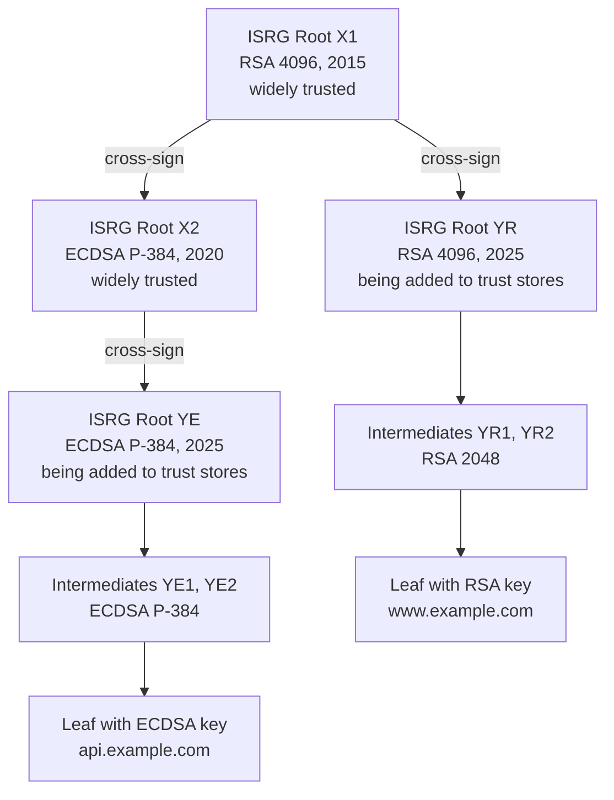
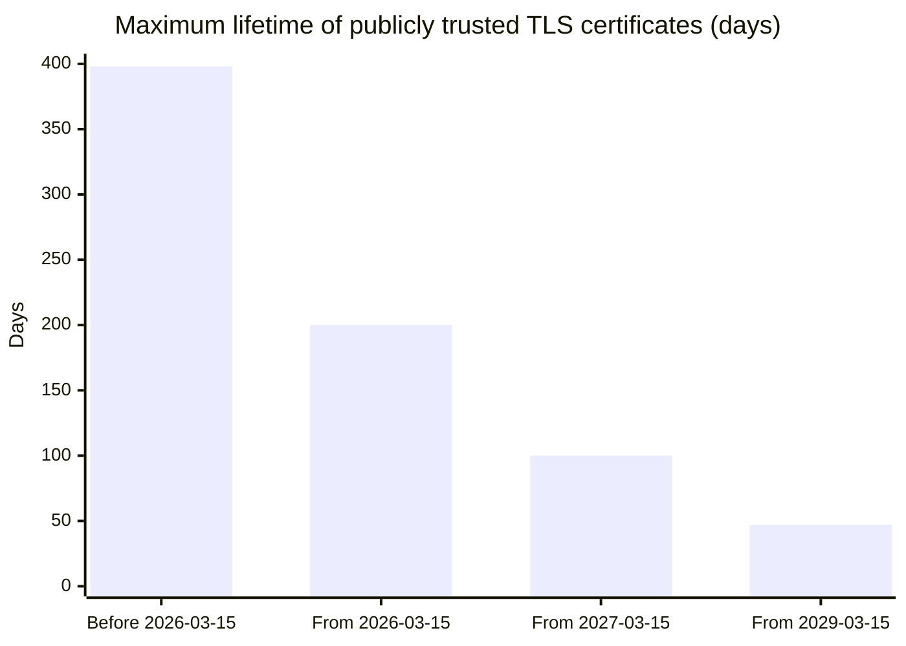

# Let's Encrypt

## Summary

Let's Encrypt is a free, automated and open certificate authority (CA) run by the nonprofit Internet Security Research Group (ISRG). Since its public launch in 2015 it has issued domain validated (DV) TLS certificates exclusively through the ACME protocol, which it co-designed, and it is the largest CA on the web by number of certificates. Its certificates are trusted through ISRG Root X1 (RSA) and ISRG Root X2 (ECDSA), are valid for 90 days by default, and are meant to be renewed automatically. Using it well means understanding its chains of trust, its rate limits, its staging environment, its certificate profiles, and the changes it is making: shorter lifetimes (45 days by 2028), the end of OCSP in favor of CRLs, and new validation methods.

## Prerequisites

- [SSL and TLS](ssl-and-tls.md) for certificates and chains of trust.
- [ACME](acme.md) for the protocol Let's Encrypt speaks.

## Core concepts

### What it is and why it exists

In 2014, most websites still served plain HTTP, largely because certificates cost money and had to be obtained and renewed by hand. ISRG, founded in 2013 with support from Mozilla, the Electronic Frontier Foundation, the University of Michigan, Cisco and Akamai, set out to remove both obstacles: certificates free of charge, and issuance fully automated through an open protocol. Let's Encrypt issued its first certificate in September 2015, opened a public beta in December 2015 and left beta in April 2016. Its design principles are: free, automatic, secure, transparent (all certificates are logged publicly), open (the protocol is an IETF standard, the CA software Boulder is open source) and cooperative.

*Analogy.* A public library card instead of a private club membership. Anyone can get one, it costs nothing, the process is the same for everyone and is done by a machine at the entrance, and the card is renewed automatically while you use the library. The analogy breaks on identity: a library card identifies you as a person, while a Let's Encrypt certificate states only that whoever requested it controlled the domain at validation time; it says nothing about the organization behind the site.

What Let's Encrypt issues and does not issue (checked 2026-11):

| Issues | Does not issue |
| --- | --- |
| DV certificates for DNS names, including wildcards (dns-01 only) | OV and EV certificates (no organization identity checks) |
| Certificates with up to 100 names (SANs) | Code signing or S/MIME (email) certificates |
| RSA and ECDSA certificate keys | Certificates for internal names that are not publicly resolvable domains (`server.local`) |
| Short-lived certificates for IP addresses through the short-lived profile (TODO: verify current availability of IP address certificates) | Certificates with lifetimes longer than its profiles allow |

### Chains of trust

A Let's Encrypt certificate is signed by an *intermediate* CA, which is signed by an ISRG *root* in the trust stores of browsers and operating systems. Servers send the leaf and the intermediate; clients already have the root.



The diagram shows the current hierarchy (checked against letsencrypt.org/certificates, 2026-11). Leaves are issued by the intermediates YR1 and YR2 (RSA) or YE1 and YE2 (ECDSA), which belong to the new root generation ISRG Root YR and YE created in September 2025. Because the new roots are not yet in all trust stores, they are cross-signed by the old ones, so the default chains end at ISRG Root X1, which almost every client trusts:

| Leaf key | Default chain served to clients |
| --- | --- |
| RSA | leaf, YR1 or YR2, ISRG Root YR (cross-signed by X1), trusted root ISRG Root X1 |
| ECDSA | leaf, YE1 or YE2, ISRG Root YE (cross-signed by X2), ISRG Root X2 (cross-signed by X1), trusted root ISRG Root X1 |

Shorter alternate chains that end at Root YE, YR or X2 exist for clients that already trust those roots. Facts to keep in mind:

- Intermediates rotate regularly: R3 and E1 until 2024, R10, R11, E5 and E6 from 2024, R12, R13, E7 and E8 from August 2025, and the Y generation since then; YE3 and YR3 are backups that can be used without notice. A certificate may come from any active intermediate. **Never pin an intermediate** in clients or configuration; serve the chain the ACME server returns (`fullchain.pem`).
- ISRG Root X1 is expected to remain trusted until about 2030 and Root X2 until about 2035, depending on root program policies; the Y roots are the long-term replacement.
- The old cross-signature by IdenTrust's DST Root CA X3 expired on 30 September 2021, which broke old clients (for example OpenSSL 1.0.x and devices that never updated their trust stores). Devices with trust stores from before about 2016 do not trust Let's Encrypt at all.

### Certificate profiles and lifetimes

Let's Encrypt supports ACME *profiles*: the client selects a profile name in the new-order request and receives a certificate with that profile's lifetime and contents.

| Profile | Lifetime (checked 2026-11) | Notes |
| --- | --- | --- |
| `classic` | 90 days (default) | Scheduled: 64 days from 10 February 2027, 45 days from 16 February 2028 |
| `tlsserver` | 45 days since 13 May 2026 | Opt-in, for early adopters of the shorter lifetime |
| `shortlived` | about 6 days | Opt-in; requires fully reliable automation, makes revocation almost irrelevant |
| `tlsclient` | Transitional | For subscribers that still need the TLS client authentication usage, which is being removed from the default profiles; TODO: verify the end date |

The reduction follows CA/Browser Forum ballot SC-081v3 (April 2025), which caps the lifetime of all publicly trusted TLS certificates at 200 days from 15 March 2026, 100 days from 15 March 2027 and 47 days from 15 March 2029, and shortens how long a CA may reuse a domain validation down to 10 days by 2029. Let's Encrypt also plans to shorten its authorization reuse period (10 days in 2027, 7 hours in 2028).



The chart shows the industry-wide schedule from SC-081v3. Let's Encrypt's default is already shorter (90 days) and drops to 45 days in 2028, a year before the industry deadline. Shorter lifetimes limit the damage of a compromised key or a misissued certificate, because revocation checking is unreliable in practice; the price is that every certificate must be renewed by automation.

### Rate limits

Rate limits protect the CA from runaway clients. The main limits for production (checked against letsencrypt.org/docs/rate-limits, 2026-11; the staging environment has much higher limits):

| Limit | Value | Scope |
| --- | --- | --- |
| New orders per account | 300 per 3 hours, refilling one per 36 seconds | Per ACME account |
| New certificates per registered domain | 50 per 7 days | Per registered domain (for example everything under `example.com`), across all accounts; also per IPv4 address or IPv6 /64 |
| Duplicate certificates | 5 per 7 days | Per exact set of identifiers |
| Authorization failures | Limited per identifier and per account per hour | Repeated failing validations |
| Names per certificate | 100 | Per order |
| Renewals coordinated through ARI | Exempt from all rate limits | Per certificate |

Limits refill gradually (token bucket), so waiting is the fix for most limit errors; large hosting providers can request overrides. The registered domain is determined from the Public Suffix List, which is why platforms like `github.io` subdomains count as separate registered domains.

### Validation behavior

- Challenges: `http-01`, `dns-01` and `tls-alpn-01`; wildcards need `dns-01` ([ACME](acme.md)). `dns-persist-01` was announced in February 2026 for staging in early 2026 and production in the second quarter of 2026; TODO: verify its production status.
- Validation is performed from several network perspectives in different regions (multi-perspective validation), and all must agree, so geo-blocking that admits only some countries can make validation fail.
- CAA records are checked before issuance; the identifier Let's Encrypt recognizes is `letsencrypt.org`, and it supports the RFC 8657 `accounturi` and `validationmethods` parameters ([Certificates for domains](domain-certificates.md)).
- Authorizations can be reused for a limited period (being shortened, see above).

### Revocation status: from OCSP to CRLs

Let's Encrypt ended its Online Certificate Status Protocol (OCSP) service in 2025, after announcing in December 2024 that it would rely only on certificate revocation lists (CRLs). New certificates no longer contain an OCSP URL but a CRL distribution point, OCSP Must-Staple requests are rejected, and the OCSP responders were shut down in August 2025 (TODO: verify the exact shutdown date). Reasons given by ISRG: OCSP leaks which sites a user visits to the CA (privacy), it is costly to operate at scale, and browsers rely on aggregated CRLs (Mozilla CRLite, Chrome CRLSets) anyway. Software that hard-fails when no OCSP URL is present (some VPN clients and older appliances) needed updates. Let's Encrypt also stopped sending expiration notification emails in June 2025; monitoring expiry is the subscriber's job.

### Environments

| Environment | Directory URL | Use |
| --- | --- | --- |
| Production | `https://acme-v02.api.letsencrypt.org/directory` | Trusted certificates |
| Staging | `https://acme-staging-v02.api.letsencrypt.org/directory` | Testing; certificates chain to untrusted "(STAGING)" roots; high rate limits |

## Worked example

Obtain and install a certificate for an nginx server with Certbot, test against staging first, and verify the result. Untested; Certbot 2.x on Ubuntu 24.04 with nginx 1.24, checked 2026-11. `example.com` and its A record pointing to the server are placeholders.

```bash
sudo apt install certbot python3-certbot-nginx

# 1. Dry run against staging: validates http-01 without consuming production limits
sudo certbot certonly --nginx -d example.com -d www.example.com --dry-run

# 2. Real issuance, with nginx configured automatically and an ECDSA key
sudo certbot --nginx -d example.com -d www.example.com --key-type ecdsa

# 3. Renewal is scheduled by a systemd timer; test it
systemctl list-timers | grep certbot
sudo certbot renew --dry-run
```

Verify what clients see:

```bash
openssl s_client -connect example.com:443 -servername example.com </dev/null 2>/dev/null \
  | openssl x509 -noout -issuer -dates -ext subjectAltName
```

```text
issuer=C=US, O=Let's Encrypt, CN=YE1
notBefore=Nov 11 09:12:44 2026 GMT
notAfter=Feb  9 09:12:43 2027 GMT
X509v3 Subject Alternative Name:
    DNS:example.com, DNS:www.example.com
```

The certificate is valid for 90 days (classic profile), issued by an ECDSA intermediate of the new root generation, and lists both names. Certbot's timer runs twice a day and renews when less than 30 days remain (or when the ARI window says so, in Certbot versions with ARI support; TODO: verify the Certbot version that added ARI). Add external expiry monitoring, for example the `probe_ssl_earliest_cert_expiry` metric of the Prometheus blackbox exporter, with an alert at 14 days or less.

## Trade offs and when to use it

- **Benefits.** Free, automated, trusted almost everywhere, short lifetimes that limit damage, a large ecosystem of clients and integrations.
- **Costs and limits.** DV only; rate limits for large fleets on one registered domain; automation is mandatory; every name appears in public Certificate Transparency logs; no service-level agreement or support contract.
- **Alternatives.** Other free ACME CAs (ZeroSSL, Google Trust Services, both with External Account Binding) for redundancy; commercial CAs for OV and EV, warranties or support; a private ACME CA for internal names. Configuring a second ACME CA as a fallback (Caddy and cert-manager support several issuers) protects against a CA outage.

## Common mistakes

- **Pinning intermediates or bundling a fixed chain file.** Rotation then breaks clients. Fix: serve the chain returned at issuance (`fullchain.pem`).
- **Testing in production and hitting the duplicate certificate limit.** Fix: `--dry-run` or the staging directory.
- **Relying on expiration emails.** They no longer exist. Fix: monitor the live endpoint.
- **One certificate per subdomain for thousands of subdomains of one registered domain.** The 50 per week limit stops issuance. Fix: wildcard certificates, SAN bundling, or a rate limit override.
- **Firewall or geo-blocking that admits only some regions.** Multi-perspective validation fails. Fix: allow port 80 for validation from everywhere, or use dns-01.
- **Old clients and devices** that do not trust ISRG Root X1. Fix: update trust stores; for devices that cannot be updated, use a CA chained to an older root.

## Practice

1. Which organization runs Let's Encrypt, and what kinds of certificates does it not issue?
2. Why should a server never be configured with a fixed Let's Encrypt intermediate?
3. What is the maximum lifetime of a publicly trusted TLS certificate from 15 March 2027?
4. What does the limit of 50 certificates per registered domain per week count?
5. How does a client check revocation of a Let's Encrypt certificate issued in 2026?
6. Which environment and URL do you use to test an ACME setup?

Answers:

1. The Internet Security Research Group (ISRG); it does not issue OV, EV, code signing or S/MIME certificates.
2. Let's Encrypt rotates intermediates and may issue from any current one; a fixed intermediate makes the served chain wrong after rotation.
3. 100 days (CA/B Forum ballot SC-081v3).
4. New certificates containing names under one registered domain, across all accounts, within a sliding 7-day window.
5. Through the CRL listed in the certificate's CRL distribution point extension (in browsers, through aggregated CRL mechanisms); Let's Encrypt no longer runs OCSP.
6. The staging environment, `https://acme-staging-v02.api.letsencrypt.org/directory`.

## Further reading

- [How It Works](https://letsencrypt.org/how-it-works/) and [documentation](https://letsencrypt.org/docs/) (Let's Encrypt).
- [Chains of Trust](https://letsencrypt.org/certificates/) (Let's Encrypt): current roots and intermediates.
- [Rate Limits](https://letsencrypt.org/docs/rate-limits/) (Let's Encrypt).
- [Certificate Lifetime Rationale and Plans](https://letsencrypt.org/docs/cert-lifetimes/) (Let's Encrypt, 2026).
- [Ending OCSP Support in 2025](https://letsencrypt.org/2024/12/05/ending-ocsp/) (Let's Encrypt, 2024).
- [Ballot SC-081v3: Introduce Schedule of Reducing Validity and Data Reuse Periods](https://cabforum.org/2025/04/11/ballot-sc081v3-introduce-schedule-of-reducing-validity-and-data-reuse-periods/) (CA/Browser Forum, 2025).
- *Let's Encrypt: An Automated Certificate Authority to Encrypt the Entire Web* (Aas et al., ACM CCS, 2019): the design and first years of operation.
