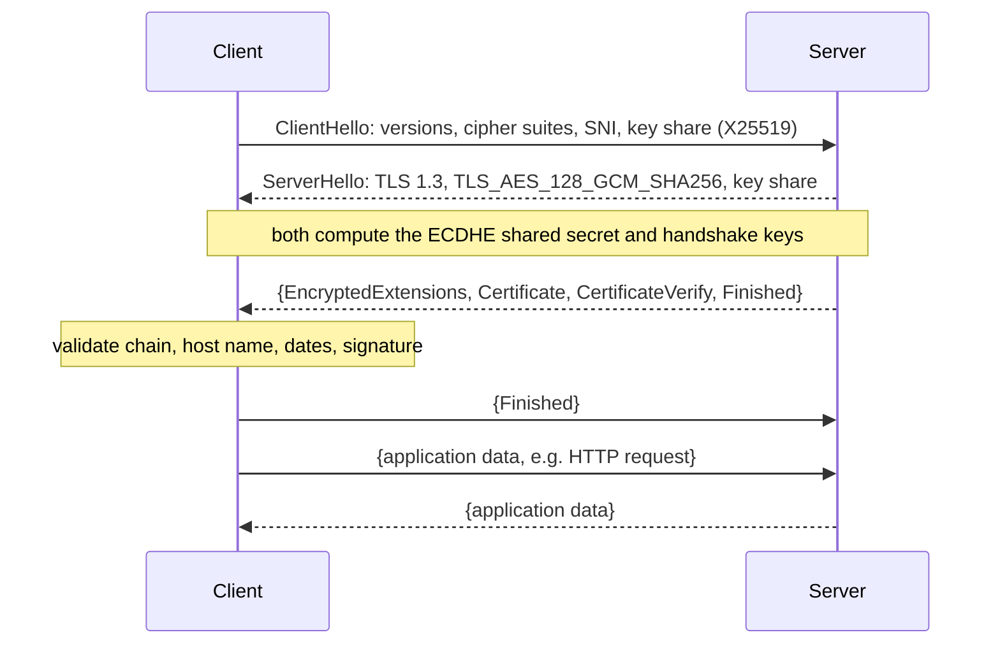

# SSL and TLS

## Summary

Transport Layer Security (TLS) is the cryptographic protocol that provides encryption, server (and optionally client) authentication and integrity for connections such as HTTPS, SMTP, IMAP and database traffic. Its predecessor, Secure Sockets Layer (SSL), and TLS 1.0 and 1.1 are deprecated because of known weaknesses; TLS 1.2 is the widespread baseline and TLS 1.3 (RFC 8446, 2018) the current version, with a faster handshake and only modern algorithms. During the handshake the server presents an X.509 certificate signed by a certificate authority (CA), the peers agree on keys with ephemeral Diffie-Hellman, and then all data is protected with fast symmetric encryption. For DevOps, TLS work means certificate lifecycle automation, sound configuration and debugging handshakes.

## Prerequisites

- [TCP/IP model](../network-models/tcp-ip-model.md) and [HTTP and HTTPS](../application-layer/http-and-https.md).

## Core concepts

### SSL and TLS versions

| Version | Year | Status |
| --- | --- | --- |
| SSL 2.0, SSL 3.0 | 1995, 1996 | Insecure (POODLE and others), prohibited |
| TLS 1.0, TLS 1.1 | 1999, 2006 | Deprecated by RFC 8996 (2021), disabled in browsers |
| TLS 1.2 | 2008 | Secure with modern cipher suites; still the most widely supported |
| TLS 1.3 | 2018 | Current: one round-trip handshake, forward secrecy always, legacy algorithms removed |

SSL was the original protocol and is deprecated due to vulnerabilities; "SSL certificate" survives as a common name for TLS certificates. Use TLS 1.2 and 1.3 only and disable SSL and older TLS versions.

*Analogy.* Meeting a stranger to exchange secrets. You check their government ID issued by an authority you trust (certificate signed by a CA), then you both mix private ingredients in a way that lets you agree on a shared code word nobody overhearing can derive (Diffie-Hellman), and from then on you talk in that code (symmetric encryption) with tamper-evident seals on every message (integrity). The analogy breaks on scale and speed: computers do this in milliseconds and can repeat it for millions of connections.

### How the handshake works

1. **ClientHello**: the client sends supported TLS versions, a list of cipher suites, a random number, the server name (SNI) and, in TLS 1.3, its key share.
2. **ServerHello**: the server picks the version and cipher suite and sends its random number and key share; it sends its X.509 certificate chain (encrypted in TLS 1.3) and proves possession of the private key with a signature.
3. **Certificate validation**: the client checks the chain up to a trusted root CA, the validity dates, the host name against the certificate's subject alternative names, and revocation information. Expired, revoked or untrusted (for example self-signed) certificates fail unless explicitly trusted.
4. **Key exchange**: with Diffie-Hellman (DH) or elliptic-curve Diffie-Hellman (ECDHE, for example X25519), both sides compute the same shared secret without sending it. TLS 1.3 also supports hybrid post-quantum key exchange (X25519MLKEM768), enabled by default in major browsers since 2024 (checked 2026-11).
5. **Session keys**: both derive the same symmetric keys from the shared secret and the random values.
6. **Secure communication**: `Finished` messages confirm the handshake, and application data flows encrypted with the symmetric keys.



Braces mark encrypted messages. TLS 1.2 needs two round trips before data and sends the certificate in clear; with static RSA key exchange (TLS 1.2 only) a stolen server key decrypts recorded past traffic, which ephemeral DH prevents (*forward secrecy*).

### Cryptographic building blocks

1. **Asymmetric (public key) cryptography**, used in the handshake for authentication (signatures) and key agreement:
   - RSA, at least 2048-bit keys (3072 for long-term use),
   - ECDSA (for example P-256), preferred for performance and smaller keys,
   - Ed25519 (supported by TLS 1.3, limited CA support).
2. **Symmetric encryption**, for the data after the handshake:
   - AES-128 and AES-256 in GCM mode (authenticated encryption),
   - ChaCha20-Poly1305, fast on devices without AES hardware support.
3. **Hashing and message authentication**, for integrity and key derivation:
   - SHA-256 and SHA-384,
   - HMAC and HKDF; in TLS 1.3 integrity comes from the AEAD cipher itself.

A secure configuration uses RSA 2048+ or ECDSA certificates, ECDHE key exchange, AEAD ciphers (AES-GCM or ChaCha20-Poly1305) and SHA-256 or stronger. AES-128 is not weak; AES-256 adds margin.

### Certificates

An X.509 certificate binds a public key to identities and is signed by a CA, forming a chain of trust from the server certificate through intermediate CAs to a root CA in the client's trust store.

| Component | Meaning |
| --- | --- |
| Subject and Common Name (CN) | Historically the domain name; browsers now ignore CN and use the SAN extension |
| Subject Alternative Names (SAN) | All DNS names (and IPs) the certificate is valid for |
| Public key | The server's key for signatures in the handshake |
| Issuer | The CA that signed the certificate |
| Validity period | Not before and not after dates; publicly trusted certificates issued since 15 March 2026 are limited to 200 days, dropping to 100 days in March 2027 and 47 days in March 2029 (CA/Browser Forum ballot SC-081v3, checked 2026-11) |
| Signature | The issuer's signature over the certificate |

Types of certificates:

1. **Domain Validated (DV)**: verifies control of the domain; quick, low cost or free; basic HTTPS.
2. **Organization Validated (OV)**: also verifies the organization's identity; used by businesses.
3. **Extended Validation (EV)**: the most extensive identity checks; used by financial institutions, although browsers no longer display EV specially in the address bar.
4. **Wildcard**: `*.example.com` covers all names one level below the domain (`www.example.com`, `api.example.com`) but not `example.com` itself or `a.b.example.com`.
5. **Self-signed**: signed by its own key; used internally and in tests, not trusted by browsers. A private (internal) CA is the better choice for internal services.
6. **Let's Encrypt**: a free CA issuing DV certificates through the ACME protocol, which automates issuance and renewal; ideal for DevOps automation (cert-manager in Kubernetes, Certbot, Caddy). See [Let's Encrypt](lets-encrypt.md) and [ACME](acme.md).

In practice: automate with Let's Encrypt or another ACME CA, use wildcards when many subdomains share one host or proxy (and the private key can be protected), and choose OV or EV only where contracts or policies require identity validation.

### Revocation and transparency

- **Revocation**: CRLs and OCSP let CAs mark certificates as invalid before expiry; OCSP stapling lets servers deliver fresh OCSP responses. Let's Encrypt ended OCSP support in 2025 in favor of CRLs and short lifetimes (checked 2026-11).
- **Certificate Transparency (CT)**: CAs log every public certificate in append-only logs, so domain owners can detect misissued certificates (search at crt.sh).

How DNS records (CAA, ACME challenge records, TLSA), validation and Certificate Transparency fit together across the certificate lifecycle is explained in [Certificates for domains](domain-certificates.md).

## Worked example

Inspect and test a server's TLS configuration. Untested; OpenSSL 3.x, checked 2026-11.

```bash
openssl s_client -connect www.example.com:443 -servername www.example.com -brief </dev/null
# CONNECTION ESTABLISHED
# Protocol version: TLSv1.3
# Ciphersuite: TLS_AES_256_GCM_SHA384
# Peer certificate: CN = www.example.org
# Verification: OK

openssl s_client -connect www.example.com:443 -servername www.example.com </dev/null 2>/dev/null \
  | openssl x509 -noout -subject -issuer -dates -ext subjectAltName

openssl s_client -connect www.example.com:443 -tls1_1 </dev/null   # should fail: old protocol disabled
```

A minimal modern nginx configuration (Mozilla "intermediate" profile, abbreviated):

```nginx
ssl_protocols TLSv1.2 TLSv1.3;
ssl_ciphers ECDHE-ECDSA-AES128-GCM-SHA256:ECDHE-RSA-AES128-GCM-SHA256:ECDHE-ECDSA-AES256-GCM-SHA384:ECDHE-RSA-AES256-GCM-SHA384:ECDHE-ECDSA-CHACHA20-POLY1305:ECDHE-RSA-CHACHA20-POLY1305;
ssl_prefer_server_ciphers off;
ssl_session_tickets off;
add_header Strict-Transport-Security "max-age=63072000" always;
```

TLS 1.3 cipher suites are not configured by `ssl_ciphers`; all of them are secure.

## Trade offs and when to use it

- **TLS everywhere**, including internal traffic, protects against network-level attackers; the cost is certificate management, which ACME and internal CAs automate.
- **TLS termination at the edge** (load balancer, CDN) simplifies certificates but exposes plain traffic behind it unless re-encrypted; **end-to-end TLS or mTLS** keeps it encrypted at extra CPU and complexity.
- **Mutual TLS (mTLS)** authenticates clients with certificates, which suits service-to-service traffic ([Service mesh](../traffic-management/service-mesh.md)).
- **TLS inspection** (decrypting at a corporate proxy) gives visibility but breaks end-to-end guarantees and certificate pinning.

## Common mistakes

- **Expired certificates.** Outages are common and embarrassing. Fix: automated renewal and expiry monitoring (for example a Prometheus blackbox exporter alert at 14 days).
- **Missing intermediate certificates** in the served chain. Some clients fail. Fix: serve the full chain.
- **Disabling verification in clients** (`curl -k`, `verify=False`) and forgetting it. Fix: trust the right CA instead.
- **Private keys in images or repositories.** Fix: secrets management and automatic issuance at runtime.
- **Leaving TLS 1.0 and 1.1 or weak ciphers enabled** for "compatibility". Fix: modern profiles, test with SSL Labs or testssl.sh.

## Practice

1. Why is forward secrecy important, and which key exchange provides it?
2. What does a client check when validating a server certificate?
3. Does `*.example.com` cover `example.com` and `api.eu.example.com`?
4. How many round trips does a TLS 1.3 handshake take before application data, compared with TLS 1.2?

Answers:

1. It ensures that stealing the server's long-term key later does not decrypt recorded past sessions; ephemeral Diffie-Hellman (ECDHE) provides it.
2. The signature chain up to a trusted root, the validity period, the host name against the SAN, the allowed usage and the revocation status.
3. No to both: a wildcard covers exactly one label below `example.com`.
4. One round trip (zero with 0-RTT resumption) compared with two for TLS 1.2.

## Further reading

- [RFC 8446: The Transport Layer Security (TLS) Protocol Version 1.3](https://www.rfc-editor.org/rfc/rfc8446) (IETF, 2018).
- [RFC 8996: Deprecating TLS 1.0 and TLS 1.1](https://www.rfc-editor.org/rfc/rfc8996) (IETF, 2021).
- [Mozilla Server Side TLS guidelines and configuration generator](https://ssl-config.mozilla.org/) (Mozilla).
- [The Illustrated TLS 1.3 Connection](https://tls13.xargs.org/) (Michael Driscoll): every byte of a handshake explained.
- [CA/Browser Forum Baseline Requirements](https://cabforum.org/working-groups/server/baseline-requirements/) (CA/Browser Forum): certificate lifetime rules.
- [Let's Encrypt documentation](https://letsencrypt.org/docs/) (Internet Security Research Group).
