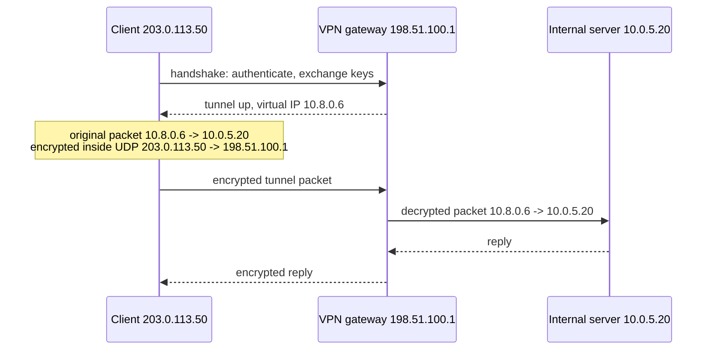

# VPN

## Summary

A virtual private network (VPN) creates an encrypted tunnel across an untrusted network such as the Internet, so that devices exchange data as if they were connected to the same private network. Remote access VPNs connect individual users to a company network, site-to-site VPNs join whole networks (branches, data centers, clouds), and provider VPNs such as MPLS VPNs separate customers inside a carrier network. Modern protocols are WireGuard, IPsec with IKEv2 and TLS-based VPNs such as OpenVPN; PPTP is broken and must not be used. VPNs protect data in transit and hide traffic from local observers, but a remote access VPN that places users on the whole network conflicts with least privilege, which is why zero trust network access (ZTNA) is replacing it for application access.

## Prerequisites

- [SSL and TLS](ssl-and-tls.md) for encryption and certificates.
- [IP](../internet-layer/ip.md) and [Ports](../transport-layer/ports.md).

## Core concepts

### Definition and functions

A VPN establishes a secure, encrypted connection over a public or untrusted network and lets devices send and receive data as if directly connected to a private network.

Key functions:

- **Privacy**: encrypts traffic and hides the user's IP address from the visited services (they see the VPN server's address).
- **Security**: protects data from interception, for example man-in-the-middle attacks on public Wi-Fi.
- **Remote access**: employees reach corporate networks securely.
- **Location masking**: services see the VPN server's location, which consumer VPNs advertise for bypassing geographic restrictions (subject to the services' terms and local law).
- **Bypassing firewalls and censorship**: access to restricted sites where this is legal or necessary for safety.

Use cases: remote work, privacy from ISP and third-party tracking, protecting VoIP, email and sensitive transactions, and reaching blocked services under restrictive regimes.

*Analogy.* An armored, opaque tunnel through a public city. Your car (packet) enters at one end, nobody outside can see what is inside or where exactly it goes, and it comes out inside the company grounds. The analogy breaks on trust: the tunnel operator at the far end (the VPN server or provider) sees everything that leaves the tunnel, so the VPN only moves trust, it does not remove it.

### How it works

A VPN tunnels traffic through an encrypted pathway: the original packet (with private addresses) is encrypted and wrapped in a new packet addressed to the VPN gateway (*encapsulation*). The client gets a virtual IP address inside the private network.

1. The client initiates a connection to the VPN server.
2. Authentication (username and password, certificates, MFA).
3. Key exchange and creation of the encrypted tunnel.
4. Traffic is routed into the tunnel (all traffic in *full tunnel* mode, only private networks in *split tunnel* mode).
5. The VPN server forwards traffic to the private network or the Internet on behalf of the client.



### Types

| Type | Connects | Typical use |
| --- | --- | --- |
| Remote access VPN | A single device to a corporate or private network | Employees, contractors and travelers reaching office files and servers |
| Site-to-site VPN | Two or more networks, gateway to gateway | Branch offices so that company networks appear as one |
| Client-to-site TLS VPN ("SSL VPN") | Users to a TLS-based gateway, through a browser portal or a lightweight client | Web-based remote access (OpenVPN Access Server, Cisco Secure Client, formerly AnyConnect) |
| MPLS VPN (layer 3 VPN) | Customer sites inside a carrier's MPLS network, separated by labels and routing instances | Enterprise WAN from ISPs; provides separation, not encryption, unless combined with IPsec |
| Cloud VPN | On-premises networks to AWS, Azure or Google Cloud over IPsec | Hybrid cloud |

### Protocols

| Protocol | Port | Encryption | Pros | Cons |
| --- | --- | --- | --- | --- |
| PPTP | TCP 1723 plus GRE | MPPE (RC4), broken | Fast and easy | Insecure, deprecated; never use |
| L2TP/IPsec | UDP 500, 4500 (and 1701 inside IPsec) | AES | More secure than PPTP | Slower because of double encapsulation, NAT issues |
| IKEv2/IPsec | UDP 500, 4500 | AES, ChaCha20 | Stable, fast reconnect when networks change (MOBIKE), native on many OSes | Complex to configure |
| OpenVPN | UDP or TCP 1194 by default | AES-256-GCM, ChaCha20-Poly1305 over TLS | Very flexible, open source, works on any port | Needs a client, user-space performance |
| WireGuard | UDP 51820 by default | ChaCha20-Poly1305, Curve25519 | Very fast, small and audited code base, in the Linux kernel since 5.6 (2020) | Static peer configuration; needs extra tooling for user management |
| TLS VPN ("SSL VPN") | TCP 443 | TLS | Passes restrictive firewalls | TCP over TCP overhead; gateway products are frequent targets of exploits |

Recommended: **WireGuard** for speed and simplicity, **OpenVPN** for compatibility and flexibility, **IKEv2/IPsec** for mobile devices and interoperability with network equipment.

### Encryption

| Algorithm | Key length | Strength |
| --- | --- | --- |
| AES-128 | 128 bits | Secure; no practical attack |
| AES-256 | 256 bits | Secure, larger margin (often marketed as "military grade") |
| ChaCha20 | 256 bits | Secure; faster than AES on CPUs without AES hardware instructions; used by WireGuard |
| Blowfish | Variable, usually 128 bits | Legacy 64-bit block cipher, vulnerable to the SWEET32 attack; replaced by AES |

Use authenticated encryption (AES-GCM, ChaCha20-Poly1305). OpenVPN example (OpenVPN 2.6 syntax; older configurations used `cipher AES-256-CBC` with `auth SHA256`):

```text
data-ciphers AES-256-GCM:CHACHA20-POLY1305
tls-version-min 1.2
tls-crypt ta.key        # encrypts and authenticates the control channel; replaces tls-auth
```

### Security considerations

| Risk | Fix |
| --- | --- |
| Data leaks: DNS queries, IP addresses, WebRTC bypassing the tunnel | DNS leak protection (test for example with dnsleaktest.com), kill switch, disable WebRTC in browsers where needed |
| Man in the middle | TLS or IKE with certificate validation and strong authentication |
| Rogue or untrustworthy VPN providers | Avoid free consumer VPNs, which often monetize user data; prefer audited no-log providers or self-hosted VPNs |
| Traffic correlation attacks | For strong anonymity, Tor (optionally over a VPN) rather than a VPN alone |
| Vulnerable VPN gateways | Patch quickly: VPN appliances are a top target (for example CVE-2023-4966 in Citrix NetScaler, CVE-2024-3400 in Palo Alto GlobalProtect) |

**Kill switch.** Block all traffic that does not go through the tunnel, except the tunnel connection itself. Linux example for OpenVPN (untested; adjust the server address and port):

```bash
iptables -A OUTPUT -o lo -j ACCEPT
iptables -A OUTPUT -o tun0 -j ACCEPT
iptables -A OUTPUT -d 198.51.100.1 -p udp --dport 1194 -j ACCEPT   # allow the tunnel to be (re)established
iptables -A OUTPUT -j DROP                                          # everything else is blocked if tun0 is down
```

The single rule `iptables -A OUTPUT ! -o tun0 -j DROP` also blocks the connection to the VPN server, so the tunnel can never come up.

**Logging and privacy.** Some providers log user activity, which defeats the privacy purpose; no-log providers claim not to store it (independent audits make the claim more credible). Corporate VPNs log by design for security monitoring.

### Blocking and evasion

Some networks block VPNs with deep packet inspection (DPI) or firewall rules. Techniques used to get through, where permitted:

- obfuscated servers that make VPN traffic look like ordinary HTTPS,
- SSH or TLS tunneling (hiding the VPN inside TLS),
- Tor over VPN,
- VPN over TCP port 443.

For network defenders, the same list explains how unauthorized tunnels leave a corporate network; egress filtering, TLS inspection and anomaly detection on long-lived connections counter it.

## Worked example

A WireGuard site-to-site tunnel between an office (10.1.0.0/16) and a cloud network (10.2.0.0/16). Untested; wireguard-tools 1.0 on Linux, checked 2026-11. Keys are placeholders.

```bash
wg genkey | tee office.key | wg pubkey > office.pub   # repeat on the cloud gateway
```

`/etc/wireguard/wg0.conf` on the office gateway:

```ini
[Interface]
Address = 10.255.0.1/30
PrivateKey = <OFFICE_PRIVATE_KEY>
ListenPort = 51820

[Peer]
PublicKey = <CLOUD_PUBLIC_KEY>
Endpoint = 198.51.100.20:51820
AllowedIPs = 10.255.0.2/32, 10.2.0.0/16    # routes and the cryptokey routing table: what may come from this peer
PersistentKeepalive = 25                    # keeps NAT mappings open
```

```bash
sudo sysctl -w net.ipv4.ip_forward=1
sudo wg-quick up wg0
sudo wg show                 # latest handshake a few seconds ago, transfer counters increasing
ping -c 3 10.2.0.10          # a host in the cloud network
```

`AllowedIPs` acts as both routing table and access control: packets from the peer with source addresses outside it are dropped.

## Trade offs and when to use it

- **Site-to-site VPNs** remain the standard for connecting networks (branches, clouds) when private connectivity (MPLS, Direct Connect, Interconnect) is too expensive or as a backup.
- **Remote access VPNs** are simple but grant network-level access; for application access, ZTNA gives finer control ([ZTNA](ztna.md)).
- **Full tunnel** gives inspection of all traffic; **split tunnel** saves bandwidth and latency but leaves Internet traffic uninspected.
- **Consumer VPNs** move trust from the ISP to the VPN provider; they do not make users anonymous.

## Common mistakes

- **Using PPTP or weak ciphers.** Fix: WireGuard, IKEv2 or OpenVPN with AEAD ciphers.
- **Overlapping address ranges** between sites. Routing breaks. Fix: plan private ranges centrally ([IPAM](../internet-layer/ipam.md)).
- **MTU problems.** Encapsulation reduces the usable MTU; large packets are dropped and connections hang. Fix: lower the tunnel MTU (WireGuard defaults to 1420) and clamp TCP MSS.
- **Unpatched VPN appliances.** Fix: treat them as internet-facing critical systems with fast patching and MFA.

## Practice

1. What is the difference between a remote access VPN and a site-to-site VPN?
2. Does an MPLS VPN encrypt traffic?
3. Why does `iptables -A OUTPUT ! -o tun0 -j DROP` alone break an OpenVPN client?
4. Why is WireGuard faster than OpenVPN on Linux?

Answers:

1. Remote access connects one device to a network; site-to-site connects whole networks through gateways.
2. No. It separates customer traffic with labels and routing instances inside the carrier network; encryption requires IPsec on top.
3. It also drops the encrypted packets to the VPN server, which leave through the physical interface, so the tunnel cannot be established.
4. It runs in the kernel with a minimal protocol and modern ciphers, avoiding user-space copies and TLS overhead.

## Further reading

- [WireGuard: Next Generation Kernel Network Tunnel](https://www.wireguard.com/papers/wireguard.pdf) (Jason A. Donenfeld, NDSS, 2017).
- [RFC 7296: Internet Key Exchange Protocol Version 2 (IKEv2)](https://www.rfc-editor.org/rfc/rfc7296) (IETF, 2014).
- [NIST SP 800-77 Rev. 1: Guide to IPsec VPNs](https://csrc.nist.gov/pubs/sp/800/77/r1/final) (NIST, 2020).
- [OpenVPN 2.6 reference manual](https://openvpn.net/community-resources/reference-manual-for-openvpn-2-6/) (OpenVPN Inc.).
