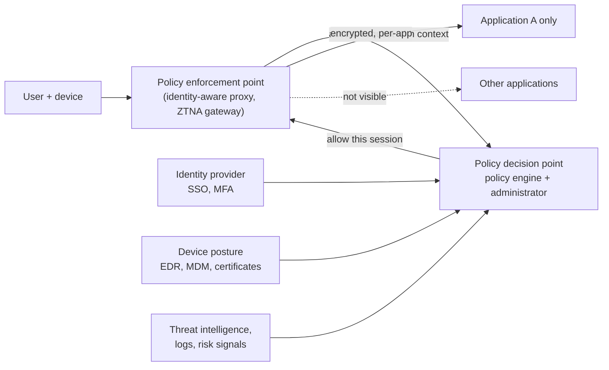

# ZTNA and zero trust

## Summary

Zero trust is a security model built on "never trust, always verify": no user, device or workload is trusted because of its network location, and every access request is authenticated, authorized and encrypted based on identity, device posture and context. Zero trust network access (ZTNA) applies the model to remote and internal access: users reach individual applications through an identity-aware proxy or gateway instead of joining a whole network through a VPN. Microsegmentation applies it inside the data center and cloud, restricting east-west traffic down to single workloads. Together they address the weakness of perimeter designs such as a classic DMZ, where an attacker who gets inside can move laterally. NIST SP 800-207 defines the reference architecture.

## Prerequisites

- [DMZ](dmz.md) and [Firewalls](firewalls.md) for perimeter security.
- [VPN](vpn.md) for the access model ZTNA replaces.

## Core concepts

### The problem: implicit trust

Traditional DMZ designs rely on perimeter security: anything inside the internal network is treated as trusted. Lateral movement after a phishing compromise, zero-day exploits on internal systems, insider threats, cloud services outside the perimeter and remote work all break that assumption. Once an attacker is inside, a flat network lets ransomware reach every reachable host.

*Analogy.* A castle with a moat compared with a modern office building. In the castle, anyone who crosses the drawbridge can walk everywhere. In the office, a badge is checked at every door, opens only the rooms your role needs, and stops working when you leave the company or your laptop fails a security check. The analogy breaks on frequency: zero trust checks happen on every request, many times per second, not once per door per day.

### Definition

**Zero trust** is a security model that enforces "never trust, always verify": every device, user and application must authenticate and be explicitly allowed, instead of internal systems being assumed safe. **ZTNA** is the product category that delivers application access under this model.

NIST SP 800-207 describes the logical components: a *policy engine* decides, a *policy administrator* establishes or tears down sessions, and *policy enforcement points* sit in the path between subject and resource.



### Microsegmentation

*Microsegmentation* divides a network into isolated segments down to the workload or application level. Unlike VLANs and traditional DMZs, it restricts traffic even within the same network segment.

### Zero trust compared with a DMZ

| Traditional DMZ | Zero trust and microsegmentation |
| --- | --- |
| Perimeter security | Security enforced at every layer and request |
| Internal traffic assumed safe | No implicit trust; every connection verified |
| Coarse VLAN-based segmentation | Fine-grained, workload-based segmentation |
| Susceptible to lateral movement | Limits lateral movement with policy enforcement |
| Static policies by IP and port | Dynamic, identity-based policies |

### Key concepts

**Identity-based segmentation.** Policies use identities instead of IP addresses or VLANs:

- **user identity** through authentication (SSO, MFA, LDAP or another directory),
- **device identity** (endpoint security posture, certificates),
- **application or workload identity** (which application may talk to which).

Example: only authenticated engineers on company-managed devices may open SSH sessions to production servers.

**Least privilege access.** Allow only the minimum necessary communication between workloads. Example: a web server may only reach its database on port 3306 (MySQL).

| Flow | Decision |
| --- | --- |
| `WebServer -> Database:3306` (MySQL) | Allowed |
| `WebServer -> all internal hosts:*` | Blocked |
| `User workstation -> production database` | Blocked |

**East-west traffic control.** Traditional firewalls protect north-south traffic (Internet to internal). Microsegmentation controls east-west traffic (internal to internal), which stops ransomware and insider attacks from spreading.

| Attack | Traditional security | Zero trust and microsegmentation |
| --- | --- | --- |
| Ransomware spreading laterally | The perimeter firewall does not see internal movement | Blocks movement that policy does not allow |
| Insider threat or stolen credentials | Broad access to internal systems | The user sees only approved services, and anomalies trigger re-verification |
| Unauthorized remote access | A VPN grants broad network access | ZTNA grants access per application |

### Implementation approaches

**Network-based microsegmentation** (firewalls, VLANs, ACLs). Layered firewall rules restrict internal communication. Drawback: hard to manage dynamically as workloads change.

```bash
iptables -A FORWARD -s 10.0.1.10 -d 10.0.2.20 -p tcp --dport 3306 -j ACCEPT
iptables -A FORWARD -d 10.0.2.0/24 -j DROP     # everything else to the database subnet is dropped
```

**Identity- and label-based microsegmentation (software-defined).** Policies define who may talk to what by labels or identities rather than addresses. Kubernetes NetworkPolicies select pods by labels (they enforce at layers 3 and 4; layer 7 policies need a service mesh or Cilium):

```yaml
apiVersion: networking.k8s.io/v1
kind: NetworkPolicy
metadata:
  name: db-access
spec:
  podSelector:
    matchLabels:
      app: mysql
  policyTypes: [Ingress]
  ingress:
    - from:
        - podSelector:
            matchLabels:
              app: webserver
      ports:
        - protocol: TCP
          port: 3306
```

This allows only pods labeled `app: webserver` to reach MySQL pods on port 3306 (enforced only if the cluster's network plugin supports NetworkPolicy). A service mesh adds cryptographic workload identity with mTLS and layer 7 authorization ([Service mesh](../traffic-management/service-mesh.md)).

**Host-based microsegmentation (agent-based).** Endpoint agents enforce rules in the operating system, including which processes may use which ports (for example Illumio, Akamai Guardicore, Palo Alto Prisma Cloud). Cloud security groups give a similar per-instance enforcement without agents, enforced by the provider's virtual network:

```bash
aws ec2 authorize-security-group-ingress --group-id sg-123456 \
    --protocol tcp --port 443 --source-group sg-789012   # only members of sg-789012 may connect
```

**Software-defined perimeter (SDP).** Internal resources stay invisible until the user authenticates; access goes through identity-aware proxies (IAP) or ZTNA gateways. Examples: Google BeyondCorp (the origin of the model, described from 2014), Tailscale, Cloudflare Zero Trust.

### Hybrid and cloud environments

| Cloud provider | Segmentation and zero trust tools |
| --- | --- |
| AWS | Security groups, AWS Network Firewall, Verified Access |
| Azure | Network security groups (NSGs), Azure Firewall, Private Link |
| Google Cloud | VPC firewall rules and policies, Identity-Aware Proxy (BeyondCorp Enterprise, now Chrome Enterprise Premium), VPC Service Controls |

A deny-by-default inbound rule for an internal subnet, shown in simplified illustrative JSON (not the exact syntax of any one product):

```json
{
  "name": "DenyAll",
  "action": "Deny",
  "priority": 100,
  "direction": "Inbound",
  "rules": [
    { "source": "*", "destination": "10.0.0.0/24", "protocol": "TCP", "destinationPort": "*" }
  ]
}
```

It blocks all inbound traffic to the internal subnet unless a higher-priority rule explicitly allows it.

**ZTNA for remote access** replaces VPNs with identity-aware, per-application access. Vendors include Google BeyondCorp, Cloudflare Access, Cisco Duo (formerly Duo Beyond), Tailscale, Zscaler Private Access and Palo Alto Prisma Access.

### Comparison

| Feature | Traditional DMZ | Zero trust | Microsegmentation |
| --- | --- | --- | --- |
| Trust model | Implicit trust inside | Verify everything | Least privilege between workloads |
| Segmentation level | Network (VLANs, firewalls) | Identity and application | Process and service |
| Attack surface | Exposed public services | Resources hidden until authenticated | Highly restricted lateral communication |
| Deployment | Hardware-based, static | Cloud-native, software-defined | Hybrid and multi-cloud |

### Best practices

- **Adopt a framework**: NIST SP 800-207 (Zero Trust Architecture) and the CISA Zero Trust Maturity Model.
- **Enforce least privilege** for users and services.
- **Monitor east-west traffic** with flow logs, IDS/IPS and SIEM integration.
- **Use identity-based policies** with MFA, SSO and device posture.
- **Automate policy management** with SDN and infrastructure as code.
- **Apply consistent policies** across cloud and on-premises networks.

Zero trust and microsegmentation are the direction of modern network security: unlike a DMZ alone, they contain threats before they spread and greatly reduce lateral movement, which suits hybrid and cloud architectures. They do not remove the need for patching, monitoring and a perimeter layer; they add verification everywhere.

## Worked example

Migrating developer access to production from a VPN to ZTNA (illustrative plan):

| Phase | Action | Result |
| --- | --- | --- |
| 1 | Inventory who accesses what (VPN and firewall logs) | List of real flows, for example 40 engineers use SSH to 12 hosts and a Grafana UI |
| 2 | Put Grafana behind an identity-aware proxy with SSO and MFA | Web access without VPN; the app is no longer reachable from the network |
| 3 | SSH through a ZTNA connector with short-lived certificates tied to SSO groups | No static SSH keys; access per group and host |
| 4 | Require managed devices (posture check) for production | Personal devices are denied |
| 5 | Microsegment production: only the bastion connector and the app tier may reach databases | Lateral paths closed |
| 6 | Turn off the broad VPN profile | Network-level access removed |

## Trade offs and when to use it

- **Benefits**: smaller blast radius, no broad network access for remote users, consistent policies across cloud and offices, better audit trails.
- **Costs**: identity and device management must be mature; policies for many workloads are work to create and maintain; legacy protocols may not fit proxies.
- **Gradual adoption** is normal: start with high-value applications and remote access, then microsegment critical zones.

## Common mistakes

- **Buying a "zero trust product" without identity hygiene.** Fix: SSO, MFA and device inventory first.
- **Microsegmentation by IP lists in dynamic environments.** Fix: labels, tags and workload identity.
- **Enforcing before observing.** Policies block legitimate flows. Fix: run in monitor mode, analyze flows, then enforce.

## Practice

1. What does "never trust, always verify" change compared with perimeter security?
2. What is the difference between north-south and east-west traffic, and which one does microsegmentation target?
3. Why does ZTNA reduce risk compared with a VPN?
4. Which NIST publication defines zero trust architecture?

Answers:

1. Network location no longer grants trust; every request is authenticated and authorized by identity and context.
2. North-south crosses the perimeter, east-west flows between internal systems; microsegmentation targets east-west.
3. A VPN places the user on the network with broad reachability; ZTNA exposes only specific applications after identity and device checks.
4. NIST SP 800-207.

## Further reading

- [NIST SP 800-207: Zero Trust Architecture](https://csrc.nist.gov/pubs/sp/800/207/final) (NIST, 2020).
- [CISA Zero Trust Maturity Model 2.0](https://www.cisa.gov/zero-trust-maturity-model) (CISA, 2023).
- [BeyondCorp: A New Approach to Enterprise Security](https://research.google/pubs/beyondcorp-a-new-approach-to-enterprise-security/) (Rory Ward, Betsy Beyer, Google, ;login:, 2014).
- [Kubernetes Network Policies](https://kubernetes.io/docs/concepts/services-networking/network-policies/) (Kubernetes).
