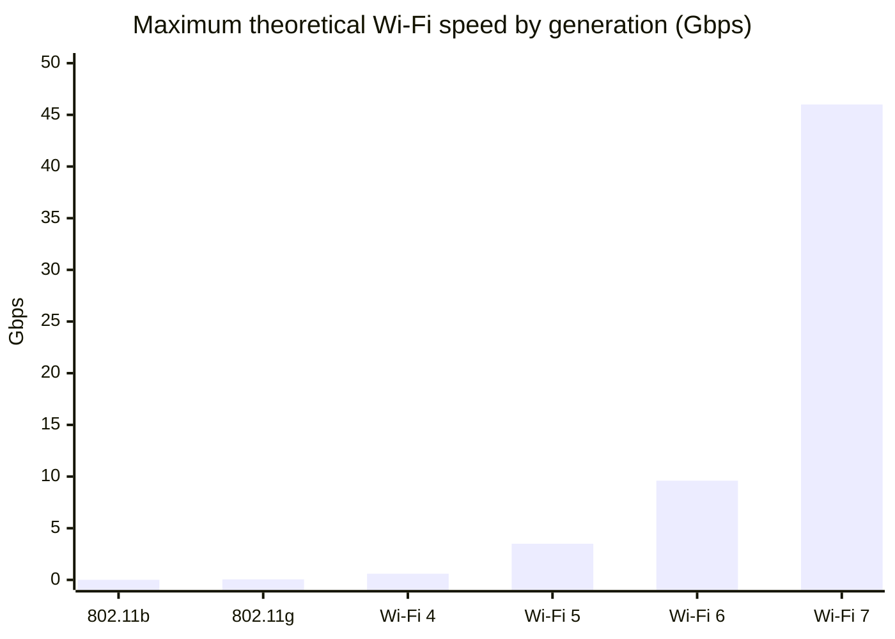

# Network types

## Summary

Computer networks are categorized by geographic scope, function and ownership. The classic scale runs from the personal area network (PAN, a few meters) through the local area network (LAN, a building) and its wireless form (WLAN, Wi-Fi), the campus area network (CAN), the metropolitan area network (MAN, a city) to the wide area network (WAN, countries and continents, including the Internet). Specialized types include storage area networks, data center networks, industrial IoT networks, 5G mobile networks and mesh networks. Each type has typical speeds, technologies and owners, and knowing them helps when designing connectivity, choosing WAN services or reading provider offers.

## Prerequisites

- [Networking overview](networking-overview.md).

## Core concepts

### The scale of networks

*Analogy.* Transport infrastructure: the hallway in your flat (PAN), the corridors of a building (LAN), the paths of a university campus (CAN), a city's road network (MAN) and highways and flight routes between countries (WAN). Larger scales are owned by others and you rent capacity on them. The analogy breaks on speed: in networks, the city-scale backbone (MAN) is often faster than the long-distance link you can afford (WAN).

### WLAN (wireless local area network)

A WLAN connects devices wirelessly with radio waves instead of cables.

- **Scope**: the same as a LAN (homes, offices, campuses).
- **Technology**: IEEE 802.11 (Wi-Fi).
- **Speed**: about 600 Mbps to 10 Gbps and more depending on the Wi-Fi generation (theoretical maximums; real throughput is often a third to a half).
- **Ownership**: private or public (home Wi-Fi, corporate WLANs, public hotspots).

| Component | Description |
| --- | --- |
| Access point (AP) | Connects wireless devices to the wired network |
| Wireless controller | Manages many APs centrally in enterprise networks |
| Client devices | Smartphones, laptops, IoT devices |
| SSID (service set identifier) | The network name broadcast by the AP |

Standards and maximum speeds (theoretical PHY rates; ranges are rough indoor figures):

| Standard | Max speed | Frequency | Range |
| --- | --- | --- | --- |
| 802.11b (1999) | 11 Mbps | 2.4 GHz | about 100 m |
| 802.11g (2003) | 54 Mbps | 2.4 GHz | about 100 m |
| 802.11n, Wi-Fi 4 (2009) | 600 Mbps | 2.4 and 5 GHz | about 150 m |
| 802.11ac, Wi-Fi 5 (2013) | 3.5 Gbps (up to 6.9 Gbps in the spec) | 5 GHz | about 100 m |
| 802.11ax, Wi-Fi 6 and 6E (2019, 2020) | 9.6 Gbps | 2.4, 5 and 6 GHz (6E adds 6 GHz) | about 150 m |
| 802.11be, Wi-Fi 7 (2024) | figures of 30 to 46 Gbps are quoted | 2.4, 5 and 6 GHz | about 200 m |

Wi-Fi 6 and 6E improve speed, efficiency in crowded spaces (OFDMA, target wake time) and security (WPA3). Wi-Fi 7 adds wider 320 MHz channels and multi-link operation for higher throughput and lower latency.

### LAN (local area network)

A LAN is restricted to one location such as a home, office or school.

- **Scope**: up to a few kilometers, typically within a building.
- **Speed**: typically 1 to 10 Gbps (25 to 100 Gbps in data centers).
- **Ownership**: usually private.
- **Technology**: Ethernet, Wi-Fi (802.11ac and ax); Token Ring is legacy.

| Type | Description |
| --- | --- |
| Wired LAN | Ethernet over copper (Cat5e, Cat6) or fiber |
| Wireless LAN (WLAN) | Wi-Fi |
| Virtual LAN (VLAN) | A logically segmented network within a physical LAN ([VLAN](link-layer/vlan.md)) |

### WAN (wide area network)

A WAN covers large areas such as cities, countries or continents.

- **Scope**: up to global.
- **Speed**: usually lower than a LAN, about 10 Mbps to 10 Gbps per site connection.
- **Ownership**: usually operated by internet service providers (ISPs) and carriers.
- **Technology**: fiber optics, MPLS, SD-WAN, satellite.

| Type | Description |
| --- | --- |
| Enterprise WAN | A private network connecting branch offices (for example an MPLS VPN) |
| Public WAN | The Internet, operated by ISPs |
| SD-WAN | Software that steers traffic over several WAN links (Internet, MPLS, LTE) by policy |

| Technology | Description |
| --- | --- |
| MPLS (Multiprotocol Label Switching) | Carrier service that forwards packets by labels along predetermined paths; private and predictable |
| Leased lines (T1, E1, OC-3) | Dedicated point-to-point circuits with fixed bandwidth |
| VPN over WAN | Encrypted tunnels over the Internet ([VPN](network-security/vpn.md)) |
| SD-WAN | Dynamic, application-aware management of WAN traffic |

### MAN (metropolitan area network)

A MAN spans a city or metropolitan region and connects many LANs.

- **Scope**: about 10 to 50 km.
- **Speed**: about 10 to 100 Gbps.
- **Ownership**: public or private.
- **Technology**: fiber, Ethernet, microwave.

| Technology | Description |
| --- | --- |
| Metro Ethernet | Ethernet-based carrier connectivity within a city |
| Dark fiber | Unused (unlit) fiber leased by an organization that runs its own equipment on it |
| Wireless MAN | City-wide wireless access (WiMAX historically, LTE-Advanced, 5G) |

### CAN (campus area network)

A CAN interconnects many LANs in a campus such as a university or business park.

- **Scope**: about 1 to 5 km.
- **Speed**: about 10 to 100 Gbps backbones.
- **Ownership**: private.
- **Technology**: Ethernet, Wi-Fi, fiber.

### PAN (personal area network)

A PAN is a very small network for personal devices.

- **Scope**: a few meters.
- **Speed**: varies (Bluetooth Classic about 3 Mbps; Wi-Fi Direct 100 Mbps and more).
- **Ownership**: individual.

| Type | Technology |
| --- | --- |
| Wired PAN | USB, FireWire (legacy) |
| Wireless PAN (WPAN) | Bluetooth, Zigbee, NFC, infrared |

### Other types

| Network type | Description |
| --- | --- |
| Storage area network (SAN) | Dedicated high-speed network for block storage (Fibre Channel, iSCSI, NVMe over Fabrics) |
| Data center network (DCN) | Connects servers and infrastructure in data centers, typically a leaf-spine fabric |
| Industrial IoT (IIoT) networks | Networks for smart factories and automation, with deterministic protocols (PROFINET, TSN) |
| 5G mobile networks | High-speed wireless WAN, with private 5G for campuses |
| Mesh networks | Decentralized multi-hop wireless networks (home mesh Wi-Fi, city-wide Wi-Fi) |

### LAN, MAN and WAN compared

| Feature | LAN | MAN | WAN |
| --- | --- | --- | --- |
| Coverage | Building or office | City | Country or world |
| Speed | 1 to 10 Gbps | 10 to 100 Gbps | 10 Mbps to 10 Gbps per connection |
| Ownership | Private | Public or private | ISP or carrier managed |
| Technology | Ethernet, Wi-Fi | Metro Ethernet, 5G | MPLS, SD-WAN, VPN |
| Use case | Office or home | City networks | Internet, remote offices |

## Worked example

Choosing connectivity for a company with headquarters, two branches and staff working from home (requirements and options are illustrative):

| Need | Choice | Network type |
| --- | --- | --- |
| Offices internally | Wired Ethernet with 1 Gbps to desks, Wi-Fi 6 access points, VLANs per department | LAN and WLAN |
| Headquarters buildings on one site | Fiber backbone between buildings | CAN |
| Branches to headquarters | Two Internet links per site with SD-WAN and encrypted tunnels instead of only MPLS | WAN |
| Remote staff | Zero trust network access ([ZTNA](network-security/ztna.md)) or VPN | WAN over the Internet |
| Laptop peripherals | Bluetooth | PAN |

The SD-WAN choice trades MPLS's guaranteed latency for lower cost and redundancy over two Internet providers.

## Trade offs and when to use it

- **MPLS** gives predictable latency and carrier SLAs at high cost; **SD-WAN over the Internet** is cheaper and flexible, with variable quality.
- **Wi-Fi** is convenient but shared and variable; use wired links for servers and latency-sensitive equipment.
- **Dark fiber** gives full control and capacity but requires your own optical equipment and operations.

## Common mistakes

- **Comparing theoretical Wi-Fi rates with wired speeds.** Real Wi-Fi throughput is much lower and shared. Fix: plan with measured throughput.
- **Ignoring WAN latency.** Chatty applications designed for a LAN become slow over a WAN. Fix: measure round-trip time and design for it.
- **Treating VLANs as security boundaries without firewalls between them.** Fix: route between VLANs through a firewall with rules.

## Practice

1. Order the network types by scope: MAN, PAN, WAN, LAN, CAN.
2. What does an SSID identify?
3. What is the difference between MPLS and SD-WAN?
4. What is dark fiber?

Answers:

1. PAN, LAN, CAN, MAN, WAN.
2. The name of a wireless network broadcast by an access point.
3. MPLS is a carrier-operated private label-switched service; SD-WAN is software that steers traffic dynamically over several links, often Internet connections.
4. Unused fiber leased by an organization, which lights it with its own equipment.

## Further reading

- [IEEE 802.11 Working Group](https://www.ieee802.org/11/) (IEEE): the Wi-Fi standards.
- [Wi-Fi Alliance: Wi-Fi 7](https://www.wi-fi.org/discover-wi-fi/wi-fi-certified-7) (Wi-Fi Alliance): features of the newest generation.
- *Computer Networking: A Top-Down Approach*, 8th edition (Kurose, Ross, Pearson, 2021): link layer and wireless chapters.
- [RFC 3031: Multiprotocol Label Switching Architecture](https://www.rfc-editor.org/rfc/rfc3031) (IETF, 2001).
