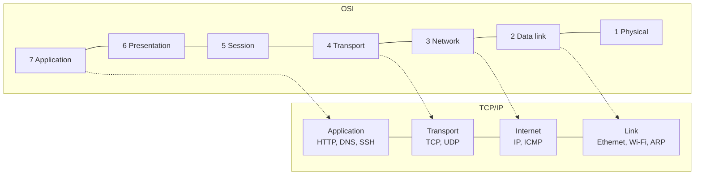

# Networking overview

## Summary

A computer network is a collection of interconnected devices (computers, servers, phones, routers, switches) that communicate to share resources and information over wired or wireless links. Networks range from a local area network (LAN) in one building to wide area networks (WANs) spanning continents; the Internet is the largest, a network of networks. Communication follows protocols organized in layers (the OSI and TCP/IP models): data is split into packets with headers and payloads, addressed with IP addresses, forwarded between networks by routers and within a network by switches, and names are translated to addresses by DNS. For DevOps work, networking explains most "it cannot connect" problems, and the tools (`ping`, `traceroute`, `ss`, Wireshark, `nmap`) are daily instruments.

## Prerequisites

- None. This is the entry note of the [Networking](README.md) area.

## Core concepts

### Definition

A network connects devices so they can exchange data. Connections can be wired or wireless. Networks vary in size and scope, from small LANs in a building to WANs spanning cities, countries or continents. The Internet connects millions of smaller networks and supports file sharing, web access and distributed applications.

*Analogy.* The postal system. Houses have addresses (IP addresses), letters have envelopes with sender and recipient (packet headers) around the content (payload), local post offices deliver within a town (switching in a LAN), sorting centers forward between towns (routing), and a phone book translates names into addresses (DNS). The analogy breaks on speed and size: a packet carries at most about 1,500 bytes on Ethernet, so one email is many "letters" that may take different routes and are reassembled by TCP.

The figure shows a typical small network: devices connect to switches, wireless clients to an access point, and a router connects the LAN (192.168.0.0/24) to the Internet.


### Core components

1. **Devices.**
   - *End devices*: laptops, smartphones, servers, IoT devices.
   - *Networking devices*: routers, switches, hubs, firewalls, access points.
2. **Protocols.** Rules that define how devices communicate, for example TCP/IP, UDP, HTTP, FTP and DNS.
3. **Media.**
   - *Wired*: Ethernet copper cables, fiber optics.
   - *Wireless*: Wi-Fi, Bluetooth, cellular networks.
4. **Data.** Transmitted as packets (frames at layer 2) that consist of headers (metadata such as addresses) and payloads (the actual data).

### Key concepts

1. **IP addressing.** Unique identifiers for devices on a network: IPv4 (32 bits, for example `192.168.1.1`) and IPv6 (128 bits, for example `2001:db8::1`). See [IP addressing](internet-layer/ip-addressing.md).
2. **Subnetting.** Dividing a network into smaller subnetworks to manage traffic and improve security. See [CIDR](internet-layer/cidr.md).
3. **DNS (Domain Name System).** Resolves names such as `example.com` into IP addresses. See [DNS](application-layer/dns/dns-overview.md).
4. **Routing.** Determines the path data takes across networks; done by routers and layer 3 switches. See [Router](internet-layer/router.md).
5. **Switching.** Forwards data within one network by MAC address; done by layer 2 switches. See [Switch](link-layer/switch.md).
6. **NAT (Network Address Translation).** Lets many devices on a private network share one public IP address. See [NAT](internet-layer/nat.md).
7. **VPN (Virtual Private Network).** Creates an encrypted connection over an untrusted network. See [VPN](network-security/vpn.md).
8. **CIDR (Classless Inter-Domain Routing).** The method for allocating IP address blocks and aggregating routes.

### Network types

- **LAN (local area network)**: a small area such as an office.
- **WAN (wide area network)**: a large area such as a city, country or the world.
- **Internet**: a global network of interconnected LANs and WANs.

[Network types](network-types.md) covers LAN, WLAN, MAN, CAN, PAN, WAN and others in detail.

### Network models

The **OSI model** is a conceptual framework of seven layers:

1. **Physical**: transmission of bits over hardware.
2. **Data link**: node-to-node transfer within a link, error detection (and in some technologies correction).
3. **Network**: routing and forwarding between networks (IP).
4. **Transport**: end-to-end communication and error recovery (TCP, UDP).
5. **Session**: managing sessions between applications.
6. **Presentation**: translation, encryption and compression of data.
7. **Application**: network services for applications (HTTP, FTP).

The **TCP/IP model** is the simpler, practical model of the Internet with four layers:

1. **Link**: OSI physical and data link.
2. **Internet**: OSI network layer (IP).
3. **Transport**: OSI transport layer (TCP, UDP).
4. **Application**: OSI session, presentation and application.



Details: [OSI model](network-models/osi-model.md) and [TCP/IP model](network-models/tcp-ip-model.md). This area is organized by the TCP/IP layers.

### Common protocols

| Protocol | Purpose | Note |
| --- | --- | --- |
| IP | Addressing and routing of packets | IPv4 32-bit, IPv6 128-bit addresses |
| TCP | Reliable, ordered, error-checked byte stream | Connection-oriented |
| UDP | Fast, connectionless datagrams, no delivery guarantee | DNS, streaming, QUIC |
| HTTP, HTTPS | Web traffic | [HTTP and HTTPS](application-layer/http-and-https.md) |
| FTP, SFTP | File transfer | [FTP](application-layer/ftp.md) |
| SSH | Secure remote login and command execution | [SSH](application-layer/ssh.md) |
| DNS | Translates names to IP addresses | [DNS](application-layer/dns/dns-overview.md) |

### Monitoring and tools

- **ping**: tests reachability of a host.
- **traceroute**: shows the path packets take.
- **netstat** (and its successor **ss**): network connections, routing tables, interface statistics.
- **Wireshark**: protocol analyzer that decodes captured packets.
- **nmap**: network scanner (use only on networks you are authorized to scan).

See [Network tools](network-operations/network-tools.md).

## Worked example

Follow one HTTPS request from a laptop on a home LAN to a website and name the concept involved at each step (addresses illustrative).

| Step | What happens | Concept |
| --- | --- | --- |
| 1 | The laptop got `192.168.0.10/24`, gateway `192.168.0.1` and a DNS server from the router | DHCP, IP addressing, subnetting |
| 2 | It resolves `www.example.com` to `93.184.215.14` | DNS |
| 3 | The destination is not in `192.168.0.0/24`, so the packet goes to the gateway; ARP finds the gateway's MAC address | Routing decision, ARP |
| 4 | The switch forwards the frame to the router's port | Switching |
| 5 | The router replaces the private source address with its public address | NAT |
| 6 | Routers across the Internet forward the packet hop by hop | Routing (BGP between providers) |
| 7 | TCP handshake, then TLS handshake on port 443 | Transport, ports, TLS |
| 8 | HTTP request and response inside TLS | Application layer |

```bash
ip addr; ip route                   # steps 1 and 3: address, prefix, default gateway
dig +short www.example.com          # step 2
ip neigh                            # step 3: ARP cache with the gateway's MAC
traceroute -n www.example.com       # step 6: the routers on the path
curl -v https://www.example.com/    # steps 7 and 8: connect, TLS handshake, HTTP exchange
```

## Trade offs and when to use it

- **Models are maps, not territory.** OSI is useful vocabulary ("a layer 7 load balancer"); TCP/IP describes how the Internet is actually built.
- **Wired versus wireless.** Wired links give stable latency and bandwidth; wireless gives mobility with shared, variable capacity.
- **Flat versus segmented networks.** Segmentation (subnets, VLANs) improves security and limits broadcast domains at the cost of routing and firewall configuration.

## Common mistakes

- **Blaming "the network" without layering the problem.** Fix: check each layer: link up, IP and route, DNS, port reachability, TLS, application.
- **Confusing DNS failures with connectivity failures.** Fix: test by IP address (`ping 1.1.1.1`) and by name separately.
- **Using real public addresses in examples and documentation.** Fix: documentation ranges `192.0.2.0/24`, `198.51.100.0/24`, `203.0.113.0/24` and `2001:db8::/32`.

## Practice

1. What are the four layers of the TCP/IP model?
2. Which device forwards traffic between networks, and which within a network?
3. Why does a home with ten devices need only one public IPv4 address?
4. Which tool shows the path to a destination?

Answers:

1. Link, internet, transport, application.
2. A router between networks; a switch within one network.
3. NAT on the router translates the private addresses of all devices to its single public address.
4. `traceroute` (or `mtr`).

## Further reading

- *Computer Networking: A Top-Down Approach*, 8th edition (James Kurose, Keith Ross, Pearson, 2021): the standard textbook.
- [RFC 1122: Requirements for Internet Hosts, Communication Layers](https://www.rfc-editor.org/rfc/rfc1122) (IETF, 1989): the definition of the Internet layers.
- [RFC 5737: IPv4 Address Blocks Reserved for Documentation](https://www.rfc-editor.org/rfc/rfc5737) (IETF, 2010).
- *TCP/IP Illustrated, Volume 1*, 2nd edition (Kevin R. Fall, W. Richard Stevens, Addison-Wesley, 2011): protocols shown with real packet traces.
