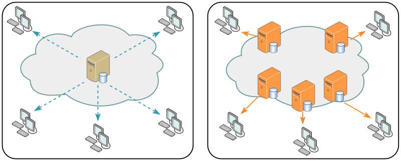
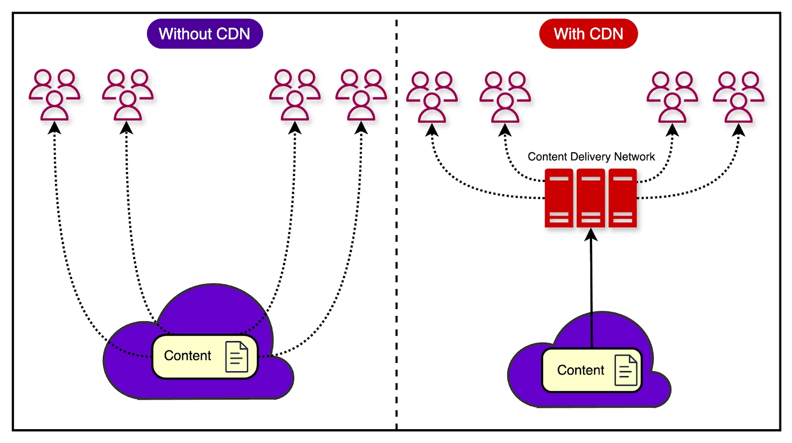
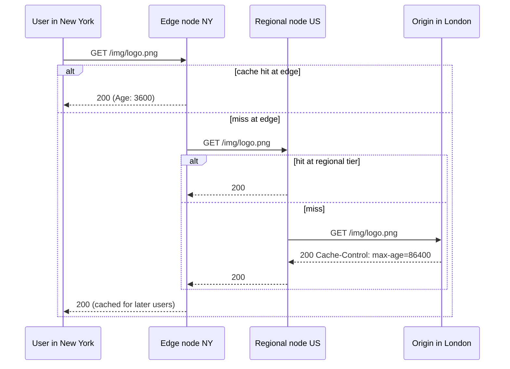
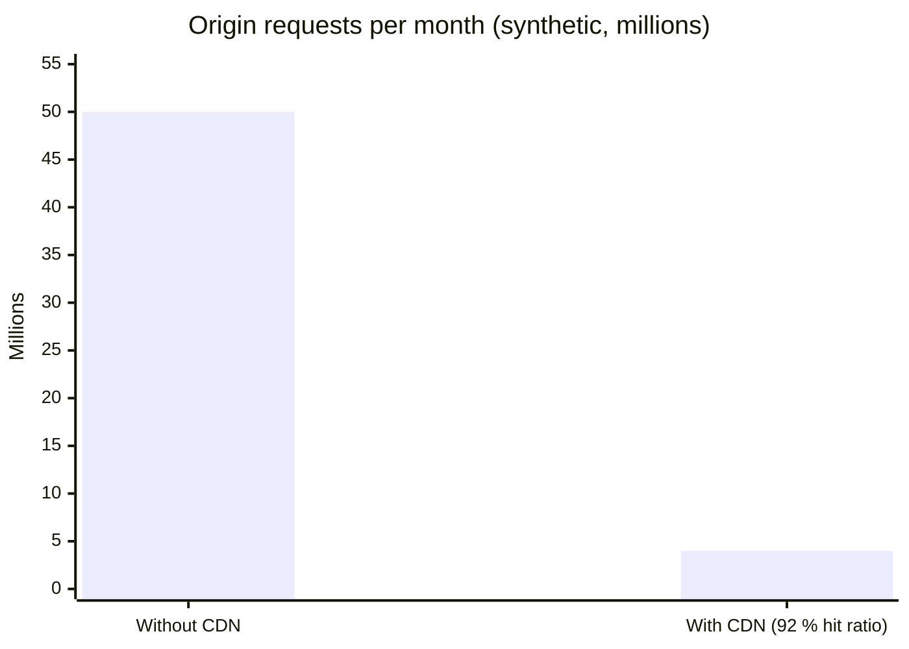

# CDN

## Summary

A content delivery network (CDN) is a globally distributed network of caching reverse proxy servers (edge nodes) that serve content from locations close to users. DNS directs each user to a nearby edge; the edge serves cached content or fetches it from the origin and caches it according to TTLs. CDNs cut latency, offload origin servers and absorb traffic spikes and DDoS attacks; modern CDNs also accelerate dynamic content, terminate TLS, run WAF rules and execute code at the edge. Content is either pushed to the CDN by the owner or pulled from the origin on first request. Costs, stale content and cache invalidation are the main trade-offs.

## Prerequisites

- [Reverse proxy](reverse-proxy.md), [DNS overview](../application-layer/dns/dns-overview.md), [HTTP and HTTPS](../application-layer/http-and-https.md).

## Core concepts

### Definition

A CDN is a globally distributed network of proxy servers that serve content from locations closer to the user. Static files (HTML, CSS, JavaScript, images, video) are the classic payload, but CDNs such as Amazon CloudFront, Cloudflare and Fastly also handle dynamic content and APIs. DNS resolution tells clients which server to contact.

Serving content from a CDN improves performance in two ways:

- users receive content from data centers near them, which reduces round-trip time,
- your servers do not handle requests the CDN fulfills.

The figure contrasts a single central server sending content to every client worldwide with a CDN whose edge servers near the clients serve them.





*Analogy.* A chain of local bookshops instead of one central warehouse. Popular books are stocked in every town, so readers get them immediately; unusual books are ordered from the warehouse the first time someone asks and then kept on the shelf for a while. The analogy breaks on freshness: a bookshop does not need to recall books when a new edition appears, but a CDN must purge or expire outdated copies.

### How it works

The figure shows the full flow for Bob in New York visiting `www.myshop.com`, whose origin is in London:


1. Bob's browser looks up `www.myshop.com`; the local DNS cache misses and asks the DNS resolver.
2. The resolver queries the website's authoritative nameserver, which returns a CNAME `www.myshop.cdn.com`.
3. The resolver queries the CDN's authoritative nameserver, which returns another CNAME pointing to the CDN's load balancing name `www.myshop.lb.com`.
4. The CDN's global load balancer returns the IP address of a nearby edge node, chosen by the resolver's (or client's, with EDNS Client Subnet) location, edge health and load. Many CDNs instead announce the same IP addresses from every location with anycast and let BGP pick the closest one.
5. Bob's browser connects to the edge node in New York.
6. If the edge has the content cached and fresh, it responds immediately (a cache hit). If not, it asks a regional node (US), which asks a central node, which pulls the content from the origin in London. Each level caches the response, so the origin is contacted once for many users (tiered caching or origin shielding).



### Push and pull CDNs

**Push CDNs** receive new content whenever it changes on your side. You are responsible for providing content: upload it directly to the CDN and rewrite URLs to point to it. You configure when content expires and is updated. Content is uploaded only when new or changed, which minimizes transfer traffic but maximizes storage. Push suits sites with little traffic or content that changes rarely: content is placed once instead of being pulled repeatedly.

**Pull CDNs** fetch content from your server (the origin) when the first user requests it. Content stays on your server and URLs point to the CDN. The first request is slower until the content is cached. A *time to live* (TTL), usually from `Cache-Control` headers, determines how long content stays cached. Pull CDNs minimize storage on the CDN but can cause redundant traffic if files expire and are pulled again before they actually changed. Pull suits high-traffic sites: traffic spreads evenly and only recently requested content stays on the CDN. Most CDNs today work in pull mode.

| Aspect | Push | Pull |
| --- | --- | --- |
| Who moves content | Owner uploads | CDN fetches on demand |
| First request | Fast (already present) | Slower (cache miss) |
| CDN storage | Higher (everything stored) | Lower (only requested content) |
| Origin traffic | Only on changes | On misses and expiries |
| Good for | Small or rarely changing sites, large files distributed in advance | High-traffic sites |

### Controlling caching

- `Cache-Control: public, max-age=86400` lets shared caches keep a response for a day; `s-maxage` sets the shared-cache lifetime separately; `private` and `no-store` prevent CDN caching.
- **Versioned file names** (`app.3f9c2a.js`) allow very long TTLs because a change produces a new URL.
- **Purge (invalidation)** removes content before its TTL ends, by URL, tag or prefix.
- **Cache keys** decide which requests share a cached object (URL, chosen headers, cookies); including too much destroys the hit ratio.

### Advantages and disadvantages

Advantages: lower latency, less origin load and bandwidth, resilience to spikes, DDoS absorption, TLS termination close to users, and edge features (WAF, bot management, image optimization, edge functions).

Disadvantages:

- Costs can be significant with high traffic, although they must be weighed against the cost of serving everything from your own infrastructure.
- Content can be stale if it changes before the TTL expires.
- Static content URLs must point to the CDN (or DNS must be delegated to it).
- Debugging is harder because several caching layers are involved, and the CDN becomes a critical dependency (CDN outages take down many sites at once).

## Worked example

Measure the effect of a CDN cache with `curl`. Untested; curl 8.x, checked 2026-11. Header names vary by CDN (`CF-Cache-Status` for Cloudflare, `X-Cache` for CloudFront and Fastly).

```bash
for i in 1 2; do
  curl -s -o /dev/null -D - https://cdn.example.com/img/hero.jpg \
    -w 'time_total=%{time_total}\n' | grep -Ei 'x-cache|cf-cache-status|age:|time_total'
done
```

Illustrative output:

```text
x-cache: Miss from cloudfront
time_total=0.412
x-cache: Hit from cloudfront
age: 2
time_total=0.038
```

Synthetic monthly view of the origin offload for a site with 50 million requests and a 92 percent hit ratio:

| Metric | Without CDN | With CDN |
| --- | --- | --- |
| Requests reaching the origin | 50,000,000 | 4,000,000 |
| Median latency for users far from the origin | 180 ms | 35 ms |



## Trade offs and when to use it

- **Use a CDN** for public websites, downloads, media and APIs with a geographically spread audience.
- **Skip or limit it** for internal applications or highly personalized responses that cannot be cached (although TLS termination and DDoS protection may still justify it).
- **Multi-CDN** setups increase resilience at the cost of complexity and consistent configuration.

## Common mistakes

- **Caching personalized pages** because `Cache-Control` was missing or cookies were ignored. Fix: explicit headers and cache keys.
- **Purging everything on every deployment.** The origin is flooded. Fix: versioned asset names.
- **Leaving the origin open to the Internet.** Attackers bypass the CDN. Fix: allow only CDN IP ranges or authenticated origin pulls.

## Practice

1. When is a pull CDN better than a push CDN?
2. How does DNS send a user to a nearby edge node?
3. Why do versioned file names allow long cache lifetimes?

Answers:

1. For high-traffic sites where content is requested often, so the CDN fetches it once and keeps only what is in demand.
2. The domain is a CNAME to the CDN, whose authoritative DNS (or anycast routing) returns the address of an edge close to the resolver or client.
3. Each change produces a new URL, so cached old versions are never served for the new content and never need purging.

## Further reading

- [What is a CDN?](https://www.cloudflare.com/learning/cdn/what-is-a-cdn/) (Cloudflare Learning Center).
- [System Design Primer: content delivery network](https://github.com/donnemartin/system-design-primer#content-delivery-network) (Donne Martin).
- [RFC 9111: HTTP Caching](https://www.rfc-editor.org/rfc/rfc9111) (IETF, 2022).
- [Amazon CloudFront Developer Guide](https://docs.aws.amazon.com/AmazonCloudFront/latest/DeveloperGuide/Introduction.html) (Amazon Web Services).
