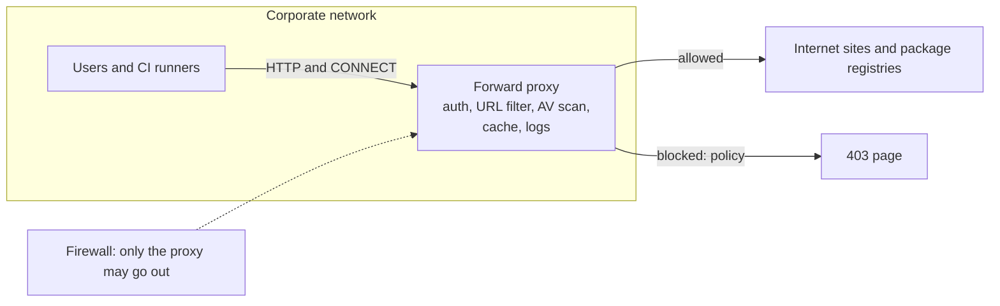

# Forward proxy

## Summary

A forward proxy is an intermediary that clients use to reach external servers: clients send requests to the proxy, which applies policy (filtering, authentication, malware scanning), may serve from cache, logs the traffic and forwards the request with its own address. Organizations use forward proxies to control and observe outbound traffic from users and servers, build pipelines use them to cache dependencies, and security testers use intercepting proxies such as Burp Suite and OWASP ZAP. The destination sees the proxy, not the client, which gives privacy and also allows abuse (open proxies, scraping), so forward proxies need access control.

## Prerequisites

- [Proxies](proxies.md).

## Core concepts

### Definition and flow

A forward proxy sits between clients and the Internet or target servers, handles client requests and forwards them, adding functions such as filtering, logging or caching.

1. **Client request**: the client (for example a browser) sends its request to the forward proxy, configured explicitly (proxy settings, `HTTPS_PROXY`, PAC file) or intercepted transparently.
2. **Proxy processing**: the proxy evaluates the request and, depending on configuration, logs, filters or modifies it.
3. **Forwarding**: the proxy sends the original or modified request to the destination.
4. **Server response** to the proxy.
5. **Proxy response**: the proxy processes (scans, caches) and forwards the response to the client.

*Analogy.* A company's purchasing department. Employees do not buy directly from suppliers; they submit orders to purchasing, which checks them against policy, may already have the item in the stockroom (cache), records every order, and places the order in the company's name, so suppliers never see who asked. The analogy breaks with HTTPS: unless the proxy decrypts traffic, it only sees which supplier was contacted, not the order contents.



### Key features

1. **Anonymity**: hides the client's IP address from destinations.
2. **Access control**: allows or blocks sites and services by rules (categories, domains, users).
3. **Caching**: stores frequently requested resources to cut load times and bandwidth.
4. **Traffic filtering**: scans and blocks malicious content or restricts traffic types.
5. **Logging and monitoring**: records activity for compliance, analytics or debugging.

### Use cases

1. **Privacy and security**: individuals and organizations hide IP addresses and reduce tracking.
2. **Content filtering**: schools, libraries and workplaces restrict sites or content types.
3. **Caching and bandwidth optimization**: fewer repeated downloads.
4. **Bypassing restrictions**: reaching geo-restricted content or getting around firewalls (subject to the law and the services' terms).
5. **Data scraping**: automated collection that rotates proxy addresses to avoid IP bans (subject to the target sites' terms and the law).
6. **Malware scanning**: intercepting and scanning downloads.

### Advantages and disadvantages

Advantages: privacy (client identity hidden from destinations), performance (caching), centralized control of network policy, and access management.

Disadvantages: extra latency, configuration and maintenance expertise, misuse of open forward proxies, and a single point of failure for all clients' Internet access.

### Forward proxies in DevOps

1. **Security testing**: intercepting proxies such as Burp Suite and OWASP ZAP capture and modify requests during authorized penetration tests.
2. **Infrastructure management**: controlling outbound traffic from internal systems (egress control), for example only allowing servers to reach update repositories.
3. **API rate limiting**: an egress proxy can limit calls to external APIs to stay within quotas.
4. **Dependency management**: caching proxies and artifact repositories (Nexus, Artifactory, Squid) cache packages and images for CI/CD, cutting build times and protecting against registry outages.

### Example scenarios

1. **Personal use**: Alice browses through a forward proxy to mask her IP address.
2. **Corporate environment**: a company blocks social media during work hours and scans downloads for malware.
3. **Web scraping**: a developer rotates IP addresses through proxies to avoid blocks by target sites.

### Forward proxy compared with reverse proxy

| Feature | Forward proxy | Reverse proxy |
| --- | --- | --- |
| Purpose | Acts on behalf of clients | Acts on behalf of servers |
| Used by | Clients (people, browsers, devices, servers making outbound calls) | Server operators (web servers, backend systems) |
| Direction of traffic | Outbound, from clients to external servers | Inbound, from clients to backend servers |
| Example | Corporate web filtering, bypassing geo-restrictions | Load balancing to backend servers |

## Worked example

A Squid forward proxy that only allows build servers to reach package registries. Untested; Squid 6.x on Ubuntu 24.04, checked 2026-11.

```text
# /etc/squid/conf.d/ci.conf
acl ci_runners src 10.20.0.0/24
acl registries dstdomain .pypi.org .pythonhosted.org .npmjs.org registry-1.docker.io .docker.io
acl SSL_ports port 443
acl CONNECT method CONNECT

http_access deny CONNECT !SSL_ports
http_access allow ci_runners registries
http_access deny all

http_port 3128
cache_dir ufs /var/spool/squid 20000 16 256      # 20 GB disk cache
```

```bash
sudo squid -k parse && sudo systemctl reload squid
# on a runner:
export HTTPS_PROXY=http://proxy.internal:3128
pip download requests          # allowed: TCP_TUNNEL/200 in /var/log/squid/access.log
curl -I https://example.com/   # denied: 403 from the proxy, TCP_DENIED/403 in the log
```

Because HTTPS is tunneled with CONNECT, Squid filters by domain name without decrypting; caching of HTTPS content would require TLS interception (SSL bump) with a company CA trusted by the runners.

## Trade offs and when to use it

- **Explicit proxies** are simple and visible but require client configuration; **transparent interception** needs none but cannot handle HTTPS cleanly.
- **TLS interception** enables content scanning and caching of HTTPS at the cost of privacy, certificate management and breaking certificate pinning.
- **Egress allowlists** are strong controls for servers and CI; for users, category-based filtering is more practical.

## Common mistakes

- **Allowing CONNECT to any port.** The proxy becomes a tunnel for anything (SSH, SMTP spam). Fix: restrict CONNECT to 443 and needed ports.
- **No redundancy.** Proxy failure stops all outbound access. Fix: two or more proxies behind a load balancer or PAC failover.
- **Leaving direct egress open in the firewall.** Clients bypass the proxy. Fix: only proxies may reach the Internet.

## Practice

1. How does a forward proxy filter HTTPS sites without decrypting them?
2. Why do CI pipelines benefit from a caching forward proxy?
3. Who configures and uses a forward proxy, the client or the server side?

Answers:

1. It sees the target host in the `CONNECT` request (and the TLS SNI) and allows or denies the tunnel by domain.
2. Dependencies are downloaded once and served locally, which speeds builds and protects against registry outages and rate limits.
3. The client side: clients (or their organization) configure and use it.

## Further reading

- [Squid configuration reference](https://www.squid-cache.org/Doc/config/) (Squid project).
- [OWASP ZAP documentation](https://www.zaproxy.org/docs/) (ZAP project): an intercepting proxy for authorized security testing.
- [RFC 9110: HTTP Semantics, CONNECT method](https://www.rfc-editor.org/rfc/rfc9110#name-connect) (IETF, 2022).
