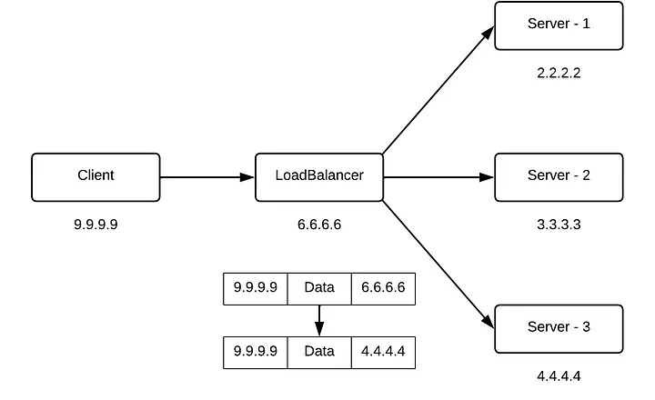
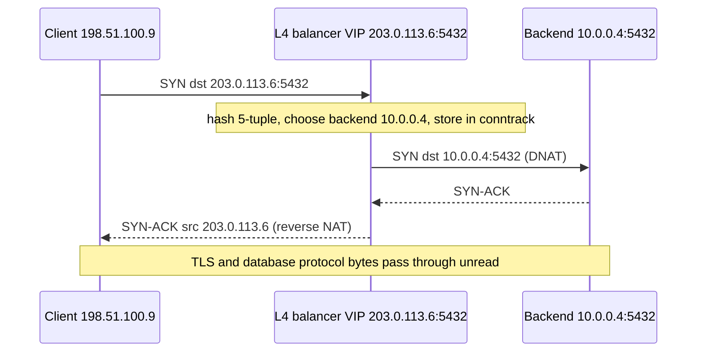

# Layer 4 load balancing

## Summary

A layer 4 load balancer distributes connections using transport layer information only: source and destination IP addresses and ports, and the protocol (TCP or UDP). It does not read packet contents, so it is fast, cheap per connection and works for any protocol on TCP or UDP (databases, MQTT, DNS, game traffic, TLS passed through untouched). It forwards packets to the chosen backend, typically rewriting addresses with NAT, or delivers them with direct server return or tunneling at very high scale. It cannot route by URL or cookie; that requires layer 7.

## Prerequisites

- [Load balancing](load-balancing.md), [NAT](../internet-layer/nat.md), [Ports](../transport-layer/ports.md).

## Core concepts

### Definition

Layer 4 load balancers use transport layer information: usually the source and destination IP addresses and ports in the headers, but not the contents of the packet. They forward packets to and from the upstream server and perform network address translation (NAT).

The figure shows a client (`9.9.9.9`) sending a packet to the load balancer (`6.6.6.6`); the balancer picks server 3 (`4.4.4.4`) and rewrites the destination address, so the packet `9.9.9.9 | data | 6.6.6.6` becomes `9.9.9.9 | data | 4.4.4.4`.



Layer 4 load balancers are effective for TCP and UDP. They handle high traffic volumes efficiently and direct requests based on network-level information, which makes them central to application delivery and scalability.

*Analogy.* A motorway toll operator who sends each arriving car to one of several exit lanes based only on the license plate number, without looking inside the car. It is very fast but cannot send "cars carrying furniture" to a special lane. The analogy breaks because once a car is assigned to a lane, all its later packets (the whole TCP connection) must follow the same lane, which the balancer tracks or hashes.

### Forwarding modes

| Mode | How it works | Notes |
| --- | --- | --- |
| NAT (full proxy or destination NAT) | Rewrites destination (and often source) address; replies return through the balancer | Simple; the balancer handles both directions |
| Direct server return (DSR) | Balancer forwards to the backend, which replies directly to the client using the virtual IP on a loopback | Very high throughput because responses bypass the balancer |
| IP-in-IP or GRE tunneling | Balancer encapsulates packets to backends | Used by large-scale balancers (Maglev, Katran) |
| TCP proxy (connection splicing) | Balancer terminates TCP and opens a new connection, without parsing the payload | HAProxy `mode tcp`, nginx `stream` |

Connections are pinned to a backend with a connection table or a consistent hash of the 5-tuple (source IP, source port, destination IP, destination port, protocol), so all packets of a connection reach the same server.



### Layer 4 compared with layer 7

| Aspect | Layer 4 | Layer 7 |
| --- | --- | --- |
| Visibility | Addresses, ports, protocol | Full request: host, path, headers, cookies |
| Protocols | Any TCP or UDP | HTTP, gRPC and similar |
| TLS | Passed through (end to end) | Usually terminated |
| Performance | Very high, low latency | Higher CPU per request |
| Features | Distribution, health checks on TCP or simple probes | Routing, rewriting, caching, WAF, stickiness by cookie |

## Worked example

Load-balance PostgreSQL connections with HAProxy in TCP mode, sending writes to the primary only. Untested; HAProxy 2.8, checked 2026-11.

```text
listen postgres_primary
    bind :5432
    mode tcp
    option tcp-check
    balance leastconn                  # long-lived connections
    server db1 10.0.0.4:5432 check
    server db2 10.0.0.5:5432 check backup   # used only if db1 fails
```

Linux kernel alternative with IPVS (untested; ipvsadm 1.31):

```bash
sudo ipvsadm -A -t 203.0.113.6:5432 -s rr                      # virtual service, round robin
sudo ipvsadm -a -t 203.0.113.6:5432 -r 10.0.0.4:5432 -m        # -m: NAT mode
sudo ipvsadm -a -t 203.0.113.6:5432 -r 10.0.0.5:5432 -m
sudo ipvsadm -Ln --stats
```

Kubernetes `Service` objects of type `ClusterIP` and `LoadBalancer` are layer 4 load balancing implemented by kube-proxy (iptables or IPVS) or eBPF.

## Trade offs and when to use it

- **Choose layer 4** for databases, message brokers, non-HTTP protocols, TLS passthrough and very high packet rates.
- **Choose layer 7** when routing must depend on request content.
- Many architectures combine both: a layer 4 balancer (cloud NLB) in front of a fleet of layer 7 proxies.

## Common mistakes

- **Expecting HTTP health checks or cookies** from a pure layer 4 balancer. Fix: TCP or simple HTTP probes, or a layer 7 balancer.
- **Losing the client IP** in NAT mode with source rewriting. Fix: PROXY protocol or DSR.
- **Uneven load with long-lived connections** and round robin. Fix: least connections.

## Practice

1. Which header fields does a layer 4 balancer use?
2. Why does DSR increase throughput?
3. Can a layer 4 balancer route `/api` and `/static` to different servers?

Answers:

1. Source and destination IP addresses and ports, and the protocol.
2. Responses, usually much larger than requests, go from backends directly to clients without passing through the balancer.
3. No; the path is inside the application payload, which it does not inspect.

## Further reading

- [What is layer 4 load balancing?](https://www.f5.com/glossary/layer-4-load-balancing) (F5).
- [Linux Virtual Server (IPVS) documentation](http://www.linuxvirtualserver.org/Documents.html) (LVS project).
- [AWS Network Load Balancer documentation](https://docs.aws.amazon.com/elasticloadbalancing/latest/network/introduction.html) (Amazon Web Services).
- [PROXY protocol specification](https://www.haproxy.org/download/2.8/doc/proxy-protocol.txt) (HAProxy).
