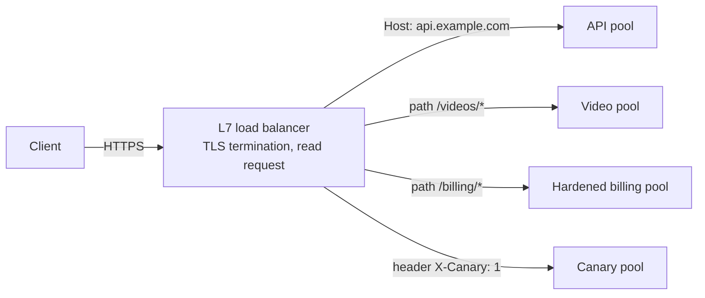

# Layer 7 load balancing

## Summary

A layer 7 load balancer works at the application layer: it terminates the client's connection (and TLS), reads the request (host, path, headers, cookies), decides where to send it and opens its own connection to the chosen backend. This allows routing by content (send `/videos` to video servers, billing traffic to hardened servers), session persistence, rewriting, compression, TLS termination, deep health checks and detailed request logs. It costs more CPU than layer 4 balancing, which rarely matters on modern hardware. A device doing layer 7 load balancing is a reverse proxy.

## Prerequisites

- [Load balancing](load-balancing.md), [Reverse proxy](reverse-proxy.md), [HTTP and HTTPS](../application-layer/http-and-https.md).

## Core concepts

### Definition

Layer 7 load balancers use application layer data, such as headers, message content and cookies, to distribute requests. They terminate network traffic, read the message, make a decision and open a connection to the selected server. Example: video traffic goes to servers that host video, while sensitive billing traffic goes to security-hardened servers.

The figure shows a client (IP `44.1.1.1`) requesting `http://yourdomain.com`; the layer 7 load balancer (`44.2.2.2`) can read the HTTP data, here the path `/blog`, and routes `/comments` and `/blog` requests to different instance groups that share a database.


*Analogy.* A mail room that opens envelopes to read the subject line and then delivers each letter to the department that handles that subject. A layer 4 mail room only reads the address on the envelope. The analogy breaks on encryption: to read the "letter", a layer 7 load balancer must hold the TLS keys.



### Benefits

Layer 7 load balancing is more CPU-intensive than packet-based layer 4 load balancing but rarely degrades performance on modern servers. It allows smarter decisions and optimizations and changes to content (compression, encryption). It buffers requests and responses, offloading slow clients from upstream servers, which improves performance. A device performing layer 7 load balancing is often called a reverse proxy server.

### Features

- **Persistence** (affinity, server affinity, sticky sessions): all requests from one client go to the same server so application context is kept, usually through a cookie.
- **Context switching** (content-based routing): traffic is directed by the content and context of the request (host, path, headers, method).
- **Content rewriting**: requests and responses are rewritten, for example to hide internal URLs or support applications with hardcoded URLs (path rewrites, header changes, redirects).
- **TLS termination**: handling TLS is resource-intensive; doing it on the load balancer frees web and application servers for content delivery.
- **Health checking**: the load balancer queries the application (for example an HTTP endpoint expecting a status code or body) to confirm that it works and responds in time, and the algorithm only uses available servers.
- **Logging and monitoring**: positioned in the path of all layer 4 and layer 7 traffic, the load balancer records every request (status, latency, upstream server), which supports monitoring, tracing and detection of suspicious activity. Logs should be shipped off the device and analyzed centrally.
- **Security functions**: web application firewall rules, rate limiting, authentication offload (OIDC), request size limits.

## Worked example

Path-based routing with a canary on Kubernetes using the Gateway API. Untested; Gateway API v1, checked 2026-11.

```yaml
apiVersion: gateway.networking.k8s.io/v1
kind: HTTPRoute
metadata:
  name: shop
spec:
  parentRefs: [{ name: public-gateway }]
  hostnames: ["shop.example.com"]
  rules:
    - matches: [{ path: { type: PathPrefix, value: /api } }]
      backendRefs:
        - { name: api-v1, port: 8080, weight: 90 }
        - { name: api-v2, port: 8080, weight: 10 }     # 10 percent canary
    - matches: [{ path: { type: PathPrefix, value: /static } }]
      backendRefs: [{ name: static, port: 80 }]
```

Test: repeated `curl -s https://shop.example.com/api/version` returns `v2` about one time in ten; `/static/app.js` always comes from the static service. Neither split is possible at layer 4, because the path is invisible there.

## Trade offs and when to use it

- **Use layer 7** for HTTP and gRPC services that need routing by content, TLS termination, observability and security features.
- **Use layer 4** for non-HTTP protocols, extreme throughput or when TLS must pass through end to end ([Layer 4 load balancing](layer-4-load-balancing.md)).
- Layer 7 adds a TLS termination point that must be protected and introduces another hop in latency budgets.

## Common mistakes

- **Mismatched timeouts** between client, load balancer and backend. Fix: align and document them.
- **Health checks hitting expensive endpoints** every second on every server. Fix: lightweight dedicated health endpoints.
- **Losing client IPs.** Fix: `X-Forwarded-For` or `Forwarded` headers and trusted proxy configuration in backends.

## Practice

1. Why can a layer 7 load balancer route by URL path while a layer 4 one cannot?
2. What does buffering at the load balancer protect backends from?
3. Name two features that require terminating TLS.

Answers:

1. It terminates the connection and parses the HTTP request; a layer 4 balancer only sees addresses and ports.
2. Slow clients occupying backend connections while they send or receive data slowly.
3. Any two of: content-based routing, cookie persistence, WAF inspection, content rewriting, compression of responses, HTTP-level logging.

## Further reading

- [What is layer 7 load balancing?](https://www.f5.com/glossary/layer-7-load-balancing) (F5).
- [Kubernetes Gateway API](https://gateway-api.sigs.k8s.io/) (Kubernetes SIG Network).
- [AWS Application Load Balancer documentation](https://docs.aws.amazon.com/elasticloadbalancing/latest/application/introduction.html) (Amazon Web Services).
- [Envoy proxy documentation](https://www.envoyproxy.io/docs) (Envoy project).
