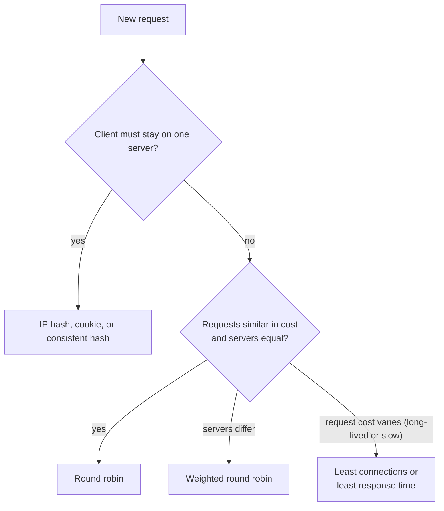
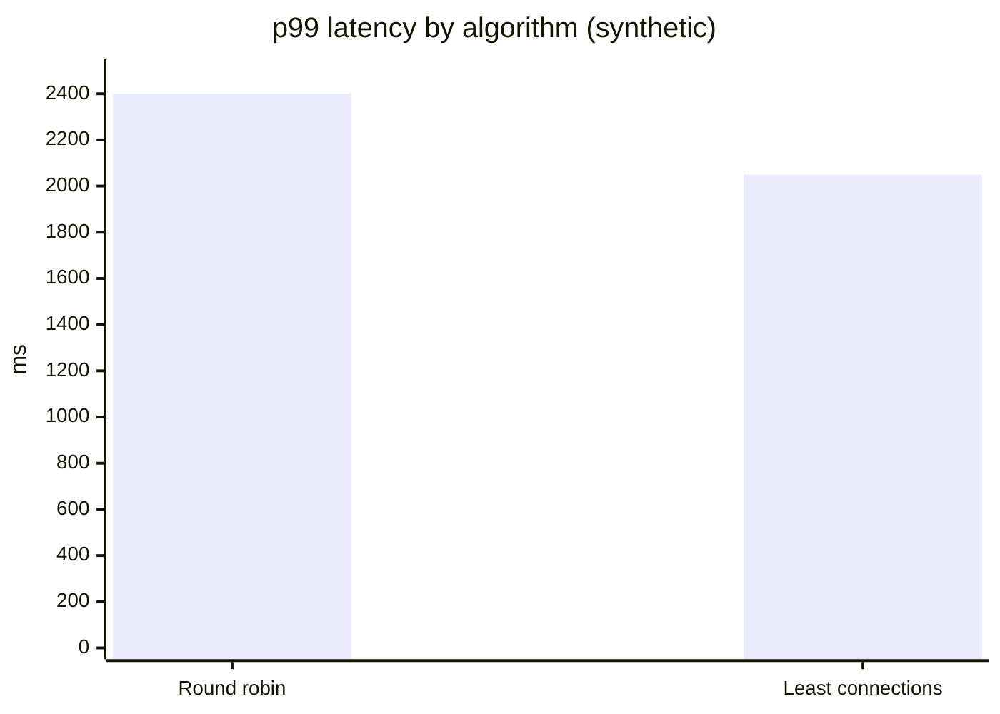

# Load balancing algorithms

## Summary

A load balancing algorithm is the rule a load balancer uses to choose a server for each connection or request. *Static* algorithms (round robin, weighted round robin, IP hash, random) decide without looking at server state; *dynamic* algorithms (least connections, weighted least connections, weighted response time, resource-based) use current load or performance. The right choice depends on how uniform requests and servers are, whether clients must stick to a server, and whether the pool changes often, which is where consistent hashing helps.

## Prerequisites

- [Load balancing](load-balancing.md).

## Core concepts

### Static and dynamic

A load balancer is a software or hardware device that keeps any one server from being overloaded; the algorithm is its set of predefined rules for distributing traffic.

- **Static load balancing** distributes traffic without considering server state, for example in a fixed order or at random.
- **Dynamic load balancing** takes the current state of each server into account.

*Analogy.* Checkout lanes in a supermarket. A static rule is a staff member sending customers to lanes 1, 2, 3 in turn regardless of queues; a dynamic rule is customers joining the shortest queue. The analogy breaks because in software the "queue length" information may be stale or measured differently by several load balancers at once.

### Static algorithms

- **Round robin**: servers receive requests in rotation. In *DNS round robin* an authoritative nameserver holds several A records for a name and returns them in rotating order for each query; load balancers apply the same rotation per connection or request.
- **Weighted round robin**: administrators assign weights, and servers able to handle more traffic receive proportionally more. In DNS this can be done with weighted records (for example Route 53 weighted routing).
- **IP hash**: a hash of the source (and optionally destination) IP addresses selects the server, so the same client keeps reaching the same server without cookies; it breaks when the pool changes and when many clients share one NAT address.
- **Random** (and "power of two choices": pick two servers at random, use the less loaded one), simple and effective at large scale.

### Dynamic algorithms

- **Least connections**: send to the server with the fewest open connections; assumes connections need roughly equal work.
- **Weighted least connections**: least connections adjusted by server weights, for servers with different capacities.
- **Weighted response time**: combines each server's average response time with its open connections and prefers fast servers, which gives users faster service.
- **Resource-based**: an agent on each server reports available CPU and memory, and the load balancer queries it before sending traffic.

### Consistent hashing

With plain modulo hashing (`hash(key) % N`), adding or removing one server remaps almost all keys. Consistent hashing places servers and keys on a ring so that a change moves only about 1/N of keys, which keeps cache hit rates and sticky sessions largely intact (used by HAProxy `hash-type consistent`, Envoy ring hash and Maglev, and caches).



## Worked example

Compare round robin and least connections when request durations vary (synthetic simulation). Three servers; requests arrive in a steady stream; every fourth request is a slow report taking 2,000 ms, others take 50 ms. Measured outcome over one minute in the simulation:

| Algorithm | p50 latency (ms) | p99 latency (ms) | Max concurrent on one server |
| --- | --- | --- | --- |
| Round robin | 55 | 2,400 | 31 |
| Least connections | 52 | 2,050 | 12 |



Round robin keeps sending fast requests to a server already busy with slow reports, so queues build up there; least connections notices the open connections and steers around it. With uniform request costs both behave almost identically. The numbers are illustrative, not a benchmark.

Configuration in nginx (untested, nginx 1.26):

```nginx
upstream app {
    least_conn;                       # default would be round robin
    server 10.0.1.11:8080 weight=2;   # twice the capacity
    server 10.0.1.12:8080;
    server 10.0.1.13:8080;
}
```

## Trade offs and when to use it

- **Round robin** is simple and fair for uniform requests and servers.
- **Least connections** suits variable request durations and long-lived connections (WebSockets, database proxies).
- **Hash-based** algorithms provide affinity and cache locality but can create hot spots for popular keys.
- **Resource-based** algorithms react to real load but need agents and can oscillate if metrics lag.

## Common mistakes

- **IP hash behind corporate NAT**: thousands of users share one IP and land on one server. Fix: cookie-based affinity or consistent hashing on a better key.
- **Least connections with many load balancers** that each see only their own connections. Fix: power of two choices or server-side load reporting.
- **Forgetting slow start**: a newly added server receives a flood under least connections. Fix: slow-start ramp-up settings.

## Practice

1. Which algorithm would you choose for WebSocket connections of very different lifetimes?
2. Why does modulo hashing hurt when a server is added?
3. What is the difference between weighted round robin and weighted least connections?

Answers:

1. Least connections (weighted if servers differ).
2. Almost all keys map to different servers afterwards, destroying cache locality and sessions.
3. Weighted round robin distributes by fixed ratios regardless of current load; weighted least connections uses current open connections adjusted by weight.

## Further reading

- [Types of load balancing algorithms](https://www.cloudflare.com/learning/performance/types-of-load-balancing-algorithms/) (Cloudflare Learning Center).
- "Maglev: A Fast and Reliable Software Network Load Balancer" (Eisenbud et al., Google, NSDI 2016): consistent hashing at scale.
- [nginx upstream module](https://nginx.org/en/docs/http/ngx_http_upstream_module.html) (nginx project).
- "The Power of Two Choices in Randomized Load Balancing" (Michael Mitzenmacher, IEEE Transactions on Parallel and Distributed Systems, 2001).
