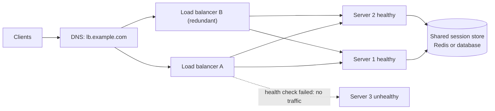

# Load balancing

## Summary

A load balancer distributes incoming client requests across a pool of computing resources (application servers, databases, caches) and returns each response to the right client. It keeps requests away from unhealthy servers, prevents any single server from being overloaded and removes the single server as a single point of failure. Load balancers work at layer 4 (TCP and UDP connections) or layer 7 (HTTP requests), are implemented in hardware, in software (HAProxy, nginx, Envoy) or as cloud services, and add features such as TLS termination, session persistence, health checks and cross-zone distribution. They are the enabler of horizontal scaling, which in turn requires stateless servers.

## Prerequisites

- [Reverse proxy](reverse-proxy.md) and [TCP/IP model](../network-models/tcp-ip-model.md).

## Core concepts

### Definition and benefits

Load balancers distribute client requests to resources and return responses to the appropriate clients. They are effective at:

- preventing requests from going to unhealthy servers,
- preventing resource overload,
- helping eliminate a single point of failure.

They can be hardware appliances (expensive, for example F5 BIG-IP) or software (HAProxy, nginx, Envoy) and managed cloud services (AWS ELB, Azure Load Balancer, Google Cloud Load Balancing). Additional benefits:

- **TLS termination**: decrypt incoming requests and encrypt responses, so backends do not perform these expensive operations, and X.509 certificates need not be installed on every server.
- **Session persistence**: issue cookies and route a client's requests to the same instance when web applications do not keep shared session state.

*Analogy.* The host at a busy restaurant entrance. Guests (requests) do not choose a table themselves; the host knows which waiters (servers) are free or overloaded, skips a waiter who is ill (health check), keeps regulars with the same waiter (stickiness), and opening a second dining room (scaling out) does not change the entrance. The analogy breaks at failure: if the only host faints, nobody gets seated, which is why load balancers themselves run in redundant pairs or as distributed services.



### Disadvantages

- The load balancer can become a performance bottleneck without enough resources or with poor configuration.
- Introducing a load balancer to remove a single point of failure adds complexity.
- A single load balancer is itself a single point of failure; multiple load balancers (active-passive with a floating IP and VRRP, active-active behind DNS or anycast) add further complexity.

### Use cases

The figure summarizes six realistic uses.


- **Failure handling**: traffic is redirected away from failing components automatically, keeping the service available.
- **Instance health checks**: instances are checked continuously (for example `GET /health` expecting `200 OK`), and only healthy ones receive requests.
- **Platform-specific routing**: requests from different device types (mobile, desktop) go to specialized backends.
- **TLS termination**: encryption and decryption happen at the load balancer, reducing backend load.
- **Cross-zone load balancing**: traffic is spread across availability zones or regions for resilience and capacity. Without cross-zone balancing, a zone with fewer instances gives each instance more load (in the figure, 50 percent of traffic goes to each zone; zone 2's four instances receive 12.5 percent each when cross-zone balancing is off, while zone 1's single instance receives all 50 percent).
- **User stickiness**: requests of a given user consistently go to the same backend to keep session state.

### Horizontal scaling

Load balancers enable horizontal scaling (scale out): adding more commodity machines instead of buying a bigger one (vertical scaling, scale up). Scaling out is usually more cost-efficient and gives higher availability, and skills for commodity hardware are easier to hire than for specialized enterprise systems.

Disadvantages and requirements of horizontal scaling:

- It adds complexity and involves cloning servers (images, configuration management, autoscaling).
- Servers should be stateless: they must not keep user data such as sessions or uploaded pictures locally.
- Sessions go to a central store such as a database (SQL or NoSQL) or a persistent cache (Redis, Memcached); files go to object storage.
- Downstream systems (caches, databases) must handle more simultaneous connections as upstream servers scale out; connection pooling and proxies (PgBouncer) help.

### Layer 4 and layer 7

| Aspect | Layer 4 | Layer 7 |
| --- | --- | --- |
| Decision based on | IP addresses and ports | HTTP host, path, headers, cookies |
| Connection handling | Forwards packets or splices TCP connections | Terminates the client connection, opens a new one to the backend |
| Features | Very fast, protocol-agnostic (any TCP or UDP) | Routing by content, TLS termination, caching, rewriting, WAF |
| Examples | AWS NLB, Linux IPVS, HAProxy `mode tcp` | AWS ALB, nginx, Envoy, HAProxy `mode http` |

Details: [Layer 4 load balancing](layer-4-load-balancing.md) and [Layer 7 load balancing](layer-7-load-balancing.md). The distribution logic is covered in [Load balancing algorithms](load-balancing-algorithms.md).

## Worked example

HAProxy in front of three web servers with health checks and cookie-based stickiness. Untested; HAProxy 2.8 or later, checked 2026-11.

```text
frontend www
    bind :443 ssl crt /etc/haproxy/certs/example.com.pem
    default_backend web

backend web
    balance roundrobin
    option httpchk GET /health
    http-check expect status 200
    cookie SRV insert indirect nocache          # stickiness: server id stored in a cookie
    server web1 10.0.1.11:8080 check inter 2s fall 3 rise 2 cookie w1
    server web2 10.0.1.12:8080 check inter 2s fall 3 rise 2 cookie w2
    server web3 10.0.1.13:8080 check inter 2s fall 3 rise 2 cookie w3
```

Behavior: every 2 seconds HAProxy calls `/health`; after three failures (about 6 seconds) a server is marked down and receives no traffic; after two successes it returns. New clients are distributed in rotation, and each client keeps its server through the `SRV` cookie unless that server goes down.

## Trade offs and when to use it

- **Managed cloud load balancers** are highly available and scale automatically; self-managed ones give control and portability.
- **Stickiness** helps legacy stateful applications but unbalances load and loses sessions on failure; stateless services with shared session stores are better.
- **DNS-based balancing** is global and simple but slow to react because of caching; combine it with local load balancers.

## Common mistakes

- **Shallow health checks** that return 200 even when the database is down. Fix: health endpoints that check critical dependencies (without making them cascade on every check).
- **One load balancer instance.** Fix: redundancy.
- **Storing sessions or uploads on local disks** behind a load balancer. Fix: shared stores.
- **Ignoring connection draining.** Deployments cut in-flight requests. Fix: deregistration delay or graceful shutdown.

## Practice

1. Why must servers be stateless for horizontal scaling?
2. What does a health check protect against?
3. What happens to traffic per instance without cross-zone load balancing when one zone has one instance and the other has four?

Answers:

1. Any server may receive any request; state kept locally would be missing on other servers and lost when a server is removed.
2. Sending requests to failed or unresponsive servers.
3. Each zone gets half the traffic, so the single instance takes 50 percent while each of the four takes 12.5 percent.

## Further reading

- [System Design Primer: load balancer](https://github.com/donnemartin/system-design-primer#load-balancer) (Donne Martin).
- [What is load balancing?](https://www.cloudflare.com/learning/performance/what-is-load-balancing/) (Cloudflare Learning Center).
- [HAProxy configuration manual](https://docs.haproxy.org/) (HAProxy Technologies).
- [Elastic Load Balancing documentation](https://docs.aws.amazon.com/elasticloadbalancing/) (Amazon Web Services): cross-zone balancing and health checks.
