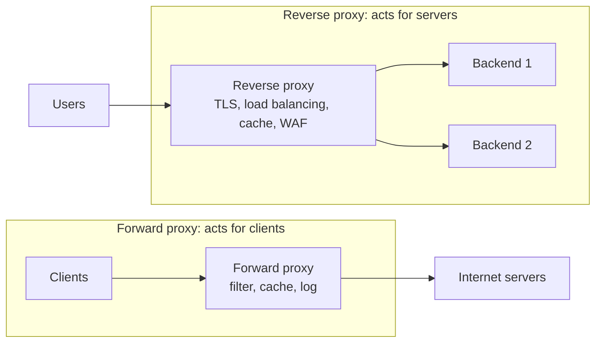

# Proxies

## Summary

A proxy is an intermediary server between a client and a destination server: the client sends its request to the proxy, which evaluates, possibly modifies, logs or caches it, forwards it, and relays the response back. Proxies are classified by whom they act for (forward proxies act for clients, reverse proxies for servers), by visibility (transparent, anonymous, elite, distorting), by function (caching) and by protocol (HTTP, SOCKS). They provide privacy, security, caching, load balancing, access control and monitoring, at the cost of an extra hop, a potential single point of failure and configuration effort.

## Prerequisites

- [HTTP and HTTPS](../application-layer/http-and-https.md) and [TCP/IP model](../network-models/tcp-ip-model.md).

## Core concepts

### Definition

A proxy server sits between a client and a destination server and facilitates or controls the flow of requests and responses. It intercepts requests from clients (browsers, applications) and forwards them to target servers.

Purposes:

- hide or mask client IP addresses,
- improve security and privacy,
- improve performance through caching,
- enforce policies such as content filtering or access control.

*Analogy.* An agent who does your errands. You give the agent your request, the agent goes to the shop, may refuse forbidden purchases, may already have the item in stock (cache), and brings back the result; the shop only sees the agent. A reverse proxy is the shop's own front counter clerk who fetches goods from the storeroom: customers never see the storeroom. The analogy breaks on scale: one proxy handles tens of thousands of concurrent errands.

### How it works

1. **Request flow**: the client sends its request to the proxy instead of the target server; the proxy evaluates, modifies or logs it according to its configuration and forwards it.
2. **Response flow**: the server responds to the proxy, which may alter or log the response before sending it to the client.



### Types

1. **Forward proxy**: acts on behalf of clients that access external networks; used for filtering, caching and anonymization ([Forward proxy](forward-proxy.md)).
2. **Reverse proxy**: acts on behalf of servers; clients talk to the proxy, which forwards to backends; used for load balancing, TLS termination and security ([Reverse proxy](reverse-proxy.md)).
3. **Transparent (intercepting) proxy**: intercepts traffic without client configuration, typically through routing or firewall redirection; used by ISPs and enterprises for filtering and monitoring. It does not hide that a proxy exists and usually passes the client IP.
4. **Anonymous proxy**: hides the client's IP address from the destination but identifies itself as a proxy (for example with a `Via` header).
5. **High anonymity (elite) proxy**: hides both the client IP and the fact that a proxy is used.
6. **Distorting proxy**: identifies as a proxy but sends a false client IP address.
7. **Caching proxy**: stores copies of frequently requested resources to reduce latency and bandwidth (Squid, Varnish, CDN edges).
8. **Open proxy**: usable by anyone on the Internet; often insecure and abused for attacks, spam and fraud.
9. **SOCKS proxy**: works below application protocols (usually described as OSI layer 5) and relays any TCP (and with SOCKS5 also UDP) traffic, such as FTP or HTTPS, without understanding it; SSH's `-D` option provides one.
10. **HTTP proxy**: understands HTTP; it can filter and cache web traffic, and tunnels HTTPS with the `CONNECT` method.

### Use cases

1. **Privacy and security**: hiding user identity and IP addresses, preventing tracking.
2. **Content filtering**: blocking sites or categories in schools, enterprises or parental controls.
3. **Performance**: caching reduces bandwidth and response times; CDNs are global caching reverse proxies.
4. **Load balancing**: reverse proxies distribute requests across servers.
5. **Access control**: restricting resources by IP, authentication or policy.
6. **Traffic monitoring**: logging activity for analytics or security.

### Advantages and disadvantages

Advantages: privacy (masks client identity and location), security (filters malicious traffic and acts as a barrier), performance (caching), load management, and central control and monitoring.

Disadvantages: added latency from an extra hop, a single point of failure unless redundant, configuration and maintenance expertise, and abuse potential of open proxies. TLS adds another trade off: a proxy can only inspect HTTPS content if it terminates TLS, which requires trusted certificates on clients (forward) or the site's certificate (reverse).

## Worked example

Use a forward HTTP proxy and a SOCKS proxy from the command line. Untested; curl 8.x and OpenSSH 9.x, checked 2026-11. Proxy addresses are placeholders.

```bash
# HTTP proxy for plain HTTP and HTTPS (CONNECT tunnel)
curl -x http://proxy.example.com:3128 -I https://www.example.org/
export HTTPS_PROXY=http://proxy.example.com:3128 NO_PROXY=localhost,.internal   # used by many tools
# SOCKS5 proxy through an SSH bastion
ssh -D 1080 -N bastion.example.com &
curl --socks5-hostname 127.0.0.1:1080 https://intranet.internal/
```

`--socks5-hostname` resolves names at the proxy side, so internal DNS names work and DNS queries do not leak locally.

## Trade offs and when to use it

- **Forward proxies** centralize egress control in enterprises and build pipelines; they must be highly available because everything depends on them.
- **Reverse proxies** are standard in front of web applications.
- **Transparent proxies** need no client configuration but cannot cleanly intercept HTTPS without breaking certificates.

## Common mistakes

- **Running an open proxy by accident** (no access control). Fix: restrict by source network and authenticate.
- **Forgetting `NO_PROXY`** for internal addresses; internal calls go through the proxy and fail. Fix: list internal domains and ranges.
- **Trusting `X-Forwarded-For` from anyone.** Clients can forge it. Fix: only trust it from known proxies.

## Practice

1. What is the key difference between a forward and a reverse proxy?
2. How does an HTTP proxy carry HTTPS traffic without decrypting it?
3. Which proxy type hides even the fact that a proxy is used?

Answers:

1. A forward proxy acts for clients reaching external servers; a reverse proxy acts for servers receiving client requests.
2. With the `CONNECT` method it opens a TCP tunnel to the destination and relays the encrypted bytes.
3. A high anonymity (elite) proxy.

## Further reading

- [RFC 9110: HTTP Semantics, intermediaries and CONNECT](https://www.rfc-editor.org/rfc/rfc9110) (IETF, 2022).
- [RFC 1928: SOCKS Protocol Version 5](https://www.rfc-editor.org/rfc/rfc1928) (IETF, 1996).
- [Squid documentation](https://www.squid-cache.org/Doc/) (Squid project).
