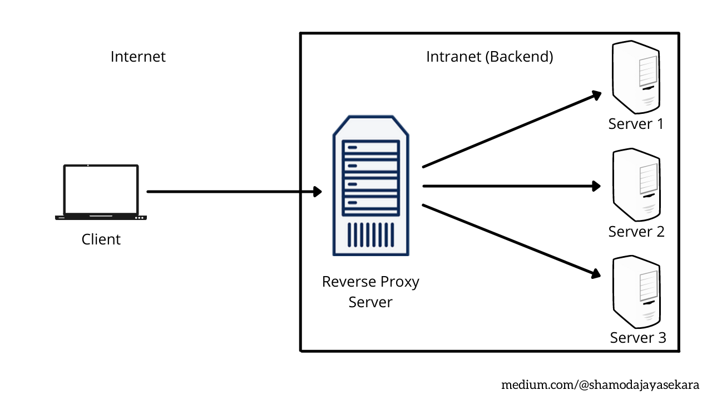
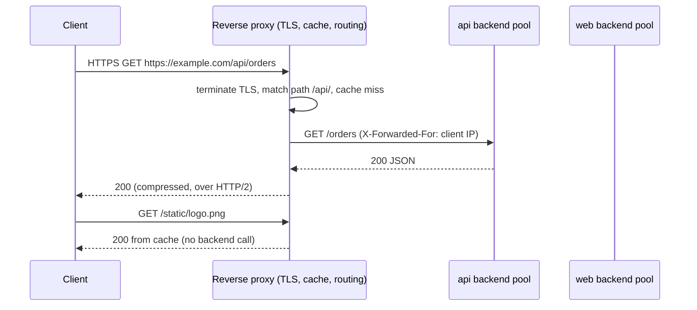

# Reverse proxy

## Summary

A reverse proxy is a server that accepts client requests on behalf of one or more backend (origin) servers and forwards them, so that clients never talk to the origins directly. It is where load balancing, TLS termination, caching, compression, rate limiting, request routing by host or path, web application firewall rules and hiding of the internal topology happen. nginx, HAProxy, Envoy, Traefik, Apache HTTP Server, cloud load balancers and CDNs all act as reverse proxies. The distinction from a forward proxy: a forward proxy sits in front of clients and acts for them; a reverse proxy sits in front of servers and acts for them.

## Prerequisites

- [Proxies](proxies.md) and [HTTP and HTTPS](../application-layer/http-and-https.md).

## Core concepts

### Definition

A reverse proxy sits in front of web servers and forwards client (for example browser) requests to them, typically to improve security, performance and reliability. A forward proxy sits in front of a client and ensures that no origin server communicates directly with that client; a reverse proxy sits in front of an origin server and ensures that no client communicates directly with that origin.

The figure shows the basic layout: a client on the Internet reaches the reverse proxy, which forwards requests to servers 1 to 3 on the internal network.



*Analogy.* A hotel reception. Guests (clients) only deal with reception, which decides which staff member handles a request, keeps commonly requested items at the desk (cache), checks IDs (TLS, authentication) and never gives out staff home addresses (origin IPs). Staff can be replaced or go on break without guests noticing. The analogy breaks at scale: one reverse proxy can front hundreds of services and route by host name and path.

### Benefits

- **Load balancing**: a popular site cannot handle all traffic with one origin server, so the reverse proxy distributes requests across a pool of servers and stops sending to failed ones ([Load balancing](load-balancing.md)).
- **Protection from attacks**: the origin servers' IP addresses are never revealed, so targeted attacks such as DDoS hit the proxy (for example a CDN like Cloudflare), which has stronger defenses and more capacity. WAF rules and rate limits are applied here.
- **Global server load balancing (GSLB)**: a site served from many locations sends each client to the nearest one, which reduces latency.
- **Caching**: a user in Paris visiting a site whose servers are in Los Angeles connects to a reverse proxy in Paris; the proxy fetches the response from Los Angeles once and serves later Paris visitors from its cache, much faster.
- **TLS termination**: encrypting and decrypting TLS for every client costs CPU; the proxy decrypts incoming requests and encrypts responses, freeing origin resources and centralizing certificates.
- **Maintenance**: the proxy is the single entry point regardless of how many servers sit behind it, so staff can take servers out, replace software or hardware and fix bugs without clients noticing.
- **Speed**: compression of responses, HTTP/2 and HTTP/3 to clients while backends speak HTTP/1.1, connection reuse to backends, and geographic caching (as CDNs do).



### Reverse proxy compared with load balancer

A reverse proxy sits between the Internet and one or more servers, intercepts requests, can add security, hide server characteristics and location, manage TLS and cache content. A load balancer distributes traffic across multiple servers so that none is overloaded, can be hardware or software, and increases reliability and capacity.

| Feature | Reverse proxy | Load balancer |
| --- | --- | --- |
| Main function | Forward client requests to the right server and add services | Distribute traffic across several servers |
| Location | In front of backend servers | Between clients and backend servers |
| Security | Often adds security (hiding origins, WAF, TLS) | Focused on distribution |
| Server visibility | Hides backend details | Does not necessarily hide them (layer 4 balancers may preserve client and server addresses) |
| TLS | Commonly terminates TLS | Layer 7 balancers terminate TLS; layer 4 balancers pass it through |
| Caching | Often caches | Typically does not |

In practice the roles overlap: nginx, HAProxy and cloud application load balancers are layer 7 reverse proxies that load-balance. A reverse proxy with one backend is not a load balancer; a layer 4 load balancer that only forwards packets is not a reverse proxy at the HTTP level. Both improve performance and reliability and are often used together.

### Headers and client identity

Because the backend sees the proxy's address, proxies pass the original client information in headers: `X-Forwarded-For` (client IP chain), `X-Forwarded-Proto` (http or https), `X-Forwarded-Host`, or the standardized `Forwarded` header (RFC 7239). Layer 4 proxies use the PROXY protocol instead. Backends must trust these headers only from known proxies.

## Worked example

nginx as a reverse proxy with TLS termination, path routing, caching and two backends. Untested; nginx 1.26, checked 2026-11.

```nginx
proxy_cache_path /var/cache/nginx keys_zone=static:10m max_size=1g inactive=60m;

upstream api_backend {
    server 10.0.1.11:8080 max_fails=3 fail_timeout=10s;
    server 10.0.1.12:8080 max_fails=3 fail_timeout=10s;
    keepalive 32;                                  # reuse connections to backends
}

server {
    listen 443 ssl;
    http2 on;
    server_name example.com;
    ssl_certificate     /etc/ssl/example.com/fullchain.pem;
    ssl_certificate_key /etc/ssl/example.com/privkey.pem;

    location /api/ {
        proxy_pass http://api_backend/;            # trailing slash strips /api/
        proxy_http_version 1.1;
        proxy_set_header Connection "";
        proxy_set_header Host $host;
        proxy_set_header X-Forwarded-For $proxy_add_x_forwarded_for;
        proxy_set_header X-Forwarded-Proto $scheme;
        proxy_read_timeout 30s;
    }

    location /static/ {
        proxy_pass http://10.0.1.20:8080;
        proxy_cache static;
        proxy_cache_valid 200 10m;
        add_header X-Cache-Status $upstream_cache_status;
    }
}
```

Test: `curl -sI https://example.com/static/logo.png` returns `X-Cache-Status: MISS` the first time and `HIT` the second. Stopping one API backend leaves `/api/` working; stopping both returns `502 Bad Gateway`. See [nginx](nginx.md).

## Trade offs and when to use it

- **Benefits**: one controlled entry point with TLS, caching, routing and security.
- **Costs**: an extra hop and a critical component that must be redundant (two or more instances behind DNS or a layer 4 load balancer, or a managed service).
- **Managed options** (cloud load balancers, CDNs, API gateways) remove operations work but limit customization.

## Common mistakes

- **Backends logging the proxy IP for every request.** Fix: configure real-IP handling from trusted proxies.
- **Timeouts shorter in the proxy than in the backend.** Requests are cut off with 504 while the backend continues. Fix: align timeouts along the chain.
- **Caching personalized responses.** Users see others' data. Fix: cache only public content, respect `Cache-Control: private`, vary on cookies or authorization.
- **Exposing origins directly as well.** Attackers bypass the proxy. Fix: firewall origins to accept traffic only from the proxy.

## Practice

1. What is the difference between a forward proxy and a reverse proxy?
2. Name four services a reverse proxy commonly provides.
3. Why should origin servers accept traffic only from the reverse proxy?

Answers:

1. A forward proxy acts for clients and hides them from servers; a reverse proxy acts for servers and hides them from clients.
2. Any four of: load balancing, TLS termination, caching, compression, routing by host or path, rate limiting, WAF, hiding origins.
3. Otherwise attackers can bypass the proxy's protections (WAF, rate limits, DDoS absorption) by connecting to the origins' IP addresses.

## Further reading

- [What is a reverse proxy?](https://www.cloudflare.com/learning/cdn/glossary/reverse-proxy/) (Cloudflare Learning Center).
- [nginx reverse proxy guide](https://docs.nginx.com/nginx/admin-guide/web-server/reverse-proxy/) (F5 NGINX).
- [RFC 7239: Forwarded HTTP Extension](https://www.rfc-editor.org/rfc/rfc7239) (IETF, 2014).
- [HAProxy documentation](https://docs.haproxy.org/) (HAProxy Technologies).
