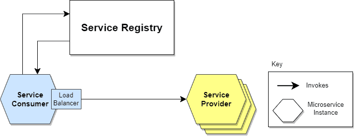
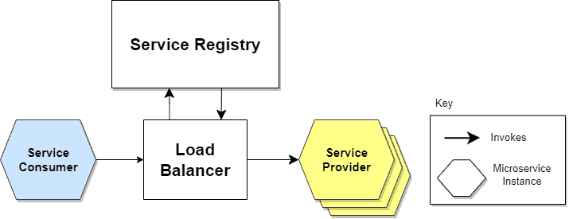
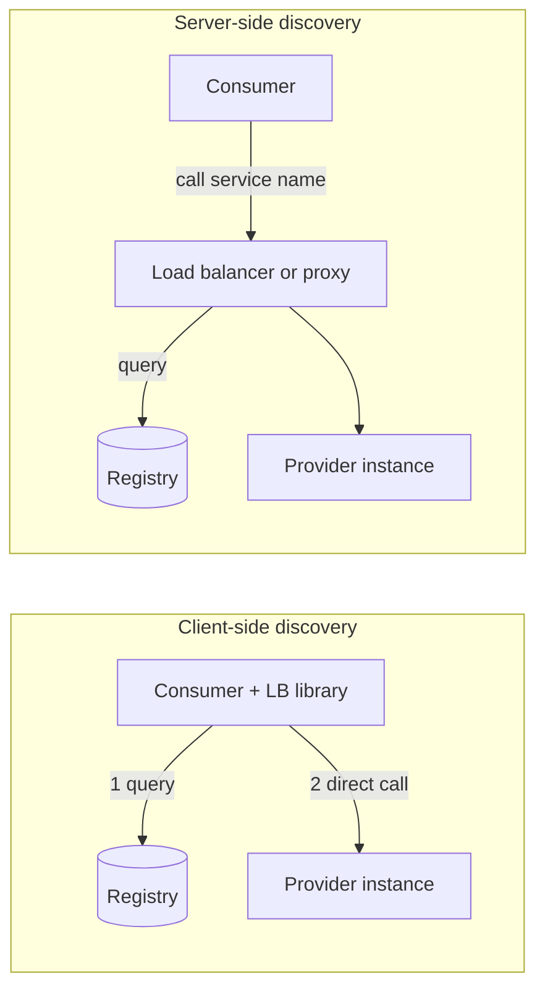
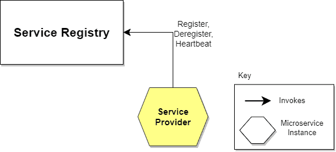
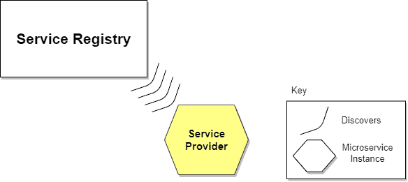

# Service discovery

## Summary

Service discovery is the mechanism by which services in a dynamic environment find the current network locations (IP address and port) of the instances they need to call. A *service registry* keeps the list of live instances; instances get into it by registering themselves or by a third-party registrar watching the platform; consumers find them either directly (client-side discovery, with client-side load balancing) or through a load balancer or proxy that queries the registry (server-side discovery). Kubernetes Services with DNS, Consul, etcd, Eureka and cloud service registries are common implementations. Without discovery, addresses are hardcoded or configured statically, which breaks as soon as instances are autoscaled, replaced or redeployed.

## Prerequisites

- [Load balancing](load-balancing.md) and [DNS overview](../application-layer/dns/dns-overview.md).

## Core concepts

### The problem

A microservice application consists of several services that communicate, for example over REST or gRPC. It usually runs in virtualized or containerized environments where the number of instances and their locations change dynamically: autoscaling adds and removes instances under load, and every release replaces them. A service must know the location (IP address and port) of each service it calls. Hardcoding locations or injecting them through static configuration couples services and makes the system hard to maintain, which works for traditional applications but not for modern cloud applications. Service discovery tracks where every instance is.

*Analogy.* A company switchboard with an always-current staff directory. Employees change desks every day; callers ask the switchboard for "accounting", and the directory says which extensions belong to accounting right now. New hires add themselves to the directory, or HR adds them. The analogy breaks on speed: instances can appear and disappear within seconds, so the directory must update continuously and detect departures through health checks.

### How it works

Service discovery has two parts: a way for an instance to register ("I'm here!") and a way to find registered instances. The figure shows a service consumer and a service provider (a service exposing a REST API):


1. The service provider's location is sent to the service registry, a database of the locations of all available instances.
2. The service consumer asks the discovery server for the provider's location.
3. The registry looks up the location and returns it.
4. The consumer calls the provider directly.

### Client-side discovery

The consumer itself determines the available instances and balances requests between them: it queries the registry, applies a load balancing algorithm and calls the chosen instance.



- Advantage: no extra hop through a dedicated load balancer.
- Disadvantage: every consumer must implement the discovery and load balancing logic, so consumer and registry are coupled, and the logic must exist for every language and framework in use (for example Netflix Eureka with the Ribbon client library, gRPC client-side load balancing).

### Server-side discovery

The consumer calls a load balancer (or router), which queries the registry and routes each request to an available instance.



- Advantage: a dedicated component does load balancing, so consumers are lighter and need no discovery logic per language.
- Disadvantage: the load balancer must be set up and managed (and be highly available), unless the platform provides it, as Kubernetes Services, AWS load balancers or a service mesh do.



### Service registry

The registry is the central part of service discovery: a database of the network locations of service instances. It must be highly available and up to date. Clients may cache locations, but cached entries go stale and then point to instances that no longer exist, so caches need short lifetimes and retries. A registry therefore runs as a cluster of servers that replicate state with a consensus protocol (Raft in Consul and etcd, ZooKeeper's Zab).

### Registration options

**Self-registration.** Each instance registers and deregisters itself and sends heartbeats to keep its registration alive.



- Pro: simple, no other components needed.
- Con: couples instances to the registry; registration code is needed in every language and framework.

**Third-party registration.** A separate component, the *registrar*, registers instances: it polls the deployment environment or subscribes to its events, records new instances and removes terminated ones.



- Pro: services are decoupled from the registry; registration is managed centrally, with no per-language logic.
- Con: unless it is built into the deployment platform, it is another highly available component to set up and run.

In Kubernetes, the control plane is the registrar: the EndpointSlice controller tracks pods that match a Service's selector and pass readiness probes, and CoreDNS and kube-proxy (or a mesh) provide server-side discovery through a stable name such as `orders.shop.svc.cluster.local`.

| Tool | Registry | Registration | Discovery |
| --- | --- | --- | --- |
| Kubernetes Services | API server (etcd) | Third party (controllers, readiness probes) | DNS name and virtual IP (server side), or headless DNS (client side) |
| HashiCorp Consul | Consul servers (Raft) | Agent registration with health checks | DNS interface, HTTP API, service mesh |
| Netflix Eureka | Eureka servers | Self-registration with heartbeats | Client-side libraries |
| etcd or ZooKeeper | Key-value store | Self-registration with leases or ephemeral nodes | Clients watch keys |
| AWS Cloud Map, ECS Service Connect | Managed registry | Platform | DNS or API |

## Worked example

Discover service instances in Kubernetes, server side and client side. Untested; Kubernetes 1.30+, checked 2026-11.

```yaml
apiVersion: v1
kind: Service
metadata: { name: orders, namespace: shop }
spec:
  selector: { app: orders }
  ports: [{ port: 80, targetPort: 8080 }]
---
apiVersion: v1
kind: Service
metadata: { name: orders-headless, namespace: shop }
spec:
  clusterIP: None                 # headless: DNS returns pod IPs for client-side balancing
  selector: { app: orders }
  ports: [{ port: 8080 }]
```

```bash
kubectl -n shop get endpointslices -l kubernetes.io/service-name=orders   # live instance list
kubectl -n shop run tmp --rm -it --image=busybox:1.36 -- sh -c \
  'nslookup orders; nslookup orders-headless'
# orders           -> one virtual IP (kube-proxy balances: server side)
# orders-headless  -> 10.244.1.17, 10.244.2.9, 10.244.3.4 (client chooses: client side)
kubectl -n shop scale deploy orders --replicas=5    # the lists update within seconds, no config change
```

## Trade offs and when to use it

- **Platform-provided discovery** (Kubernetes, cloud) is the default: no extra components.
- **Client-side discovery** saves a hop and enables smart client balancing (gRPC) but needs libraries per language; **server-side discovery** keeps clients simple.
- **DNS-based discovery** works with every client but suffers from caching and lacks health detail; registries with APIs or meshes react faster.

## Common mistakes

- **Long DNS caching in clients** (for example the JVM caching forever). Clients keep calling dead instances. Fix: short TTLs and client settings that respect them.
- **No health checks in registration.** Unready instances receive traffic. Fix: readiness probes or registry health checks.
- **A single-node registry.** Discovery outage stops all communication. Fix: a replicated cluster.

## Practice

1. What are the two parts of service discovery?
2. What is the main drawback of client-side discovery?
3. Who registers pods in Kubernetes?

Answers:

1. Registration of instances in a registry, and lookup of instances by consumers.
2. Discovery and load balancing logic must be implemented in every consumer, for every language and framework.
3. The control plane (EndpointSlice controller) as a third-party registrar, based on Service selectors and readiness.

## Further reading

- [Pattern: Service registry](https://microservices.io/patterns/service-registry.html), [Client-side discovery](https://microservices.io/patterns/client-side-discovery.html) and [Server-side discovery](https://microservices.io/patterns/server-side-discovery.html) (Chris Richardson, microservices.io).
- [Kubernetes Services and DNS](https://kubernetes.io/docs/concepts/services-networking/service/) (Kubernetes).
- [Consul service discovery](https://developer.hashicorp.com/consul/docs/concepts/service-discovery) (HashiCorp).
