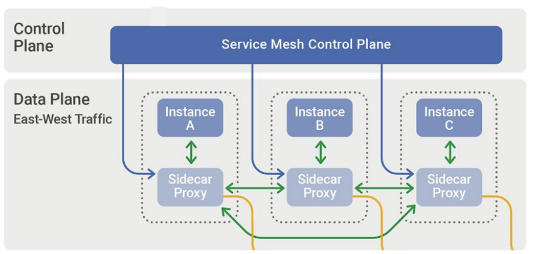
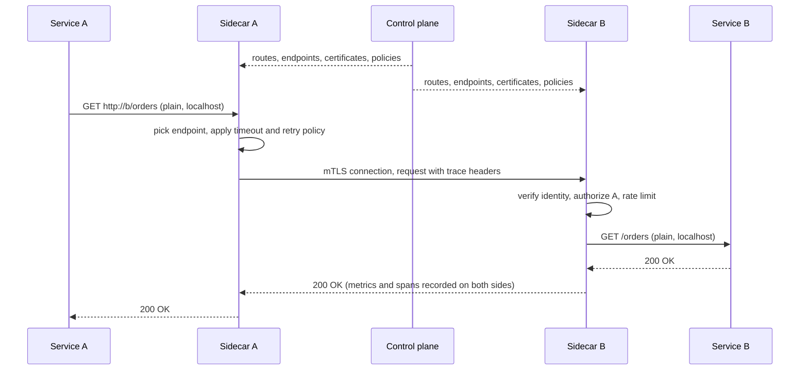

# Service mesh

## Summary

A service mesh is an infrastructure layer that manages communication between the services of a distributed application. Instead of every service implementing retries, timeouts, encryption, load balancing and telemetry in its own code, a *data plane* of proxies (traditionally a sidecar proxy next to each service instance) intercepts all service-to-service traffic and applies these functions uniformly, while a *control plane* configures the proxies from central policies. A mesh gives mutual TLS between services, fine-grained traffic routing (canary releases, traffic splitting), resilience features and consistent metrics and traces. It also adds latency, resource overhead and operational complexity, so it pays off mainly for many services with demanding security or traffic requirements.

## Prerequisites

- [Load balancing](load-balancing.md) and [Service discovery](service-discovery.md), which a mesh provides between services.
- [SSL and TLS](../network-security/ssl-and-tls.md) for mutual TLS.
- [Reverse proxy](reverse-proxy.md), since each sidecar is a small proxy.

## Core concepts

### The problem a service mesh solves

In a microservice architecture, a single user request can cross ten services. Each hop can fail, be slow or be intercepted. Every team would otherwise have to implement the same networking logic (retry budgets, timeouts, circuit breakers, TLS certificates, tracing headers) in every language they use, and keep it consistent. A mesh moves that logic out of the application into the platform.

*Analogy.* An air traffic control system. Pilots (services) fly their routes, but radio, radar and control towers (proxies and control plane) handle separation, routing, rerouting around weather and recording every flight. Airlines do not build their own radar. The analogy breaks on placement: control towers are separate from the planes, while a sidecar proxy sits in the same pod as each service, which is why each one costs memory and CPU.

### Definition and components

A service mesh is an infrastructure layer that handles and manages communication between microservices. It provides load balancing, service discovery, traffic management, security and observability, which makes microservice architectures more reliable and scalable.

1. **Data plane.** Lightweight proxies, usually deployed as sidecars next to each service instance, that handle all incoming and outgoing network traffic of the service: load balancing, service discovery, encryption and monitoring. Envoy is the most common data plane proxy (Istio, Consul); Linkerd uses its own Rust proxy.
2. **Control plane.** The central management layer that configures and manages the data plane proxies. It defines policies for routing, security and observability and distributes certificates, so behavior is consistent across the mesh (istiod in Istio).

The figure shows the classic sidecar layout: the control plane configures a sidecar proxy next to each instance, and all east-west traffic (between services) flows proxy to proxy.



### How it works

Each microservice is paired with a sidecar proxy. When Service A calls Service B:

1. The sidecar of Service A intercepts the outbound request (in Kubernetes, iptables rules or an eBPF program redirect the pod's traffic to the proxy).
2. It applies the configured policies (service discovery, load balancing, retries, timeouts), establishes mutual TLS and forwards the request to the sidecar of Service B.
3. The sidecar of Service B intercepts the inbound request, applies its policies (authentication, authorization, rate limiting) and forwards it to Service B on localhost.

The communication logic is abstracted away from the services, so developers focus on business functionality and the mesh handles networking concerns.



North-south traffic (entering or leaving the cluster) passes through gateways that are part of or integrated with the mesh, while east-west traffic flows between sidecars. The figure shows the entry options in an Istio mesh: an Istio ingress gateway, a Kubernetes Ingress, an API gateway with its own proxy, or a NodePort or load balancer directly to a workload.


The next figure adds the observability side: ingress and egress pass through proxies, traffic between proxies is encrypted, and every proxy sends monitoring, logging and tracing data to a telemetry provider. It is drawn for Anthos Service Mesh, now called Cloud Service Mesh on Google Cloud.


### Sidecarless data planes

Sidecars cost memory and CPU per pod and complicate upgrades (every pod restarts to get a new proxy). Newer designs reduce this:

- **Istio ambient mode** (generally available since Istio 1.24 in 2024): a per-node *ztunnel* handles mTLS and layer 4 policy, and optional per-namespace *waypoint* proxies handle layer 7 features.
- **Cilium service mesh**: eBPF in the kernel for layer 4, with a per-node Envoy for layer 7.
- **Proxyless gRPC**: gRPC libraries receive mesh configuration directly through the xDS API.

### Benefits

- **Observability.** Uniform metrics (request rate, errors, latency per service pair), access logs and distributed tracing for every call, which simplifies debugging and performance monitoring.
- **Security.** Mutual TLS (mTLS) between services gives encryption, integrity and strong service identity (in Istio, SPIFFE identities issued by the control plane), plus authorization policies (which service may call which).
- **Traffic management.** Advanced routing, load balancing and traffic splitting by weight, header or path, which supports canary releases, blue-green deployments and fault injection for testing.
- **Resilience.** Retries, timeouts, circuit breakers and outlier detection make the application more robust.

### Popular implementations

| Implementation | Notes |
| --- | --- |
| Istio | Open source (CNCF graduated), Envoy-based, the most feature-rich; sidecar and ambient modes |
| Linkerd | Lightweight, focused on simplicity and performance, designed for Kubernetes; Rust micro-proxy (CNCF graduated); stable release builds are distributed by Buoyant since 2024 |
| Consul service mesh (formerly Consul Connect) | HashiCorp Consul, with strong service discovery and support for VMs and Kubernetes |
| AWS App Mesh | Managed mesh from AWS based on Envoy; AWS announced its discontinuation with end of support on 2026-09-30 and recommends Amazon ECS Service Connect or VPC Lattice |
| Cilium service mesh | eBPF-based, sidecarless |
| Cloud Service Mesh | Google Cloud's managed Istio-based mesh (formerly Anthos Service Mesh) |

### Considerations

Service meshes bring many benefits, but they also add complexity and resource overhead: an extra proxy hop per side (typically a few milliseconds or less at the median, more at the tail), memory per sidecar, another control plane to upgrade and secure, and new failure modes. Assess whether the application's scale and requirements justify a mesh. For small applications, the added complexity can outweigh the benefits. A mesh is a powerful way to manage service-to-service communication with observability, security and control, but its suitability must be judged per case.

## Worked example

A canary release with Istio: send 10 percent of traffic for the `reviews` service to version 2, with a timeout and retries. Untested; Istio 1.2x networking API, checked 2026-11.

```yaml
apiVersion: networking.istio.io/v1
kind: DestinationRule
metadata:
  name: reviews
spec:
  host: reviews
  subsets:
    - name: v1
      labels: { version: v1 }
    - name: v2
      labels: { version: v2 }
  trafficPolicy:
    outlierDetection:            # eject an endpoint after 5 consecutive 5xx errors
      consecutive5xxErrors: 5
      interval: 10s
      baseEjectionTime: 30s
---
apiVersion: networking.istio.io/v1
kind: VirtualService
metadata:
  name: reviews
spec:
  hosts: [reviews]
  http:
    - route:
        - destination: { host: reviews, subset: v1 }
          weight: 90
        - destination: { host: reviews, subset: v2 }
          weight: 10
      timeout: 2s
      retries:
        attempts: 2
        perTryTimeout: 800ms
        retryOn: 5xx,connect-failure
---
apiVersion: security.istio.io/v1
kind: PeerAuthentication
metadata:
  name: default
  namespace: shop
spec:
  mtls:
    mode: STRICT                 # reject plain-text traffic between services
```

Expected result: about one request in ten reaches `reviews-v2`, visible in the per-version request metrics. If v2's error rate stays low, the weights move to 50/50 and then 0/100 (a progressive delivery tool such as Argo Rollouts or Flagger can automate this based on metrics). No application code changed.

## Trade offs and when to use it

- **Use a mesh** for many services (dozens or more) in several languages, zero-trust requirements (mTLS everywhere), and teams that need canary routing and uniform telemetry.
- **Avoid a mesh** for a handful of services, a single language with a good resilience library, or teams without capacity to operate it. Kubernetes network policies, an ingress controller and OpenTelemetry may be enough.
- **Sidecar or ambient.** Ambient and eBPF approaches reduce overhead and simplify upgrades, while sidecars give the most mature per-workload layer 7 control.
- **Retries multiply load.** Mesh retries on top of application retries can turn a slowdown into an overload; define retry budgets in one place.

## Common mistakes

- **Enabling STRICT mTLS before all workloads have sidecars.** Calls from workloads outside the mesh fail. Fix: start with PERMISSIVE, migrate, then switch to STRICT.
- **Stacked retries** in the client library, the mesh and the gateway. Fix: one retry layer with a budget.
- **Ignoring sidecar resources.** Thousands of pods times a default proxy memory request adds up. Fix: tune requests, use sidecar scoping (only the configuration a workload needs) or ambient mode.
- **Treating the mesh as a firewall replacement.** Fix: keep network policies as an additional layer (defense in depth).

## Practice

1. What are the responsibilities of the data plane and the control plane?
2. Describe the path of a request from Service A to Service B in a sidecar mesh.
3. What is east-west traffic, and what is north-south traffic?
4. Name two downsides of a service mesh.
5. Why does STRICT mTLS give stronger security than network-level firewall rules alone?

Answers:

1. The data plane (proxies) handles every request: routing, load balancing, encryption, retries and telemetry. The control plane configures the proxies, distributes certificates and policies.
2. A's sidecar intercepts the request, applies routing and resilience policies, opens an mTLS connection to B's sidecar, which verifies and authorizes the caller and forwards the request to B on localhost.
3. East-west traffic flows between services inside the system; north-south traffic enters or leaves it.
4. Added latency and resource use per request and pod, and operational complexity (another critical component to upgrade and debug).
5. mTLS authenticates the calling service by a cryptographic identity, not by IP address, and encrypts the traffic, so a compromised host in an allowed network range cannot impersonate a service or read traffic.

## Further reading

- [Istio documentation](https://istio.io/latest/docs/) (Istio project, CNCF): traffic management, security and ambient mode.
- [Linkerd documentation](https://linkerd.io/2/overview/) (Linkerd project, CNCF): a lightweight mesh and its design choices.
- [Envoy proxy documentation](https://www.envoyproxy.io/docs) (Envoy project, CNCF): the data plane most meshes use.
- [NIST SP 800-204A: Building Secure Microservices-based Applications Using Service-Mesh Architecture](https://csrc.nist.gov/pubs/sp/800/204/a/final) (NIST, 2020): security guidance for meshes.
- [AWS App Mesh end of support](https://docs.aws.amazon.com/app-mesh/latest/userguide/what-is-app-mesh.html) (Amazon Web Services): the discontinuation notice and migration options.
