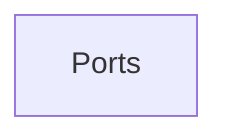

# Transport layer

Delivering data between processes on hosts: ports, connection-oriented TCP and connectionless UDP, and modern transports such as QUIC.

## Map

The diagram shows the notes in reading order; subareas are marked with (subarea).

## Notes in reading order

1. [Ports](ports.md): ranges, common ports, TCP and UDP, port forwarding and SSH tunnels.

## Planned topics

- TCP in depth: handshake, flow and congestion control
- UDP
- QUIC
- TCP tuning on Linux
