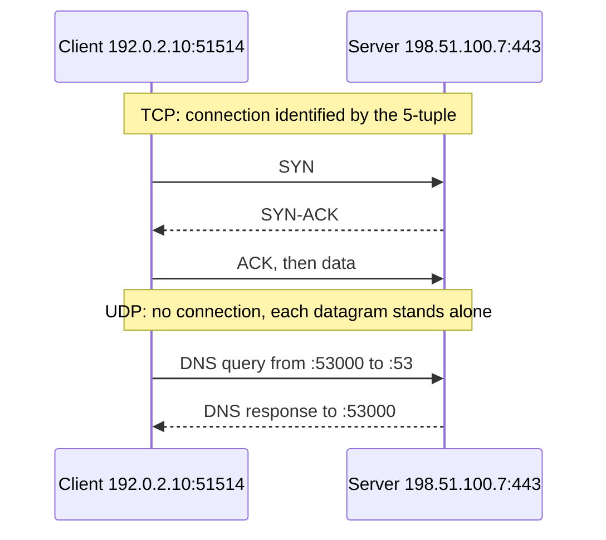

# Ports

## Summary

A port is a 16-bit number (0 to 65535) that the transport layer (TCP or UDP) uses to deliver traffic to the right process on a host: the IP address identifies the machine, the port identifies the service. A connection is identified by the 5-tuple of protocol, source address and port, destination address and port. Ports are divided into well-known (0 to 1023), registered (1024 to 49151) and dynamic or ephemeral ranges, and IANA keeps the official assignments. Knowing common ports is essential for firewall rules, security groups, troubleshooting and service configuration; port forwarding maps external ports to internal services, on routers (NAT) or through SSH tunnels.

## Prerequisites

- [TCP/IP model](../network-models/tcp-ip-model.md) and [IP addressing](../internet-layer/ip-addressing.md).

## Core concepts

### Definition

A network port is a logical endpoint that identifies a specific process or service on a device. Ports let many services share one network interface and distinguish types of traffic.

- Every IP address identifies a device (interface) on a network.
- Each device can run many services at once.
- Ports direct traffic to the right service.

Examples: web (HTTP) on port 80, secure web (HTTPS) on 443, mail transfer (SMTP) on 25, remote login (SSH) on 22. Ports are what let many network services run on one machine at the same time.

*Analogy.* An office building's street address (IP) and room numbers (ports). Mail addressed to the building alone would not reach anyone; "room 443" reaches the web team. Visitors leaving the building get a temporary visitor badge number (ephemeral port) so replies can find them. The analogy breaks because TCP and UDP have separate "room number" sets: TCP 53 and UDP 53 are different endpoints.

### Port ranges

| Range | Usage | Examples |
| --- | --- | --- |
| 0 to 1023, well-known (system) ports | Standard services; binding them on Unix needs root or `CAP_NET_BIND_SERVICE` | SSH 22, HTTP 80, HTTPS 443 |
| 1024 to 49151, registered (user) ports | Assigned to specific applications by IANA on request | MySQL 3306, RDP 3389, Docker daemon 2375 |
| 49152 to 65535, dynamic or private (ephemeral) | Temporary source ports for client connections | Random ports of a browser's outgoing connections |

Operating systems choose their own ephemeral range: Linux uses 32768 to 60999 by default (`/proc/sys/net/ipv4/ip_local_port_range`), Windows uses 49152 to 65535. Well-known ports are standardized; ephemeral ports are assigned dynamically for the duration of a connection.

### Common ports

Web and HTTP services:

| Port | Service | Description |
| --- | --- | --- |
| 80 | HTTP | Unencrypted web traffic |
| 443 | HTTPS (TCP), HTTP/3 (UDP) | Secure web traffic with TLS |
| 8080 | HTTP alternative | Proxies, application servers, development |
| 8443 | HTTPS alternative | Secure web services and admin interfaces |

Remote access:

| Port | Service | Description |
| --- | --- | --- |
| 22 | SSH | Secure remote login |
| 23 | Telnet | Unencrypted remote login (obsolete, do not use) |
| 3389 | RDP | Windows Remote Desktop |

Email:

| Port | Service | Description |
| --- | --- | --- |
| 25 | SMTP | Server-to-server mail transfer |
| 110 | POP3 | Mail retrieval |
| 143 | IMAP | Mail retrieval with synchronization |
| 465 | SMTPS (submission over implicit TLS) | Secure submission; re-standardized by RFC 8314 and recommended |
| 587 | Submission with STARTTLS | Secure mail sending from clients |
| 993 | IMAPS | Secure IMAP |
| 995 | POP3S | Secure POP3 |

Databases:

| Port | Service |
| --- | --- |
| 1433 | Microsoft SQL Server |
| 1521 | Oracle Database |
| 3306 | MySQL and MariaDB |
| 5432 | PostgreSQL |
| 6379 | Redis |
| 9042 | Cassandra |
| 27017 | MongoDB |

DevOps and CI/CD tools:

| Port | Service | Description |
| --- | --- | --- |
| 2375 | Docker daemon API | Unencrypted and unauthenticated; exposing it equals giving root to anyone |
| 2376 | Docker daemon API over TLS | Secure Docker API |
| 5000 | Docker registry (default) | Private image registry |
| 8081 | Nexus Repository | Artifact storage |
| 9090 | Prometheus | Metrics server |
| 3000 | Grafana | Dashboards |

Infrastructure and monitoring:

| Port | Service | Description |
| --- | --- | --- |
| 53 (UDP and TCP) | DNS | Name resolution |
| 67 and 68 (UDP) | DHCP | Address assignment (server and client) |
| 123 (UDP) | NTP | Time synchronization |
| 161 and 162 (UDP) | SNMP and SNMP traps | Monitoring queries and alerts |
| 514 (UDP), 6514 (TCP with TLS) | Syslog | Logging |

Kubernetes:

| Port | Service | Description |
| --- | --- | --- |
| 6443 | Kubernetes API server | Cluster management |
| 2379 to 2380 | etcd | Client and peer communication of the cluster store |
| 10250 | Kubelet API | Node agent |
| 30000 to 32767 | NodePort range | Services exposed on every node |

These assignments are the basis of firewall rules, monitoring and service configuration.

### TCP and UDP

Services use either TCP (Transmission Control Protocol) or UDP (User Datagram Protocol), and each has its own port space.

| Protocol | Characteristics | Use cases |
| --- | --- | --- |
| TCP, connection-oriented | Handshake, reliable, ordered delivery, retransmission, flow and congestion control | Web (HTTP and HTTPS), SSH, SMTP, RDP, FTP, databases |
| UDP, connectionless | No handshake, no retransmission or ordering, lower overhead; has a checksum to detect corruption but no recovery | DNS, VoIP, video calls, online games, SNMP, NTP, QUIC (HTTP/3) |

Examples: web browsing uses TCP (or QUIC over UDP, which adds reliability itself) because every byte must arrive; real-time calls (Zoom, VoIP) use UDP because a late packet is useless, so speed matters more than retransmission. Recorded video streaming (YouTube) mostly uses TCP or QUIC with buffering. Use TCP for data that must be complete and UDP for real-time traffic where speed matters more than reliability.



### Port forwarding

Port forwarding redirects traffic arriving at one address and port to another address and port, typically from a public IP to a host inside a private network. It is used to:

- expose local services to the Internet,
- reach internal servers remotely (SSH, RDP),
- host websites and applications behind a firewall,
- manage network devices remotely,
- forward traffic in cloud and container environments (for example `docker run -p 8080:80`, `kubectl port-forward`).

It exposes private services without changing their internal IP configuration, which is why it must be combined with firewall rules and authentication.

How router port forwarding works (destination NAT):

1. A client on the Internet sends a request to the public IP `203.0.113.5` on port 8080.
2. The router or firewall forwards it to the internal IP `192.168.1.10` on port 80.
3. The internal server processes the request and responds.
4. The router translates the response back and sends it to the client.

| External IP | External port | Internal IP | Internal port |
| --- | --- | --- | --- |
| `203.0.113.5` | 8080 | `192.168.1.10` | 80 |

A request to `http://203.0.113.5:8080` is forwarded to `192.168.1.10:80`.

### SSH port forwarding

**Local port forwarding** forwards traffic from a port on the local machine through an SSH server to a destination; it tunnels private services through SSH.

```bash
ssh -L 8080:example.com:80 user@remote-host
```

`localhost:8080` now reaches `example.com:80`, as seen from `remote-host`.

**Remote port forwarding** exposes a local service on a remote machine, for example to make an internal service reachable from outside.

```bash
ssh -R 9000:localhost:5000 user@remote-server
```

Connections to port 9000 on `remote-server` reach `localhost:5000` on the client (by default only from `remote-server` itself unless `GatewayPorts` is enabled).

**Dynamic port forwarding** creates a SOCKS proxy that routes connections to any destination through the SSH server, used to reach internal networks or act like a lightweight VPN (only where policy allows it).

```bash
ssh -D 8080 user@remote-server
```

Applications configured to use `localhost:8080` as a SOCKS proxy send their traffic through `remote-server`. See [SSH](../application-layer/ssh.md).

## Worked example

Find what listens on a server and verify reachability. Untested; iproute2 and netcat on Linux, checked 2026-11.

```bash
sudo ss -tulpn
# Netid State  Local Address:Port  Process
# tcp   LISTEN 0.0.0.0:22          users:(("sshd",pid=812,...))
# tcp   LISTEN 127.0.0.1:5432      users:(("postgres",pid=1042,...))   <- only local
# tcp   LISTEN *:443               users:(("nginx",pid=1101,...))
# udp   UNCONN 127.0.0.53%lo:53    users:(("systemd-resolve",...))
nc -vz app.example.com 443       # succeeded: open and reachable
nc -vz app.example.com 5432      # timed out: filtered (firewall) or not listening externally
sudo lsof -i :8080               # which process holds port 8080
cat /proc/sys/net/ipv4/ip_local_port_range   # ephemeral range: 32768 60999
```

The listen address matters as much as the port: `127.0.0.1:5432` is reachable only from the host, `0.0.0.0` or `*` from every interface. "Connection refused" means the host answered but nothing listens; a timeout usually means a firewall dropped the packet.

## Trade offs and when to use it

- **Standard ports** make services easy to find for clients and attackers alike; non-standard ports reduce scanner noise but are not security.
- **Port forwarding** is quick for exposure but bypasses central controls; prefer reverse proxies, load balancers or ZTNA for production access.
- **Many outbound connections** from one host (proxies, NAT gateways) can exhaust ephemeral ports; widen the range, reuse connections.

## Common mistakes

- **Exposing databases or the Docker API (2375) to the Internet.** Fix: bind to private interfaces and firewall them.
- **Forgetting UDP** in firewall rules (DNS, NTP, QUIC). Fix: specify protocols explicitly.
- **Assuming port numbers identify the protocol.** Anything can run on any port. Fix: verify with protocol-level checks.

## Practice

1. Which ranges are well-known, registered and dynamic ports?
2. What does "connection refused" tell you compared with a timeout?
3. What is the difference between `ssh -L` and `ssh -R`?
4. Why does DNS use both UDP and TCP port 53?

Answers:

1. Well-known 0 to 1023, registered 1024 to 49151, dynamic 49152 to 65535 (Linux uses 32768 to 60999 for ephemeral ports by default).
2. Refused: the host is reachable but no process listens on the port (a RST came back). Timeout: packets are dropped, typically by a firewall, or the host is unreachable.
3. `-L` makes a local port forward to a destination reachable from the SSH server; `-R` makes a port on the SSH server forward to a destination reachable from the client.
4. UDP for ordinary small queries (fast, no handshake) and TCP for large responses and zone transfers.

## Further reading

- [IANA Service Name and Transport Protocol Port Number Registry](https://www.iana.org/assignments/service-names-port-numbers/) (IANA).
- [RFC 6335: Procedures for the Management of the Service Name and Transport Protocol Port Number Registry](https://www.rfc-editor.org/rfc/rfc6335) (IETF, 2011).
- [RFC 9293: Transmission Control Protocol (TCP)](https://www.rfc-editor.org/rfc/rfc9293) (IETF, 2022) and [RFC 768: User Datagram Protocol](https://www.rfc-editor.org/rfc/rfc768) (IETF, 1980).
- [Kubernetes ports and protocols](https://kubernetes.io/docs/reference/networking/ports-and-protocols/) (Kubernetes).
