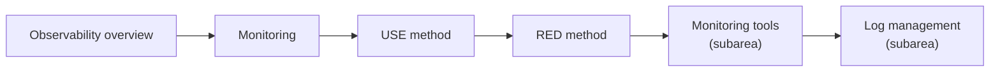

# Observability

Understanding running systems from their telemetry: monitoring, logging, tracing and alerting, and the tools for them.

## Map of the area

The diagram shows the notes in reading order; subareas are marked with (subarea).

## Notes in reading order

1. [Observability overview](observability-overview.md): signals, OpenTelemetry and the difference from monitoring.
2. [Monitoring](monitoring.md): categories, golden signals, alerting and tools.
3. [USE method](use-method.md): utilization, saturation and errors of every resource, with a Linux checklist.
4. [RED method](red-method.md): rate, errors and duration of every request-driven service, dashboards and SLIs.
5. [Monitoring tools](monitoring-tools/README.md): application monitoring, Nagios, New Relic, Splunk, AppDynamics, Instana.
6. [Log management](log-management/README.md): the log lifecycle, Elastic Stack, Graylog, Papertrail, Loki.

## Planned topics

- The four golden signals
- Prometheus
- Grafana
- OpenTelemetry in depth
- Distributed tracing (Jaeger, Tempo)
- Alerting and on-call (Alertmanager, PagerDuty)
- Zabbix
- Datadog
