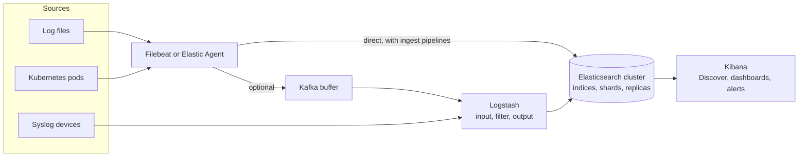

# Elastic Stack

## Summary

The Elastic Stack (formerly the ELK Stack, after Elasticsearch, Logstash and Kibana) is a suite for searching, analyzing and visualizing large volumes of data in near real time, widely used for log management, observability and security analytics. Elasticsearch is a distributed search and analytics engine built on Apache Lucene, Logstash and Beats (or Elastic Agent) collect and transform data, and Kibana visualizes it. It is developed by Elastic N.V. and available self-managed or as Elastic Cloud. Its strength is fast full-text search and aggregations over petabytes; its cost is the effort and hardware needed to run Elasticsearch clusters well.

## Prerequisites

- [Log management](log-management-overview.md) for the log lifecycle.
- JSON and HTTP basics.

## Core concepts

### Purpose

The Elastic Stack is designed to:

- **Collect and aggregate data**: logs, metrics and application data from distributed systems.
- **Search and analyze**: fast full-text search and aggregations on large data sets.
- **Visualize insights**: interactive dashboards and visualizations in Kibana.
- **Monitor systems**: application performance, infrastructure health and network activity.
- **Detect and respond to security threats**: Elastic Security provides SIEM, threat detection and endpoint protection.

*Analogy.* Elasticsearch is the index at the back of a huge book, built for every word on every page and split into volumes kept on different shelves (shards on nodes), with spare copies (replicas). Looking up a word is instant; adding a page means updating the index too, which is why indexing costs CPU and disk. The analogy breaks on aggregation: a book index cannot count how many pages per chapter mention a word, while Elasticsearch computes such aggregations on the fly.

### Components and data flow



| Component | Description |
| --- | --- |
| Elasticsearch | Distributed search and analytics engine that stores and indexes data |
| Logstash | Data ingestion and transformation pipeline: collects, processes and sends data to Elasticsearch |
| Kibana | Visualization and dashboarding tool for Elasticsearch data |
| Beats | Lightweight data shippers (Filebeat, Metricbeat, Packetbeat, Heartbeat, Winlogbeat) |
| Elastic Agent and Fleet | A single unified agent with central management that replaces individual Beats in newer deployments |

### Elasticsearch

- **Distributed search engine** with full-text search, aggregations and filtering.
- **Indexing.** Data is stored as JSON *documents* in *indices*; each index is divided into *primary shards* (for scale) with *replica shards* (for availability and read throughput). A shard is a Lucene index.
- **Inverted index.** For each term, Lucene stores the list of documents that contain it, which makes full-text queries fast.
- **Query DSL.** Queries use a JSON-based language for search and aggregations, for example `{"query": {"match": {"message": "error"}}}`. Elasticsearch also offers SQL and ES|QL, a piped query language.
- **Data streams and index lifecycle management (ILM).** Time-series data is written to a data stream that rolls over to a new backing index by size or age and moves through hot, warm, cold, frozen and delete phases.

### Logstash

- **Ingestion pipeline** collecting data from logs, metrics or APIs.
- **Processing**: parses, filters and transforms data before sending it to Elasticsearch.
- **Inputs, filters, outputs**:
  - Input: file, syslog, Beats, Kafka, HTTP.
  - Filter: grok, mutate, date, JSON.
  - Output: Elasticsearch, file, Kafka.

A minimal pipeline (the grok pattern only extracts the syslog timestamp):

```text
input {
  file { path => "/var/log/syslog" }
}
filter {
  grok { match => { "message" => "%{SYSLOGTIMESTAMP:timestamp}" } }
}
output {
  elasticsearch { hosts => ["localhost:9200"] }
}
```

Elasticsearch *ingest pipelines* can do much of the same parsing inside the cluster, so many deployments now skip Logstash.

### Kibana

- **Data visualization**: dashboards, graphs and time-series charts.
- **Discover**: search and filter raw data.
- **Lens**: drag-and-drop visualization builder.
- **Alerting**: rules and connectors for threshold-based and query-based notifications. *Watcher* is the older Elasticsearch alerting feature.

### Beats

- **Filebeat**: log files.
- **Metricbeat**: system and application metrics.
- **Packetbeat**: network traffic.
- **Heartbeat**: service uptime.
- **Winlogbeat**: Windows event logs.

### Observability features

| Feature | Description |
| --- | --- |
| Logs | Centralize and analyze application logs |
| Metrics | Monitor CPU, memory and application metrics |
| APM | Trace application performance and dependencies (Elastic APM, OpenTelemetry native) |
| Uptime (synthetics) | Track service availability |
| Security (SIEM) | Detect threats and analyze behavior |

### Key terminology

| Term | Description |
| --- | --- |
| Index | Collection of documents in Elasticsearch |
| Document | A JSON object representing one data entry |
| Shard | Subdivision of an index for parallel processing and distribution |
| Replica | A copy of a primary shard on another node |
| Mapping | The schema of an index: field names and types |
| Grok | Logstash filter for parsing unstructured text with named patterns |
| Dashboard | Visual representation of indexed data in Kibana |
| Watcher | Elasticsearch alerting feature for notifications |

### Licensing

The license history matters for tool choice. In 2021 Elastic moved Elasticsearch and Kibana from Apache 2.0 to a dual license (Server Side Public License and Elastic License), which is not an open source license under the OSI definition; Amazon forked the last Apache-licensed version as **OpenSearch** (now under the Linux Foundation). In 2024 Elastic added the AGPLv3 as a third license option, so the source is again available under an OSI-approved license. Advanced features (some security, machine learning and alerting functions) remain commercial subscription features.

### Advantages

- **Scalability and performance.** Elasticsearch scales horizontally to petabytes, with distributed search, fast queries and near real-time indexing.
- **Open source and flexible.** The core is available under open licenses (see above), with custom pipelines, indexing strategies and dashboards.
- **Full-text search** on Apache Lucene with powerful queries.
- **Real-time insights**: near real-time ingestion, search and visualization.
- **Rich visualization** in Kibana, including time series and geospatial analysis.
- **Ecosystem integrations** with Docker, Kubernetes, AWS, Azure, Google Cloud and third-party logging tools; Grafana can query Elasticsearch too.

### Disadvantages

- **Complexity.** A production cluster needs cluster management, shard sizing, mappings, lifecycle policies and tuning.
- **Resource intensive.** Elasticsearch uses significant CPU, memory (JVM heap plus file system cache) and disk, especially for high-volume logging.
- **Cost.** Elastic Cloud and advanced features are commercial; scaling raises infrastructure and license costs.
- **Query complexity.** The JSON Query DSL is harder for beginners than SQL-like languages.

### Comparison with alternatives

| Feature | Elastic Stack | Splunk | Datadog | New Relic |
| --- | --- | --- | --- | --- |
| Log management | Yes | Yes | Yes | Yes |
| Metrics monitoring | Yes | Yes | Yes | Yes |
| Visualization | Yes | Yes | Yes | Yes |
| Open source | Yes (AGPLv3 option since 2024; OpenSearch fork under Apache 2.0) | No | No | No (agents partly open) |
| Real-time ingestion | Yes | Yes | Yes | Yes |
| Cost efficiency when self-hosted | Yes, if you can operate it | No | No | No |

## Worked example

Find the services with the most errors in the last 15 minutes. Untested; Elasticsearch 8.x Query DSL, checked 2026-11. The data stream `logs-app-default` is assumed to contain ECS fields `log.level` and `service.name`.

```bash
curl -s -u elastic:<PASSWORD> -H 'Content-Type: application/json' \
  'https://es.example.com:9200/logs-app-default/_search?size=0' -d '
{
  "query": {
    "bool": {
      "filter": [
        { "term":  { "log.level": "error" } },
        { "range": { "@timestamp": { "gte": "now-15m" } } }
      ]
    }
  },
  "aggs": {
    "by_service": { "terms": { "field": "service.name", "size": 5 } }
  }
}'
```

`filter` clauses do not compute relevance scores and are cached, which makes them faster than `must` for exact matches. `size=0` returns only the aggregation. Example response, shortened:

```json
{
  "hits": { "total": { "value": 1834, "relation": "eq" } },
  "aggregations": {
    "by_service": {
      "buckets": [
        { "key": "checkout", "doc_count": 1290 },
        { "key": "payments", "doc_count": 412 },
        { "key": "search",   "doc_count": 132 }
      ]
    }
  }
}
```

The same question in ES|QL:

```text
FROM logs-app-default
| WHERE log.level == "error" AND @timestamp >= NOW() - 15 minutes
| STATS errors = COUNT(*) BY service.name
| SORT errors DESC
| LIMIT 5
```

## Trade offs and when to use it

- **Choose the Elastic Stack** when you need fast full-text search, flexible aggregations, SIEM and observability in one self-hostable platform.
- **Choose OpenSearch** for an Apache-licensed alternative or when using Amazon OpenSearch Service.
- **Choose Loki** for cheaper log storage when label filters plus grep-like search are enough.
- **Shard sizing** drives performance: too many small shards waste heap, too few large ones limit parallelism and slow recovery. A common guideline is shards of tens of GB (Elastic suggests roughly 10 to 50 GB, checked 2026-11).

## Common mistakes

- **Dynamic mapping on uncontrolled data.** Every new JSON key creates a field until the index hits the field limit ("mapping explosion"). Fix: explicit mappings, `dynamic: false` or flattened fields for arbitrary keys.
- **Running without lifecycle policies.** Disks fill up and the cluster turns read-only at the flood-stage watermark. Fix: ILM with rollover and delete phases.
- **Exposing port 9200 to the internet.** Unprotected clusters have leaked large data sets. Fix: security enabled (the default since 8.0), TLS, network restrictions.
- **JVM heap above about 31 GB.** It disables compressed object pointers and wastes memory. Fix: heap at most half of RAM and below that threshold.

## Practice

1. What is the difference between a primary shard and a replica?
2. When can you skip Logstash?
3. Why was OpenSearch created?
4. Why use `filter` instead of `must` for the log level in the worked example?

Answers:

1. A primary shard holds a part of the index's data; a replica is a copy of a primary on another node for availability and read scaling.
2. When Beats or Elastic Agent ship directly to Elasticsearch and ingest pipelines do the parsing, with no need for Logstash's complex routing or buffering.
3. Because Elastic changed the license of Elasticsearch and Kibana in 2021 to licenses that are not OSI open source; AWS forked the last Apache 2.0 version.
4. Exact-match conditions do not need relevance scoring, and filter results are cached, so the query is faster.

## Further reading

- [Elastic documentation](https://www.elastic.co/docs) (Elastic): Elasticsearch, Kibana, Logstash, Beats and Elastic Agent.
- [Query DSL](https://www.elastic.co/docs/reference/query-languages/querydsl) (Elastic): query and filter context, aggregations.
- [Size your shards](https://www.elastic.co/docs/deploy-manage/production-guidance/optimize-performance/size-shards) (Elastic): shard sizing guidance.
- [Elasticsearch is Open Source. Again!](https://www.elastic.co/blog/elasticsearch-is-open-source-again) (Shay Banon, Elastic, 2024): the AGPL announcement.
- [OpenSearch documentation](https://opensearch.org/docs/latest/) (OpenSearch Project, Linux Foundation): the fork.
