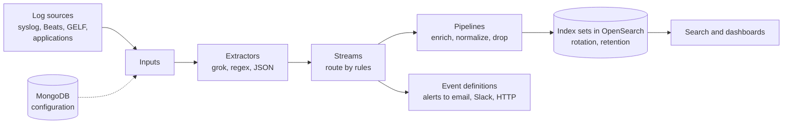

# Graylog

## Summary

Graylog is a log management platform that collects, aggregates, indexes and analyzes log data from many sources in real time. It is used for centralized logging, troubleshooting, security auditing and infrastructure monitoring, and is often chosen as a simpler alternative to the Elastic Stack or a cheaper one to Splunk. Its model is a processing chain: *inputs* receive messages, *extractors* and *pipelines* parse and enrich them, *streams* route them into logical groups, and *index sets* store them in an OpenSearch (formerly Elasticsearch) backend, with MongoDB holding the configuration. Graylog Open is free (under the Server Side Public License since version 4.0); archiving, correlation and security features need a paid edition.

## Prerequisites

- [Log management](log-management-overview.md) for the log lifecycle and syslog.
- [Elastic Stack](elastic-stack.md) for indices and shards, which Graylog uses underneath.

## Core concepts

### Purpose

- **Centralized log collection** from servers, applications, containers and cloud platforms.
- **Troubleshooting** of performance issues and application failures.
- **Security monitoring** of system activity, incidents and access violations.
- **Compliance audits** with collected and retained logs.
- **Operational insights** through custom dashboards.

*Analogy.* Graylog is a mail room with conveyor belts. Letters arrive at different doors (inputs), clerks open them and write the sender and subject on a label (extractors and pipelines), sorting rules send each letter to the right department's bin (streams), and each department keeps its bins for its own retention time (index sets). The analogy breaks because one log message can go to several streams at once, while a letter can only be in one bin.

### How it works



Graylog processes log data in a pipeline architecture:

1. **Input.** Collects logs from sources (for example syslog, Filebeat or Amazon CloudWatch).
2. **Processing.** Parses, transforms and enriches logs with extractors and pipelines.
3. **Storage and indexing.** Stores logs in the search backend for efficient searching.
4. **Search and analysis.** Querying and visualizing logs in the Graylog web interface.
5. **Alerting and dashboards.** Notifications based on custom rules and dashboards with widgets.

Detailed flow of one message:

1. **Log source**: syslog, Filebeat, application logs.
2. **Input**: a Graylog input receives the log stream.
3. **Extractors**: parse fields (for example IP address, timestamp).
4. **Streams**: route logs into logical groups (for example "Error logs").
5. **Pipelines**: apply rules (enrich, normalize, discard).
6. **Search backend**: index logs for search and analysis.
7. **Search and analyze**: Graylog UI for queries and dashboards.
8. **Alerts**: email or Slack on critical patterns.

The order of extractors, streams and pipelines can be configured in the message processor settings; pipelines attach to streams, so stream routing usually happens before pipeline processing.

### Core vocabulary

| Concept | Description |
| --- | --- |
| Inputs | Receive data from sources such as syslog, Beats, GELF, AWS or custom HTTP endpoints |
| Messages | Individual log entries with structured or unstructured data |
| Streams | Real-time routing of messages into logical groups (for example "Error logs", "Security logs") |
| Extractors | Parsers that extract fields from raw messages with grok, regex and other methods (pipelines are the more powerful successor) |
| Pipelines | Processing rules with conditions (when, then) to transform, enrich or drop messages |
| Index sets | Groups of indices with their own rotation and retention settings |
| Alerts and notifications | Event definitions that fire when messages match conditions, with email, Slack or HTTP notifications |
| Dashboards | Visual representations of log data with widgets, graphs and charts |
| Roles and permissions | Role-based access control (RBAC) to streams, dashboards and features |

*GELF* (Graylog Extended Log Format) is a JSON-based log format, sent over UDP, TCP or HTTP, that avoids syslog's message length limits and carries arbitrary structured fields.

### Key features

| Feature | Description |
| --- | --- |
| Centralized log management | Aggregates logs from many systems into one platform |
| Full-text search | Fast search with the OpenSearch backend and a Lucene-like query syntax |
| Streams and filtering | Real-time classification and routing |
| Extractors | Parse raw logs into structured fields |
| Custom pipelines | Transform, enrich or discard logs before indexing |
| Alerting | Alerts on patterns, errors and aggregated conditions |
| Dashboards and widgets | Graphs, charts and counters |
| Role-based access | Granular access control for users and teams |
| Integrations | Syslog, GELF, AWS, Beats and custom inputs |
| REST API | Automation and programmatic queries |

### Advantages

- **Free core.** Graylog Open is free; enterprise features are available as paid editions.
- **Easy extractors** for grok, regex and CSV parsing.
- **Streams and pipelines** for real-time filtering and advanced processing.
- **Built-in alerting** on critical log events.
- **RBAC** for user permissions.
- **REST API** for automation and integration.
- **Modular design** (inputs, streams, extractors, pipelines) that adapts to many environments.

### Disadvantages

- **Dependencies.** Requires a JVM, MongoDB for configuration and an OpenSearch (or older Elasticsearch) cluster, or the Graylog Data Node that manages OpenSearch for you.
- **Resource consumption** grows in high-volume setups.
- **Less modern UI** than Kibana or Splunk.
- **Complex at large scale.** Distributed setups need search cluster expertise.
- **Paid advanced features.** Archiving, correlation and some security features need a commercial license.
- **License.** Graylog Open uses the SSPL, which is not an OSI-approved open source license.

### Comparison with alternatives

| Feature | Graylog | Elastic Stack | Splunk |
| --- | --- | --- | --- |
| Ease of setup | Easier | More complex | Easy (cloud), complex (on-premises) |
| Performance | Good for medium volumes | Highly scalable for large volumes | High performance, scales well |
| Cost | Free core, paid enterprise | Free self-hosted core, paid cloud and advanced features | Expensive |
| UI and UX | Functional but basic | Modern (Kibana) | Polished |
| Query language | Lucene-like search syntax | Query DSL (JSON), KQL, ES|QL | SPL (powerful but complex) |
| Alerting | Built in (basic in the free edition) | Basic rules free, advanced paid | Advanced |
| Data parsing | Extractors and pipelines (easier) | Logstash and ingest pipelines (flexible but complex) | Built-in parsing and field extraction |

## Worked example

A pipeline rule that tags failed SSH logins with the source IP and routes them to a security stream. Untested; Graylog 6.x pipeline rule syntax, checked 2026-11.

```text
rule "extract failed ssh logins"
when
  has_field("message") &&
  contains(to_string($message.message), "Failed password")
then
  let m = regex("from (\\d+\\.\\d+\\.\\d+\\.\\d+) port", to_string($message.message));
  set_field("src_ip", m["0"]);
  set_field("event_type", "ssh_failed_login");
  route_to_stream(name: "Security logs");
end
```

An example input line and the resulting fields:

```text
Nov  9 14:22:01 web1 sshd[2231]: Failed password for root from 203.0.113.45 port 52144 ssh2
```

| Field | Value |
| --- | --- |
| `source` | web1 |
| `src_ip` | 203.0.113.45 |
| `event_type` | ssh_failed_login |
| streams | All messages, Security logs |

An event definition on the "Security logs" stream with an aggregation `count() > 20` grouped by `src_ip` over 5 minutes then alerts on brute-force attempts from one address.

## Trade offs and when to use it

- **Choose Graylog** for centralized logging with simple routing and alerting, when you want something easier than assembling the Elastic Stack yourself and cheaper than Splunk.
- **Choose the Elastic Stack** for very large volumes, richer analytics and APM in the same platform.
- **Choose Loki** when cost matters most and full-text indexing is not needed.
- **Plan the backend.** Graylog's scalability is the scalability of its OpenSearch cluster.

## Common mistakes

- **One index set for everything.** Debug logs then live as long as audit logs. Fix: separate index sets with different retention.
- **Heavy regex extractors on every message.** Throughput drops. Fix: parse structured formats (JSON, GELF) and limit regex to matching streams.
- **Exposing inputs to the internet.** Anyone can inject log messages. Fix: firewall inputs, use TLS and authentication where supported.

## Practice

1. What is the role of MongoDB in a Graylog installation?
2. What is the difference between a stream and an index set?
3. Why might you prefer GELF over classic syslog for application logs?

Answers:

1. It stores Graylog's configuration and metadata (inputs, streams, users), not the log messages.
2. A stream is a routing rule that groups messages logically; an index set is the storage configuration (indices, rotation, retention) that streams write to.
3. GELF carries structured fields as JSON and has no small message length limit, so stack traces and custom fields arrive intact.

## Further reading

- [Graylog documentation](https://go2docs.graylog.org/) (Graylog): architecture, inputs, streams, pipelines and index sets.
- [Pipeline rules](https://go2docs.graylog.org/current/making_sense_of_your_log_data/rules.html) (Graylog): rule syntax and functions.
- [GELF specification](https://go2docs.graylog.org/current/getting_in_log_data/gelf.html) (Graylog): the Graylog Extended Log Format.
