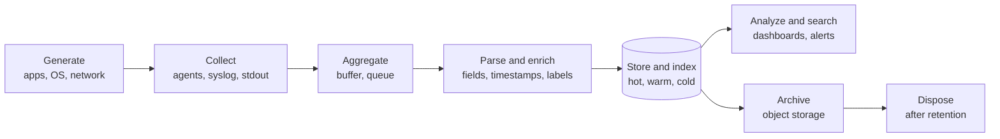
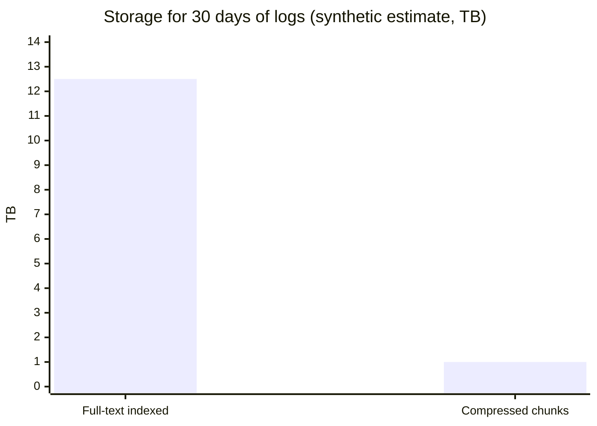

# Log management

## Summary

Log management is the process of handling the log events produced by all software applications and the infrastructure they run on. It covers the whole lifecycle of a log event: collection, aggregation, parsing, storage, analysis, search, archiving and disposal. The aim is to use log data for troubleshooting and business insight while keeping applications and infrastructure compliant and secure. In practice it means shipping logs off every machine into a central system where they are structured, indexed or labeled, retained for a defined time and searchable in seconds.

## Prerequisites

- [Observability overview](../observability-overview.md) for logs as one of the telemetry signals.
- Basic Linux logging: files under `/var/log`, the systemd journal ([Startup management](../../operating-systems/system-administration/startup-management.md) covers systemd).

## Core concepts

### The problem log management solves

On a single server you can `tail -f` a log file. With 300 containers that live for minutes, logs are scattered across machines, disappear when a container is deleted, use different formats and time zones, and cannot be searched together. During an incident nobody has time to log into hosts one by one. Central log management collects everything as it is written, keeps it after the source is gone and lets one query search all of it.

*Analogy.* A post office sorting center. Letters (log events) arrive from thousands of mailboxes, are stamped with time and origin (collection and enrichment), sorted by address (parsing and indexing), kept in a warehouse for a fixed time (retention) and destroyed after it (disposal). The analogy breaks on reading: a post office never opens the letters, while log management exists to read and search them.

### The log lifecycle



1. **Collection.** Agents (Filebeat, Fluent Bit, Fluentd, Vector, the OpenTelemetry Collector, Promtail or Grafana Alloy) read files, the journal or container stdout; network devices send syslog.
2. **Aggregation.** Events are buffered and often passed through a queue (Kafka, Redis) to absorb bursts.
3. **Parsing and enrichment.** Unstructured lines become fields (timestamp, level, service, trace ID); metadata such as host, pod and environment is added.
4. **Storage.** Events are indexed (full text in Elasticsearch, OpenSearch, Splunk) or stored compressed with a small label index (Grafana Loki).
5. **Analysis and search.** Queries, dashboards and alerts.
6. **Archiving.** Older data moves to cheaper tiers or object storage.
7. **Disposal.** Data is deleted when its retention period ends, which also limits privacy and compliance risk.

### Structured logging

A structured log line is a record with named fields, usually JSON, instead of free text:

```json
{"ts":"2026-11-09T14:10:02.531Z","level":"error","service":"checkout","trace_id":"4bf92f3577b34da6a3ce929d0e0e4736","msg":"payment declined","order_id":"A-1042","latency_ms":2310}
```

Structured logs need no fragile regex parsing, can be filtered by field and join with traces through `trace_id`. Log levels (DEBUG, INFO, WARN, ERROR) should be used consistently so that verbose levels can be dropped before storage.

### Syslog

*Syslog* (RFC 5424, with the older BSD format in RFC 3164) is the standard protocol for sending log messages over the network, traditionally on UDP port 514 (TCP 514 or 6514 with TLS for reliable or secure delivery). Each message carries a *facility* (source category such as `auth` or `daemon`) and a *severity* from 0 (emergency) to 7 (debug). Network devices, appliances and many Unix daemons still speak syslog, so most log platforms accept it.

### Tools in this area

| Tool | Model | Note |
| --- | --- | --- |
| [Elastic Stack](elastic-stack.md) | Full-text indexing | Self-hosted or Elastic Cloud; OpenSearch is the AWS-led fork |
| [Graylog](graylog.md) | Full-text indexing on OpenSearch | Focus on log management and security, with streams and pipelines |
| [Papertrail](papertrail.md) | SaaS, syslog based | Simple hosted live tail and search |
| [Grafana Loki](loki.md) | Label index, compressed chunks | Cheap storage, Prometheus-like labels |
| [Splunk](../monitoring-tools/splunk.md) | Full-text indexing, schema on read | SIEM and analytics leader |

## Worked example

Estimating storage for central logging (synthetic numbers): 200 services each write on average 50 log lines per second of 400 bytes.

| Quantity | Calculation | Result |
| --- | --- | --- |
| Raw volume per second | 200 x 50 x 400 B | 4 MB/s |
| Raw volume per day | 4 MB/s x 86,400 s | about 346 GB/day |
| Full-text index (about 1.0x to 1.5x raw incl. replica overhead varies) | 346 GB x 1.2 | about 415 GB/day |
| Compressed chunks (Loki-style, about 10x compression) | 346 GB / 10 | about 35 GB/day |
| 30 days retention, indexed | 415 GB x 30 | about 12.5 TB |
| 30 days retention, compressed chunks | 35 GB x 30 | about 1 TB |

The ratios are rough assumptions for illustration; real numbers depend on the data and settings, so measure with a sample. The chart makes the design consequence visible.



Dropping DEBUG logs, which are often half of the volume, halves every figure in the table, which is usually the cheapest optimization available.

## Trade offs and when to use it

- **Full-text indexing** (Elastic, Splunk, Graylog) gives fast search for any word, at high storage and memory cost.
- **Label indexing** (Loki) is much cheaper but searches by scanning chunks, so queries without good label filters are slow.
- **SaaS** (Papertrail, Splunk Cloud, Datadog Logs) removes operations but bills per GB ingested and retained.
- **Retention** is a legal and financial decision: security logs may need a year or more, debug logs a few days.

## Common mistakes

- **Logging secrets and personal data.** Fix: redact at the source or in the pipeline, and treat log stores as sensitive data stores.
- **Unbounded volume.** Fix: log levels, sampling of repetitive messages, drop rules, per-team quotas.
- **Local time zones and missing timestamps.** Fix: UTC with ISO 8601 timestamps set at the source.
- **Relying on container logs on the node.** They are rotated and deleted with the pod. Fix: ship them to a central store.

## Practice

1. List the stages of the log management lifecycle.
2. Why is structured logging preferred over free text?
3. What do the facility and severity fields of a syslog message mean?
4. Which costs more to store: full-text indexed logs or label-indexed compressed logs, and why?

Answers:

1. Collection, aggregation, parsing and enrichment, storage, analysis and search, archiving, disposal.
2. Fields can be filtered and aggregated without fragile parsing, and IDs such as trace IDs join logs with other telemetry.
3. Facility is the category of the source (for example `auth`, `kern`, `daemon`); severity is the importance from 0 (emergency) to 7 (debug).
4. Full-text indexed logs, because the index of every term is stored in addition to the data; label indexing stores only a small index and compressed data.

## Further reading

- [RFC 5424: The Syslog Protocol](https://www.rfc-editor.org/rfc/rfc5424) (IETF, 2009): message format, facilities and severities.
- [NIST SP 800-92: Guide to Computer Security Log Management](https://csrc.nist.gov/pubs/sp/800/92/final) (NIST, 2006): log management planning, retention and security.
- [OpenTelemetry logs](https://opentelemetry.io/docs/concepts/signals/logs/) (OpenTelemetry, CNCF): the log data model and correlation with traces.
