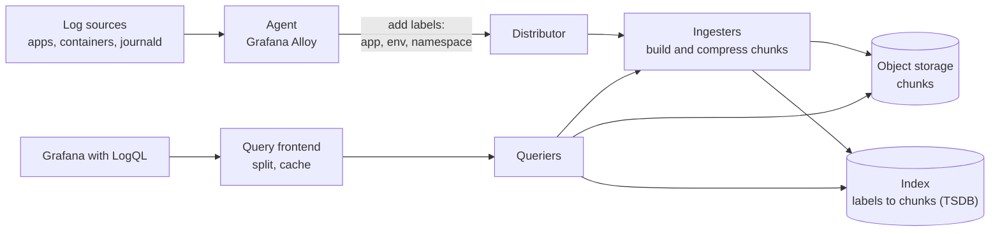

# Loki

## Summary

Grafana Loki is an open source log aggregation system from Grafana Labs, often described as "Prometheus for logs". Unlike the Elastic Stack or Splunk, Loki does not index the content of log lines. It indexes only a small set of *labels* (key-value pairs such as `app="nginx"`, `env="prod"`) per log *stream* and stores the log lines themselves as compressed *chunks*, typically in object storage. Queries in LogQL first select streams by labels, then filter and parse the lines in those streams. This makes Loki much cheaper to run at scale, at the cost of slower arbitrary full-text search. It integrates natively with Grafana, Prometheus (metrics) and Tempo (traces).

## Prerequisites

- [Log management](log-management-overview.md) for the log lifecycle and the cost of indexing.
- Prometheus labels and PromQL basics help, because LogQL reuses them ([Monitoring](../monitoring.md)).

## Core concepts

### Purpose

Loki is built to:

- **Collect and aggregate logs** from applications, services and infrastructure.
- **Store logs efficiently** in compressed form without full-text indexing, which reduces cost.
- **Query logs by labels** to filter and retrieve them.
- **Integrate with Grafana** to analyze logs next to metrics (Prometheus) and traces (Tempo).
- **Complete the observability signals** in the Grafana stack: metrics in Prometheus (or Mimir), logs in Loki, traces in Tempo.

*Analogy.* A warehouse that labels boxes but not their contents. Each box (chunk) carries a label with the sender, the department and the date (labels and time range), and the catalog lists only those labels. To find a specific letter, you pick the right boxes by label and then read through them. A full-text system catalogs every word of every letter instead: finding is faster, but the catalog becomes as large as the archive. The analogy breaks on scale: Loki reads boxes in parallel on many machines, so "reading through" is fast when the label selection is narrow.

### Data model

| Concept | Description |
| --- | --- |
| Labels | Key-value pairs attached to each log stream (for example `app="nginx", env="prod"`) |
| Stream | A unique combination of labels: a distinct source of logs |
| Chunks | Log lines of one stream batched into compressed blocks for storage |
| Index | Only labels (and chunk references) are indexed, not log content, so label-filtered queries are fast |
| LogQL | Loki Query Language, inspired by PromQL, used to filter and aggregate logs |
| Agent | Collects logs and pushes them to Loki: Grafana Alloy (current), Promtail (deprecated), or Fluent Bit, Fluentd, the OpenTelemetry Collector |
| Grafana integration | Logs are visualized in Grafana and correlated with Prometheus metrics and Tempo traces |

Promtail, the original agent for tailing files, systemd journals and Docker logs, was deprecated in 2025 in favor of Grafana Alloy, with long-term support that ended in early 2026 (checked 2026-11). New installations should use Alloy or the OpenTelemetry Collector.

### How it works



1. **Log sources**: applications, containers, system logs.
2. **Agent**: collects logs from files, systemd, Docker and Kubernetes pods.
3. **Label assignment**: metadata is attached (for example `app=nginx`, `env=prod`).
4. **Send to Loki**: logs are batched, compressed and stored in chunks.
5. **Store in the backend**: chunks go to object storage (S3, GCS, Azure Blob) or local disk; labels are indexed.
6. **Query with LogQL** through Grafana: select streams by labels, filter by text.
7. **Visualize in Grafana** next to metrics and traces.

Loki can run as a single binary for small setups or split into microservices (distributor, ingester, querier, query frontend, compactor) for horizontal scale.

### Cardinality

Every unique label combination is a separate stream with its own chunks. A label with many values (user ID, request ID, IP address) creates millions of tiny streams, which blows up the index and destroys performance. Labels should describe *where* a log comes from (cluster, namespace, app, environment, level), with roughly bounded values; *what* the log says stays in the line and is filtered at query time. High-cardinality fields that need fast filtering can be stored as *structured metadata* (Loki 3.x) instead of labels.

### LogQL

A LogQL query always starts with a stream selector in braces, followed by a pipeline.

Basic query, logs from `nginx` containing `error`:

```text
{app="nginx"} |= "error"
```

Filter by several labels:

```text
{app="nginx", env="prod"} |= "timeout"
```

Count log entries per stream over 5 minutes (a metric query):

```text
count_over_time({app="nginx"}[5m])
```

Parse JSON and filter on a field, then compute the 95th percentile of a duration field:

```text
quantile_over_time(0.95,
  {app="checkout", env="prod"} | json | unwrap latency_ms [5m]
) by (pod)
```

Line filters: `|=` contains, `!=` does not contain, `|~` matches regex, `!~` does not match regex.

### Key features

| Feature | Description |
| --- | --- |
| Log aggregation | Logs from applications, containers and servers |
| Label-based search | Labels select streams efficiently |
| Compression and chunk storage | Compressed storage in cheap object storage |
| Native Grafana integration | Logs next to metrics and traces, with links between them |
| Alerting | Alerts on log patterns with the Loki ruler or Grafana Alerting |
| Scalability | Distributed deployment with horizontal scaling |
| Multi-tenancy | Separate log storage per tenant (`X-Scope-OrgID` header) |
| Cloud-native | Optimized for Kubernetes, Docker and containers |

### Advantages

- **Lightweight and cost-effective**: no full-text index, much lower storage and memory needs.
- **Native Grafana integration** for logs, metrics and traces in one place.
- **Easier to operate** than an Elasticsearch cluster.
- **Efficient label-based filtering**, especially for structured logs.
- **Horizontal scalability** with object storage.
- **Built for Kubernetes** and containerized applications (labels from pod metadata).
- **Open source** (AGPLv3) with commercial support and Grafana Cloud from Grafana Labs.

### Disadvantages

- **No full-text index**: searching arbitrary text across many streams over long periods is slow compared with Elasticsearch or Splunk.
- **LogQL learning curve**, different from classic log search.
- **Weaker for unstructured logs** where labels cannot narrow the search.
- **Younger ecosystem** than the Elastic Stack or Splunk (first released in 2018), with fewer community resources and integrations, although it is growing fast.

### Comparison with alternatives

| Feature | Loki | Elastic Stack | Graylog | Splunk |
| --- | --- | --- | --- | --- |
| Ease of setup | Simple | Complex | Moderate | Easy as SaaS, complex on-premises |
| Storage efficiency | High (no full index) | Lower (large index) | Lower (OpenSearch index) | Lower |
| Full-text search | Limited (scan after label selection) | Advanced | Good | Advanced |
| Cost efficiency | High | Lower | Medium | Lowest |
| Grafana integration | Native | Supported (data source) | Basic | Basic (plugin) |
| Cloud-native focus | Strong | Moderate | Low | Low |

## Worked example

Find which pods of the `checkout` service produce timeout errors and alert on the error rate. Untested; Loki 3.x LogQL, checked 2026-11.

1. Explore in Grafana:

```text
{namespace="shop", app="checkout"} |= "timeout" | json | level="error"
```

2. Turn it into a metric per pod:

```text
sum by (pod) (
  count_over_time({namespace="shop", app="checkout"} |= "timeout" | json | level="error" [5m])
)
```

Example result (synthetic): `checkout-7d9f-abc` 312, `checkout-7d9f-def` 4, `checkout-7d9f-ghi` 6. One pod produces almost all timeouts, which points at that pod (its node, its connection pool) rather than at the downstream service.

3. Alert with a Loki ruler rule (Prometheus rule format):

```yaml
groups:
  - name: checkout-logs
    rules:
      - alert: CheckoutTimeouts
        expr: |
          sum(count_over_time({namespace="shop", app="checkout"} |= "timeout" [5m])) > 100
        for: 5m
        labels:
          severity: page
        annotations:
          summary: "More than 100 checkout timeouts in 5 minutes"
```

Note that the stream selector uses only bounded labels (`namespace`, `app`); the pod name is a label added by the Kubernetes discovery, which is acceptable because the number of pods is bounded.

## Trade offs and when to use it

- **Choose Loki** for Kubernetes and cloud-native environments, large volumes and tight budgets, especially if Grafana and Prometheus are already used.
- **Choose a full-text system** (Elastic, Splunk, OpenSearch) for security investigations and ad hoc searches across all data for rare strings, where scan-based search is too slow.
- **Design labels first.** Most Loki performance problems come from label cardinality, not from Loki itself.
- **Object storage** makes retention cheap, so longer retention is realistic than with indexed systems.

## Common mistakes

- **High-cardinality labels** (`user_id`, `trace_id`, `ip`). Fix: keep them in the log line or structured metadata and filter at query time.
- **Queries without narrow label selectors** (`{env="prod"} |= "foo"` over 30 days). They scan terabytes. Fix: select by app or namespace and shorten the time range.
- **Building a new deployment on Promtail.** It is deprecated. Fix: Grafana Alloy or the OpenTelemetry Collector.
- **Unstructured text everywhere.** Fix: structured JSON logs, so `| json` can extract fields at query time.

## Practice

1. What does Loki index, and what does it not index?
2. Why is `user_id` a bad label?
3. Write a LogQL query that counts error lines per app in the `prod` environment over 10 minutes, assuming lines contain `level=error`.
4. When is Elasticsearch the better choice than Loki?

Answers:

1. It indexes labels (stream metadata) and chunk references; it does not index the content of log lines.
2. It has unbounded values, so each user creates a separate stream; the index grows huge and chunks become tiny, which ruins performance.
3. `sum by (app) (count_over_time({env="prod"} |= "level=error" [10m]))`.
4. When users need fast full-text search for arbitrary strings across all logs and long periods, for example security investigations.

## Further reading

- [Grafana Loki documentation](https://grafana.com/docs/loki/latest/) (Grafana Labs): architecture, labels, storage and operations.
- [LogQL](https://grafana.com/docs/loki/latest/query/) (Grafana Labs): log and metric queries.
- [Label best practices](https://grafana.com/docs/loki/latest/get-started/labels/bp-labels/) (Grafana Labs): cardinality guidance.
- [Promtail deprecation and migration to Alloy](https://grafana.com/docs/loki/latest/send-data/promtail/) (Grafana Labs): the status of Promtail.
