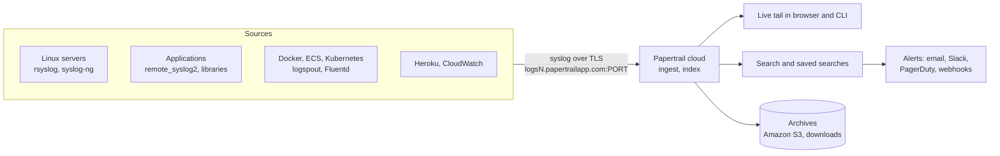

# Papertrail

## Summary

Papertrail is a cloud-based (SaaS) log management and aggregation service, owned by SolarWinds, that gives real-time visibility into logs from servers, applications, cloud infrastructure and devices. It is known for simplicity: systems send logs over the syslog protocol (or through a small agent), and within seconds they appear in a browser as a *live tail*, the hosted equivalent of `tail -f` across all machines, with fast search, saved searches and alerts. It deliberately does little else: no metrics, no rich dashboards, no on-premises option. It fits small and medium teams that want central logs without running a logging cluster.

## Prerequisites

- [Log management](log-management-overview.md) for syslog and the log lifecycle.

## Core concepts

### Purpose

Papertrail is designed to:

- **Aggregate logs** from many sources into one cloud location.
- **Enable real-time search** and filtering of live and historical logs.
- **Support troubleshooting** of application errors, server issues and performance problems.
- **Alert on critical events** when specific log patterns or errors occur.
- **Reduce log management overhead** by replacing self-hosted log servers with cloud storage and access.

Use cases: application debugging (crashes, exceptions, errors), server monitoring (system logs), deployment monitoring (watching logs live during a release), security and auditing (login attempts, unauthorized access, system changes), and container logs (Docker, Amazon ECS, Kubernetes).

*Analogy.* Papertrail is a shared group chat that every server writes into. Everyone sees new messages instantly, can scroll back and search, and can set a notification when someone mentions a keyword. Nobody has to run the chat server. The analogy breaks on analysis: a chat app offers no statistics about its messages, and Papertrail also offers only basic graphs, which is the reason to choose a heavier tool when you need analytics.

### How it works



1. **Configure the log source.** Send logs via syslog, file monitoring or log forwarders (for example rsyslog or Docker logging drivers).
2. **Ingest into Papertrail.** Logs are aggregated in the cloud and indexed for fast retrieval.
3. **View live and search.** Live tail shows real-time logs; historical logs can be searched instantly.
4. **Alert.** Saved searches can trigger alerts on errors, exceptions or text patterns.
5. **Archive (optional).** Store logs long term in Amazon S3 or download archives for offline storage.

### Core vocabulary

| Concept | Description |
| --- | --- |
| Log aggregation | Collecting logs from applications, servers, containers and cloud services |
| Live tail | Real-time streaming view of logs, like `tail -f` in a terminal |
| Search | Instant search across live and recent logs |
| Saved search | A named search that can be reopened and attached to alerts |
| Alerts | Notifications triggered by log patterns |
| Archiving | Long-term storage in S3 or downloadable files |
| Sources (systems) | Configured systems (servers, apps, containers) that send logs |
| Groups | Logical groups of sources for easier viewing |
| Access control | User roles that restrict access to logs |

### Key features

| Feature | Description |
| --- | --- |
| Real-time log streaming | Live viewing and troubleshooting as logs are generated |
| Instant search | Search by keywords, time range or patterns, with boolean operators |
| Notifications and alerts | Email, Slack, PagerDuty or webhooks when patterns are detected |
| Long-term archiving | Archive to S3 or download for compliance and audits |
| Integrations | Syslog, Docker, CloudWatch, Amazon ECS, Heroku, Kubernetes and more |
| Custom views | Saved searches for frequent log patterns |

### Advantages

- **Cloud-based**: no infrastructure to set up, quick start.
- **Real-time search** of live and archived logs.
- **Simple setup** on Linux, Windows, Docker, AWS, Heroku and custom applications.
- **Live tail** streaming.
- **Alerts** to email, Slack and PagerDuty for custom patterns.
- **Archiving** to Amazon S3 or downloadable archives.
- **Team access** with role-based control.
- **Integrations** with Heroku, Amazon CloudWatch, Docker, syslog and monitoring tools.

### Disadvantages

- **Cloud only.** No on-premises option; you depend on Papertrail's infrastructure and region.
- **Limited features.** Focused on aggregation and search; lacks advanced analytics, metrics and dashboards of the Elastic Stack or Splunk.
- **Cost.** Pricing is based on log volume and searchable retention; it grows with high volumes.
- **Basic visualization.** Text-based search and tailing, with only simple event graphs.

### Comparison with alternatives

| Feature | Papertrail | Elastic Stack | Graylog | Splunk |
| --- | --- | --- | --- | --- |
| Ease of setup | Very easy | Complex | Moderate to complex | Easy (cloud) |
| Real-time viewing | Yes | Yes | Yes | Yes |
| Search performance | Fast | Fast | Good | Fast |
| Visualization | Basic | Advanced | Basic | Advanced |
| Alerts | Yes | Yes (basic rules free, advanced paid) | Yes | Yes |
| Self-hosting | No, cloud only | Yes | Yes | Optional |
| Cost | Pay per volume | Elastic Cloud or own infrastructure | Free core, paid enterprise | Expensive |

## Worked example

Forward all system logs of a Debian or Ubuntu server to Papertrail over TLS with rsyslog. Untested; rsyslog 8.x syntax, checked 2026-11. The host and port come from the Papertrail account settings; `logsN` and `PORT` are placeholders.

```bash
sudo apt-get install -y rsyslog-gnutls
cat <<'EOF' | sudo tee /etc/rsyslog.d/95-papertrail.conf
# TLS settings: verify the Papertrail certificate
global(DefaultNetstreamDriverCAFile="/etc/ssl/certs/ca-certificates.crt")

# forward everything; the disk-assisted queue keeps logs during network outages
*.* action(type="omfwd" protocol="tcp" target="logsN.papertrailapp.com" port="PORT"
           StreamDriver="gtls" StreamDriverMode="1" StreamDriverAuthMode="x509/name"
           StreamDriverPermittedPeers="*.papertrailapp.com"
           queue.type="LinkedList" queue.filename="papertrail" queue.saveOnShutdown="on"
           action.resumeRetryCount="-1")
EOF
sudo systemctl restart rsyslog
logger "papertrail test from $(hostname)"
```

Expected result: the test message appears in the Papertrail event viewer within a few seconds, with the host name as the system. A saved search such as `"Failed password" OR "authentication failure"` with a Slack alert every minute then notifies the team about authentication failures across all servers.

## Trade offs and when to use it

- **Choose Papertrail** for small to medium environments that want central logs and live tail in minutes with no infrastructure.
- **Choose Loki, the Elastic Stack or Graylog** to self-host, control cost at high volume or need analytics and dashboards.
- **Choose Splunk or a full observability platform** when logs must correlate with metrics, traces and security analytics.
- **Data residency.** Check where logs are stored before sending personal or regulated data.

## Common mistakes

- **Plain UDP syslog over the internet.** Messages can be lost or read in transit. Fix: TCP with TLS, as in the example.
- **Sending everything without filters.** Volume and cost grow fast. Fix: filter noisy sources in rsyslog or the agent and use Papertrail's log filters.
- **No archive configured.** Searchable retention is short; older logs are gone. Fix: enable S3 archiving if logs must be kept.

## Practice

1. What is live tail, and why is it useful during a deployment?
2. Why does the worked example configure a queue on the rsyslog action?
3. Name two reasons to move from Papertrail to a self-hosted stack.

Answers:

1. A real-time stream of incoming logs from all sources; during a deployment it shows errors from all servers as they happen without logging into each one.
2. So that logs are buffered and retried during network outages instead of being lost.
3. High log volume making the per-volume price too expensive, and needs for advanced analytics, dashboards or on-premises data storage.

## Further reading

- [Papertrail knowledge base](https://www.papertrail.com/help/) (SolarWinds): setup guides for syslog, Docker, Kubernetes and archives.
- [rsyslog documentation: omfwd](https://www.rsyslog.com/doc/configuration/modules/omfwd.html) (rsyslog project): forwarding and queue options.
- [RFC 5425: TLS Transport Mapping for Syslog](https://www.rfc-editor.org/rfc/rfc5425) (IETF, 2009): syslog over TLS.
