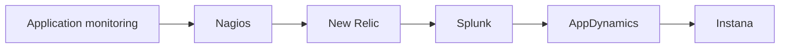

# Monitoring tools

Monitoring and application performance monitoring products: what each does, how it works and when to choose it.

## Map

The diagram shows the notes in reading order; subareas are marked with (subarea).

## Notes in reading order

1. [Application monitoring](application-monitoring.md): what APM measures and how instrumentation works.
2. [Nagios](nagios.md): check-based infrastructure monitoring.
3. [New Relic](new-relic.md): SaaS observability with NRQL.
4. [Splunk](splunk.md): indexing, SPL and SIEM.
5. [AppDynamics](appdynamics.md): business transactions and health rules.
6. [Instana](instana.md): automatic discovery and one-second metrics.

## Planned topics

- Dynatrace
- Datadog
- Zabbix
