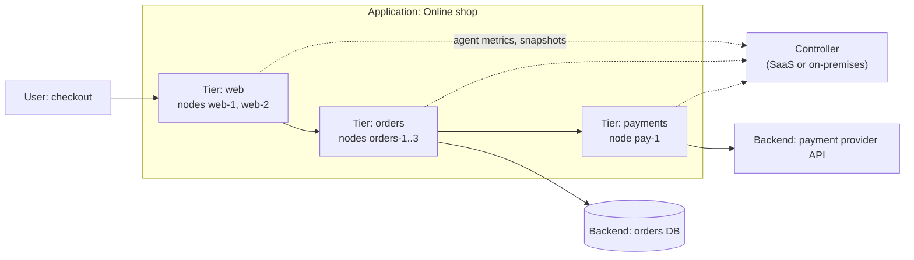

# AppDynamics

## Summary

AppDynamics is an enterprise application performance monitoring (APM) platform that gives real-time insight into application performance, user experience and business metrics. Founded in 2008, it was acquired by Cisco in 2017 and has been sold as Splunk AppDynamics since Cisco bought Splunk in 2024. Its signature concept is the *business transaction*: an end-to-end user action such as "checkout", traced across every tier it touches, measured against a learned baseline and linked to business data such as revenue. It suits large, often Java and .NET based, enterprise systems; it is expensive and its agents need careful rollout.

## Prerequisites

- [Application monitoring](application-monitoring.md) for what APM tools measure.
- [Monitoring](../monitoring.md) for baselines and alerting.

## Core concepts

### Purpose

AppDynamics is used to:

- **Monitor application performance** across servers, databases and cloud environments.
- **Detect performance bottlenecks**: slow transactions, memory leaks and resource consumption issues.
- **Monitor business transactions** and map performance to business outcomes.
- **Analyze root causes automatically** with machine learning based correlation.
- **Give infrastructure visibility** into the servers and containers under the applications.

*Analogy.* AppDynamics follows a business transaction the way a parcel tracking system follows a parcel: every depot (tier) scans it, the system knows the usual travel time between depots, and when a parcel is late it shows exactly which depot held it and for how long. The analogy breaks at the code level: parcel tracking cannot open the depot and show which worker was slow, while transaction snapshots show the slow method or SQL query.

### Model: applications, tiers, nodes and business transactions

The diagram is a simplified *application flowmap*: the controller receives data from agents on every node and draws the tiers, the backends and the calls between them.

| Concept | Description |
| --- | --- |
| Business transaction | End-to-end flow of a user request (for example the checkout process) across all tiers |
| Application flowmap | Visual representation of application components and their dependencies |
| Tiers and nodes | A tier is a logical group of identical components (web tier, orders service); a node is one instance (a JVM, a process) |
| Backends | Databases, message queues and external services called by the application, detected automatically |
| Health rules | User-defined performance conditions that trigger alerts (for example response time above 3 seconds) |
| Snapshots | Detailed diagnostics of individual transactions, with call graphs |
| Anomaly detection | Machine learning detection of unusual performance patterns |
| Agents | Components installed on applications, databases, servers and browsers to collect telemetry |
| Controller | The central server that stores data, computes baselines and serves the UI |

### Key features

- **Application flowmap.** Visualizes the architecture, shows dependencies between services and highlights bottlenecks in color.
- **Transaction snapshots.** Capture slow or failed transactions with code-level details: method execution times, SQL queries and external API calls.
- **Dynamic baselines.** Learn normal performance patterns (per hour of day and day of week) and detect anomalies when performance deviates.
- **Business iQ (business journeys).** Combines application performance with business metrics, such as revenue impact analysis and conversion rates.
- **Alerts and health rules.** Health rules evaluate metrics against static thresholds or baselines; policies connect violations to actions (notifications, scripts, tickets).

### Advantages

- **End-to-end visibility** from front end (browser and mobile RUM) to back end.
- **Business transaction monitoring** that ties application performance to business impact, such as revenue lost during an incident.
- **AI-assisted insights** for anomaly detection and root cause analysis.
- **Cloud and on-premises support** for hybrid environments, including AWS, Azure and Google Cloud; the controller is available as SaaS or on-premises.
- **Automatic application mapping** of service dependencies into flowmaps.
- **Code-level diagnostics** that pinpoint slow methods, database queries and external calls.

### Disadvantages

- **Cost.** A premium APM product, often more expensive than alternatives.
- **Complex setup.** Agent installation and configuration are challenging in large, distributed systems (agent versions per runtime, controller sizing, naming of tiers and transactions).
- **Resource consumption.** Agents add CPU and memory overhead on application servers; deep instrumentation increases it.

## Worked example

A health rule for the checkout business transaction, with the reasoning behind each choice. Untested; configuration described as in the AppDynamics UI, checked 2026-11.

| Setting | Value | Why |
| --- | --- | --- |
| Affects | Business transaction `Checkout` | One rule per critical user action |
| Warning condition | Average response time > baseline + 2 standard deviations, for 5 minutes | Adapts to daily patterns |
| Critical condition | Average response time > 3,000 ms for 5 minutes, and calls per minute > 50 | Absolute limit users notice; the load condition prevents alerts on two slow test calls at night |
| Action | Notify the on-call group and collect diagnostic snapshots | Evidence is captured while the problem is happening |

What a violation looks like: the flowmap shows the `payments` tier in red, the snapshot of a slow checkout shows 2.4 seconds spent in an HTTP call to the payment provider, and Business iQ shows that completed orders per minute dropped from 140 to 95 during the incident. The team now knows where the time goes and what it costs.

## Trade offs and when to use it

- **Choose AppDynamics** for large enterprise estates (Java, .NET, SAP and mainframe integrations) where business transaction views and an on-premises controller matter.
- **Choose New Relic, Datadog, Dynatrace or Instana** when SaaS-first operation, broader language coverage or different pricing fit better; capabilities overlap.
- **Choose OpenTelemetry with an open backend** when avoiding proprietary agents and license costs matters more than turnkey dashboards.
- **Plan agent rollout** carefully: name tiers and business transactions deliberately, because the default auto-detection can produce hundreds of meaningless transactions.

## Common mistakes

- **Accepting default business transaction detection.** Fix: define the 10 to 20 transactions that matter and exclude the rest.
- **Static thresholds only.** Fix: combine baselines (for relative change) with absolute limits (for user-visible slowness).
- **Ignoring agent overhead.** Fix: test agents under load before production and keep snapshot collection at defaults unless debugging.

## Practice

1. What is a business transaction, and how is it different from a single HTTP request?
2. What is the difference between a tier and a node?
3. Why does the critical condition in the worked example include a calls-per-minute clause?
4. Which company owns AppDynamics today, and under which name is it sold?

Answers:

1. A business transaction is an end-to-end user action traced across all tiers; one business transaction usually consists of many internal requests and calls.
2. A tier is a logical group of identical components; a node is one running instance within a tier.
3. To avoid alerts when traffic is too low for the average to be meaningful.
4. Cisco, as Splunk AppDynamics.

## Further reading

- [Splunk AppDynamics documentation](https://docs.appdynamics.com/) (Cisco): agents, business transactions and health rules.
- [Business transactions](https://docs.appdynamics.com/appd/24.x/latest/en/application-monitoring/business-transactions) (Cisco): how transactions are detected and configured.
- [Cisco completes acquisition of AppDynamics](https://newsroom.cisco.com/) (Cisco, 2017): background on the ownership.
